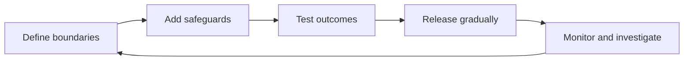

# Building Responsible AI Systems

Responsible AI is the practice of creating and operating AI systems in ways that respect people, reduce harm, and remain accountable to human values and legal requirements. That may sound broad, so let's make it concrete. Responsible AI is not a final review or a single safeguard. It shapes what a system is designed to do, what information it uses, how its decisions are checked, and how problems are handled after release.

AI systems can influence choices about money, education, employment, health, travel, and access to services. Even a confident, useful-sounding response can be wrong, unfair, unclear, or intrusive. Responsible design asks teams to consider those consequences before people experience them.

We'll use an AI-enabled travel-booking application for the rest of this chapter to teach the main principles of responsible AI.

A traveler asks for a refundable flight from London to Nairobi for less than $900. The AI suggests an itinerary that appears to meet every requirement.

There is one problem: the connecting flight departs before the first flight arrives.

```text
AB120 arrives in Istanbul on 2026-09-14 at 14:40 +03:00.
CD455 departs Istanbul on 2026-09-14 at 13:55 +03:00.
```

Both records use the same local date and UTC offset, so there is no time-zone ambiguity: the onward flight departs 45 minutes before the first flight arrives. Even when the times are in the correct order, the application must also enforce the airport's minimum transfer time.

This example establishes a boundary we will reuse throughout the chapter: **the AI suggests; the application checks and acts; the person makes high-impact choices**. The AI may propose an itinerary, but it does not verify the schedule or complete a purchase. The application performs those checks and actions. The traveler decides whether to buy, change, or cancel a trip.

## Learning Objectives

By the end of this chapter, you will be able to:

- Explain safety, alignment, fairness, transparency, and privacy in the context of an AI system.
- Recognize unsupported claims, excessive authority, and errors that spread across multiple steps.
- Define clear boundaries around what an AI-enabled application may do.
- Match important risks with checks, limits, permissions, and human approval.
- Handle personal data according to justified purpose, applicable legal basis, minimization, and retention requirements.
- Keep records that support investigation without unnecessarily exposing sensitive information.
- Apply responsible AI practices during design, development, release, and operation.

## The Impossible Itinerary Reveals a Bigger Problem

Let's look beyond the incorrect connection for a moment. It is the first visible failure, but it is not the only responsibility involved. The AI must represent the traveler's requirements in its suggestions. The application must use current flight information, protect personal details, and require the traveler's approval before spending money.

Responsibility belongs to the whole system, not only to the part that produced the itinerary. Its designers decide what information is trusted, what must be checked, which actions are available, and when the traveler must make the final decision.

Several decisions must work together:

- The dates, budget, and refund preference must be understood correctly.
- Flight information must be current and internally consistent.
- Connection times must be checked.
- Personal and payment information must be used only when necessary.
- The traveler must review the final itinerary before purchase.
- The organization must be able to explain what happened if something goes wrong.

No single safeguard covers all of these responsibilities. A connection-time check can reject an impossible itinerary, but it cannot prevent unnecessary collection of passport details. A confirmation step can prevent an unwanted purchase, but it cannot make an inaccurate price truthful.

Responsibility also grows with consequence. Comparing flights is easy to reverse. Reserving a seat affects availability. Sharing passport details affects privacy. Charging a card creates a financial consequence. As the possible impact grows, the system needs stronger evidence, clearer permission, and more meaningful human review.

### First Ask Whether AI Belongs in the System

Before evaluating how to use AI responsibly, the team should ask two earlier questions: **Why are we building this, and does this part of the application require AI?** A deterministic search, calculation, or rules engine may be more accurate, explainable, and economical for some tasks. AI should be used where its capabilities serve a clear user need, not because every part of the product must contain AI.

If AI does serve the task, the team still needs a way to examine its responsibilities. There is no single universal list of responsible AI principles. Organizations adapt established frameworks to their context, risks, legal obligations, and the people affected by the system.

Several well-known approaches illustrate both the shared concerns and the differences in emphasis:

| Approach | Examples of concerns it emphasizes |
| --- | --- |
| Microsoft Responsible AI | Fairness, reliability and safety, privacy and security, inclusiveness, transparency, and accountability |
| NIST AI Risk Management Framework | Validity and reliability, safety, security and resilience, accountability and transparency, explainability, privacy, and fairness |
| European Commission Ethics Guidelines for Trustworthy AI | Human oversight, robustness and safety, privacy and data governance, transparency, fairness, societal well-being, and accountability |
| Cloud Security Alliance Trusted AI Safety Expert guidance | Fairness, accountability, beneficence, transparency, privacy, safety, and security |

This chapter intentionally uses five questions rather than attempting to reproduce any one framework. They provide a manageable starting point for an agentic application, but teams should also follow the governance framework, laws, and domain requirements that apply to their work.

### Ask Five Responsible AI Questions

How can the team examine all of those responsibilities without treating them as one large problem? Five questions about safety, alignment, fairness, transparency, and privacy give us a useful starting point. These concepts overlap, but they are not interchangeable.

| Concept | Question it answers | Travel-booking example |
| --- | --- | --- |
| **Safety** | Can the system avoid or contain unacceptable harm? | Reject an itinerary whose connection time is impossible. |
| **Alignment** | Does the system follow the traveler's actual goal and constraints? | Do not replace a requested refundable fare with a cheaper nonrefundable fare. |
| **Fairness** | Do people receive comparable quality and treatment across relevant groups and circumstances? | Test whether names, languages, locations, or accessibility needs lead to systematically worse options. |
| **Transparency** | Can people understand what the system knows, does not know, and has done? | Show when a price was last checked and whether the trip has been booked. |
| **Privacy** | Is personal data collected and used only for an appropriate purpose? | Share passport details only when required for an approved booking. |

Suppose the system recommends a real flight at a verified price but ignores the traveler's accessibility requirement. The information may be accurate, yet the result is not aligned with the traveler's goal. Suppose the itinerary meets every preference but passport details appear in a support log. The result may be useful, yet the system has failed to protect privacy.

Responsible design asks all four questions rather than treating a correct-looking itinerary as sufficient.

> **NOTE:** The level of protection should match the possible consequence. A poor restaurant suggestion is inconvenient. Incorrect visa information can prevent a person from traveling.

#### Quick Practice: Name the Primary Concept

These situations can overlap, but choose the primary concept that gives the team the clearest starting question.

1. An itinerary leaves only ten minutes for an airport transfer that requires at least one hour.
2. A traveler asks for wheelchair assistance, but every suggested itinerary ignores that requirement.
3. The application displays a fare without saying that the price was last checked yesterday.
4. The application asks for a passport number while the traveler is only comparing public fares.
5. Travelers using one language consistently receive longer and more expensive routes than travelers making equivalent requests in another language.

<details>
<summary>Check your answers</summary>

1. **Safety:** the connection creates a foreseeable risk of a missed flight.
2. **Alignment:** the suggestions do not follow an explicit traveler requirement.
3. **Transparency:** the traveler cannot judge how current the displayed price is.
4. **Privacy:** passport data is unnecessary for the stated search purpose.
5. **Fairness:** equivalent requests receive systematically different outcomes across groups.

</details>

Fairness overlaps with safety and alignment, but naming it explicitly prevents average performance from hiding unequal outcomes. The team should compare results across relevant languages, locations, accessibility needs, and names. Doing so requires careful measurement without collecting sensitive data merely because it might be useful; fairness evaluation and privacy must be designed together.

### Draw a Boundary Around What the System May Do

Now that we have four questions to guide us, let's draw a boundary around the system. Before choosing safeguards, the team writes down what the first version of the AI may suggest, what the application may check or do, and which high-impact choices remain with the traveler. The result is a boundary that reviewers and testers can evaluate.

```text
The AI may suggest:
- relevant offers from the information the application provides;
- trade-offs between possible itineraries;
- a draft itinerary for review.

The application may check and act:
- search approved flight and hotel services;
- verify current prices, schedules, policies, and transfer times;
- place a temporary hold after the traveler confirms the exact offer;
- purchase, change, or cancel only the exact action the traveler approved.

The traveler decides:
- whether a proposed trip meets their needs;
- whether to share required personal data for a stated booking purpose;
- whether to approve the exact price and terms of a purchase, change, or cancellation.
```

With that boundary in place, consider what can still go wrong.

## One Incorrect Suggestion Begins to Spread

So far, we have treated the impossible connection as one bad suggestion. What happens if the application trusts it? The failure can grow in three distinct ways, and each calls for a different response.

### Problem 1: The AI Presents an Unsupported Claim

An AI system may present information that is not supported by the available evidence. This is commonly called a **hallucination**. The claim may be false, invented, or more certain than the source allows.

```text
Flight record: AB120 arrives at 14:40.
Flight record: CD455 departs at 13:55.
System response: Your connection time is 1 hour and 15 minutes.
```

The response sounds natural, but the times do not support it. The application should check important facts against reliable sources and avoid acting when information cannot be verified.

### Problem 2: The Application Grants Too Much Authority

**Over-delegation** occurs when an application allows AI suggestions to trigger more action than the task requires.

Suppose a traveler says, "Find me the best route and take care of it." The word "best" does not define price, duration, refundability, accessibility, or permission to spend. Allowing the application to purchase a trip from that request transfers a high-impact decision without informed approval.

A safer division of responsibility is:

| Step | AI suggests | Application checks and acts | Person decides |
| --- | --- | --- | --- |
| Search | Suggest relevant offers | Search only approved travel services | Set the trip requirements |
| Compare | Summarize trade-offs | Check prices, schedules, and policies | Decide which trade-offs are acceptable |
| Propose | Prepare an itinerary | Display checked terms and total cost | Review the exact offer |
| Purchase | Explain the proposed action | Complete only the approved action | Confirm or reject the purchase |

The AI remains useful, but authority stays proportional to the consequence.

### Problem 3: One Error Creates More Errors

A **cascading error** occurs when one incorrect result is accepted by later steps and causes additional failures. In other words, one unchecked claim becomes the starting point for the next decision.

Consider this sequence:

1. The AI incorrectly states that checked baggage is included.
2. The itinerary is ranked as the cheapest overall.
3. The fare is purchased.
4. The confirmation repeats the incorrect baggage claim.
5. A support response later repeats the same claim again.

Repetition does not make the original claim true. Checks before ranking, approval, and purchase interrupt the chain. Keeping the airline's facts separate from the AI's summary also makes the original source clear.

> **TIP:** Place the strongest check immediately before an action that is difficult to reverse. Information and prices can change between search and purchase.

### Exercise 1: Find Where the Trip Goes Wrong

A traveler asks for a direct, refundable flight under $700. The AI cannot find one, so it suggests a $640 itinerary with a connection and a nonrefundable fare. The application books the trip using a saved card and sends a confirmation stating that the request was satisfied.

Use [the Exercise 1 starter](./code/exercises/exercise-1.md) to identify three failures. For each one, record the violated requirement, possible harm, preventive safeguard, and evidence that would help an investigation.

A strong answer separates the poor suggestion from the decision to allow an unapproved purchase.

Solution: [Exercise 1 solution](./code/solutions/exercise-1.md)

Recognizing the chain is only the first step. Safeguards must stop the suggestion before it becomes a purchase.

## The Team Adds Safeguards Before the Next Booking

We know where the booking can fail. Great, next we need to stop those failures before they reach the traveler. A **guardrail** is a safeguard that guides, limits, checks, or records what a system does. No single guardrail can prevent every problem. Clear rules cannot prove that a connection is possible, and a connection check cannot decide whether the traveler agrees to the price.

Several guardrails work together. This is sometimes called **defense in depth**: if one safeguard misses a problem, another still has a chance to stop it.


### Guardrail 1: Give the AI Clear Instructions

Let's start with the instruction given to the AI. The first guardrail states its purpose and limits. A weak rule might say:

```text
Find good trips and complete the traveler's request quickly.
```

This rule does not define "good" or distinguish between suggesting and purchasing. A clearer version sets both expectations:

```text
The AI compares the travel offers supplied by the application and prepares possible itineraries.

It must:
- follow the traveler's stated budget, dates, and required preferences;
- avoid presenting unverified prices, schedules, or policies as facts;
- say when important information is missing;
- show the exact itinerary, restrictions, and total price before approval;
- treat search, reservation, purchase, change, and cancellation as separate actions.
```

These rules describe suitable behavior, but they are not enough on their own. The application must enforce important boundaries even when the system makes a mistake.

### Guardrail 2: Limit Which Actions Are Available

Clear instructions help, but what if the AI still makes a poor suggestion? The application also needs to limit what can happen. These hard boundaries belong in deterministic application code and permission checks rather than in instructions that ask the AI to police itself. While a traveler is comparing flights, the application should not make charging a card or cancelling a trip available to the AI-assisted flow.

| Stage | Actions the application may make available |
| --- | --- |
| Search | Find offers and compare public information |
| Review | Prepare an itinerary and display its terms |
| Hold | Temporarily reserve the exact offer the traveler selected |
| Purchase | Buy only the exact offer the traveler approved |
| Manage a trip | View a booking; changing or cancelling it requires a new decision |

If the AI makes a mistake during search, it remains a poor suggestion because the application has not made purchasing available.

### Guardrail 3: Check Permission Before Acting

Before changing or purchasing a trip, the application checks three things:

1. Is this the signed-in traveler?
2. Is this traveler allowed to act on this booking?
3. Did the traveler approve this exact itinerary and price?

Signing in does not mean approving a purchase. Permission to manage one booking does not grant access to another traveler's trip.

Suppose the traveler approves an itinerary for $684.20, but the price rises to $712.40 before purchase. The earlier approval no longer matches the action. The application must stop and ask the traveler to review the new total.

### Guardrail 4: Check Important Facts Independently

Now we come back to the impossible connection. Important facts should be checked against reliable travel information and ordinary application rules. The system should not rely on a confident summary to decide whether a connection is possible or a fare is refundable.

Return to the opening example. The application compares the arrival and departure times and rejects the itinerary because the second flight leaves first. Similar checks can verify dates, airports, prices, currencies, refund rules, and accessibility requirements.

Clear instructions cannot make incorrect information correct. When a fact affects money, safety, or access, the application should verify it before continuing.

### Guardrail 5: Keep the Traveler in Control

**Human-in-the-loop**, or **HITL**, means giving a meaningful decision to a person at the right point in the process. It is more than placing a generic confirmation button after important details have been hidden.

Before purchase, the traveler should see:

- airlines, flight numbers, airports, dates, and local times;
- connection durations;
- passenger names;
- baggage and refund restrictions;
- the complete price and currency;
- the action that confirmation will trigger.

The traveler can then approve, reject, or change the proposed trip. A trained reviewer may need to handle unusual situations, such as an unconfirmed accessibility request or a mismatch between the account and passenger identity.

Human review should match the consequence. Requiring approval for every search creates fatigue. Omitting approval for a purchase removes meaningful control.

### Exercise 2: Choose Safeguards for a Risky Request

A traveler asks the AI to "find something good under $900 and take care of it." The AI suggests a nonrefundable itinerary for $840. Before the application purchases it, the price rises to $930.

Use [the Exercise 2 starter](./code/exercises/exercise-2.md) to name the issues and map each one to a single guardrail in a compact table. Then explain why the changed price requires a new decision.

Solution: [Exercise 2 solution](./code/solutions/exercise-2.md)

The booking is safer, but it raises another question: what personal data is actually needed?

## The Booking Request Introduces a Privacy Risk

Now that the application has limits on what it can do, we need to look at the information it uses. Travel planning can involve names, contact details, passport information, accessibility needs, loyalty accounts, payment information, and location history. Some of this information may be necessary for a booking but unnecessary during search.

Suppose a traveler asks, "Which of these flights has the shortest connection?" The application needs flight times to answer. It does not need the traveler's passport number, saved payment method, date of birth, or complete booking history.

### Ask for Personal Data Only When It Is Needed

Two ideas help us decide what belongs in each stage. **Purpose limitation** means using data only for the reason it was collected. **Data minimization** means collecting and sharing only the information required for that purpose.

| Task | Data needed | Data not needed |
| --- | --- | --- |
| Search flights | Origin, destination, dates, passenger count | Name, passport, payment information |
| Compare preferences | Preferences the traveler chooses to share | Passport number, complete trip history |
| Create a booking | Legal passenger name and required travel details | Unrelated conversations or searches |
| Take payment | Approved total and protected payment reference | Payment details displayed in the conversation |
| Provide support | Booking reference and relevant history | Other travelers' bookings |

The safest sensitive information is often the information the AI system never receives.

### Protect the Traveler's Data Wherever It Goes

Secure handling includes every place where data enters, moves through, or leaves the system.

Practical protections include:

- confirm identity before showing private trips;
- allow access only to the correct booking and passenger records;
- remove unnecessary sensitive information before processing a request;
- protect stored and transmitted data;
- use approved travel services with clear data-handling terms;
- remove sensitive details from logs and support records;
- define when data will be deleted;
- review any use of real traveler data for testing.

> **NOTE:** Removing one obvious field may not fully hide a person's identity. A booking reference, route, and date can identify a traveler when combined.

### Let the Traveler See and Control Their Information

The application should explain what information is required, why it is needed, who will receive it, and how long it will be kept.

Passport details may be unnecessary during search but required by a particular airline during booking. The application should request them only at that point and name the recipient.

Personal data needs a clear, justified purpose and a legally valid reason for being used. The correct reason depends on the situation and applicable law; it is not always consent. Approving a ticket purchase authorizes that transaction. It does not automatically permit unrelated or optional uses of the traveler's data.

Travelers should be able to review saved details, correct inaccurate information, delete optional preferences, and understand any optional secondary use. Privacy, security, legal, and travel specialists should review the rules that govern these choices.

### Exercise 3: Protect Data and Explain the Request

During a flight search, the application asks the traveler for a passport number. It does not explain why the number is needed, who will receive it, or how long it will be retained.

Use [the Exercise 3 starter](./code/exercises/exercise-3.md) to identify the unnecessary data, state what the traveler should be told, and choose an investigation record that does not contain secrets.

Solution: [Exercise 3 solution](./code/solutions/exercise-3.md)

Collecting less data protects privacy. Explaining the request helps the traveler understand and challenge it. Both become important when something goes wrong.

## A Traveler Complains: Can the Team Explain What Happened?

The traveler reports that the AI suggested a price below $900 but the application later attempted a higher purchase. Resolving the complaint requires clear information for the traveler and a useful record of the booking attempt.

### Show What Is Known, Uncertain, and Not Yet Done

Let's start with what the traveler sees. Transparency should appear when it helps a person decide, not only in a general disclaimer. The interface should also make clear when a suggestion or explanation was generated by AI and distinguish that output from facts verified by the application or travel service.

```text
Price: $684.20 USD
Checked with the travel service 2 minutes ago
Refundability: Refundable with a $75 fee
Booking status: Not booked
Next action: Review the itinerary and confirm purchase
```

This display separates verified information from explanation and tells the traveler what has not happened. When baggage details are missing, the system should say so instead of filling the gap with a typical policy.

### Keep a Useful Record Without Copying Secrets

A useful record should answer basic questions:

- Who requested the action?
- What itinerary and price were shown?
- What did the traveler approve?
- Which safeguard allowed or blocked the action?
- What did the travel service report?
- What did the traveler see afterward?

The record should avoid passport numbers, payment details, and a complete copy of every conversation. Access should be limited, and records should not be kept longer than needed.

### Reconstruct the Full Journey from Request to Outcome

Now let's reconstruct the booking. An investigation should follow the complete path from request to consequence:

1. What did the traveler ask for?
2. Which travel information was available?
3. Which itinerary was proposed?
4. Which checks passed or failed?
5. What did the traveler review and approve?
6. Was a purchase attempted or completed?
7. What message did the traveler receive?

These questions distinguish an incorrect suggestion from a failed check, missing approval, or misleading interface. Each problem requires a different response.

Outcomes also need comparison across users. A system may perform well on average while producing worse options for particular languages, locations, accessibility needs, or less common names. Those differences should become evaluation cases rather than disappear inside an average result.

One investigation can explain one incident. The lifecycle determines whether its lessons improve future trips.

## Before Launch, the Team Plans for Failure

At this point, we can explain how one booking failed. But what about the next booking, or the one after that? The impossible itinerary is not a problem to fix once and forget. Responsible AI continues through design, development, release, and operation. This continuing work is the **AI lifecycle**.

Travel information, traveler needs, and application capabilities change. A safeguard that worked at launch may miss a new route, policy, language, or pattern of use.

### Start with the Traveler and the Intended Task

During design, the team defines who the application serves, what the AI may suggest, what the application may check and do, and which decisions stay with a person. It also considers foreseeable misuse, such as a request to retrieve another traveler's itinerary.

A compact **risk register** gives each concern a safeguard, a signal, and a response:

| Risk | Possible harm | Preventive safeguard | How the team notices | Response |
| --- | --- | --- | --- | --- |
| Impossible itinerary | Missed connection | Check chronology and minimum transfer time | Failed itinerary check | Remove the offer and investigate |
| Unapproved purchase | Unexpected charge | Require approval for the exact itinerary and total | Purchase and approval do not match | Block or reverse the purchase |
| Passport disclosure | Identity harm | Request and share data only for a justified purpose | Review sensitive-data access | Block access and begin incident response |

"Be safe" cannot be tested. "Reject a purchase that does not match the confirmed itinerary and total" can.

### Test, Release, and Learn

With the risks written down, the team can test them. During development, each risk becomes an **evaluation case**: a concrete situation with an expected outcome. Cases should cover ordinary trips, impossible connections, changed prices, missing approval, privacy failures, and outcome differences across languages, locations, accessibility needs, and names.

Capabilities are then released gradually:

1. Begin with AI suggestions while the application supports search only.
2. Enable temporary holds for a small group after checks and traveler approval.
3. Enable purchases for a small group and review outcomes.
4. Expand only while safeguards continue to work.

After release, blocked actions, traveler corrections, access failures, and complaints reveal where safeguards are weak. Each investigation can add a new risk, evaluation case, or application improvement.



Now it's your turn to bring these ideas together in one booking journey.

## Assignment: Prepare the Travel System for Its Next Booking

A company wants an AI travel system that searches flights and hotels, prepares itineraries, and retrieves existing bookings. In a later version, it may place holds and purchase trips.

Your task is to design a high-level safety plan before purchasing is enabled. Focus on what should happen, what must be checked, and when a person must decide. You do not need to design the underlying AI or write application code.

### Follow One Booking Journey

Choose one journey from search to purchase. Describe the traveler's requirements, what the AI may suggest, what the application must check and may do, what the traveler decides, what personal data is needed at each stage, and what limited record remains afterward.

Then document exactly three risks:

1. One **factual risk**, such as an impossible connection.
2. One **authority risk**, such as a purchase without exact approval.
3. One **privacy risk**, such as passport data requested too early or sent to the wrong recipient.

Finally, write exactly three evaluation cases, one for each risk. Each case should state the situation, expected AI suggestion, expected application behavior, expected traveler decision, and evidence needed afterward.

### Submission Template

Use this compact structure so each responsibility remains visible.

#### Journey

| Stage | AI suggests | Application checks or acts | Traveler decides | Data needed | Record kept |
| --- | --- | --- | --- | --- | --- |
| Search |  |  |  |  |  |
| Review |  |  |  |  |  |
| Purchase |  |  |  |  |  |

#### Three Risks

| Type | Risk and possible harm | Safeguard | How noticed | Owner and response |
| --- | --- | --- | --- | --- |
| Factual |  |  |  |  |
| Authority |  |  |  |  |
| Privacy |  |  |  |  |

#### Three Evaluation Cases

| Situation | Expected AI suggestion | Expected application behavior | Expected traveler decision | Evidence needed |
| --- | --- | --- | --- | --- |
| Factual case |  |  |  |  |
| Authority case |  |  |  |  |
| Privacy case |  |  |  |  |

### What a Strong Safety Plan Shows

A strong submission connects each important risk to a safeguard, a way to notice failure, and a responsible owner. It also distinguishes a useful suggestion from permission to act.

## Solution

Compare your work with the [assignment solution](./assignment/solution.md). The reference follows one itinerary from search to purchase and connects each risk to a safeguard, expected evidence, and an owner.

## Summary

We began with an impossible connection and followed it through the booking process. The error became dangerous only when the surrounding application could turn it into a purchase. That distinction gives us the central lesson: responsibility must remain explicit from suggestion to outcome.

The key lessons are:

- Keep responsibility explicit: the AI suggests, the application checks and acts, and the person makes high-impact choices.
- A confident response can still be unsupported or wrong.
- Greater consequences require stronger checks and clearer permission.
- Several independent safeguards are more reliable than one broad instruction.
- Personal data should be collected only for a clear and necessary purpose.
- Transparency and careful records help people understand and challenge outcomes.
- Responsible AI continues through design, testing, release, operation, and improvement.

In Chapter 3, we will examine large language models, one of the technologies that can produce the kinds of AI responses discussed here. Understanding how they work will help explain why fluent output can still be uncertain or incorrect.