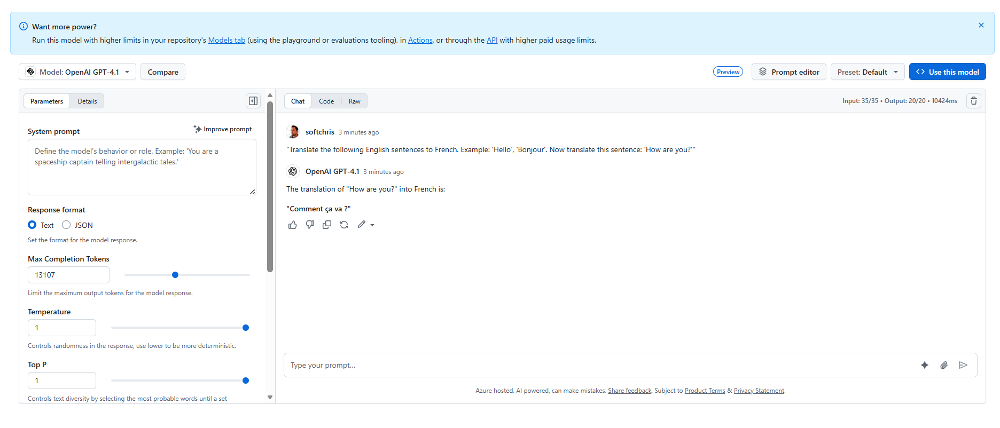
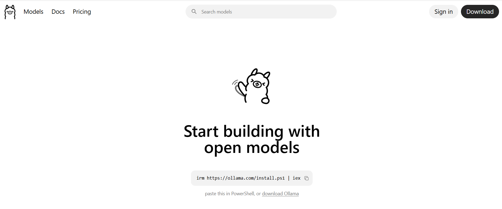
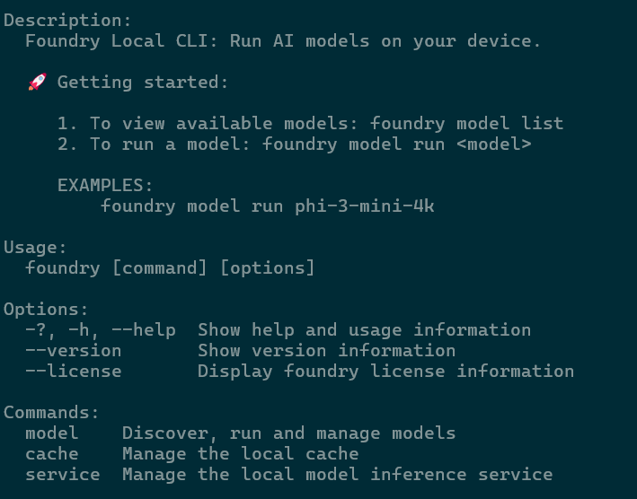
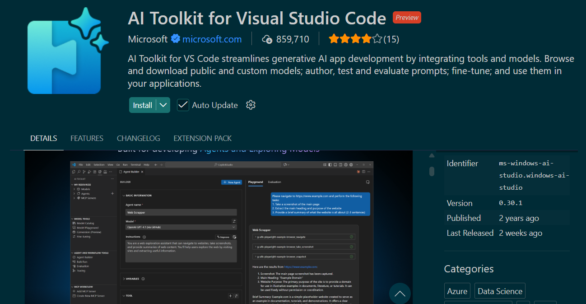
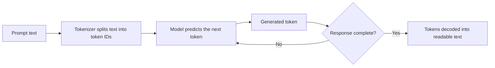
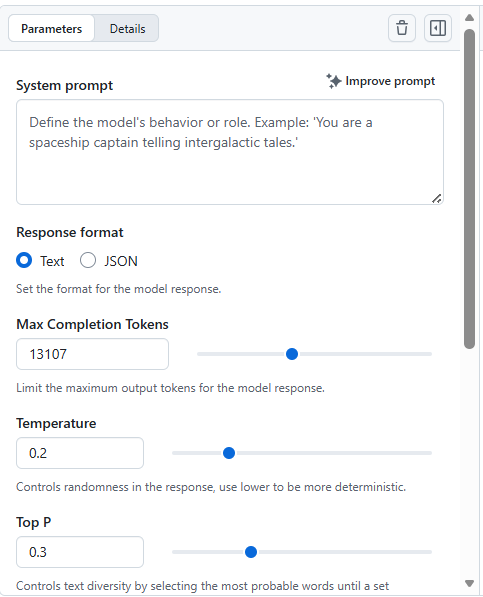
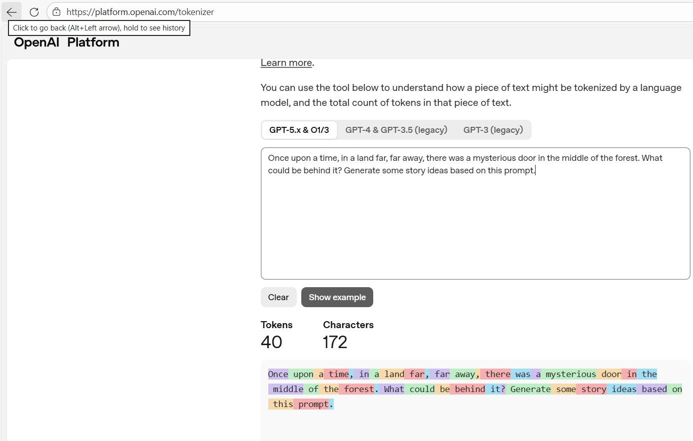
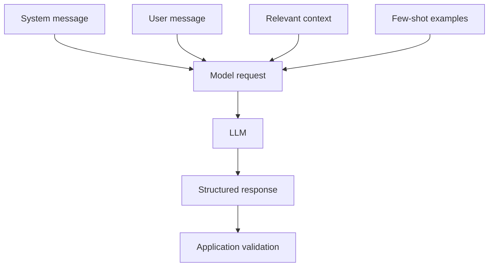

# Introduction to Large Language Models (LLMs)

A prompt is a normal sentence (or set of sentences) that you send into an LLM and out comes output. That is the basic idea of how we interact with LLMs, and it already provides value: planning a vacation, deciding what to cook for dinner, or solving a coding problem. Large parts of our society benefit from this type of interaction.

If you are new to LLMs, a simple mental model helps: you write a prompt, it gets broken into tokens, the model predicts the next tokens, and you receive a response.

What else should we know about LLMs as developers? After all, we need to understand the tools we are building with, configure them and be aware of both risks and rewards. 

For an application developer, there are a few core concepts to understand about LLMs. This chapter aims at explaining the following concepts and have you build with them:

- **Model**, the LLM itself, the engine that powers reasoning and decision-making, there's more than one and more than one type of model, and they have different capabilities and costs.
- **Where to find models**, they live in the cloud, but you can also self-host them, and that has implications for latency, cost, and control.
- **Prompt engineering**, the art of crafting effective prompts to get the desired output from an LLM, but also how that has evolved into context engineering, which is about designing the entire ecosystem in which the model operates.
- **Tokens and context windows**, how LLMs process input and output, and how that affects the design of your app and its cost.
- **Guidance**, how to steer the model's output towards more deterministic or more creative responses using parameters like temperature and top-p, system prompts, few-shot prompting, and structured outputs like JSON schemas.

In this chapter, you will learn how to do the following:

- Author prompts using roles, examples, constraints, and the CREATE framework.
- Use system prompts to set the behavior of the model.
- Break larger tasks into steps and connect focused prompts into a prompt chain.
- Design structured output schemas to get machine-readable responses.
- Use LLMs from different providers and understand the trade-offs between them.
- Configure the model's parameters to balance creativity and determinism in its responses.

## Tools of the trade

It's important to not only learn about AI and Agents but also actually get in the habit of building with it. Therefore, I encourage you to set up an environment or try playgrounds where you can experiment with LLMs and prompt engineering. Here are some tools and platforms you can use. Some choices, such as Ollama, can run locally without per-request service fees, whereas others might require a subscription to GitHub Copilot or an account with GitHub. There are also various cloud options like Azure OpenAI, AWS Bedrock, Google Gemini and more, but for the purpose of this chapter, I will focus on tools that are more accessible to everyone.

- **GitHub Models Playground**: A playground with rate-limited free usage for GitHub users. It gives you the ability to try various models and settings without first building an application. Availability and limits can change, so check the current terms when you use the [GitHub Models Playground](https://github.com/marketplace/models/azure-openai/gpt-4-1/playground).

   

- **Ollama**: A tool for running LLMs locally on your machine. It allows you to download and run models without needing to use a cloud service, giving you more control over your data and potentially reducing latency. You can find it [here](https://ollama.com/).

   

- **Foundry Local**: This is a tool similar to Ollama that allows you to run LLMs locally on your machine. Learn more in the [Foundry Local documentation](https://learn.microsoft.com/en-us/azure/foundry-local/get-started?view=foundry-classic).

  


- **[Foundry Toolkit (formerly AI Toolkit)](https://marketplace.visualstudio.com/items?itemName=ms-windows-ai-studio.windows-ai-studio)**: This Visual Studio Code extension helps you explore models, build AI applications, and work with related development tools. The product name has changed, so older documentation and screenshots might still refer to AI Toolkit.

      

- **GitHub Copilot SDK**: For those of you that have a GitHub Copilot subscription, you can leverage that to build your own AI-powered applications. The SDK provides tools to integrate with LLMs, MCP Servers, tools and more. Learn more about the [SDK here](https://github.com/github/copilot-sdk/blob/main/docs/getting-started.md).

## Prompts

So a prompt, what is it? A prompt is a text sentence or a set of sentences that you send to an LLM to get a response. It can be as simple as "Tell me a joke" or as complex as "Given the following FAQ page, answer the user's question." The way you craft your prompt can have a significant impact on the quality and relevance of the model's response. A prompt can include a set of things:

- **Instructions**: Clear directives on what you want the model to do. For example, "Summarize the following article in three sentences."
- **Context**: Providing background information or examples to guide the model's response. For instance, "Here are some examples of good customer support responses: [examples]. Now, respond to this customer query: [query]."
- **Constraints**: Specifying any limitations or requirements for the response. For example, "Answer the following question without using more than 50 words."

### System and user messages

Before you start applying prompting techniques, it helps to understand where instructions can come from. Many LLM APIs organize a conversation into messages with different roles. Two roles you will encounter often are:

- **System message**: Instructions supplied by the application developer that set the model's overall behavior, boundaries, or purpose.
- **User message**: The request supplied by the person using the application.

The exact role names vary by provider and API version. For example, an API might use a `developer` role for application instructions instead of, or in addition to, a `system` role. Always follow the message hierarchy documented for the model you are calling.

Why does this distinction matter? In a consumer-facing application, the system message is typically configured in code and hidden from the end user. This lets a developer consistently tell a recipe assistant to avoid allergens, for example, while each user asks for a different meal.

```text
SYSTEM: You are a recipe assistant. Never suggest recipes containing nuts.
USER: I have flour, sugar, eggs, and chocolate chips. What can I make?
```

The system message establishes the application-level behavior, while the user message provides the immediate task. Most model APIs let developers send these as separate messages. We will see the code for doing that in the next chapter.

> NOTE: A system message guides the model, but it is not a security boundary or a guarantee. Applications must still validate model output and enforce important rules in code.

Here is a simple flow of what happens when you send a prompt:



The tokenizer converts text into units the model can process. Depending on the model and language, a token might be a whole word, part of a word, punctuation, or even a single character. The model then predicts one token at a time until it reaches a stopping condition, after which those tokens are decoded into the response you read.

### Challenge - A recipe prompt

Try crafting a prompt for an LLM to generate a recipe based on a list of ingredients. Include instructions, context, and constraints to guide the model's response. Use one of the suggested options for trying out your prompt, such as the GitHub Models Playground or Ollama.

## Prompt engineering

Prompt engineering is not an engineering discipline in the traditional sense, but it's a crucial skill for working effectively with LLMs. What it means is that there are best practices and techniques for crafting prompts to get the desired output. Some common techniques include:

- **Role-based prompting**, where you give the model a perspective or area of expertise from which to approach the task.
- **Few-shot prompting**, where you provide a few examples of the desired output in the prompt to guide the model's response.
- **Step-by-step decomposition**, where you ask the model to break a larger task into a concise plan or a set of smaller tasks.
- **Prompt chaining**, where the output of one focused prompt becomes the input to the next prompt.
- **Maieutic prompting**, which is about self-correction, guiding the LLM through a process of self-reflection and correction to identify errors and inconsistencies in the model's output and encourage it to revise its response.

Let's dive into each more in detail. At the end of the section, you will use a summary table to compare when each technique is most useful.

### Role-based prompting

Role-based prompting asks the model to approach a task from a particular perspective. This matters when the same source material needs different kinds of attention. A technical editor and a security reviewer, for example, will look for different problems.

Here is a role-based prompt for the recipe scenario:

> "You are a nutritionist. Review this cake recipe and suggest substitutions that reduce its sugar content while preserving its texture."

The role supplies a useful perspective, but it does not replace a clear request. The prompt still says what to review, what to change, and what quality to preserve.

Role-based prompting and system messages are related, but they are not the same thing. A role is an instruction technique that can appear in any prompt. A system message is a specific message type provided by many LLM APIs. You might place a long-lived role in a system message, or assign a temporary role in a user message for one task.

### Combining techniques with the CREATE framework

Now that you have several prompt components to work with, a framework can help you remember them. CREATE is one practical mnemonic for assembling a complete prompt. It is not a requirement or an API feature; it is a checklist you can adapt to the task.

- **Character**: Define the perspective the model should adopt.
- **Request**: State the task clearly.
- **Examples**: Show what a useful answer looks like.
- **Adjustments**: Add constraints, boundaries, or refinements.
- **Type**: Specify the output format.
- **Evaluate**: Ask for a check against explicit criteria.

For example, you can apply CREATE to the recipe challenge:

```text
Character: You are a practical home cook.
Request: Create a dinner recipe using chickpeas, tomatoes, and rice.
Examples: Prefer meals such as curries, stews, or rice bowls.
Adjustments: Use no nuts, take no more than 30 minutes, and serve two people.
Type: Return a title, ingredient list, and numbered method.
Evaluate: Check that every ingredient appears in the method and that the recipe meets the time limit.
```

This version combines a role, task, examples, constraints, output shape, and review criterion. You will not need every CREATE element for every request, but the checklist helps reveal what a vague prompt is missing.

> NOTE: Prompt conventions vary across model families, model versions, and APIs. A format that works well for one model might be less effective for another. Check the current vendor documentation for your target model, such as [OpenAI's prompt engineering best practices](https://help.openai.com/en/articles/6654000-best-practices-for-prompt-engineering-with-the-openai-api), then test the prompt with representative inputs instead of assuming that one formatting style is universal.

### Few-shot prompting

This is the type of prompting where you provide a few examples of the desired output in the prompt to guide the model's response. The reason for its name is that you are giving the model a few examples "few shots" to learn from.

For example:

> "Translate the following English sentences to French. Example: 'Hello', 'Bonjour'. Now translate this sentence: 'How are you?'"

### Challenge

Let's try this out in an AI playground of your choice, for example GitHub Models playground or Ollama. Try the following prompt:

> "Translate the following English sentences to Spanish. Example: 'Good morning', 'Buenos días'. Now translate this sentence: 'See you later!'"

Try adjusting it also to a language of your choice and see how the model performs. You can also try adding more examples to see if it improves the translation quality.

### Prompt chaining

Some tasks are easier to control when you divide them across several model calls. Prompt chaining does this by using the result of one focused prompt as context for the next. This matters because each stage can have one clear responsibility, and your application can inspect an intermediate result before continuing.

Imagine that you want to turn a set of ingredients into a checked shopping list. Instead of asking for everything at once, use this chain:

```text
Prompt 1: Create a three-day dinner plan using these ingredients: [ingredients].

Prompt 2: Review this dinner plan for allergens and list any missing ingredients:
[output from Prompt 1]

Prompt 3: Convert the reviewed plan into a shopping list grouped by store aisle:
[output from Prompt 2]
```

Each prompt produces a concrete intermediate result: a meal plan, a review, and then a shopping list. In an application, validate each result before passing it forward. Otherwise, an error in the first response can propagate through the entire chain.

Prompt chaining is especially useful when different stages need different prompts, tools, output schemas, or approval rules. Later chapters will build on this idea when agents plan and execute multi-step tasks.

### Step-by-step decomposition

Step-by-step decomposition asks the model to divide a larger problem into smaller, visible tasks. This matters because a short plan is easier for you to review, correct, and adapt than one large answer that mixes planning with implementation.

For example, rather than asking generally how to build a recipe application, provide the stages you want the response to follow:

> "To build a web app, you need to: 1. Choose a framework. 2. Design the UI. 3. Implement the backend. Now, given this problem, how would you approach building an app that manages my recipe collection?"

Here is a shortened excerpt of what a model might return:

```text
1. Choose a framework
   Select a frontend, backend, and database based on the team's experience.

2. Design the UI
   Map the recipe list, recipe details, editing, and search screens.

3. Implement the backend
   Define the recipe data model and the API operations for creating,
   reading, updating, and deleting recipes.
```

Now compare it with a general prompt that does not supply an organizing structure:

> "How would you build a web app that manages my recipe collection?"

```text
Start by defining the features, such as adding, editing, searching, and
categorizing recipes. Then choose a frontend framework, backend framework,
and database. Build the API and user interface before deploying the app.
```

Both answers may be useful, but they give the reader different levels of control:

| Prompt style | What it controls | Likely result |
| --- | --- | --- |
| General request | The goal only | The model chooses its own structure and level of detail |
| Decomposed request | The goal and the stages to cover | The response follows a plan that is easier to review |

The key improvement is not access to the model's private reasoning. It is the visible structure you supplied in the prompt. Ask for concise steps, a plan, or supporting evidence rather than a long internal reasoning trace. This produces an answer that is easier to evaluate and can reflect how your team already works.

### Challenge - Decompose an application plan

Now test how much control decomposition adds to a larger request. This matters because application planning often produces broad answers that are difficult to review unless you specify the stages you need.

Imagine you want to build a personal reading-list application. Start with this general prompt:

> "How would you build an application that manages my reading list?"

Then work through the challenge:

1. Run the general prompt and note how the model organizes its answer.
2. Rewrite the prompt so the model must cover requirements, data design, user interface, implementation, and testing in that order.
3. Ask for no more than three concise bullets under each stage.
4. Compare the two responses. Identify which one is easier to review and which assumptions still need clarification.

The decomposed prompt should produce a predictable plan rather than a mixture of features, technologies, and code. If a stage remains vague, refine only that stage instead of rerunning the entire planning request.

### Maieutic prompting

This one is about self correction. The idea is to guide the LLM through a process of self-reflection and correction. The purpose is to find errors and inconsistencies in the model's output and encourage it to revise its response. An important realization with this technique is to not take the first response from the LLM at face value, but to use it as a starting point for further refinement. You want the model to explain, justify and reflect on its own output, which can improve its coverage and coherence. Here's an example:

> "Given the following question, provide an answer and then reflect on it to identify any potential errors or areas for improvement. Question: How does prompting work?"

First, let's show what the output look like with just a simple prompt:

> Given the following question, provide an answer. Question: How does prompting work?

```text
Prompting is the process of providing input text (a "prompt") to a large language model (LLM) to guide it toward generating a desired output.

## How it works:

**1. Input Processing**: The prompt is converted into tokens (numerical representations) that the model can understand.

**2. Context Understanding**: The model analyzes the prompt using its trained parameters to understand the context, intent, and patterns in your request.

**3. Next-Token Prediction**: Based on its training, the model predicts the most likely next token, then uses that to predict the next one, and so on, generating a sequence of tokens that form the response.

**4. Output Generation**: The tokens are decoded back into human-readable text.

## Key Principles:

- **Clarity**: Be specific about what you want
- **Context**: Provide relevant background information
- **Structure**: Use formatting, examples, or role definitions
- **Iteration**: Refine prompts based on outputs

## Prompt Engineering Techniques:

- **Zero-shot**: Direct instruction without examples
- **Few-shot**: Providing examples of desired input/output pairs
- **Chain-of-thought**: Asking the model to reason step-by-step
- **System/User/Assistant roles**: Structuring conversations with defined roles

The quality and structure of your prompt significantly impacts the quality, accuracy, and relevance of the model's response.
```

This is a fairly good answer, but it can be improved by encouraging the model to reflect on its own output and identify potential errors or areas for improvement. Let's see what happens when we use the maieutic prompting technique:

> Given the following question, provide an answer and then reflect on it to identify any potential errors or areas for improvement. Question: How does prompting work?

Here's what the output looks like:

```text
I'll answer this question about prompting and then reflect on the response.

Answer: How Does Prompting Work?
Prompting is the process of providing text input to a Large Language Model (LLM) to guide it toward generating a desired output. When you send a prompt to an LLM, the model processes the text tokens sequentially, using its trained parameters to predict the most likely next tokens based on patterns learned from its training data.

The prompt acts as a set of instructions and context that shapes the model's response. It can include:

Direct instructions (e.g., "Translate this to French")
Examples to demonstrate the desired format or style (few-shot learning)
Context that provides background information
Constraints that limit the scope or format of the response
The model uses attention mechanisms to weigh the importance of different parts of the prompt and generates output token by token until it reaches a stopping condition (end token, length limit, or other criteria).

Reflection on This Answer
Potential errors or areas for improvement:

Missing technical depth: The answer doesn't explain the mathematical underpinnings (transformer architecture, attention weights, embeddings) which some audiences might expect.

Oversimplification: The phrase "most likely next tokens" is accurate but doesn't capture the nuance that parameters like temperature can make the model choose less likely tokens for creativity.

Context window not mentioned: An important aspect of how prompting works—the limited context window—isn't addressed. This affects how much information can be included in a prompt.

No mention of prompt engineering evolution: The answer doesn't acknowledge that prompting has evolved from simple questions to sophisticated techniques like chain-of-thought, system prompts, and structured outputs.

Tokenization clarity: While I mention "tokens," I don't explain that text is broken into subword units, which might confuse beginners.

Missing practical implications: The answer could benefit from mentioning cost, latency, and quality trade-offs that affect how developers craft prompts in real applications.

```

The big improvement here is that the model is able to:

- Identify specific areas where the initial answer could be enhanced.
- Provide a more comprehensive and nuanced explanation of how prompting works.

Why does this help? The second pass gives you a visible list of omissions to inspect instead of presenting the first answer as final. However, self-critique is still generated by the same model and can repeat the same mistake with more confidence.

> NOTE: Self-critique can improve an answer's coverage and presentation, but it does not independently verify facts. Check important claims against trusted sources, application data, tests, or external tools.

What this means for you as a developer is that you can use this technique to iteratively refine the model's output.

Imagine for example you are building a research assistant. You could have it generate an initial summary of a paper, and then use maieutic prompting to understand how good that summary is. If you wanted you could then try improving the answer as a next step, and also give the user an understanding of how good the summary is and what its limitations are.

> This can lead to a much more robust and reliable application.

### Exercise - Maieutic prompting

Try using maieutic prompting to improve the output of an LLM on a specific task, for example explain a topic like "What is reinforcement learning?" and then reflect on the answer to identify any potential errors or areas for improvement.

Try it both as a standalone prompt and as a maieutic prompt and compare the outputs.

You can run prompts like this in [GitHub Models playground](https://github.com/marketplace/models/azure-openai/gpt-4-1/playground) or an AI playground of your choice.

The following table summarizes the techniques you have now practiced. Use it as a quick guide when deciding how much structure a new task needs:

| Technique | When to use | Example prompt | Expected output style |
| --- | --- | --- | --- |
| Role-based | You need a particular professional perspective | "Act as a technical editor..." | Uses the chosen perspective |
| Few-shot | You need consistent formatting or tone | "Example: ... Now do: ..." | Mirrors the examples |
| Step-by-step decomposition | You want a large task divided into manageable parts | "Give me a five-step plan..." | Concise ordered steps |
| Prompt chaining | A task has distinct stages | "Create a plan, check it, then format it..." | Each stage feeds the next |
| Maieutic | You need self-checking and refinement | "Answer, then critique your answer" | Answer and reflection |

## Models and where to find them

Models are usually in one of two places, in the cloud or on your local machine. Various vendors like Ollama and Foundry allows you to download models locally. You can also find models in GitHub repositories, Hugging Face and more. Cloud providers offer services like Azure OpenAI, AWS Bedrock, Google Gemini where you both can find models and use them from various services.

### Local models

For Ollama and Foundry, you download a tool that you run in your terminal. Additionally, these come with SDKs so you can also integrate them into code. Let's focus on Ollama for a second to see what operations are available so you get a sense of what you can do. The features offered in Foundry local are pretty similar. Here's a list of supported Ollama commands:

```text
Available Commands:
  serve       Start Ollama
  create      Create a model
  show        Show information for a model
  run         Run a model
  stop        Stop a running model
  pull        Pull a model from a registry
  push        Push a model to a registry
  signin      Sign in to ollama.com
  signout     Sign out from ollama.com
  list        List models
  ps          List running models
  cp          Copy a model
  rm          Remove a model
  launch      Launch the Ollama menu or an integration
  help        Help about any command
```

Let's dive into a few commands you're likely to use often.

- `pull`, this is the command you use to download a model from a registry. To know which models are available you can check out the [Ollama search page](https://ollama.com/search). Here's how you would download a model:

   ```bash
   ollama pull qwen3-vl:2b
   ```

- `run`, using this command, you can run a model that you have downloaded. This takes you to a terminal interface where you can interact with the model.   

- `list`, to list the models you have downloaded, you can use this command:

   ```bash
   ollama list
   ```

There's also another interesting concept called model files, which is a way to define a model using a file. This allows you to specify not only the base model but also system prompts, few-shot examples, and more. Here's an example of what a model file might look like, which is a text file.

```yaml
FROM qwen3-vl:2b
SYSTEM You are a helpful assistant that provides cooking recipes based on the ingredients provided by the user. IMPORTANT, never suggest anything with NUTS.
```

Here we are defining a model that is based on the `qwen3-vl:2b` model, but we are also adding a system prompt that instructs the model to be a helpful assistant for cooking recipes and to never suggest anything with nuts. 

Next, we need to create a model using this file, we can do that with the `create` command:

```bash
 ollama create my-recipe-assistant -f Modelfile
```

Now use this model by running it:

```bash
ollama run my-recipe-assistant
```

Ask it to create a recipe and you will see that it follows the instructions we provided in the model file. 

```text
>>> give me a recipe for a cake, make it brief
Vanilla Cake

Mix flour, sugar, baking powder, eggs, milk, butter, and vanilla. Pour the
batter into a greased cake pan and bake at 350 F (175 C) for 25-30 minutes.
```

The response follows the recipe-assistant behavior without exposing or requesting a detailed reasoning trace. Exact wording will vary between runs and model versions.

Ollama started out as a service to run models locally, but they have recently added the ability to also run cloud hosted models. Check out the `signin` command to see how to connect your Ollama CLI to the cloud and then you can use the `run` command to run cloud hosted models as well.

### Cloud hosted models

Cloud hosted models have the benefit of not using your local resources which is a big plus if you don't have a powerful machine. They also tend to be associated with a cloud service that offers a bunch of other features like observability, logging, security, policies and more that make you comfortable using them in production. The downside is that they cost more and you need to learn about that specific cloud provider and their APIs.

I'm not going to provide a cloud provider recommendation here but I think it's fair to say that any of the major cloud providers (Azure, AWS, Google) have good offerings in this space and you can find models in their marketplaces. You can also find models in Hugging Face and use them through the Hugging Face API.

Now that you have seen both hosting approaches, use this table to compare the operational trade-offs:

| Dimension | Local models | Cloud models |
| --- | --- | --- |
| Cost | Lower per-request, higher hardware cost | Pay per token, no local hardware |
| Latency | Fast on suitable hardware | Depends on network and region |
| Privacy | Data can stay on the device | Data is processed under the provider's service terms |
| Setup | Install and manage models | Create an account and use APIs |
| Scale | Limited by available hardware | Can scale through the provider |

## Model parameters

Model APIs expose generation parameters such as temperature, top-p, output-token limits, and stop sequences. Names, supported ranges, and availability vary by provider and model; some models do not expose every control. Let's look at the concepts behind three parameters you will encounter often.

- **Temperature**, this parameter influences how strongly the model favors higher-probability tokens. A lower value usually makes responses more consistent, while a higher value can increase variation. A low temperature does not guarantee identical output, and supported ranges vary by model.
- **Top-p (nucleus sampling)**, this parameter controls the diversity of the model's output by limiting the next token choices to a subset of the most probable tokens whose cumulative probability exceeds a certain threshold p. What this means in plain language is that if you set a high top-p value, the model will consider a larger pool of potential next tokens, which can lead to more diverse and creative responses. Conversely, a lower top-p value will restrict the model to a smaller set of high-probability tokens, resulting in more focused and deterministic output.

- **Output-token limit**, this parameter caps how many tokens the model can generate in one response. APIs use names such as `max_output_tokens` or `max_completion_tokens`, so check the SDK you are using. A lower value can control response length, latency, and cost, but setting it too low can truncate the answer.

| Parameter | Range | Effect | Beginner tip |
| --- | --- | --- | --- |
| Temperature | Model-specific | Consistency versus variation | Begin with the model's default |
| Top-p | Model-specific | Breadth of token choices | Change it separately from temperature |
| Output-token limit | Model-specific | Maximum response length | Set a cap that leaves room for a complete answer |

Let's take this into a practical example. Imagine you are building a creative writing assistant and you want it to generate story ideas. A lower temperature usually keeps the output closer to high-probability choices, while a higher temperature can produce more variation. Lowering top-p also narrows the set of tokens the model can choose from. Because these controls overlap, changing both at once makes it harder to tell which setting caused the difference.

> TIP: Change either temperature or top-p while keeping the other at its default. This makes experiments easier to compare and usually provides a more stable starting point. Supported ranges and defaults vary by model, so check the model's documentation.

### Exercise - Model parameters

Let's test the writing assistant example while changing one parameter at a time. You can use the GitHub Models Playground or another playground that exposes these settings.

1. Keep top-p at the model's default and generate a response with temperature values `0.2`, `0.5`, and `0.8`.
2. Choose one temperature value and keep it fixed. Generate another set of responses with top-p values `0.3`, `0.7`, and `0.9`.
3. Compare the responses for focus, variety, and relevance. Record which parameter changed before each run.

This sequence gives you two controlled comparisons. You can now describe the effect of each parameter without guessing which of two simultaneous changes produced the result.

Here's a suggested prompt:

> "There was a mysterious door in the middle of the forest. What could be behind it? Generate some story ideas based on this prompt."

See this image for how to set these parameters in the GitHub Models Playground:



## Tokens, context windows, and cost

Great, now that we have covered how to steer the model's output using parameters like temperature and top-p, let's talk about some other important concepts that you need to understand as a developer as this has implications for cost and how you design your app.

### Tokens, the smallest unit of text that the model processes

As soon as you start building with LLMs, you will start hearing about tokens, context windows and cost implications. First off, a token is a unit of text that the model processes. It can be as short as one character or as long as one word, depending on the language and the specific tokenization method used by the model. So how do I know how many tokens my input will be? Most models have a tokenizer tool that you can use to calculate the number of tokens in your input. 

There's also the notion of input tokens and output tokens, which are the tokens you send to the model and the tokens the model generates in response. Both of these contribute to the total number of tokens processed, which can affect cost and performance. So when you set a max tokens parameter, you are setting a limit on the number of output tokens the model can generate, but you also need to be mindful of the number of input tokens you are sending, as that also counts towards the total token count.

> NOTE: So setting a low max tokens value can help you control the length of the output, but if you are sending a very long prompt with a lot of input tokens, you might still end up with a high total token count, which can increase cost and latency.

### Exercise - calculate tokens

OpenAI has a playground you can test for free to calculate the number of tokens [here](https://platform.openai.com/tokenizer).

Test it with a phrase like:

> "Once upon a time, in a land far, far away, there was a mysterious door in the middle of the forest. What could be behind it? Generate some story ideas based on this prompt."

Here's an example run of the tool below:



Try changing the sentence or just translate the phrase to another language and see how that affects the token count. You can also try adding more context to the prompt and see how that affects the token count as well.

### Context window

The context window is the maximum number of tokens that a model can process in a single request, including both input and output tokens. Why this window would be big is that you might have:

- long prompts because you provide a document or a long conversation history as context for the model.
- long outputs because you want the model to generate a detailed response.

Many models allow large context windows, but filling the window still affects cost and latency. Response quality can also decline when relevant instructions or evidence are buried in a long input, even when that input fits within the advertised limit. Common approaches include selecting only relevant context, summarizing older material, or truncating content according to an explicit policy.

Let's revisit this concept in later chapters when we get more hands-on and see how to manage the context window effectively in real applications.

## Steering model output

Free-form text works well when a person will read the response. If another system needs to consume that response or use it to trigger an action, you need more control over both the model's behavior and the shape of its output.

This section connects the prompting techniques you have already learned to that application boundary. You will use system messages for persistent behavior, few-shot examples for consistency, and structured outputs for machine-readable data.

- **System messages** set persistent application-level instructions, such as the assistant's purpose and boundaries.
- **Few-shot prompting** provides examples that demonstrate the expected content, tone, or format.
- **Structured outputs** constrain the response to a format such as JSON that an application can validate and consume.

The following diagram brings these controls together in one application flow. On the left are the inputs your application assembles. On the right, the model response passes through validation before any other application code relies on it.



The system message establishes persistent behavior, while the user message supplies the immediate request. Context contributes the information needed for this request, and few-shot examples demonstrate the desired pattern. The model combines those inputs into a response, but the application still validates the response's structure and allowed values before using it. This final validation step is what turns model guidance into a safer application boundary.

### System messages, apply behavior through an API

Earlier, you learned that system and user messages have different purposes. Now let's represent those roles in the shape commonly used by model APIs. Keeping the messages separate matters because the API can preserve their intended roles instead of treating everything as one block of user text.

Here is the behavior we want to apply:

```text
SYSTEM: You are a helpful assistant that provides cooking recipes based on the ingredients provided by the user. IMPORTANT, never suggest anything with NUTS.
```

Most chat-oriented SDKs accept a collection of messages similar to this one:

```python
messages = [
   {
      "role": "system",
      "content": "You are a recipe assistant. Never suggest recipes containing nuts.",
   },
   {
      "role": "user",
      "content": "I have flour, sugar, eggs, and chocolate chips. What can I make?",
   },
]

result = call_llm(model="your-model", messages=messages)
```

The exact method name varies by SDK, but the important idea remains the same: application instructions and user input occupy separate roles. The system message guides the response; application code must still enforce critical requirements such as allergen safety.

Few-shot examples can also stabilize a response's content, tone, or shape, as you saw earlier in the chapter. Examples are useful guidance, but they do not guarantee valid machine-readable data. When application code depends on the response format, use schema-backed structured output where the model API supports it.

### Structured outputs, get a machine-readable response

Structured output is especially important for agents because an agent's response often becomes input to code. A conversational sentence such as "I will search for a flight to Seattle" is useful to a person, but it does not give an application a precise, validated action to route.

For example, a flight-search agent could return an action request like this:

```json
{
   "action": "search_flights",
   "origin": "LHR",
   "destination": "SEA",
   "departureDate": "2026-09-15"
}
```

Your application can validate these fields and route an allowed action to the appropriate tool. It should not execute model-generated actions blindly: authorization, business rules, user confirmation, and input validation still belong in application code.

There are two common ways to request this structure. The first is to describe the expected format in the prompt:

> "Please provide the output in the following JSON format: { \"recipe\": \"string\", \"ingredients\": [\"string\"], \"instructions\": \"string\" }"

The second, more reliable option is to use SDK support for a schema-backed response. You define the output structure and supply it with the model call:

```python
class RecipeOutput(BaseModel):
    recipe: str
    ingredients: List[str]
    instructions: str

result = call_llm(user_prompt, model="your-model", output_schema=RecipeOutput)
```

In both cases, parse and validate the result before using it. A schema-backed API can constrain generation more reliably than prompt wording alone, but application-level checks are still required.

## Knowledge check

Now that you have moved from basic prompts to model configuration and structured responses, use these questions to check the connections between the concepts:

1. What is the difference between a system message and a user message, and who typically supplies each one?
2. When would role-based prompting be useful, and why does assigning a role not replace a clear request?
3. Which parts of the CREATE framework would you use to require JSON output and ask the model to check that no fields are missing?
4. How does prompt chaining differ from step-by-step decomposition?
5. What happens to model output when you increase temperature, and how does that differ from changing top-p?
6. Why do input and output tokens both matter when considering a model's context window and cost?
7. Why is a schema-backed structured output more reliable for application code than merely asking for JSON in a prompt?
8. Why should an application verify a model's self-critique against trusted sources or tools?

## Summary

In this chapter, you learned how a prompt moves through tokenization and generation, and how its instructions, context, and constraints shape the response. You used role-based and few-shot prompting, combined prompt components with CREATE, divided larger tasks into visible steps, and connected focused tasks through prompt chaining. You also saw how self-critique can reveal omissions without replacing independent verification.

You then compared local and cloud-hosted models and explored how temperature, top-p, and maximum output tokens affect model behavior. Finally, you connected token usage and context-window limits to cost, then used system messages, examples, and structured outputs to make responses more suitable for an application.

In the next chapter, you will put these concepts into practice with SDKs, sending role-based messages to models and consuming their responses in code.