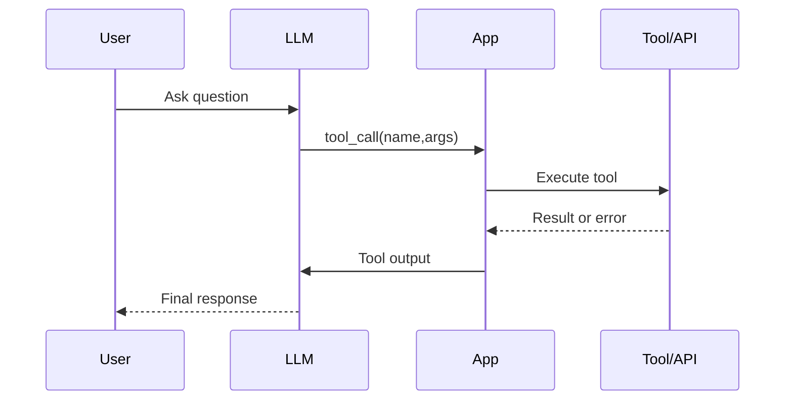
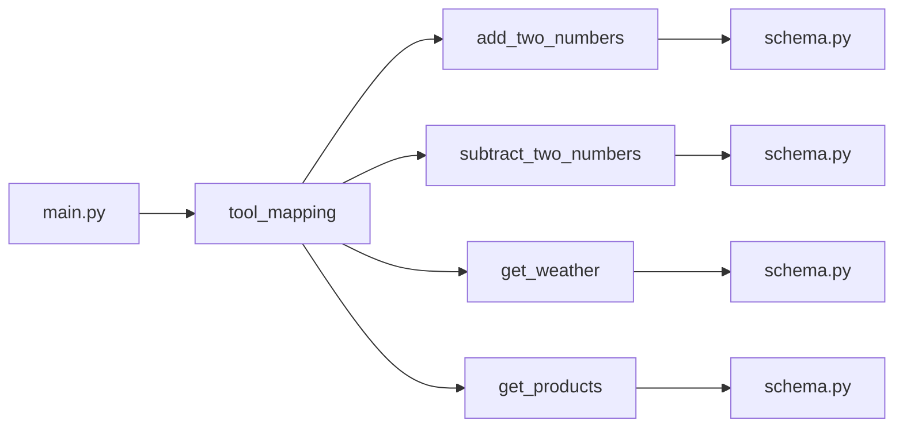
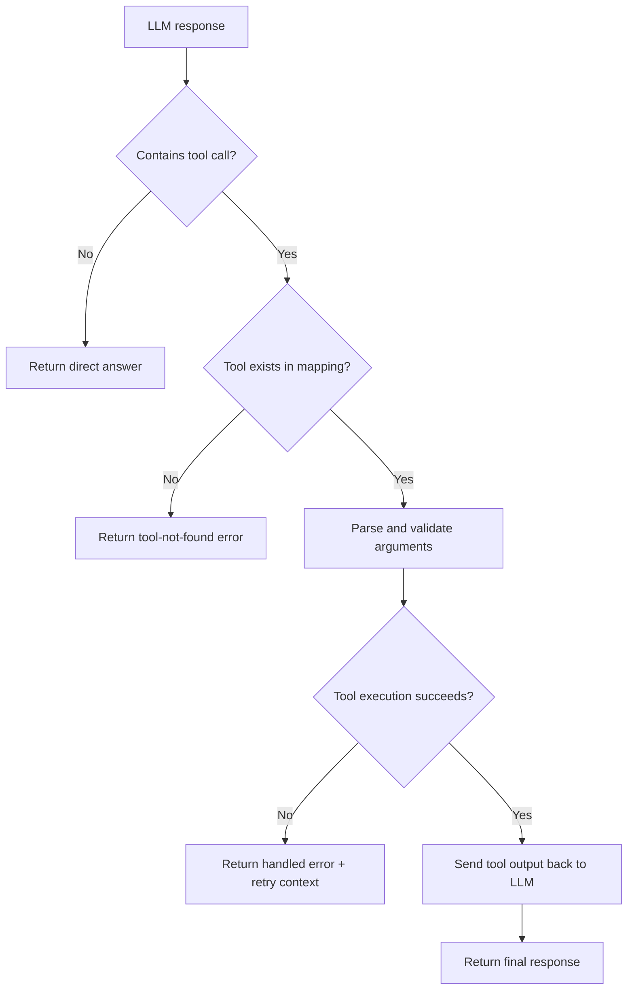

# Enhancing LLMs with Tool Calling

The LLM is like the brain of an AI Agent. However an LLM is limited in what it can do. It can only generate text based on the patterns it has seen in its training data.  

For some agents, generic answers are perfectly fine. For example, if you have an agent that answers questions about general knowledge, the LLM can generate good answers based on what it has seen during training. However, for other agents, you may want them to perform specific tasks that require more than just generating text. For this to be possible, you need to enhance the capabilities of the LLM and thereby your agent and that's what this chapter is about.

In this chapter, you will learn how to do the following:

- Define tools that an LLM can call to fetch data or perform actions.
- Implement tool calling protocols to enable LLMs to interact with external systems.
- Handle errors and ensure robust tool interactions.

*Use the roadmap below to orient yourself before diving in — each row maps a chapter section to its key learning goal and why it matters.*

| Section | What you learn | Why it matters |
|---|---|---|
| Tool calling fundamentals | Define tools, schemas, and execution loop | Core pattern used in agent systems |
| Ollama implementation | Apply the same pattern in another SDK | Transfers skills across providers |
| API and database examples | Build practical tools with real data sources | Moves from toy examples to useful apps |
| Tool architecture | Organize many tools into modules | Keeps projects maintainable as they grow |
| Copilot SDK abstraction | Reduce boilerplate with decorators | Improves developer productivity |

## Tool calling

So how do we solve situations where we need the LLM to produce a better answer? We can use what's known as tool calling (also sometimes called function calling). The idea is the following:

1. Define a function or tool that performs a specific task (e.g., fetching data from an API, executing code, querying a database) and so on.
1. Let the LLM know about this tool and how to call it (e.g., through a schema or API definition).
1. When the LLM generates a response, it can indicate that it wants to call the tool. At this point, you need to intercept this call, execute the tool, and then feed the results back to the LLM so it can generate a final response or just answer with the tool output if that's what the user asked for.

*Here is how the full round-trip looks, from the moment a user asks a question all the way to the final response.*



**Fig 1 - End-to-end tool-calling flow between the user, LLM, application, and external tool.**

*Each step in the pipeline carries its own risks — the breakdown below highlights where things most commonly go wrong.*

| Step | App responsibility | Typical failure mode |
|---|---|---|
| 1. Register tool | Provide schema/metadata to model call | Missing/incorrect parameter schema |
| 2. Detect tool call | Parse tool name and arguments | Invalid JSON arguments |
| 3. Execute tool | Call mapped function with validated args | Runtime/API/DB exception |
| 4. Return result | Send tool output back to model | Tool result format mismatch |
| 5. Final answer | Model composes user-facing response | Hallucinated details if tool output is unclear |

The five rows describe what happens **at runtime for one request**. The next three sections are organized around the broader **implementation tasks** needed to make that runtime flow possible, so the sections do not map to the rows one-to-one:

| Teaching section | Lifecycle step it prepares or implements |
|---|---|
| Define a tool | Creates the function that the application will execute. This is a prerequisite for the five-step runtime flow. |
| Instruct the LLM on how to call the tool | Implements step 1 by describing and registering the tool with the model. |
| Handle tool calls and errors | Keeps steps 2-5 together as one response-handling loop: detect the request, execute the function, return its result, and produce the final answer. |

For example, when a user asks for today's sales, `get_current_sales` must already exist before the request begins. During the request, the application registers that function's schema, detects the model's tool call, runs the function, returns the sales data, and lets the model compose the answer. Grouping the material into three teaching sections separates setup from runtime behavior while keeping the full five-step request flow intact.

Now that the relationship between the two views is clear, let's build each implementation task in order.

## Define a tool

A tool is literally just a normal function that performs a specific task. For example, you could have a tool that fetches the current products that are on sale like so:

```python
async def get_current_sales(date: str) -> dict:
    response = await api.call("GET", f"https://api.example.com/sales?date={date}")
    # Imagine this function calls an API or database to fetch current sales
    return response.json()
``` 

The above code is a simple tool definition that fetches current sales from an API. That's all you need for this step; next, we need to let the LLM know about this tool and how to call it.

## Instruct the LLM on how to call the tool

Let's talk about conceptually what should happen next. At this point, you have a function defined but the LLM doesn't understand functions per se. What it does understand is text. So you need to translate the function definition into a format that the LLM can understand. What that means is that you need to translate the function and its parameters into a JSON definition that the LLM can understand. For example, you could define a tool schema like so:

```json
{
  "name": "get_current_sales",
  "description": "Fetches the current sales from the API",
  "parameters": {
    "type": "object",
    "properties": {
      "date": {
        "type": "string",
        "description": "The date for which to fetch current sales"
      }
    },
    "required": ["date"]
  }
}
```

What you're looking at above is a JSON schema that represents our `get_current_sales` function. Here you see:

- `name`: the name of the tool or function.
- `description`: a brief description of what the tool does.
- `parameters`: a JSON schema that defines the parameters that the tool accepts. In this case, our tool takes a single parameter, `date`, which is required.

For a simple SDK you would then need to pass this schema to the LLM so it can understand how to call the tool. For example, if you're using OpenAI's API, you pass this schema in the `tools` parameter when making a call to the LLM. Here's the code for that:

```python
# 1. function definition
async def get_current_sales(date: str) -> dict:
    response = await api.call("GET", f"https://api.example.com/sales?date={date}")
    return response.json()

# 2. function schema
tool_schema = {
    "type": "function",
    "function": {
        "name": "get_current_sales",
        "description": "Fetches the current sales from the API",
        "parameters": {
            "type": "object",
            "properties": {
                "date": {
                    "type": "string",
                    "description": "The date for which to fetch current sales"
                }
            },
            "required": ["date"]
        },
    },
}
# 3. pass the schema to the LLM
response = await openai.chat.completions.create(
    model="gpt-4o",
    messages=[{"role": "user", "content": "What are the current sales?"}],
    tools=[tool_schema]
)
```

Here, `tools` is the request parameter used by the current OpenAI API. Older examples may use the legacy `functions` parameter, but both names refer to the same basic job: making function schemas available to the model. Provider SDKs expose this idea through slightly different object shapes, so check the SDK-specific fields when you switch providers.

## Handle tool calls and errors

Now that we have defined the function and its JSON schema, and passed it to the LLM, the next step is to handle tool calls. You need to inspect the LLM's response to see if it wants to call a tool. With OpenAI's API, requested calls appear in the response message's `tool_calls` collection. It looks like this:

```python

# mapping of function names to actual function implementations
tool_mapping = {
    "get_current_sales": get_current_sales
}

# call LLM
response = await openai.chat.completions.create(
    model="gpt-4o",
    messages=[{"role": "user", "content": "What are the current sales?"}],
    tools=[tool_schema]
)

# check if the LLM wants to call a tool
if response.choices[0].message.tool_calls:
    tool_call = response.choices[0].message.tool_calls[0]
    tool_name = tool_call.function.name
    tool_args = json.loads(tool_call.function.arguments)
    
    # is tool name in our mapping?
    if tool_name in tool_mapping:
        # call the tool and handle errors
        try:
            tool_response = await tool_mapping[tool_name](**tool_args)
            # feed the tool response back to the LLM or return it to the user
        except Exception as e:
            # handle any errors that occur during tool execution
            print(f"Error calling tool: {e}")
```

Let's explain what this code does:

- **Define tool mapping**: First, we define a mapping of tool names to their actual function implementations. This allows us to easily call the correct function when the LLM indicates it wants to call a tool.

   ```python
   tool_mapping = {
    "get_current_sales": get_current_sales
   }
   ```
   
- **Make LLM call**: We then call the LLM with our user message and the tool schema.

   ```python
    response = await openai.chat.completions.create(
         model="gpt-4o",
         messages=[{"role": "user", "content": "What are the current sales?"}],
         tools=[tool_schema]
    )
    ```
   
- **Was there a tool call**: After we get the response from the LLM, we check whether `tool_calls` contains a request. If it does, we select the first call and extract the function name and arguments.

   ```python
    if response.choices[0].message.tool_calls:
        tool_call = response.choices[0].message.tool_calls[0]
        tool_name = tool_call.function.name
        tool_args = json.loads(tool_call.function.arguments)
   ```

   Also note that the arguments are typically returned as a JSON string, so we need to parse it using `json.loads` to get a Python dictionary that we can pass to our function.
   

- **Invoke tool**: We check if the tool name is in our mapping, and if it is, we call the corresponding function with the provided arguments. We also wrap this in a try-except block to handle any errors that may occur during tool execution.

   ```python
    if tool_name in tool_mapping:
        try:
            tool_response = await tool_mapping[tool_name](**tool_args)
            # feed the tool response back to the LLM or return it to the user
        except Exception as e:
            print(f"Error calling tool: {e}")
   ```

## Tool calling in Ollama

Let's keep working with Ollama, and see how we can implement tool calling with it. 

> NOTE: You may need to adjust how you perform tool calling based on the specific SDK or API you're using, but the general principles should remain the same. Some frameworks may have built-in support for tool calling, while others may require you to implement the logic yourself.

Ollama's SDK takes a similar approach to OpenAI's function calling, meaning you need to define a tool, pass its schema to the LLM, and then handle tool calls in the response. In both SDKs, the request uses a `tools` parameter. The response objects differ: OpenAI exposes `response.choices[0].message.tool_calls`, while Ollama exposes `response.message.tool_calls`. Keep that provider-specific path in mind as you follow the Ollama examples.

Before running the examples, install [Ollama](https://ollama.com/docs/installation), make sure its server is running, and prepare the project from the chapter's `code` directory:

```bash
uv sync
ollama pull mistral
ollama pull llama3.1
```

Why pull two models? The focused `tool.py` example uses `mistral`, while the complete `api.py` application uses `llama3.1`. Pulling both now prevents a model-not-found error when you move from one example to the other. The `uv sync` command installs all dependencies declared in `pyproject.toml`, including `ollama` and `requests`.

### Define a tool in Ollama

First, define a function that you want to use as a tool. This function should use a docstring to describe its purpose and parameters, providing a common signature that the LLM can understand. For example:

```text
Add two numbers
Args:
  a (int): The first number
  b (int): The second number
```

The more detailed this docstring is, the better the LLM will understand how to use this tool.

Here we have a tool definition for the tool `add_two_numbers` that takes two integers as input and returns their sum. The docstring provides a clear description of what the function does and what parameters it expects.

```python
def add_two_numbers(a: int, b: int) -> int:
  """
  Add two numbers

  Args:
    a (int): The first number
    b (int): The second number

  Returns:
    int: The sum of the two numbers
  """
  return a + b
```

Great, let's move on to the next step which is passing this tool definition to the LLM.

### Pass the tool schema to the LLM

This schema follows a standard format that the LLM can understand. First define this schema in your code, and then pass it to the LLM. It's important to call out you pass the schema rather than the function itself. Here's what the schema looks like for our `add_two_numbers` tool:

```python
add_two_numbers_tool = {
  'type': 'function',
  'function': {
    'name': 'add_two_numbers',
    'description': 'Add two numbers',
    'parameters': {
      'type': 'object',
      'required': ['a', 'b'],
      'properties': {
        'a': {'type': 'integer', 'description': 'The first number'},
        'b': {'type': 'integer', 'description': 'The second number'},
      },
    },
  },
}
```

Note how we have defined a JSON schema that describes our `add_two_numbers` function. Especially important is the `parameters` field which describes the parameters that our function takes, their types, and whether they are required or not.

Ok, this feels like a lot of work, and it is. This is one of the main challenges with tool calling, you need to define these schemas for every function you want to use as a tool. In an upcoming section I'll show you an SDK where this isn't needed though.

Now let's instruct the LLM next.

### Handle tool calls

Before we pass the functions, let's set up a mapping between function names and their implementations. This will allow us to scale our tool calling as we add more functions without having to write custom logic for each one.

```python
available_functions = {
  'add_two_numbers': add_two_numbers
}
```

Now to creating a client and carrying out the chat call. 

```python
client = ollama.AsyncClient()

response: ChatResponse = await client.chat(
  model,
  messages=messages,
  tools=[add_two_numbers_tool],
)
```

You can see that we are passing the tool schema to the LLM through the `tools` parameter. 

Finally, let's see how we deal with a tool call in the response:

```python
if response.message.tool_calls:
    # There may be multiple tool calls in the response
    for tool in response.message.tool_calls:
      # Ensure the function is available, and then call it
      if function_to_call := available_functions.get(tool.function.name):
        print('Calling function:', tool.function.name)
        print('Arguments:', tool.function.arguments)
        output = function_to_call(**tool.function.arguments)
        print('Function output:', output)
      else:
        print('Function', tool.function.name, 'not found')
```

In the above code we're:

- **Check for tool calls**: Check if the LLM's response includes any tool calls by inspecting the `tool_calls` field in the response message, if it's populated, it means the LLM wants to call a tool.

   ```python
    if response.message.tool_calls:
    ```

- **Iterate through tool calls**: Iterate through each tool call in the response. The LLM may want to call multiple tools, so we need to handle each one.

    ```python
     for tool in response.message.tool_calls:
    ```

    Here we look through each tool and see if it's in our `available_functions` mapping. 

- **Call tool**: Check if the tool is in our mapping of available functions, if it is, parse out the arguments and call the function with those arguments.

    ```python
      if function_to_call := available_functions.get(tool.function.name):
        print('Calling function:', tool.function.name)
        print('Arguments:', tool.function.arguments)
        output = function_to_call(**tool.function.arguments)
        print('Function output:', output)
      else:
        print('Function', tool.function.name, 'not found')
    ```

    See how `function_to_call` is assigned the actual function implementation and how `tool.function.arguments` contains the arguments that the LLM wants to pass to the function. We then call the function with those arguments and print the output which we do with `function_to_call(**tool.function.arguments)`.

To see and run this example, head over to the `code` directory for this chapter and see how to run a file called `tool.py` which contains the full code for this example.

Now that we've seen how it works for a simple example like adding two numbers, let's see how we can use this for more complex tools like calling an API or querying a database.

## Example: Call an API

Let's work on a slightly more interesting example, namely to call an API to fetch the current weather for a given location. Let's do the following things:

1. Write the function that calls the weather API and formats the response.
1. Define the tool schema for this function.
1. Pass the tool schema to the LLM and handle tool calls in the response.

Great, now that we have a plan, let's dive into the code.

### Write the function

```python 
# weather.py
# Get weather for a location (latitude, longitude)
url = "https://api.open-meteo.com/v1/forecast"

places = {
    "Seattle": {
        "latitude": 47.6062,
        "longitude": -122.3321
    },
    "London": {
        "latitude": 51.5074,
        "longitude": -0.1278
    },
}

def print_weather_data(data, location_name="Location"):
    """
    Format weather data from Open-Meteo API into a readable string.
    """
    # Weather code descriptions (WMO Weather interpretation codes)
    weather_codes = {
        0: "Clear sky",
        1: "Mainly clear",
        2: "Partly cloudy",
        3: "Overcast",
        45: "Foggy",
        48: "Depositing rime fog",
        51: "Light drizzle",
        53: "Moderate drizzle",
        55: "Dense drizzle",
        61: "Slight rain",
        63: "Moderate rain",
        65: "Heavy rain",
        71: "Slight snow",
        73: "Moderate snow",
        75: "Heavy snow",
        77: "Snow grains",
        80: "Slight rain showers",
        81: "Moderate rain showers",
        82: "Violent rain showers",
        85: "Slight snow showers",
        86: "Heavy snow showers",
        95: "Thunderstorm",
        96: "Thunderstorm with slight hail",
        99: "Thunderstorm with heavy hail"
    }

    # Extract current weather data
    current = data['current_weather']
    temp = current['temperature']
    windspeed = current['windspeed']
    winddirection = current['winddirection']
    weathercode = current['weathercode']
    is_day = current['is_day']

    # Get weather description
    weather_desc = weather_codes.get(weathercode, f"Unknown (code {weathercode})")

    # Determine day or night
    time_of_day = "☀️ Day" if is_day else "🌙 Night"

    lines = [
        "",
        "="*50,
        f"🌍 Weather for {location_name}",
        "="*50,
        f"📍 Location: {data['latitude']}°N, {data['longitude']}°E",
        f"⛰️  Elevation: {data['elevation']}m",
        f"⏰ Time: {current['time']} ({data['timezone_abbreviation']})",
        "",
        f"{time_of_day}",
        f"🌡️  Temperature: {temp}°C",
        f"🌤️  Condition: {weather_desc}",
        f"💨 Wind Speed: {windspeed} km/h",
        f"🧭 Wind Direction: {winddirection}°",
        "="*50,
        "",
    ]
    return "\n".join(lines)

def get_weather(place="London"):
    """
    Fetch and display weather for a given place
    
    Args:
        place: Name of the place (must exist in places dict). Defaults to "London"
    """
    params = places[place]
    params["current_weather"] = True
    response = requests.get(url, params=params)
    data = response.json()
    
    # Use the formatted output for tool results
    return print_weather_data(data, place)

```

There were quite a few things we created here namely:

- `print_weather_data`: A helper function that takes the raw weather data from the API and formats it into a nice string that we can return to the user or feed back to the LLM after a tool call.
- `get_weather`: The main function that calls the Open-Meteo API to fetch the current weather for a given location. It takes a `place` as input, looks up its latitude and longitude, calls the API, and then formats the response using the `print_weather_data` function.
- `places`: A simple dictionary that maps place names to their latitude and longitude. This allows us to call the `get_weather` function with a place name rather than having to provide coordinates.
- API call: We make a GET request to the Open-Meteo API with the appropriate parameters to fetch the current weather data.

Now that we have this function defined, let's move on to defining the tool schema for it. Remember, this is what the LLM need to understand how to call this function as a tool.

### Define the tool schema

This is a JSON formatted schema and we need to make sure it mentions the functions name, its parameters and any required parameters. Here's the schema:

```python
get_weather_tool = {
  'type': 'function',
    'function': {
        'name': 'get_weather',
        'description': 'Fetch current weather for a given location (Seattle or London)',
        'parameters': {
        'type': 'object',
        'required': ['place'],
        'properties': {
            'place': {'type': 'string', 'description': 'The name of the place to get weather for (Seattle or London)'},
        },
        },
    },
}
```

 
### Pass the tool schema to the LLM and handle tool calls

We've almost got everything in place, but there are two more things we need to do to ensure the LLM correctly identifies the tool to call and its parameters. First, let's add the function to the function name, function implementation mapping that we will use to call the function when the LLM indicates it wants to call this tool. 

```python
available_functions = {
  'add_two_numbers': add_two_numbers,
  'subtract_two_numbers': subtract_two_numbers,
  'get_weather': get_weather,
}
```

This needs to be followed by passing the `get_weather_tool` schema to the LLM when we make the chat call:

```python
response: ChatResponse = await client.chat(
    model,
    messages=messages,
    tools=[
       add_two_numbers_tool, 
       subtract_two_numbers_tool, 
       get_weather_tool,
    ],
  )
```

Note above how the `get_weather_tool` schema is added to `tools` array.

> **Reliability tip:** Mention available tools in the system prompt. Registering a tool makes it callable, while naming the capability in the prompt helps the model recognize when it should use that tool instead of inventing a text-only answer. This guidance is especially useful with models that do not select tools consistently.

For this weather example, update the system prompt like so:

```python
messages = [
    {'role': 'system', 'content': 'You are a helpful assistant that can perform basic math operations and fetch data from the Open-Meteo API. Use the provided tools to answer user questions.'},
]
```

The updated message tells the LLM that it can fetch data from the Open-Meteo API and directs it to use the provided tools. Some models may select the tool correctly without this instruction, but making the capability explicit improves reliability.

Here's what an example run can look like:

```text
Enter your prompt: tell me the weather in [LOG] Running prompt: tell me the weather in London
[LOG] Calling function: get_weather
[LOG] Arguments: {'place': 'London'}
[LOG] Function output:
==================================================
🌍 Weather for London
==================================================
📍 Location: 51.51147°N, -0.13078308°E
⛰️  Elevation: 16.0m
⏰ Time: 2026-03-10T21:45 (GMT)

🌙 Night
🌡️  Temperature: 10.9°C
🌤️  Condition: Overcast
💨 Wind Speed: 19.1 km/h
🧭 Wind Direction: 206°
==================================================
```

Let's look at another example next on how we can create a tool that queries a database and how we can use that with tool calling.

## Example: Query a database

The idea with this example is that we have a database of products and we want to create a tool that allows the LLM to query this database to fetch product information. 

> NOTE: This is a greatly simplified example and you really should sanitize the input as a bad actor can misuse this.

Our plan is similar to that of the former example and we will also here perform the following steps:

1. Write the function that queries the database and formats the response.
1. Define the tool schema for this function.
1. Pass the tool schema to the LLM and handle tool calls in the response and adjust the system prompt.

### Write the function querying the database

It's worth taking a moment to think about the input parameters we should allow for. For example, we could allow the LLM to query products by name, by category, or by price range. Let's keep it simple and provide an optional parameter filtering for price like so:

```python
import sqlite3


conn = sqlite3.connect('products.db')
cursor = conn.cursor()

cursor.execute(
    '''CREATE TABLE IF NOT EXISTS products
             (id INTEGER PRIMARY KEY, name TEXT, price REAL)'''
)

products = [
    (1, 'Laptop', 999.99),
    (2, 'Smartphone', 499.99),
    (3, 'Tablet', 299.99),
]

cursor.executemany('INSERT OR IGNORE INTO products VALUES (?, ?, ?)', products)
conn.commit()

def get_products(max_price: float | None = None):
    """
    Fetches a list of products from the database, optionally filtered by price.

    Args:
      max_price: Optional max price filter.

    Returns:
      list: A list of product names with prices if the request is successful, otherwise a list with an error message.
    """
    if max_price is None:
        cursor.execute('SELECT name, price FROM products')
    else:
        cursor.execute('SELECT name, price FROM products WHERE price <= ?', (max_price,))

    data = cursor.fetchall()
    if data:
        return [f"{product[0]} (${product[1]})" for product in data]
    return ['Unable to fetch data']
```

In above code we:

- Define a function `get_products` that takes an optional `max_price` parameter to filter products by price.
- Execute a SQL query to fetch products from the database, applying the price filter if `max_price` is provided.
- Format the results into a list of strings that include the product name and price, or return an error message if no data is found. 

### Define the tool schema

Next, we need to define the tool schema, we have one parameter and it's optional so the schema should look according to the following:

```python
get_products_tool = {
    'type': 'function',
    'function': {
        'name': 'get_products',
        'description': 'Fetch a list of product names from the database, optionally filtered by max price.',
        'parameters': {
            'type': 'object',
            'required': [],
            'properties': {
                'max_price': {'type': 'number', 'description': 'Optional max price filter (e.g., 500)'},
            },
        },
    },
}
```

> NOTE: We provide description on what the function does as well as for each parameter. The LLM will use this information to both correctly identify the correct tool and parse parameter values correctly.

### Pass the product tool schema to the LLM

Finally, we need to add this function to our mapping of available functions like so:

```python
available_functions = {
  'add_two_numbers': add_two_numbers,
  'subtract_two_numbers': subtract_two_numbers,
  'get_weather': get_weather,
  'get_products': get_products,
}
```

and now for the LLM:

```python
response: ChatResponse = await client.chat(
    model,
    messages=messages,
    tools=[
       add_two_numbers_tool, 
       subtract_two_numbers_tool, 
       get_weather_tool,
       get_products_tool,
    ],
  )
```

and lastly adjust the system message like so:

```python
messages = [
    {'role': 'system', 'content': 'You are a helpful assistant that can perform basic math operations, fetch data from the Open-Meteo API, and query a product database. Use the provided tools to answer user questions.'},
]
```

Great, now you can run the code and ask the LLM questions like:

```text
Enter your prompt: what products do we have under 500$?
```

and you should see output similar to:

```text
[LOG] Running prompt: what products do we have under 500$?
[LOG] Calling function: get_products
[LOG] Arguments: {'max_price': '500'}
[LOG] Function output: ['Smartphone ($499.99)', 'Tablet ($299.99)']
Final response: You want to know the products that are under 500$. I have fetched the following products:

* Smartphone: $499.99
* Tablet: $299.99

Let me know if you need more information!
```

*Looking at all three examples side by side makes it easier to spot how the same pattern scales in complexity.*

| Example | Tool input | Tool output | Pedagogical goal |
|---|---|---|---|
| Add two numbers | `a`, `b` integers | Integer result | Understand minimal tool-calling loop |
| Weather API | `place` string | Formatted weather string | Show external API integration |
| Product DB | Optional `max_price` number | Filtered product list | Show database querying with optional args |

Now that we have three different and hopefully useful examples, let's talk about architecture next, because it doesn't really scale to have one file with 10 different functions and their corresponding tool schemas.

So what's a good architecture? It's the same as always, well separated modules. Start with a tools folder and then a folder per tool like so:

```text
tools/
├── add_two_numbers
│   ├── tool.py
│   └── schema.py
├── subtract_two_numbers
│   ├── tool.py
│   └── schema.py
├── get_weather
│   ├── tool.py
│   └── schema.py
└── get_products
    ├── tool.py
    └── schema.py
```

*Notice how every tool is self-contained — `main.py` only needs to know the mapping, not any implementation details.*



**Fig 2 - Recommended module structure showing how `main.py` maps to individual tool and schema files.**

> TIP: You shouldn't have too many tools as that can confuse the LLM. In fact, many solutions first do one LLM call with all tool definitions to select a subset, and then do an additional call to choose which of those tools to execute.

### Walk through the complete `api.py` application

Now that the tools live in separate modules, let's connect that architecture to the runnable `api.py` file. This matters because a production-style tool loop does more than call a function: it keeps the schemas, implementations, conversation history, and final model response coordinated.

For example, consider the prompt `What is the weather in London?`. The application processes it in this order:

| Stage | What `api.py` does |
|---|---|
| Import | Loads each tool function and its schema from `tools`. |
| Register | Places implementations in `available_functions` and schemas in the chat call's `tools` list. |
| Select | Sends the prompt to Ollama, which can return a request for `get_weather`. |
| Execute | Looks up `get_weather`, passes the generated arguments, and awaits the result when necessary. |
| Continue | Adds the tool output to `messages` and calls the model again for a user-facing answer. |

The central routing block is the bridge between model output and application code:

```python
for tool in response.message.tool_calls:
  if function_to_call := available_functions.get(tool.function.name):
    result = function_to_call(**tool.function.arguments)
    output = await result if inspect.isawaitable(result) else result
    messages.append({
      'role': 'tool',
      'content': str(output),
      'name': tool.function.name,
    })
```

Here's what this block adds to the application:

- The model chooses a tool by name, but only functions in `available_functions` can execute.
- `**tool.function.arguments` converts the generated argument dictionary into normal function arguments.
- The `inspect.isawaitable` check lets the same router support synchronous database tools and asynchronous API tools.
- The tool result is appended with the `tool` role so the second model call can ground its final answer in real output.

After all requested tools finish, `api.py` makes the continuation call:

```python
final_response = await client.chat(model, messages=messages)
print('Final response:', final_response.message.content)
```

This second call completes the round trip shown at the start of the chapter. Run the full application with `uv run api.py`, enter a weather or product question, and watch each routing stage appear in the log.

That might have felt like a lot of ceremony meaning that we need to define a function, a schema, provide that to a `tools` parameter, adjust system message and so on. Well, how much you need to do depends on the chosen SDK, some have you do a lot less. Speaking of that, GitHub Copilot SDK is one such library, where you do a lot less, so let's show that next.

*Every LLM response must pass through this decision logic before a final answer reaches the user.*



**Fig 3 - Decision flow for detecting, executing, and handling errors from tool calls in your application.**

*Choosing the right SDK can significantly cut the boilerplate you write — here is how the three options stack up.*

| SDK | Tool schema creation | Tool registration | Boilerplate level |
|---|---|---|---|
| OpenAI tool calling | Manual JSON schema | `tools=[...]` | Medium |
| Ollama | Manual JSON schema | `tools=[...]` | Medium |
| Copilot SDK | Via decorator (`define_tool`) | Register tool function directly | Lower |

## Copilot SDK and how it simplifies tool calling

GitHub Copilot SDK is a high-level SDK that abstracts away some of the complexities of dealing with tool calling, MCP servers, and more. The idea is that it connects with your current subscription of GitHub Copilot and you can use that to integrate AI in your apps without the need to get a new AI provider. To learn more, [check out the docs here](https://github.com/github/copilot-sdk/blob/main/docs/getting-started.md).

> NOTE: This section isn't about trying to teach you all facets of Copilot SDK but rather show it can simplify how to deal with tool calling.

Ok, now that we know a little bit more about Copilot SDK, let's get back to the problem we're looking to solve.

A way to avoid tool calling boilerplate is to use a library like Copilot SDK. The question is what type of abstractions does it provide to make this easier? Here's what it provides.

It comes with a `define_tool` decorator that removes the need to create a JSON schema. Here's how it's used:

```python
from copilot.tools import define_tool

@define_tool(description="Get the current weather for a city")
def get_current_weather(city: str) -> str:
    # Imagine this function calls an API to get the current weather for the city
    return f"The current weather in {city} is sunny with a temperature of 25°C."
```

As you can see, you simply decorate your function with `@define_tool` and provide a description. The decorator takes care of the rest and creates the necessary schema. You still need to tell the LLM about this tool like so:

```python
session = await client.create_session({
    "model": "gpt-4.1",
    "streaming": True,
    "tools": [get_current_weather],
})
```

This session configuration connects the decorated function to a specific model:

- `model` selects the model that decides when the tool is useful.
- `streaming` allows response events to arrive incrementally.
- `tools` registers the decorated Python function with the session. The name must match the function defined above, which is `get_current_weather`.

The important difference is where the schema work happens. In the manual OpenAI and Ollama examples, you write the JSON schema yourself. Here, `define_tool` uses the function signature and description to produce that metadata for the SDK. You still need a clear description and useful type annotations because they guide the model's tool choice and arguments.

> NOTE: The Copilot SDK is included here to compare abstraction levels rather than provide a complete SDK tutorial. Follow the linked getting-started guide for authentication, client creation, and session lifecycle details.

## Assignment

Let's take the skills you've learned so far and implement tool calling with a new tool. The tool you will implement is a simple calculator that can perform basic arithmetic operations like addition. Make sure it responds with a structured output. 

Here's a quick reminder of how to do structured output:

```python
from pydantic import BaseModel

class CalculationResult(BaseModel):
    operation: str
    result: float

response = chat(
  model, messages=messages, format=CalculationResult.model_json_schema()
)
```


## Solution

[Solution](./assignment/README.md)

## Summary

In this chapter, you've learned how to enhance the capabilities of LLMs through tool calling. You now understand how to define tools, create schemas for them, and enable LLMs to call these tools to perform specific tasks. This allows you to build more powerful and versatile agents that can interact with external systems, fetch real-time data, and execute complex operations beyond just generating text.

In the next chapter, you'll learn more about Retrieval Augmented Generation (RAG) and how to use it to further enhance your agents' capabilities by allowing them to retrieve relevant information from external knowledge sources.
