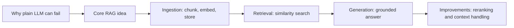
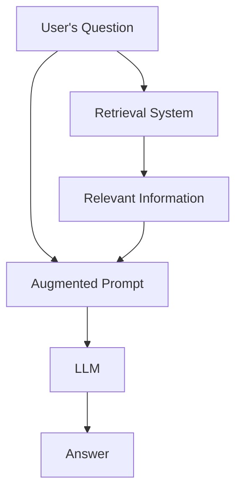
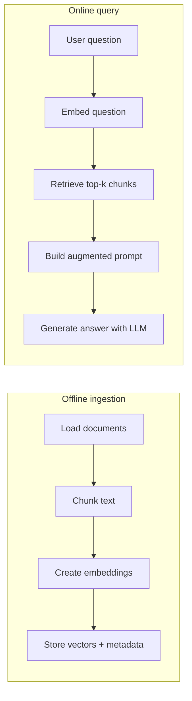
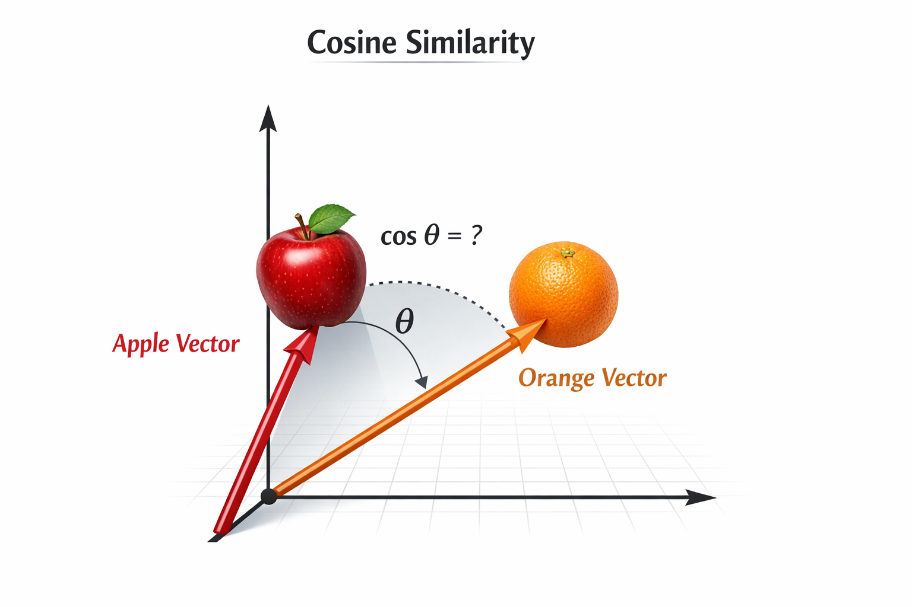
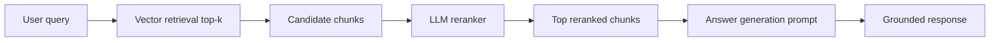

# Introduction to Retrieval-Augmented Generation (RAG)

So far you've seen how to use LLMs to generate text and call tools. But what if you want to build an app that answers questions about a specific domain, such as a company's internal documents or a large knowledge base? In that case, an LLM trained on general data might not have the specific information needed to answer accurately. You could fine-tune a model on your data, but that can be time-consuming and expensive. A practical alternative is Retrieval-Augmented Generation (RAG), where you combine the LLM's general knowledge with your own data to produce better answers.

In this chapter, you will learn how to do the following:

- Understand the core concepts of RAG and how it works.
- Implement a simple RAG system using embeddings and vector databases.
- Explore the limitations of RAG and how to mitigate them.

In the following diagram, you can see the end-to-end learning path we will follow in this chapter.



**Fig 01 - Chapter roadmap from motivation to core RAG improvements.**

## RAG, Retrieval-Augmented Generation

RAG "augments" generation by first "retrieving" relevant information and then combining that information with the user's prompt. Fetching relevant information is called retrieval, and producing the final response is called generation. The overall goal is grounding: anchoring the LLM's answer in real data.

The following diagram shows the basic RAG flow for a single user question.



**Fig 02 - Core RAG flow from user question to grounded answer.**

The user types in the question:

> Tell me about your products at Company X.

To augment this question, the system first retrieves relevant information. The code can look like this:

```python
def format_response(data):
    # format db response to something LLM likes, i.e a string
    formatted_data = ""
    for item in data:
        formatted_data += f"Product Name: {item['name']}\nDescription: {item['description']}\n\n"
    return formatted_data

def retrieve_product_info(question):
     # 1: Retrieve relevant information based on the user's question
    data = data_storage.get(filter=question)
    # 2: Format the retrieved data into a string that the LLM can understand
    return format_response(data)

def handle_user_query(question):
     # 1 & 2 are done in the retrieve_product_info function
    relevant_info = retrieve_product_info(question)
    
    # 3: Create an augmented prompt by combining the relevant information with the user's original question
    augmented_prompt = f"""
    Relevant information:
    {relevant_info}
    Question:
    {question}"""
    
    # 4: Generate an answer using the LLM with the augmented prompt
    answer = llm.generate(augmented_prompt)
    return answer
```

Let's explain our code above:

1. First, we fetch relevant information from our data storage based on the user's question. This could be a vector database, a search engine, or any other retrieval system.
2. Next, we format the retrieved data into a string that the LLM can understand.
3. Third, we create an augmented prompt by combining the relevant information with the user's original question.
4. Finally, we pass the augmented prompt to the LLM to generate a more informed answer.

After being augmented with relevant information, here's how the actual prompt can look being passed to the LLM:

```text
Products:
Product Name: Product A
Description: This is a great product that does X, Y, and Z.
Product Name: Product B
Description: This is another great product that does A, B, and C.
Question:
Tell me about your products at Company X.
```

And the response from the LLM is now something like:

```text
Company X offers two main products: Product A and Product B. Product A is a great product that does X, Y, and Z. Product B is another great product that does A, B, and C.
```

Without this augmentation, the LLM may or may not provide a useful response depending on how well-known the company and its products are.

This is the core RAG loop: retrieve relevant information, augment the user question, and generate a grounded answer.

### Challenge:

In the [GitHub Models playground](https://github.com/marketplace/models/azure-openai/gpt-4-1/playground) or using Ollama, try the following prompts:

> Tell me about the latest iPhone from the company Apple

and for the second prompt, let's make up a company and its products plus a user's question:

> Company SpinIT has two products: SpinIT Pro, a powerful spinning bike for home use, and SpinIT Go, a compact and portable spinning bike. Query: Tell me about your products at Company SpinIT.

Consider the two different responses you get from the LLM for these two prompts. The first one is a straightforward question about a well-known company and its products, while the second one is a question about a made-up company with no prior information available to the LLM. This illustrates the need for RAG when dealing with specific domain knowledge that may not be present in the LLM's training data.

## Ingestion

So far you've seen a simple RAG example where we fetched data from a database based on the user's question. But what if your data consists of text documents, Word files, PDFs, or other unstructured sources? In that case, you first need to ingest this data into a format that can be retrieved and used for augmentation.

The complete RAG pipeline has two phases. During **offline ingestion**, the system prepares source documents through chunking, embedding, and storage. During **online query processing**, it retrieves relevant chunks and uses them to generate an answer.

1. **Chunking**: Break large documents into smaller, manageable pieces called chunks.
2. **Embedding**: Convert those chunks into vector representations that capture their semantic meaning.
3. **Storage**: Save the chunks, embeddings, and useful metadata in a vector store.
4. **Retrieval**: When a question arrives, embed it and use similarity search to find the most relevant stored chunks.
5. **Generation**: Add the retrieved chunks to the prompt and ask the LLM to produce a grounded answer.

The terms used later in the chapter describe either one of these steps or a concrete way to implement it:

| Chapter term | Pipeline phase | Relationship |
| --- | --- | --- |
| Chunking | Ingestion | The conceptual step of dividing a document into chunks. |
| Text splitting | Ingestion | The code or SDK operation that performs chunking. |
| Embedding | Ingestion and query time | Documents are embedded during ingestion; the question is embedded at query time. |
| Vector database | Ingestion and retrieval | Stores chunk embeddings and searches them efficiently. |
| Similarity search | Retrieval | Compares the question embedding with stored chunk embeddings. |
| Generation | Query time | Uses retrieved text to produce the final answer. |

So, for example, **chunking** and **text splitting** are closely related but not competing pipeline stages: chunking is the goal, while a text splitter is the mechanism used to achieve it.

The next diagram separates offline ingestion from online query-time processing.



**Fig 03 - Offline and online phases in a practical RAG pipeline.**

## Ingestion step 1: Chunking

Chunking is the process of breaking large documents into smaller pieces called chunks. This matters because LLMs have a context window limit. Chunking also improves retrieval granularity: instead of returning an entire document, you can return the specific paragraph or section that answers the question.

Take the following text as example:

```text
Company X is a leading technology company that specializes in developing innovative software solutions for businesses. Founded in 2010, Company X has grown rapidly and now serves thousands of clients worldwide. The company's flagship product is a powerful project management tool that helps teams collaborate and stay organized. In addition to its project management software, Company X also offers a range of other products including a customer relationship management (CRM) system, an analytics platform, and a cloud storage solution. With a strong focus on customer satisfaction and continuous innovation, Company X is committed to helping businesses succeed in the digital age.
```

Now if we chunk it into smaller pieces, we might end up with something like this:

```text
Chunk 1:
Company X is a leading technology company that specializes in developing innovative software solutions for businesses. Founded in 2010, Company X has grown rapidly and now serves thousands of clients worldwide.
Chunk 2:
The company's flagship product is a powerful project management tool that helps teams collaborate and stay organized.
Chunk 3:
In addition to its project management software, Company X also offers a range of other products including a customer relationship management (CRM) system, an analytics platform, and a cloud storage solution.
Chunk 4:    
With a strong focus on customer satisfaction and continuous innovation, Company X is committed to helping businesses succeed in the digital age.
```

It matters how you carry out this chunking process, it can have a significant impact on the performance of your RAG system. Here's what you need to consider:

- **Too small**: If chunks are too small or split important context, retrieval quality drops.
- **Preserve semantic meaning**: Chunks should keep ideas intact so retrieval returns coherent context.

So what is the right size for a chunk? It depends on your specific use case and the nature of your documents. However, a common approach is to aim for chunks that are around 500-1000 words in length, as this tends to strike a good balance between preserving semantic meaning and fitting within the LLM's context window. However, this is not a hard rule and you may need to experiment with different chunk sizes to find what works best for your specific use case.

Let's look at common chunking strategies. Pick one that fits your documents and use case. Many SDKs implement these for you, but understanding the trade-offs is still important:

- **Fixed-size chunking**: This is the simplest approach where you break the text into chunks of a fixed size, for example, every 500 words or every 1000 characters. This method is easy to implement but may not always result in semantically meaningful chunks.
- **Semantic chunking**: This approach involves breaking the text into chunks based on its semantic structure, such as paragraphs, sections, or sentences. This can be more effective in capturing the meaning of the text and improving retrieval performance.
- **Overlap chunking**: In this method, you create overlapping chunks to ensure that important information that may be split between two chunks is still captured. For example, you could create chunks of 500 words with an overlap of 100 words.
- **Dynamic chunking**: This approach involves dynamically adjusting the chunk size based on the content of the text. For example, you could create smaller chunks for sections with dense information and larger chunks for sections with less information.
- **Hierarchical chunking**: This method involves creating a hierarchy of chunks, where larger chunks are broken down into smaller sub-chunks. This can be useful for organizing information and improving retrieval performance.
- **Custom chunking**: Depending on your specific use case, you may want to implement a custom chunking strategy that is tailored to the structure and content of your documents.

Now that we understand we need to divide the documents into chunks, we can move on to the next step which is embedding these chunks into vector representations that can be easily retrieved based on similarity.

## Ingestion step 2: Embeddings

What's an embedding? An embedding is a numerical representation of text that captures its semantic meaning. It is typically represented as a high-dimensional vector, where each dimension corresponds to a specific feature or aspect of the text. Here's what such a vector can look like representing for example the text "duck on a boat":

```text
[0.25, 0.1, 0.75, 0.5, ...]
```

Why do we do this? To make text searchable by meaning. Texts with similar meaning tend to have similar embeddings, so they appear close in vector space.

The following diagram represents an apple and an orange as vectors. Cosine similarity compares the angle $\theta$ between those vectors rather than the fruit images or the length of each arrow. A smaller angle produces a cosine value closer to 1, indicating greater similarity. A larger angle produces a lower value. The arrow directions, labels, and angle carry the meaning, so the explanation does not depend on color and remains readable in black and white.

  

**Fig 04 - Cosine similarity between two vectors.**

We'll talk more about how to calculate this similarity later but for now, the important thing to understand is that by converting our text into embeddings, we can easily retrieve relevant information based on the similarity of their embeddings.

Ok, so now we understand we need to divide our text into chunks and then convert it to vectors. How can we do that? Let's cover that next.

### How to generate embeddings?

Most frameworks and libraries that support RAG will have built-in functions to generate embeddings for your text. Let's use Ollama for this task. To carry out the embedding we need to do two things:  

- Ensure we have an AI model capable of generating embeddings. In Ollama, you can use `embeddinggemma` for example.
- Call `embed` to carry out the embedding.

> NOTE: nomic-embed-text is usually also a good choice but at present there seems to be a bug in the model, so for now you can use `embeddinggemma` which is a good alternative.

The actual code for this is straightforward:

```python
import ollama

embeddings = ollama.embed(
  model="embeddinggemma",
  input="Here's a text about cookies"
)
print(len(embeddings['embeddings'][0]))  # vector length
print(embeddings['embeddings'][0][:5])  # first 5 dimensions of the vector
```

Running this text will produce output like so:

```text
768 # vector length
[0.0024980402, 0.034154274, -0.17311984, -0.013325729, 0.037104074] # first 5 dimensions
```

Great, now we've learned how to produce embeddings. Next, let's talk about comparing similarity.

## Query-time step 1: Similarity search

Search is the core of retrieval in RAG. We now know we need embeddings for our text chunks, but how do we actually find relevant chunks? Let's start with a simple approach and then improve it.

1. Loop through all chunks
1. Compare user's prompt in chunk form with chunk embeddings using cosine similarity.
1. Return the most similar chunks based on a similarity threshold or top-k results.

Ok, now that we understand the approach, let's talk more about cosine similarity. 

### Search metrics

There's a few different metrics you can use to compare. Here's an overview of the most common ones:

- **Cosine similarity**: This is the most used metric for comparing embeddings. Mathematically, it ranges from -1 for vectors that point in opposite directions to 1 for vectors that point in the same direction. A value of 0 means the vectors are orthogonal. In many text-embedding models, however, scores tend to occupy a narrower and mostly positive range, so negative scores may be rare in a RAG application. Do not assume that a fixed value such as 0.3 always means "irrelevant." The useful cutoff depends on the embedding model and your data, and should be calibrated with representative relevant and irrelevant queries.
- **Euclidean distance**: This metric measures the straight-line distance between two vectors in the vector space. A smaller distance indicates greater similarity. You want to use this metric when you want to measure the actual distance between two points in the vector space, which can be useful in certain applications where your data has a specific geometric structure like for example in image processing or when working with spatial data.
- **Manhattan distance**: Here, we measure the distance between two vectors by calculating the sum of the absolute differences of their components. Like Euclidean distance, a smaller value indicates greater similarity. The use case for this metric is similar to Euclidean distance, but it can be more robust to outliers in certain situations, as it does not square the differences like Euclidean distance does. The reason why it's called Manhattan distance is that it can be visualized as the distance a car would travel in a grid-like city, where you can only move along streets (i.e., along vector axes).
- **Dot product**: Then finally we have this metric where we measure the similarity between two vectors by calculating the sum of the products of their corresponding components. A higher dot product indicates greater similarity. You want to use this metric when you want to measure the similarity between two vectors in terms of their direction and magnitude, which can be useful in certain applications like natural language processing or when working with high-dimensional data.

Let's dive into cosine similarity as it's the most commonly used metric to see how it works and how to calculate it.

### Cosine similarity

Ok, so we know it's most common one, now let's talk about how to calculate it. The formula for cosine similarity between two vectors A and B is:

```text
cosine_similarity = (A . B) / (||A|| * ||B||)
```

Where:

- A . B is the dot product of vectors A and B.
- ||A|| is the magnitude (length) of vector A.
- ||B|| is the magnitude (length) of vector B.
Here's how you can calculate cosine similarity in Python:

```python
import numpy as np

def cosine_similarity(vecA, vecB):
    dot_product = np.dot(vecA, vecB)
    magnitudeA = np.linalg.norm(vecA)
    magnitudeB = np.linalg.norm(vecB)
    
    if magnitudeA == 0 or magnitudeB == 0:
        return 0.0  # Avoid division by zero
    
    return dot_product / (magnitudeA * magnitudeB)

# Example usage
vecA = np.array([0.25, 0.1, 0.75, 0.5])
vecB = np.array([0.2, 0.15, 0.7, 0.55])
similarity = cosine_similarity(vecA, vecB)
print(similarity)
```

Running this code will:

- Perform a cosine similarity calculation between the two vectors `vecA` and `vecB`.
- Print the resulting similarity score, which will be a value between -1 and 1

The actual value printed from this is `0.994400684888433` which means they are very similar vectors.

Let's use this method on a more concrete example. We'll embed a small list of terms, compare every pair, and print the results. By accepting terms and the model as command-line arguments, the same script also becomes a small experiment you can use to explore an embedding model.

```python
import argparse
from itertools import combinations

import ollama
import numpy as np

def cosine_similarity(vecA, vecB):
    dot_product = np.dot(vecA, vecB)
    magnitudeA = np.linalg.norm(vecA)
    magnitudeB = np.linalg.norm(vecB)
    
    if magnitudeA == 0 or magnitudeB == 0:
        return 0.0  # Avoid division by zero
    
    return dot_product / (magnitudeA * magnitudeB)

parser = argparse.ArgumentParser(description="Compare text embeddings with cosine similarity.")
parser.add_argument("terms", nargs="*", help="Two or more terms to compare.")
parser.add_argument("--model", default="embeddinggemma", help="Ollama embedding model.")
args = parser.parse_args()

terms = args.terms or ["Banana", "Apple", "Fruit", "Car"]
if len(terms) < 2:
    parser.error("provide at least two terms")

embeddings = {
    term: ollama.embed(model=args.model, input=term)['embeddings'][0]
    for term in terms
}

print(f"Model: {args.model}")
for first_term, second_term in combinations(terms, 2):
    similarity = cosine_similarity(embeddings[first_term], embeddings[second_term])
    print(f"Cosine similarity between '{first_term}' and '{second_term}': {similarity}")
```

When you run this code without arguments, it compares the same four default terms: "Banana," "Apple," "Fruit," and "Car." You should see scores that indicate how closely the model places each pair in its embedding space.

You should see the following output:

```text
Model: embeddinggemma
Cosine similarity between 'Banana' and 'Apple': 0.6689234266203115
Cosine similarity between 'Banana' and 'Fruit': 0.7548299346304963
Cosine similarity between 'Banana' and 'Car': 0.6184377022005335
Cosine similarity between 'Apple' and 'Fruit': 0.692591651866445
Cosine similarity between 'Apple' and 'Car': 0.62018379631791
Cosine similarity between 'Fruit' and 'Car': 0.5967101850966948
```

Let's talk through these results:

- The similarity between "Banana" and "Apple" is around 0.67, which indicates that they are somewhat similar, which makes sense since they are both fruits.
- The similarity between "Banana" and "Fruit" is around 0.75, which is higher than the similarity between "Banana" and "Apple", which also makes sense since "Fruit" is a more general term that encompasses "Banana".
- The similarity between "Apple" and "Fruit" is around 0.69, which is also higher than the similarity between "Apple" and "Banana", which again makes sense for the same reason as above.
- The similarity between "Banana" and "Car" is around 0.62, which is lower than the similarity between "Banana" and "Apple", which makes sense since "Car" is not a fruit. It's kind of funny actually, make sure you don't mistakenly take a banana to work.

Now try terms whose meaning depends on context. For example, compare two apple varieties with broader or ambiguous terms:

```powershell
python .\cosine-demo.py "granny smith" "golden delicious" Apple cake "mrs. smith"
```

This produces every pairwise comparison. Look for results that surprise you, then ask what the model may have learned from the ways those phrases appear in its training data. "Granny Smith," for example, can refer to an apple variety, while "Mrs. Smith" points toward a person. The exercise shows why embedding similarity is a model's learned representation, not a dictionary definition.

You can also repeat the experiment with another Ollama embedding model:

```powershell
ollama pull nomic-embed-text
python .\cosine-demo.py --model nomic-embed-text "granny smith" "golden delicious" Apple cake "mrs. smith"
```

Compare the ranking of the pairs rather than expecting identical numeric scores. Each embedding model has its own vector space and score distribution, which is another reason to calibrate retrieval thresholds with your chosen model and real documents.

At this point, we can create embeddings and compare them with cosine similarity. For real documents, the next step is storing chunk embeddings in a vector database, so let's do that next.

## Chunking in practice: Text splitting

Now that you understand how embeddings and similarity search fit together, let's return to the first ingestion step and implement it. Text splitting is the practical implementation of chunking in many SDKs, including LangChain. We'll first use a simple splitter, then move to a structure-aware splitter.

### Simple text splitting

Here's a function that performs text splitting and takes a text and a max chunk size as input and returns a list of chunks:

```python
def text_splitter(text, max_chunk_size=500):
    words = text.split()
    chunks = []
    current_chunk = []
    
    for word in words:
        current_chunk.append(word)
        if len(current_chunk) >= max_chunk_size:
            chunks.append(' '.join(current_chunk))
            current_chunk = []
    
    # Add any remaining words as a final chunk
    if current_chunk:
        chunks.append(' '.join(current_chunk))
    
    return chunks
```

This splitter works when your text is a plain string, but it has drawbacks: it ignores structure, may split important context, and can produce chunks that are too small or too large.

### Markdown text splitting

This text splitter is a bit more advanced as it takes into account the structure of the text, it looks for headings and splits the text based on those. This can help preserve the semantic meaning of the text and improve retrieval performance. Let's use the one from LangChain as an example:

```python
from langchain_text_splitters import MarkdownTextSplitter
def markdown_text_splitter(text, chunk_size=500):
    splitter = MarkdownTextSplitter(chunk_size=chunk_size)
    chunks = splitter.split_text(text)
    return chunks
```

Let's try that on a real markdown document. You can find a sample markdown document in the code folder of this chapter called `sample.md`. Here's how you can use the markdown text splitter on that document:

```python
with open('sample.md', 'r') as file:
    text = file.read()
chunks = markdown_text_splitter(text)
for i, chunk in enumerate(chunks):
    print(f"Chunk {i+1}:\n{chunk}\n")
```

Trying to run this would result in the following output (shortened for readability):

```text
Chunk 1:
# Technical Manual: WidgetX 3000

## Introduction
WidgetX 3000 is a state-of-the-art device designed for efficient data processing and automation. This manual provides installation, configuration, and troubleshooting instructions.

---

## Table of Contents
1. Introduction
2. Installation
3. Configuration
4. Operation
5. Maintenance
6. Troubleshooting
7. Appendix

---

## Installation
### Requirements
- Windows 10 or later
- 4GB RAM minimum
- 500MB free disk space

Chunk 2:
...
```

Now let's combine that with embedding generation and similarity search to see how we can use this for RAG. Given our `sample.md` document, let's prompt it with "What are the requirements for installing WidgetX 3000?" and see if we can locate the relevant information in the document.

Here's the full code to do that:

```python
import ollama
import numpy as np
from langchain_text_splitters import MarkdownTextSplitter

model = "embeddinggemma"

def markdown_text_splitter(text, chunk_size=500):
    splitter = MarkdownTextSplitter(chunk_size=chunk_size)
    chunks = splitter.split_text(text)
    return chunks

def log(str: str):
    print(f"[LOG] {str}")

def cosine_similarity(vecA, vecB):
    dot_product = np.dot(vecA, vecB)
    magnitudeA = np.linalg.norm(vecA)
    magnitudeB = np.linalg.norm(vecB)
    
    if magnitudeA == 0 or magnitudeB == 0:
        return 0.0  # Avoid division by zero
    
    return dot_product / (magnitudeA * magnitudeB)

log("Splitting the text into chunks...")

with open('sample.md', 'r') as file:
    text = file.read()
chunks = markdown_text_splitter(text)
log(f"Created {len(chunks)} chunks.")

# 1. create embeddings for the chunks
log("Creating embeddings for the chunks...")
chunk_embeddings = [ollama.embed(model=model, input=chunk)['embeddings'][0] for chunk in chunks]

# user input
user_question = "What are the requirements for installing WidgetX 3000?"

# 2. embed the user question
log("Embedding the user question...")
question_embedding = ollama.embed(model=model, input=user_question)['embeddings'][0]

# 3. calculate similarity between user question and each chunk
log("Calculating cosine similarity between the user question and each chunk...")
similarities = [cosine_similarity(question_embedding, chunk_embedding) for chunk_embedding in chunk_embeddings]

# 4. find the most similar chunk
most_similar_chunk_index = np.argmax(similarities)
most_similar_chunk = chunks[most_similar_chunk_index]

# 5. print the most similar chunk and its similarity score
print(f"Most similar chunk:\n{most_similar_chunk} with similarity {similarities[most_similar_chunk_index]}")
```

Here's what this code does, it:

1. Reads the markdown document and splits it into chunks using the `markdown_text_splitter`.
2. Creates embeddings for each chunk using the specified model.
3. Embeds the user's question using the same model.
4. Calculates the cosine similarity between the user's question embedding and each chunk embedding.
5. Finds the chunk with the highest similarity and prints it out along with the similarity score.

When you run this code, you should see output that shows the most similar chunk from the markdown document based on the user's question, in fact, the output should look like so:

```text
[LOG] Splitting the text into chunks...
[LOG] Created 6 chunks.
[LOG] Creating embeddings for the chunks...
[LOG] Embedding the user question...
[LOG] Calculating cosine similarity between the user question and each chunk...
Most similar chunk:
---

## Installation
### Requirements
- Windows 10 or later
- 4GB RAM minimum
- 500MB free disk space

### Steps
1. Unpack the WidgetX 3000.
2. Connect the device to your computer via USB.
3. Install the WidgetX driver from the provided CD.

#### Driver Installation
- Insert the CD.
- Run `setup.exe`.
- Follow on-screen instructions.

---

## Configuration
### Initial Setup
- Launch the WidgetX Control Panel.
- Select 'Initialize Device'. with similarity 0.7321856546851474 
```

If we highlight the interesting part of the response, we see that the most similar chunk contains the relevant information i.e how to install the WidgetX 3000 and the requirements for installing it:

```text
## Installation
### Requirements
- Windows 10 or later
- 4GB RAM minimum
- 500MB free disk space
```

What other splitters are there? We mentioned some of these before in our chunking section but here's some interesting ones again:

- **Recursive Character Text Splitter**: This splitter recursively splits text based on a list of separators, starting with the most specific ones (like "\n\n\n") and moving to more general ones (like " "). This can help preserve the structure of the text while ensuring that chunks fit within the specified size.
- **Nltk Text Splitter**: This splitter uses the Natural Language Toolkit (nltk) to split text into sentences or paragraphs. This can be useful for preserving the semantic meaning of the text and improving retrieval performance.

It's worth trying a few different splitters to see which one works best for your specific use case and the structure of your documents. The choice of splitter can have a significant impact on the performance of your RAG system, so it's important to experiment and find the one that works best for you.

So far we've covered splitting and embedding. Next, let's store vectors for efficient retrieval.

## Ingestion step 3: Vector storage

Assume we've chosen a text splitter and generated embeddings. We now need storage optimized for high-dimensional vectors and similarity search: a vector database. Popular options include:

- **Pinecone**: A fully managed vector database that provides fast and scalable storage and retrieval of embeddings. It offers features like real-time indexing, similarity search, and integration with popular machine learning frameworks.
- **Weaviate**: An open-source vector search engine that allows you to store and search through large collections of embeddings. It supports various data types and provides a GraphQL API for querying.
- **FAISS**: A library developed by Facebook AI Research that provides efficient similarity search and clustering of dense vectors. It can be used for both CPU and GPU-based indexing and searching.
- **PostgreSQL with pgvector**: An extension for PostgreSQL that adds support for vector data types and similarity search. It allows you to store embeddings in a relational database and perform efficient similarity queries using SQL.

There are many more as this is quickly becoming a hot area, so make sure to do your research and find the one that best fits your needs in terms of features, scalability, and ease of use.

Let's start with an in-memory vector store to learn the fundamentals and inspect stored data easily.

### In-memory vector store

For this, let's use the in-memory option from LangChain which is a simple implementation of a vector store, it's stored as JSON. Here's what the code looks like if we just focus on the storage part:

```python
from langchain_core.vectorstores import InMemoryVectorStore
from langchain_ollama import OllamaEmbeddings
from langchain_text_splitters import MarkdownTextSplitter

embeddings = OllamaEmbeddings(model=model)
vector_store = InMemoryVectorStore(embeddings)

 # split sample.md
with open('sample.md', 'r') as file:
    text = file.read()

# run text splitter
chunks = MarkdownTextSplitter(chunk_size=500).split_text(text)
log(f"Split document into {len(chunks)} chunks")

# Add chunks to vector store (embeddings created automatically)
log("Adding chunks to the vector store...")
vector_store.add_texts(chunks)
```

Adding embeddings to the vector store is straightforward: call `add_texts` with the chunks.

```python
vector_store.add_texts(chunks)
```

A full example of how to use the in-memory vector store along with text splitting, embedding generation, and similarity search looks like this:

```python
from langchain_core.vectorstores import InMemoryVectorStore
from langchain_ollama import OllamaEmbeddings
from langchain_text_splitters import MarkdownTextSplitter
import os

model = "embeddinggemma"
vector_store_path = "vector_store.json"

def log(msg: str):
    print(f"[LOG] {msg}")

# 1. Create embeddings using Ollama
embeddings = OllamaEmbeddings(model=model)

# 2. Load existing vector store or create new one
if os.path.exists(vector_store_path):
    log(f"Loading vector store from {vector_store_path}...")
    vector_store = InMemoryVectorStore.load(vector_store_path, embeddings)
else:
    log("Creating new vector store...")
    vector_store = InMemoryVectorStore(embeddings)

    # split sample.md
    with open('sample.md', 'r') as file:
        text = file.read()

    # 3. run text splitter
    chunks = MarkdownTextSplitter(chunk_size=500).split_text(text)
    log(f"Split document into {len(chunks)} chunks")

    # Add chunks to vector store (embeddings created automatically)
    log("Adding chunks to the vector store...")
    vector_store.add_texts(chunks)
    
    # Save to disk
    log(f"Saving vector store to {vector_store_path}...")
    vector_store.dump(vector_store_path)

# user prompt
prompt = "What are the requirements for installing WidgetX 3000?"
log(f"Query: {prompt}")

# Set minimum similarity threshold (0-1, higher = more strict)
threshold = 0.7

# search for the most similar chunk (embedding + search done automatically)
log("Searching for the most similar chunk...")
results = vector_store.similarity_search_with_score(prompt, k=1)

doc, score = results[0]
if score >= threshold:
    log(f"Most similar chunk (similarity: {score:.4f}):")
    print(doc.page_content)
else:
    log(f"No relevant chunk found (best score: {score:.4f} < threshold: {threshold})")
```

We're doing a few things here, so let's break it down:

1. Create embeddings using Ollama.

   ```python
   embeddings = OllamaEmbeddings(model=model)
   ```
   
2. Load an existing vector store from disk if it exists, otherwise create a new one.
 
    ```python
    if os.path.exists(vector_store_path):
       log(f"Loading vector store from {vector_store_path}...")
       vector_store = InMemoryVectorStore.load(vector_store_path, embeddings)
    ```

3. If creating a new vector store, we read the markdown document, split it into chunks, and add those chunks to the vector store (which automatically creates embeddings for them).

   ```python
    with open('sample.md', 'r') as file:
        text = file.read()

    chunks = MarkdownTextSplitter(chunk_size=500).split_text(text)
    log(f"Split document into {len(chunks)} chunks")

    log("Adding chunks to the vector store...")
    vector_store.add_texts(chunks)
   ```
   

4. Save the vector store to disk for future use.

    ```python
     log(f"Saving vector store to {vector_store_path}...")
     vector_store.dump(vector_store_path)
    ```

5. Take a user prompt and search for the most similar chunk in the vector store based on cosine similarity.

   ```python
   log("Searching for the most similar chunk...")
   results = vector_store.similarity_search_with_score(prompt, k=1)
   ```

6. Check if the similarity score meets a specified threshold and print the most similar chunk if it does, otherwise indicate that no relevant chunk was found.

   ```python
    doc, score = results[0]
    if score >= threshold:
        log(f"Most similar chunk (similarity: {score:.4f}):")
        print(doc.page_content)
    else:
        log(f"No relevant chunk found (best score: {score:.4f} < threshold: {threshold})")
   ```
   
> TIP: it's recommended to store your vector store so you don't have to re-ingest your data every time you want to run a query. In fact, ingestion is a completely different process from retrieval and generation, you can think of it as a separate step that you only need to do when your data changes.

Right now, we haven't spent much time thinking about metadata, but in a real application you would want to store metadata along with your chunks and embeddings. By storing metadata, you can add additional context to your chunks that can be used for filtering and improving retrieval performance. For example, you could store:

- **Source information**: You could store the source of the chunk, such as the document it came from or the date it was created. This can help you filter chunks based on their source or age.
- **Chunk position**: You could store the position of the chunk within the original document, this can help you understand the context of the chunk and improve retrieval performance. This could also help indicate visually in an app where the retrieved information is located in the original document.
- **Custom tags**: You could allow users to add custom tags to chunks, this can help with organization and retrieval. For example, you could allow users to tag chunks with keywords or categories that are relevant to their use case.

The key point is to decide which metadata will improve retrieval quality and explainability in your app.

Here's a simple example where we just store the source document and the chunk index as metadata:

```python
source_file = "sample.md"
metadatas = [
    {"source": source_file, "chunk_index": i} 
    for i in range(len(chunks))
]

# Add chunks to vector store with metadata
log("Adding chunks to the vector store...")
vector_store.add_texts(chunks, metadatas=metadatas)
```

If we were ingesting several files, and we just wanted to search for `sample.md` for example, we could then filter our search like so:

```python
# search for the most similar chunk from sample.md
log("Searching for the most similar chunk from sample.md...")
results = vector_store.similarity_search_with_score(
    prompt, 
    filter={"source": "sample.md"}, 
    k=1
)
```

By filtering, we can improve accuracy and performance by only searching through relevant chunks. 

How is this stored then? Well, we chose to persist the embeddings to a JSON file, so here's what an entry can look like:

```json
"vector": [...]
"text": "# Technical Manual: WidgetX 3000\n\n## Introduction\nWidgetX 3000 is a state-of-the-art device designed for efficient data processing and automation. This manual provides installation, configuration, and troubleshooting instructions.\n\n---\n\n## Table of Contents\n1. Introduction\n2. Installation\n3. Configuration\n4. Operation\n5. Maintenance\n6. Troubleshooting\n7. Appendix\n\n---\n\n## Installation\n### Requirements\n- Windows 10 or later\n- 4GB RAM minimum\n- 500MB free disk space",
"metadata": {
    "source": "sample.md",
    "chunk_index": 0
}
```

What you see from this stored entry is the following information:

- The `vector` field contains the embedding for the chunk, which is a high-dimensional vector representation of the text.
- The `text` field contains the actual text of the chunk that was split from the original document.
- The `metadata` field contains additional information about the chunk, in this case, the source document and the chunk index, which can be useful for filtering and understanding the context of the chunk during retrieval.

This is the key pattern: store chunks and embeddings in a vector database so they are searchable. A full database improves scalability and performance, but the core principles are the same as what we've covered here.

Now let's look at a database-backed option so you can see how this works beyond in-memory storage.

Popular choices here are as we mentioned before Pinecone, Weaviate, FAISS and PostgreSQL with pgvector. It's also possible to use sqlite if you want a simple file-based database solution, there are libraries like `sqlite-vector` that add vector support to sqlite. In fact, let's see a quick example of how to use `sqlite-vector` next.

### Using sqlite-vector for vector storage

> NOTE: `sqlite-vector` needs you to type a bit, it's not as plug and play as other solutions but it shows what goes on under the hood and it's a good option if you want a simple file-based solution without having to set up a separate database server.

Here's the plan:

1. Split the text into chunks using the markdown text splitter.
2. Create embeddings for each chunk using Ollama.
3. Store the chunks and their embeddings in a sqlite database using `sqlite-vector`.

For retrieval, we would then:    

1. Embed the user's query using the same model.
1. Use `sqlite-vector` to perform a similarity search based on cosine similarity and retrieve the most relevant chunks.
1. Use the retrieved chunks to generate a response or answer the user's query.

#### Ingestion

Let's look at the main ingestion step. In this step, we create the database and a table for storing embeddings and metadata. We also split text, embed it, and store it in the table.

Here's the code to do that:

```python
# Main execution
log("Connecting to SQLite vector database...")
db = create_db()

# Check if we need to ingest data
if get_chunk_count(db) == 0:
    log("Database empty, ingesting document...")
    
    # Split sample.md
    source_file = "sample.md"
    with open(source_file, 'r') as file:
        text = file.read()
    
    # Run text splitter
    chunks = MarkdownTextSplitter(chunk_size=500).split_text(text)
    log(f"Split document into {len(chunks)} chunks")
    
    # Add chunks to database
    log("Adding chunks to vector database...")
    for i, chunk in enumerate(chunks):
        add_chunk(db, chunk, source_file, i)
        log(f"  Added chunk {i+1}/{len(chunks)}")
    
    log("Ingestion complete!")
else:
    log(f"Database already contains {get_chunk_count(db)} chunks")
```

In this code, we've:

- Connected to the sqlite database using a helper function `create_db()`.
- Checked if the database is empty by counting the number of chunks stored using `get_chunk_count(db)`.
- If the database is empty, we read the markdown document, split it into chunks, and add each chunk to the database along with its metadata (source file and chunk index) using the `add_chunk` function.
- Logged the progress of the ingestion process.
- If the database already contains chunks, we simply log the count and skip the ingestion step.

What about the retrieval part then? Here's how you can perform a similarity search using `sqlite-vector`:

```python
# Retrieval example

# User prompt
prompt = "What are the requirements for installing WidgetX 3000?"
log(f"Query: {prompt}")

# Set minimum similarity threshold
threshold = 0.7

# Search for similar chunks
log("Searching for similar chunks...")
results = similarity_search(db, prompt, top_k=1)

if results:
    chunk_id, content, source, chunk_index, distance = results[0]
    # Convert cosine distance to similarity (distance 0 = identical, 2 = opposite)
    # Cosine similarity = 1 - distance
    similarity = 1 - distance
    
    if similarity >= threshold:
        log(f"Most similar chunk (similarity: {similarity:.4f}):")
        log(f"Source: {source}, Chunk: {chunk_index}")
        print(content)
    else:
        log(f"No relevant chunk found (best similarity: {similarity:.4f} < threshold: {threshold})")
else:
    log("No results found")
```

In this sample, we're:

- Taking a user prompt and logging it.
- Setting a minimum similarity threshold to filter results.
- Performing a similarity search in the database using the `similarity_search` function, which returns the most similar chunks based on cosine distance.
- Converting the cosine distance to similarity and checking if it meets the threshold. If it does, we log the most similar chunk along with its source and index, and print the content. If not, we log that no relevant chunk was found.
- If no results are returned from the search, we log that as well.

> NOTE: we've omitted code where we create the database, the table and the helper functions for adding chunks and performing similarity search for brevity, but you can find the full code in the `vector-sqlite-demo.py` file in the code folder of this chapter.

To see the full sample, [check it out here](./code/vector-sqlite-demo.py).

Now that we've seen the solution, we may want to go towards a solution where you type less or you may have other needs like scalability, in that case, you can look into Chroma, Pinecone, Weaviate, FAISS or PostgreSQL with pgvector as we mentioned before. Let's cover Chroma next as it's a popular open-source vector database and it has a nice Python SDK that makes it easy to use.

### Chroma, a popular open-source vector database

So, what is Chroma? Chroma is an open-source vector database that provides efficient storage and retrieval of embeddings. It offers features like:

- **Real-time indexing**: Chroma allows you to add new embeddings to the database in real-time, which means you can update your vector store without having to rebuild it from scratch.
- **Similarity search**: Chroma provides efficient similarity search capabilities, allowing you to quickly retrieve the most relevant embeddings based on cosine similarity or other distance metrics.
- **Integration with machine learning frameworks**: Chroma can be easily integrated with popular machine learning frameworks like TensorFlow and PyTorch, making it a great choice for building RAG systems.
- **Ease of use**: Chroma provides a simple and intuitive Python SDK, making it easy to integrate into your existing workflows and applications.

It's fair to say that Chroma is a bit more "batteries included" type solution. What we don't get though is embeddings, so we need an external library to handle that. For that, we can use for example "sentence-transformers". Sentence transformers are a type of model that is specifically designed to create embeddings for sentences and paragraphs, they are based on transformer architectures and are trained on large datasets to capture the semantic meaning of text. As you can see, you don't also have to use Ollama for embeddings, you can use any embedding model you like, the important thing is that you use the same model for both creating embeddings for your chunks and for embedding the user's query to ensure your comparison is done correctly. 

Let's have a look at the ingestion code next. 

#### Step 1: Set up the Chroma client and collection

The first step consists of setting up the Chroma client and creating a collection for storing our embeddings.

```python
import chromadb
from chromadb.config import Settings
from sentence_transformers import SentenceTransformer
import uuid

DB_DIR = Path(__file__).resolve().parent / "chroma_db"

# 1. Create Chroma client (persistent)
print("✅ Creating client")
client = chromadb.PersistentClient(
    path=str(DB_DIR),
    settings=Settings(anonymized_telemetry=False),
)
  
# 2. Create a collection using COSINE similarity
collection = client.get_or_create_collection(
    name="docs",
    metadata={"hnsw:space": "cosine"}  # ✅ cosine similarity
)

# 3. Load embedding model
embedder = SentenceTransformer("all-MiniLM-L6-v2")
```

At this point, we've initialized the Chroma client and either retrieved an existing collection or created a new one. We've also set up a sentence transformer model for generating embeddings. Let's move on to the next step, which is ingesting our document into the Chroma collection.

#### Step 2: Ingest a document into the Chroma collection

```python
# Example documents (normally PDFs, markdown, etc.)
documents = [
    "ChromaDB is a vector database for embeddings.",
    "RAG stands for Retrieval-Augmented Generation.",
    "Cosine similarity measures the angle between vectors.",
    "LLMs can hallucinate without grounding."
]

# 4. Chunking (simplified)
chunks = documents  # assume already chunked

# 5. Embed and insert
embeddings = embedder.encode(chunks).tolist()

collection.add(
    ids=[str(uuid.uuid4()) for _ in chunks],
    documents=chunks,
    embeddings=embeddings
)

print("✅ Ingestion complete")
```

In the above code, we've:

- Created a list of example documents (in a real application, you would read and chunk your actual documents).
- Generated embeddings for each chunk using the sentence transformer model calling `embedder.encode(chunks)`.
- Added the chunks, their corresponding embeddings, and unique IDs to the Chroma collection using `collection.add()`.
- Stored the collection through `PersistentClient`, which writes changes to the configured `DB_DIR` automatically without a separate persistence call.

This concludes the ingestion step. The next step is to show retrieval from the Chroma collection based on a user query.

> NOTE: The first time you run this example, the embedding model will be downloaded from Hugging Face. This can take a few minutes depending on your network connection. Subsequent runs reuse the cached model and start much faster.

> TIP: Windows note: While ChromaDB works cross‑platform, running it in embedded mode on Windows can occasionally lead to native crashes due to low‑level indexing libraries.
> For a more reliable setup (especially for learning and demos), we recommend running ChromaDB via Docker and connecting to it over HTTP. This avoids platform‑specific issues and matches how Chroma is commonly deployed in production.

```sh
docker run -p 8000:8000 chromadb/chroma
```

```python
client = chromadb.HttpClient(host="localhost", port=8000)
```

Chroma differs from in-memory and basic sqlite approaches because it uses HNSW, an algorithm optimized for fast similarity search in high-dimensional spaces. In practice, this pays off as your chunk count grows. If you only have a few hundred chunks, simpler storage can still be a good fit.

#### Step 3: Retrieve from the Chroma collection

Ok, the next step is to perform a search. 

We need to ensure we use the same embedding model to embed the user's query and then perform a similarity search in the Chroma collection to retrieve the most relevant chunks based on cosine similarity. Here's how you can do that:

```python
from pathlib import Path

import chromadb
from chromadb.config import Settings
from sentence_transformers import SentenceTransformer

DB_DIR = Path(__file__).resolve().parent / "chroma_db"

print("✅ Creating client")
client = chromadb.PersistentClient(
    path=str(DB_DIR),
    settings=Settings(anonymized_telemetry=False),
)

collection = client.get_or_create_collection(
    name="docs",
    metadata={"hnsw:space": "cosine"}  # ✅ cosine similarity
)

# Load the same embedding model
embedder = SentenceTransformer("all-MiniLM-L6-v2")

def retrieve(query: str, k: int = 3):
    if collection.count() == 0:
        return []

    query_embedding = embedder.encode(query).tolist()

    results = collection.query(
        query_embeddings=[query_embedding],
        n_results=k
    )

    documents = results["documents"][0]
    distances = results["distances"][0]
    ids = results["ids"][0]

    return [
        {"rank": index + 1, "id": doc_id, "distance": distance, "document": document}
        for index, (doc_id, distance, document) in enumerate(zip(ids, distances, documents))
    ]

# Example query
query = "What is cosine similarity used for?"

print("✅ Running retrieval...")
print(f"✅ Looking in: {DB_DIR}")
print(f"✅ Collection contains {collection.count()} documents.")
retrieved_docs = retrieve(query)

print("🔍 Retrieved context:")
if not retrieved_docs:
    print("- No documents found. Run vector-chroma-ingest.py first.")
for result in retrieved_docs:
    print(f"- rank={result['rank']} distance={result['distance']:.4f} id={result['id']}")
    print(f"  {result['document']}")

if retrieved_docs:
    best_match = retrieved_docs[0]
    print("\n✅ Most relevant document:")
    print(f"- id={best_match['id']} distance={best_match['distance']:.4f}")
    print(f"  {best_match['document']}")
```


In the above code, we've:

- Defined a `retrieve` function that takes a user query and the number of top results to return (k).
- Embedded the user query using the same sentence transformer model to ensure consistency with the embeddings stored in the Chroma collection.
- Performed a similarity search in the Chroma collection using the `collection.query()` method, which returns the most relevant documents based on cosine similarity.
- Processed the results to extract the documents, their corresponding distances (similarity scores), and their IDs.
- Printed the retrieved documents along with their ranks and similarity scores, and highlighted the most relevant document based on the lowest distance (highest similarity).

Running this code, you should see an output similar to:

```text
✅ Running retrieval...
✅ Looking in: C:\Users\chnoring\Documents\books\agentic-book\Chapter-06-RAG\code\chroma_db
✅ Collection contains 4 documents.
🔍 Retrieved context:
- rank=1 distance=0.1601 id=9c1135fd-f0f4-4bce-a21d-2c77d146ff22
  Cosine similarity measures the angle between vectors.
- rank=2 distance=0.7868 id=728ce03f-9d1c-416f-8fb1-44c4949f3e9a
  ChromaDB is a vector database for embeddings.
- rank=3 distance=0.7893 id=4d0ff6b0-daa2-47ff-8a59-911969ffcdb6
  RAG stands for Retrieval-Augmented Generation.
```

## Improving RAG with LLMs

After retrieval, LLMs can improve quality before producing the final answer.

The following diagram shows where reranking fits between retrieval and answer generation.



**Fig 05 - Retrieval-to-reranking-to-generation flow for higher-quality responses.**

Here's what you can do to improve your RAG system with LLMs:

- **Reranking**: After retrieving the most similar chunks based on cosine similarity, you can use an LLM to rerank these chunks based on their relevance to the user's query. 
- **Answer generation**: Instead of just returning the most similar chunk, you can use an LLM to generate a more comprehensive answer based on the retrieved chunks. This can help provide a better user experience by giving more complete and coherent responses.
- **Contextual understanding**: LLMs can help understand the context of the user's query and the retrieved chunks, which can improve the relevance of the results. For example, if the user's query is ambiguous, an LLM can help disambiguate it based on the context of the retrieved chunks.
- **Handling out-of-distribution queries**: If a user's query is very different from the content in your vector store, the system can detect the weak retrieval result and either ask the user to clarify or provide a clearly labeled general-knowledge answer. This prevents the model from presenting unsupported information as if it came from your documents.

### Reranking example

Let's say the user's prompt is the following:

> "What are the requirements for installing WidgetX 3000 and how does it compare to WidgetX 2000?"

The chunks retrieved by cosine similarity might look like this:

```text
Rating: 0.73
Chunk 1:
## Installation
### Requirements
- Windows 10 or later
- 4GB RAM minimum
- 500MB free disk space
- Unpack the WidgetX 3000.
```

```text
Rating: 0.65
Chunk 2:
## WidgetX 2000 Overview
WidgetX 2000 is the predecessor to WidgetX 3000, offering basic data processing capabilities. It has lower performance compared to WidgetX 3000 and lacks some of the advanced features, but it is still a reliable option for simpler tasks.
```

```text
Rating: 0.60
Chunk 3:
Installation steps if you choose WidgetX 2000 with similar requirements to WidgetX 3000, but with some differences in the driver installation process.

...
```

If we only looked at the initial score, we would pick chunk 1. But with reranking, an LLM can better handle multi-part intent and may elevate chunk 2 because it directly addresses the comparison request.

To do reranking, add one extra LLM call with a prompt like this:

```python
prompt = 
""" 
Given the following user query and retrieved chunks, rerank the chunks based on their relevance to the query. 

Query: {user_query}
Chunks:

{chunk1} 

{chunk2}

{chunk3}
""""
```

### Answer generation example

Answer generation is another technique for improving RAG with LLMs. Instead of just returning the most similar chunk, you can use an LLM to create a better and more comprehensive answer. It could look something like this:

```python    
prompt = 
"""
Given the following user query and retrieved chunks, generate a comprehensive answer to the user's query based on the information in the chunks.

Query: {user_query}
Chunks:
{chunk1}

{chunk2}

{chunk3}
"""
```

Here we're not just selecting chunks; we're synthesizing them into a more complete answer.


### Contextual understanding example

Contextual understanding is another improvement. If a query is ambiguous, an LLM can clarify intent using retrieved context.

For example, if the user's query is "What are the requirements for installing WidgetX?" and we have two chunks that are retrieved with similar cosine similarity scores, one about WidgetX 3000 and one about WidgetX 2000, an LLM can help determine which chunk is more relevant based on the context of the query and the information in the chunks. Here's what such a prompt might look like:

```python
prompt = 
"""
Given the following user query and retrieved chunks, determine which chunk is more relevant to the user's query based on the context of the query and the information in the chunks.
Query: {user_query}
Chunks:

{chunk1}

{chunk2}
"""
```

What is the difference from reranking? Reranking reorders candidate chunks. Contextual understanding resolves ambiguity in the user intent itself.

It might sound like "relevant" and "context" are the same thing, but they can be different. Let's take a completely different example to illustrate this. Let's say the user's query is "What are the health benefits of apples?" and we have two chunks that are retrieved with similar cosine similarity scores, one about the nutritional content of apples and one about the history of apple cultivation.

- **Relevance**: Both chunks might be relevant to the user's query because they both contain information about apples, but in different ways. The chunk about nutritional content is directly relevant to health benefits, while the chunk about apple cultivation history is less direct.
- **Context**: The chunk about the nutritional content of apples provides context that is directly related to the user's query about health benefits, while the chunk about the history of apple cultivation provides context that is less directly related to the user's query.

Therefore, asking for "relevance" alone might not be enough to determine which chunk is more useful for answering the user's query, while asking for "context" can help provide a deeper understanding.

### Handling out-of-distribution queries example

An out-of-distribution query falls outside the subject matter represented in the vector store. For example, imagine that our store contains only the WidgetX technical manual and the user asks:

> What is the weather in Paris today?

The retriever may still return a WidgetX chunk because vector search always finds a nearest candidate. However, a best match is not necessarily a relevant match. If its score falls below the threshold, the application should treat the query as unsupported rather than send unrelated context to the LLM.

Let's add a prompt that gives the model an explicit fallback path:

```python
if best_similarity < threshold:
    prompt = f"""
    The available knowledge base does not contain enough information to answer
    the user's question.

    Question: {user_question}

    Explain that the question is outside the knowledge base. Do not claim that
    your answer came from the retrieved documents. If appropriate, ask the user
    to rephrase the question so it relates to WidgetX.
    """
else:
    prompt = f"""
    Answer the question using only the retrieved context.

    Context:
    {retrieved_context}

    Question: {user_question}
    """
```

This branch adds two important behaviors:

- A low retrieval score becomes a signal that the knowledge base may not cover the question.
- The model clearly separates an unsupported request from an answer grounded in retrieved documents.

For the weather question, an expected response would be: "The WidgetX knowledge base does not contain current weather information. Please ask a question about WidgetX, or use a weather service for live conditions." In a production system, you could also route this request to a weather tool, but you should not disguise general model knowledge as retrieved evidence.

## Assignment

Let's build a web app that does the following:

- Displays the content of `sample.md` in a user-friendly way.
- Has a search bar where users can input questions about the content of `sample.md`.
- Indicates visually where in the document the retrieved information is located, for example by highlighting the relevant section or showing the chunk index.

## Solution

[Solution](./assignment/README.md)

## Summary

In this chapter, we followed both phases of a RAG pipeline. During ingestion, we split documents into chunks, created embeddings, and stored them in a vector database. At query time, we embedded a question, retrieved relevant chunks with similarity search, and used an LLM to generate a grounded answer. We also explored reranking, contextual understanding, and a threshold-based fallback for queries that the knowledge base does not cover. Finally, the assignment brings these concepts together in a web app that makes the retrieved source visible to the user.

In the next chapter, we'll cover more advanced approaches such as Agentic RAG, Graph RAG, and multimodal RAG. The baseline approach in this chapter is strong, but more complex use cases often need these additional techniques.