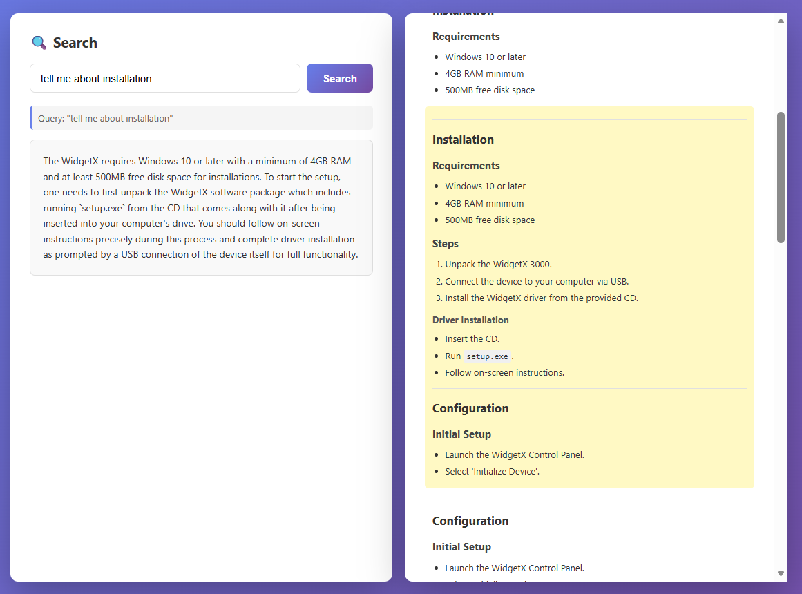

# Chapter 06 - RAG Assignment

This assignment is a small Retrieval-Augmented Generation (RAG) app available in Python and JavaScript. Both implementations use Ollama to retrieve relevant content and generate a grounded answer.

Choose the runtime that best fits your learning path:

- **Python**: Continue with the FastAPI implementation described below.
- **JavaScript**: Follow the [JavaScript assignment instructions](./js/README.md) for the Express implementation.

The rest of this page covers the Python version.

It does the following:
- Ingests `docs/sample.md` into an in-memory vector store and persists metadata to `vector_store_metadata.json`
- Exposes API endpoints for chunk listing and semantic search
- Streams model responses back to the browser UI

## Prerequisites

- Python 3.10+
- [Ollama](https://ollama.com/) installed and running locally
- Required Ollama models pulled:
	- `embeddinggemma` (embeddings)
	- `phi3:mini` (answer generation)

## Install

From this folder (`Chapter-06-RAG/assignment`):

### Option A: using uv (recommended)

```bash
uv sync
```

### Option B: using pip

```bash
python -m venv .venv
# Windows PowerShell
.venv\Scripts\Activate.ps1

pip install -e .
```

## Setup

1. Start Ollama if it is not already running.
2. Pull the required models:

```bash
ollama pull embeddinggemma
ollama pull phi3:mini
```

3. (Optional) Force a fresh ingest by deleting the local vector store file:

```bash
rm vector_store_metadata.json
```

PowerShell equivalent:

```powershell
Remove-Item .\vector_store_metadata.json -ErrorAction SilentlyContinue
```

## Run

From `Chapter-06-RAG/assignment`:

### Run with uv

```bash
uv run api.py
```

### Run with Python

```bash
python api.py
```

The app starts at:

- `http://localhost:8002`

On startup, the app ingests or loads the vector store automatically.

You should see the following user interface, where the search is loaded on the left and the document on the right:



## API Endpoints

- `GET /` - serves `index.html`
- `GET /api/chunks` - returns all markdown chunks
- `POST /api/search` - retrieves best matching chunk and streams generated answer

Example request:

```bash
curl -X POST http://localhost:8002/api/search \
	-H "Content-Type: application/json" \
	-d '{"prompt":"What are the requirements for installing WidgetX 3000?"}'
```

## Troubleshooting

- `Connection refused` or model errors:
	- Ensure Ollama is running.
	- Ensure both models are pulled.

- Wrong or stale retrieval results:
	- Delete `vector_store_metadata.json` and restart the app.

- Port already in use:
	- Stop the process using port `8002`, or run with uvicorn on another port.
