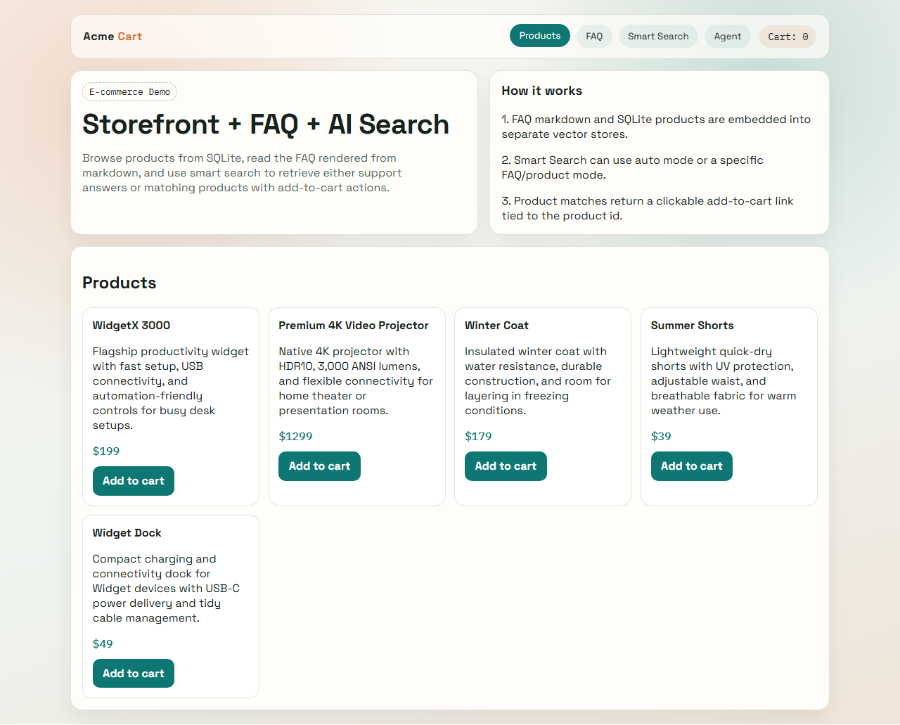
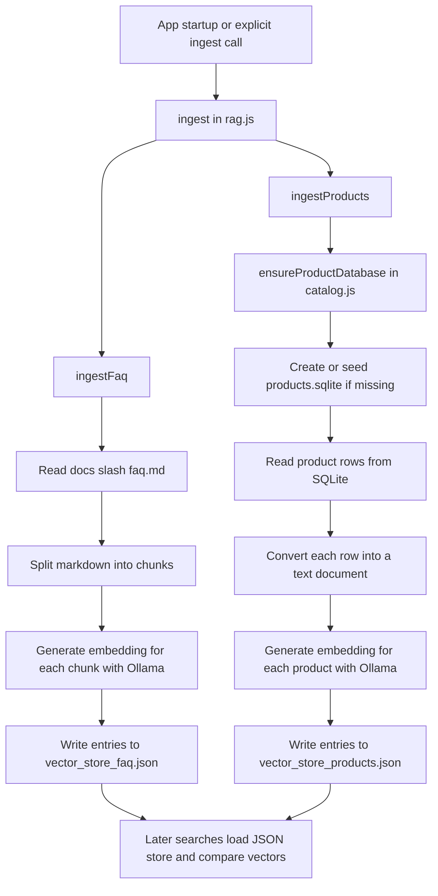

# RAG - JavaScript

JavaScript port of the RAG (Retrieval-Augmented Generation) assignment using [Ollama](https://ollama.com/).



## Prerequisites

- [Node.js](https://nodejs.org/) 18+
- [Ollama](https://ollama.com/) installed and running locally
- Required Ollama models pulled:
  - `embeddinggemma` (embeddings)
  - `phi3:mini` (chat generation)

## Install

From this folder (`Chapter-06-RAG/assignment/js`):

```bash
npm install
```

## Setup

1. Start Ollama if it is not already running.
2. Pull the required model:

```bash
ollama pull embeddinggemma
```

1. (Optional) Choose which markdown file to ingest by setting `RAG_SOURCE_DOC`.

PowerShell:

```powershell
$env:RAG_SOURCE_DOC = "faq.md"
```

If not set, the default is `faq.md`.

1. (Optional) Choose chat model for answer generation:

```powershell
$env:RAG_CHAT_MODEL = "phi3:mini"
```

1. (Optional) Force a fresh ingest by deleting the vector store file:

```bash
# PowerShell
Remove-Item ..\vector_store_faq.json -ErrorAction SilentlyContinue
Remove-Item ..\vector_store_products.json -ErrorAction SilentlyContinue
```

## Ingestion

The ingestion step runs in `rag.js` through `ingest()`, which calls `ingestFaq()` and `ingestProducts()` in parallel.

For FAQ data, `rag.js` reads `../docs/<RAG_SOURCE_DOC>`, splits the markdown into paragraph-based chunks of about 500 characters, sends each chunk to Ollama's embedding model, and stores the result in `../vector_store_faq.json`.

For product data, `catalog.js` first ensures `products.sqlite` exists and seeds it with five sample products if needed. `rag.js` then loads each row from SQLite, converts each product into a small markdown-like document, generates one embedding per product, and stores the result in `../vector_store_products.json`.

Both JSON files are persisted as object maps keyed by a UUID. Each stored entry contains:

- `id`: the UUID key for the stored chunk or product document
- `vector`: the embedding returned by Ollama
- `text`: the original text used to generate the embedding
- `metadata`: source and indexing details used for retrieval and freshness checks

Before rebuilding a store, `rag.js` checks whether the existing JSON file is still fresh. It compares the stored metadata against the current source file or SQLite database using:

- `source`
- `source_type`
- `chunking_version`
- `source_mtime`

If those values still match, the app loads the existing JSON files and skips re-ingestion.

### Stored entry example

Below is a trimmed example of a product entry from `vector_store_products.json`. The real `vector` array is much longer.

```json
{
  "499640b3-e7a0-43e6-bf95-8f9717f0ca36": {
    "id": "499640b3-e7a0-43e6-bf95-8f9717f0ca36",
    "vector": [-0.0905746, 0.0068915607, 0.034864735, 0.024159815],
    "text": "# WidgetX 3000\n\nProduct ID: 1\nPrice: $199\n\n## Description\nFlagship productivity widget with fast setup, USB connectivity, and automation-friendly controls for busy desk setups.",
    "metadata": {
      "source": ".../assignment/js/products.sqlite",
      "source_type": "product",
      "chunking_version": 1,
      "source_mtime": 1744812345678.9,
      "file_name": "products.sqlite",
      "chunk_index": 0,
      "product_id": 1,
      "product_name": "WidgetX 3000",
      "price": "$199",
      "product_description": "Flagship productivity widget with fast setup, USB connectivity, and automation-friendly controls for busy desk setups."
    }
  }
}
```

FAQ entries follow the same top-level structure, but their metadata uses `source_type: "faq"` and includes the FAQ markdown filename plus the `chunk_index` for the chunk.

### Ingestion flow



## Run

```bash
npm start
```

Open `http://localhost:3000`.

The page includes:

- Products menu backed by a local SQLite catalog that is created automatically if missing
- FAQ page rendered from markdown (`faq.md` by default)
- Smart Search with `Auto`, `Products`, and `FAQ` modes
- Product search results that return a matched product and an add-to-cart link

On first run, `catalog.js` creates `products.sqlite` with five sample products if the database is missing. `rag.js` reads `../docs/<RAG_SOURCE_DOC>` for FAQ content, reads products from SQLite, generates embeddings via Ollama, and saves them to `../vector_store_faq.json` and `../vector_store_products.json`. Subsequent runs load the stores from disk and skip ingestion unless the FAQ file or SQLite database changes.

## Usage as a module

`rag.js` exports three functions you can import in other scripts:

```js
import { ingest, getChunks, search } from "./rag.js";

// Ingest (or load) the FAQ and product vector stores
const stores = await ingest();

// Get all text chunks from the source document
const chunks = getChunks();

// Search for the most relevant FAQ or product match
const result = await search("your question here", stores, "auto");
```

It also exports `answerWithRag(prompt, mode, stores)` which returns an LLM-generated answer grounded in the retrieved FAQ chunk or product record.
