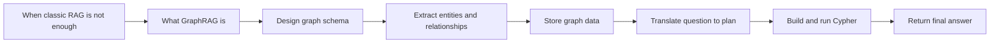
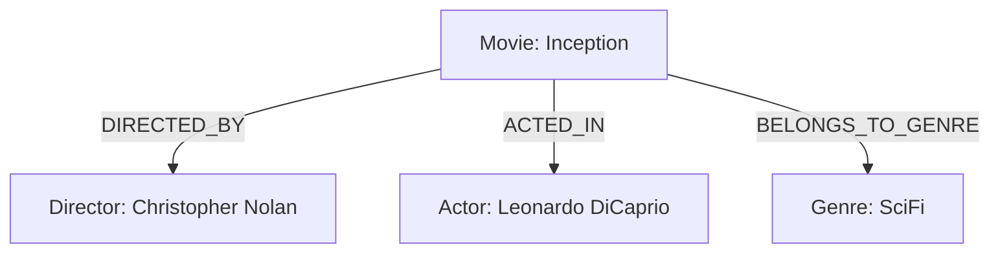
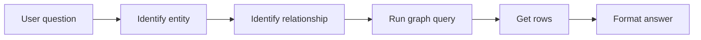
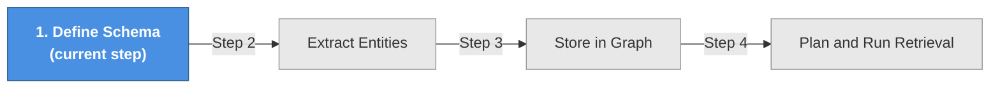
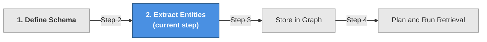
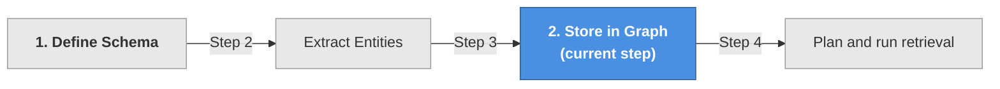
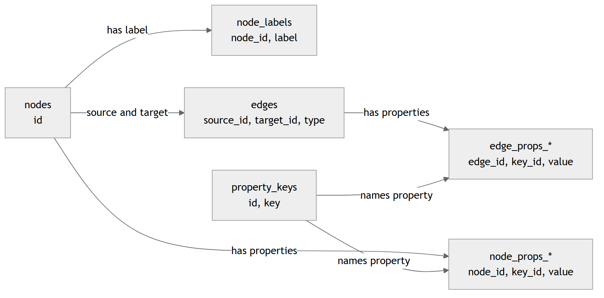
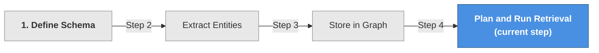
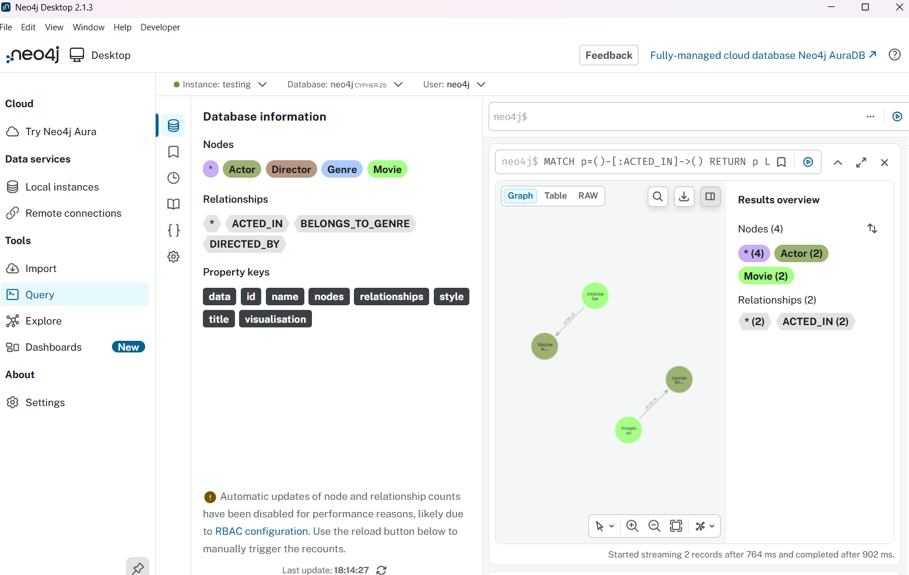

# GraphRAG, a Retrieval Approach for Relationship-Heavy Questions

In Chapter 6, you learned classic RAG: retrieve text chunks, add them to a prompt, and generate an answer.

That works well when answers live in documents.

But many real questions are about relationships. With relationships you might want to answer how something is connected. In such context, you might therefore want to ask:

- Who directed the movie Inception?
- What logistics providers are connected to vendor X?
- Which courses are taught by Professor Smith?

For questions like these, GraphRAG is often a better fit.

GraphRAG uses a knowledge graph as the retrieval layer. Instead of retrieving passages, it retrieves nodes, relationships, and properties, then uses that structured result to answer the question.

## What You Will Learn

By the end of this chapter, you will be able to:

- Explain when GraphRAG is better than classic RAG,
- Model a small domain as a knowledge graph,
- Extract entities and relationships from text,
- Query a graph with Cypher,
- Build a beginner-friendly GraphRAG pipeline using SQLite and Neo4j.

Use this roadmap to see how each section builds toward a complete implementation.



**Fig 01 - Chapter roadmap from concept to working GraphRAG retrieval.**

## Key Terms

Here are some helpful terms to know before we dive in:

Keep this quick-reference table handy whenever these terms appear later in examples.

| Term | Meaning |
| --- | --- |
| Classic RAG | Retrieves document chunks or passages. |
| Knowledge graph | Entities and relationships represented as a graph. |
| Node | A graph item for an entity such as Movie, Actor, or Course. |
| Relationship (edge) | A typed connection between two nodes. |
| Property (attribute) | Data on a node or relationship, such as title or name. |
| Schema | The node types, relationship types, and properties you support. |
| Cypher | Query language used by graph databases such as Neo4j. |
| Structured output | Forcing model output to match a strict JSON schema. |
| Upsert | Create if missing, update if present. |

We'll define more terms as we go, but these are the core ones to keep in mind. Feel free to refer back to this table as you read through the chapter.

## When to Use GraphRAG

GraphRAG is not "better" than classic RAG. It solves a different kind of retrieval problem.

To pick the right retrieval strategy, compare the strengths of each approach in this table.

| Approach | Best for | Retrieval unit | Example question |
| --- | --- | --- | --- |
| Classic RAG | Knowledge in documents | chunks/passages | What does the warranty policy say? |
| GraphRAG | Relationship-heavy questions | nodes/edges/properties | Who directed the movie Inception? |
| Agentic RAG | Multi-step and tool-using tasks | agent-chosen evidence | Compare three vendors and recommend one |

Before you decide on GraphRAG as a solution, you should evaluate whether it's a good fit. A way to evaluate this is to ask yourself: is the question/s I'm trying to answer fundamentally about relationships? If the answer is yes, then GraphRAG is likely a good fit. Additionally here's a checklist to help you evaluate:

GraphRAG is usually a good fit when:

- **Who/what questions**: Users ask who/what is connected to what,
- **Repeated relationships**: Your domain has repeated, explicit relationships for example in a supply chain or org chart.
- **Multi-hop reasoning matters**. With hop we mean the number of steps it takes to connect two entities. For example, "Who are the actors in movies directed by Christopher Nolan?" requires two hops: from director to movie, then from movie to actors. Compare this to a RAG type solution where your data is stored in chunks. In that case, you would need to retrieve the chunk about Christopher Nolan, then hope that the same chunk also contains the actors. If the information is split across multiple chunks, you might miss it or have to do multiple retrievals.
- **Structured retrieval**: You need structured retrieval, not only similarity search. The difference between the two is with structured retrieval you can ask for specific relationships and properties, like for example "Who directed Inception?" and get a direct answer. With similarity search, you would retrieve chunks that are similar to the question, but you might not get a direct answer or you wouldn't know to trust the answer because it might be generated based on partial information from multiple chunks.

To give you an even better support in evaluating whether GraphRAG is a good fit, here are some examples of domains that are a good fit for GraphRAG:

- Movie and entertainment metadata,
- Org charts and enterprise knowledge,
- Fraud and network analysis,
- Supply chain and logistics,
- School systems (students, teachers, courses, rooms).

### A Security Operations Example

The movie domain keeps the first implementation approachable, but the same pattern applies to operational systems. Consider a security analyst investigating incidents in Microsoft Sentinel. An incident can involve users, devices, IP addresses, alerts, and authentication events. Those entities become more useful when the analyst can follow their connections instead of reading each alert separately.

Why does this matter? A relationship-based view helps an analyst ask questions that cross several records. For example:

> Which devices were accessed by the same user shortly before alerts appeared in two different incidents?

A GraphRAG system could represent this investigation with nodes such as `Incident`, `Alert`, `User`, `Device`, and `IPAddress`, connected by relationships such as `CONTAINS_ALERT`, `SIGNED_IN_TO`, and `CONNECTED_FROM`. The retrieval step follows those relationships and returns the relevant paths for an answer. Microsoft Sentinel remains the source of security data; the knowledge graph is an additional retrieval layer built from selected incident entities and events.

This example is more complex than the movie graph, but the pipeline is the same: define a small schema, extract or map facts into it, store the graph, and constrain the questions the retrieval plan can answer.

## Graph Database vs GraphRAG

These terms are related but not equivalent.

This comparison clarifies the difference between storage technology and application pattern.

| Concept | What it is | What it does |
| --- | --- | --- |
| Graph database | Storage technology | Stores and queries graph-shaped data |
| GraphRAG | Application pattern | Retrieves structured graph facts and feeds them into an answer flow |

You can build GraphRAG on top of relational data, but graph-native databases are often easier to reason about for relationship-heavy retrieval.

## GraphRAG by Example

In a classic RAG system, you may store movie summaries as plain text.

In GraphRAG, you store entities and relationships. Here' a graph snippet for the movie Inception that shows how we can represent the same information in a structured way.



**Fig 02 - A tiny knowledge graph around one movie.**

Let's show the differences between RAG and GraphRAG by showing how different questions are a better fit for each approach.

Classic RAG question:

> Tell me about Leonardo DiCaprio.

Why this fits classic RAG: the question is about an entity, not a relationship. A text chunk about Leonardo DiCaprio can contain a summary of his career, his biography, and other relevant information. The answer is likely to be found in a single chunk or a few chunks.

Let's look at a question that is a better fit for GraphRAG.

GraphRAG question:

> Who directed the movie Inception?

This question is different from the first one because it asks about a relationship between two entities: the movie Inception and its director. You might find a text chunk that contains both the movie and the director, but you would be leaving that retrieval to chance. A better approach is to recognize this as a relationship question and therefore a better fit for GraphRAG. In a future chapter, we'll cover Agentic RAG, which can route between retrieval strategies based on the question. For now, the key takeaway is that this question is a better fit for GraphRAG because it is fundamentally about a relationship, not an entity or topic.

Now that we know more about GraphRAG use cases and which questions point toward it, let's build a GraphRAG pipeline.

## Retrieval Flow in GraphRAG

Before we examine the details, let's look at GraphRAG from a high level so we can see how the pieces fit together. We'll start with a prompt and follow it through the pipeline.

Question:

> Who directed Inception?

We have our questions, now what? Well, a typical flow looks like this:

1. **Identify entity**: The first step consists of identifying the key entities in the question. In this case, we can identify that "Inception" is a movie title and therefore an entity in our graph.
2. **Identify relationship**: The next step is to identify the relationship being queried. Are we asking who acted in the movie, who directed it, or something else? Here, the relationship is who directed it, which our graph names `DIRECTED_BY`.
3. **Run graph query**: With the entity and relationship identified, we can construct and run a graph query.
4. **Return rows**: The query returns rows from the graph database.
5. **Format as natural language (optional)**: Finally, the results can be formatted into a natural language response.

Here is the same process as a visual request-to-answer flow.



**Fig 03 - Simple GraphRAG retrieval flow.**

### Cypher in One Minute

So with the retrieval flow identified, let's take a quick detour to understand Cypher, the query language we will use to interact with our graph database. If you already know SQL then we can map your existing knowledge to Cypher, which will make it easier to understand.

Cypher is to graphs what SQL is to tables.

```cypher
MATCH (m:Movie {title: "Inception"})-[:DIRECTED_BY]->(d:Director)
RETURN d.name
```

Read this as:

- Find Movie node with title Inception,
- Follow DIRECTED_BY edge,
- Return the connected Director name.

In SQL the above would be something like:

```sql
SELECT d.name
FROM Movie m
JOIN Director d ON m.director_id = d.id
WHERE m.title = "Inception"
```

Here's a quick mapping of common Cypher patterns to SQL concepts to help you understand the mental model:

| Intent | Cypher | SQL-ish mental model |
| --- | --- | --- |
| Return fields | `RETURN m.title, d.name` | `SELECT m.title, d.name` |
| Filter | `WHERE m.title = "Inception"` | `WHERE m.title = "Inception"` |
| Follow connection | `MATCH (m:Movie)-[:DIRECTED_BY]->(d:Director)` | `JOIN ... ON ...` |
| Create node | `CREATE (m:Movie {title: "Inception"})` | `INSERT INTO Movie ...` |

### Why Use Cypher Instead of Another Graph Query Language?

Cypher is not the only language for querying graphs. The right language usually follows from two earlier choices: the graph data model and the database engine. This matters because graph systems do not all represent data in the same way, and a language designed for one model may not fit another.

Here are the main alternatives you are likely to encounter:

| Language | Graph model and style | Where it fits |
| --- | --- | --- |
| Cypher | Declarative property-graph patterns | Neo4j and databases with Cypher-compatible interfaces |
| Gremlin | Step-by-step property-graph traversals | Apache TinkerPop-compatible databases |
| SPARQL | Declarative matching over RDF triples | RDF stores and linked-data systems |
| GQL | Standardized property-graph querying | Engines that implement the ISO GQL standard |

For a concrete comparison, the Cypher pattern for finding Inception's director is:

```cypher
MATCH (m:Movie {title: "Inception"})-[:DIRECTED_BY]->(d:Director)
RETURN d.name
```

The equivalent traversal in Gremlin would look like this:

```groovy
g.V()
    .hasLabel('Movie')
    .has('title', 'Inception')
    .out('DIRECTED_BY')
    .values('name')
```

Both queries can answer the same question. Cypher describes the graph pattern to match, while Gremlin describes the traversal as a sequence of steps.

This chapter uses Cypher for three practical reasons:

- **The syntax mirrors the diagram**: `(Movie)-[:DIRECTED_BY]->(Director)` looks like the relationship we drew earlier, which makes the first query easier to read.
- **One language works across both examples**: `graphqlite` and Neo4j both accept the Cypher used in this chapter, so moving from local SQLite storage to Neo4j does not require rewriting the retrieval model.
- **Declarative patterns fit constrained query plans**: Each supported intent can map to a small, reviewable query template without asking the LLM to invent an arbitrary traversal.

> NOTE: Cypher is not universally better or faster than the alternatives. Choose the language supported by your database and suited to its graph model. We choose it here because it keeps the learning path and the two implementations consistent.

Great, we know how to break the question into its relational components and express the lookup in Cypher. Next, we need to connect these ideas by taking the user's input through the complete retrieval pipeline.

## Build a GraphRAG Pipeline

Let's continue with our movie domain example to build a complete GraphRAG pipeline. We've seen the general steps from user input to system response but let's be a bit more detailed this time.

Here's what we need to do:

| Step | Action | Input | Output |
| --- | --- | --- | --- |
| 1 | Define schema | domain understanding | node/edge/property design |
| 2 | Extract graph facts | source text | entities and relationships |
| 3 | Store graph | extracted facts | queryable graph |
| 4 | Plan and run retrieval | user question | constrained query plan |

Steps 1-3 prepare the graph database with relevant data. Step 4 performs retrieval: it accepts user input, converts it into a query, runs that query against the data source, and returns an answer.

Let's start with our first step: defining the graph schema.

## Step 1: Define the Schema



The schema answers how we will query the graph. It defines the node types, relationship types, and properties we will use. A good schema is crucial for effective retrieval. Only you know what this schema looks like. 

> TIP: Good beginner rule: keep version 1 small.

Example schema:

- Entity types: Movie, Director, Actor, Genre
- Relationship types: DIRECTED_BY, ACTED_IN, BELONGS_TO_GENRE
- Core properties: title and name

Let's come up with a source text that will extract information from:

Sample source text:

```text
Inception, directed by Christopher Nolan, acted in by Leonardo DiCaprio, genre SciFi
The Dark Knight, directed by Christopher Nolan, acted in by Christian Bale, genre Action
Titanic, directed by James Cameron, acted in by Leonardo DiCaprio, genre Romance
```

> NOTE: Beginner takeaway: you are modeling facts, not storing paragraphs.

In our next step, we will extract the above presented information using an LLM.

## Step 2: Extract Entities and Relationships



To extract data from the source text, we need a prompt that instructs the LLM to produce structured output. Structured output is crucial because it allows us to validate the response and ensure it matches our expected schema.

Let's have a look at our prompt idea and expected output shape before we dive into the code example.

Prompt idea:

```text
Extract entities and relationships from the following text:
{text}

For each relationship, from_entity is source and to_entity is target.
```

What we see from the prompt above is how it contains: 

- Guidelines: "Extract entities and relationships from the following text", 
- Placeholder: a place for the source data "{text}"
- Output instructions: "For each relationship, from_entity is source and to_entity is target."

The goal is to produce a shape like below JSON:

```json
{
  "entities": [
    {"type": "Movie", "name": "Inception"},
    {"type": "Director", "name": "Christopher Nolan"}
  ],
  "relationships": [
    {
      "from_entity": "Inception",
      "to_entity": "Christopher Nolan",
      "type": "directed by"
    }
  ]
}
```

To get to the above shape, we can either make the prompt more details or we provide the LLM with an output structure. Let's opt for the latter with the following Python code:

```python
# Extracting entities and relationships with structured output using Pydantic

from pydantic import BaseModel
import ollama


class Entity(BaseModel):
    type: str
    name: str


class Relationship(BaseModel):
    from_entity: str
    to_entity: str
    type: str


class KnowledgeGraph(BaseModel):
    entities: list[Entity]
    relationships: list[Relationship]


with open("data.txt", "r", encoding="utf-8") as file:
    text = file.read()

prompt = f"""
Extract entities and relationships from the following text:
{text}

For each relationship, from_entity is source and to_entity is target.
"""

response = ollama.chat(
    model="phi3:mini",
    messages=[{"role": "user", "content": prompt}],
    format=KnowledgeGraph.model_json_schema(),
)

result = KnowledgeGraph.model_validate_json(response.message.content)
print(result.model_dump())
```

> TIP: Smaller models such as `phi3:mini` can struggle to produce nested lists while also extracting accurate facts. If the model invents relationships or misses entities, try a two-pass approach. In the first prompt, ask it to list the entities and relationships in plain text. Then pass that list to a second prompt that only formats the facts into the `KnowledgeGraph` JSON schema. Separating extraction from formatting gives the model one focused task at a time.

In the above code, we've:

- **Defined structured output**: We created Pydantic models to define the expected output structure for entities and relationships. The model looks like so:

   ```python
    class Entity(BaseModel):
         type: str
         name: str
    class Relationship(BaseModel):
         from_entity: str
         to_entity: str
         type: str
    class KnowledgeGraph(BaseModel):
         entities: list[Entity]
         relationships: list[Relationship]
   ```

   There are three models: `Entity`, `Relationship`, and `KnowledgeGraph`. The `KnowledgeGraph` model contains a list of entities and relationships and is the top-level model that represents the entire output we expect from the LLM.

- **Used structured output in the prompt**: When calling the LLM, we passed the JSON schema of our `KnowledgeGraph` model to the `format` parameter. This tells the LLM to generate output that matches this structure and allows us to validate it easily.

   ```python
   response = ollama.chat(
        model="phi3:mini",
        messages=[{"role": "user", "content": prompt}],
        format=KnowledgeGraph.model_json_schema(),
   )
   ```

> IMPORTANT: extraction quality is never perfect. Add validation and normalization as your data grows.

What we have at this point is a JSON response that contains the extracted entities and relationships. It should look something like this:

```json
{
  "entities": [
    {"type": "Movie", "name": "Inception"},
        {"type": "Movie", "name": "The Dark Knight"},
        {"type": "Movie", "name": "Titanic"},
    {"type": "Director", "name": "Christopher Nolan"},
        {"type": "Director", "name": "James Cameron"},
    {"type": "Actor", "name": "Leonardo DiCaprio"},
    {"type": "Actor", "name": "Christian Bale"},
    {"type": "Genre", "name": "SciFi"},
    {"type": "Genre", "name": "Action"},
    {"type": "Genre", "name": "Romance"}
  ],
  "relationships": [
    {
      "from_entity": "Inception",
      "to_entity": "Christopher Nolan",
      "type": "DIRECTED_BY"
    },
    {
      "from_entity": "Inception",
      "to_entity": "Leonardo DiCaprio",
      "type": "ACTED_IN"
    },
    {
      "from_entity": "Inception",
      "to_entity": "SciFi",
      "type": "BELONGS_TO_GENRE"
        },
        {
            "from_entity": "The Dark Knight",
            "to_entity": "Christopher Nolan",
            "type": "DIRECTED_BY"
        },
        {
            "from_entity": "The Dark Knight",
            "to_entity": "Christian Bale",
            "type": "ACTED_IN"
        },
        {
            "from_entity": "The Dark Knight",
            "to_entity": "Action",
            "type": "BELONGS_TO_GENRE"
        },
        {
            "from_entity": "Titanic",
            "to_entity": "James Cameron",
            "type": "DIRECTED_BY"
        },
        {
            "from_entity": "Titanic",
            "to_entity": "Leonardo DiCaprio",
            "type": "ACTED_IN"
        },
        {
            "from_entity": "Titanic",
            "to_entity": "Romance",
            "type": "BELONGS_TO_GENRE"
    }
  ]
}
```

Great, now that we have our graph-structured data, we can move to the next step which is storing it in a graph database so it can be queried efficiently.

## Step 3: Store the Graph



There are many alternatives for storing graph data, from in-memory solutions to full graph databases. In this case, we will start with a simple SQLite-backed graph storage for learning purposes and then move to Neo4j, a popular graph database. To make this approach work, we need `graphqlite`, a Python library that provides a simple interface for working with graph data in SQLite.

Before inserting data, it helps to see what "a graph in SQLite" means. `graphqlite` stores the graph structure in relational tables and translates Cypher queries for us.



**Fig 04 - The major SQLite tables behind the local graph.**

The diagram separates three responsibilities:

- `nodes`, `node_labels`, and `node_props_*` store an entity, its graph label, and its properties.
- `edges` connects a source node to a target node and records the relationship type.
- `property_keys` shares property names across the typed property tables. The `*` represents variants for text, integer, real, Boolean, and JSON values.

For example, the `Movie` node for Inception has a label in `node_labels` and a `title` value in `node_props_text`. Its `DIRECTED_BY` row in `edges` points from that movie node to the Director node for Christopher Nolan. You normally use `graphqlite` rather than editing these tables directly, but knowing the shape makes an empty result easier to debug.

Let's show the interesting insertion parts of the code and then link to a full runnable example at the end.

Let's start with the code for inserting nodes and edges into the graph database:

```python
from graphqlite import graph


with graph("my_graph.db") as db:
    db.upsert_node("movie-inception", {"title": "Inception"}, "Movie")
    db.upsert_node("director-nolan", {"name": "Christopher Nolan"}, "Director")
    db.upsert_edge("movie-inception", "director-nolan", {}, "DIRECTED_BY")
    db.connection.commit()
```

Here's what the above code does:

- **Connects to the graph database**: We use a context manager to connect to our SQLite-backed graph database. The code `with graph("my_graph.db") as db:` opens a connection to the database file `my_graph.db` and ensures that it is properly closed after the block of code is executed.

- **Upserts nodes**: Thereafter, we "upsert", insert new nodes, if they don't exist, or update them if they do. The `upsert_node` method takes three parameters: a unique identifier for the node (e.g., "movie-inception"), a dictionary of properties (e.g., `{"title": "Inception"}`), and the node type (e.g., "Movie"). 
- **Saves changes**: Finally, we call `db.connection.commit()` to save the changes to the database.

How do we query the graph after inserting data? For this, we can use Cypher queries, which we introduced earlier. Here's an example of how to query the graph for the director of Inception:


```python
result = db.query("""
MATCH (m:Movie {id: 'movie-inception'})-[:DIRECTED_BY]->(d:Director)
RETURN m.title AS movie, d.name AS director
""")

for record in result:
    print(f"Movie: {record['movie']}, Director: {record['director']}")
```

The above code does the following:

- **Runs a Cypher query**: By invoking the `query` method on our graph database connection, we execute a Cypher query that matches a Movie node with the ID "movie-inception"
- **Follows the relationship**: The same query follows the DIRECTED_BY relationship to find the connected Director node, and returns the movie title and director name. So in SQL terms, this is like a JOIN between the Movie and Director tables based on the relationship.
- **Processes results**: Finally, we iterate over the result set and print out the movie and director information.

Here's a complete runnable example that includes both insertion and querying: [code/2-insert/app.py](./code/2-insert/app.py)

### Debug the Pipeline One Checkpoint at a Time

The full assignment adds Pydantic models and LLM calls around the graph. Those pieces have different jobs: the LLM proposes entities, relationships, and a query plan; Pydantic checks the response shape; and `graphqlite` stores and queries the accepted facts. Keeping those boundaries visible matters because a valid JSON response can still contain the wrong label or relationship direction.

Suppose `Who directed Inception?` returns no rows. Check the pipeline in this order:

1. **Inspect extraction output.** Confirm that the logs contain `[Movie] Inception`, `[Director] Christopher Nolan`, and `Inception --[DIRECTED_BY]--> Christopher Nolan`.
2. **Inspect the query plan.** It should use `intent="director_of_movie"` and `movie_title="Inception"`.
3. **Inspect the generated Cypher.** It should match `(:Movie)-[:DIRECTED_BY]->(:Director)` and filter on `m.title`.
4. **Inspect the rows before answer formatting.** If the first three checkpoints are correct but `rows` is empty, rebuild the local database so old labels or edges cannot remain.

From the assignment folder, rebuild the graph with:

```powershell
uv run python app.py
```

The assignment deletes and recreates `my_graph.db` by default. Use `--no-reset` only when you intentionally want to preserve existing data. This distinction is important while experimenting: changing extraction prompts or schema labels and then appending to an older graph can leave incompatible structures in the same database.

Now that we've learned how to query the data source, the next step is to add the LLM so we can translate user input into Cypher.

## Step 4: Plan and Run Retrieval



What's missing at this point is a way to send a prompt through the pipeline and turn it into Cypher. Once we add that behavior, we will have a complete end-to-end system. Let's see how to get there.

Let's start with some high-level Python code, so we understand how things should happen:

```python
with graph(DB_PATH) as db:
        # 1. Seed data
        seed_graph(db)

        user_prompt = input("Enter your query: ")
        
        # 2. Take user input prompt and translate to query plan
        plan = translate_prompt_to_plan(user_prompt)

        # 3. Convert from query plan to cypher query
        cypher = build_cypher(plan)

        # 4. Run Cypher query and return rows
        log("Executing Cypher query...")
        rows = db.query(cypher)

        # 5. Return rows to user
        log("Results:")
        if not rows:
            print("No results found.")
            return

        for row in rows:
            print(row)
```

### 1. Convert the Prompt to a Query Plan

The query plan is a class that constrains the types of supported queries. It assumes the user has an intent and will mention either a movie or a person. They might ask questions such as:

> Who starred in Titanic?

OR

> Who directed the movie Inception?

The plan uses `Literal` to constrain the intent to the five supported values, so import it from Python's `typing` module before defining the model:

```python
from typing import Literal

from pydantic import BaseModel


class QueryPlan(BaseModel):
    intent: Literal[
        "actors_in_movie",
        "director_of_movie",
        "genre_of_movie",
        "movies_for_actor",
        "movies_for_director",
    ]
    movie_title: str | None = None
    person_name: str | None = None
```

To create a such a query plan from a prompt, we need a function `translate_prompt_to_plan` like so:

```python
def translate_prompt_to_plan(user_prompt: str) -> QueryPlan:
    schema = """
Graph schema:
- Nodes:
  - Movie { id, title }
  - Director { id, name }
  - Actor { id, name }
  - Genre { id, name }
- Relationships:
  - (:Movie)-[:DIRECTED_BY]->(:Director)
  - (:Movie)-[:ACTED_IN]->(:Actor)
  - (:Movie)-[:BELONGS_TO_GENRE]->(:Genre)

Supported intents:
- actors_in_movie: who acted in a movie
- director_of_movie: who directed a movie
- genre_of_movie: what genre a movie belongs to
- movies_for_actor: what movies an actor appeared in
- movies_for_director: what movies a director made

Rules:
- Return JSON only matching the provided schema
- Choose exactly one intent
- Fill movie_title only for movie-based questions
- Fill person_name only for person-based questions
- Do not return Cypher
"""

    response = ollama.chat(
        model=MODEL,
        messages=[
            {
                "role": "system",
                "content": (
                    "You map a user question onto one supported graph query intent. "
                    "Return structured JSON only."
                ),
            },
            {
                "role": "user",
                "content": f"{schema}\nUser question: {user_prompt}",
            },
        ],
        format=QueryPlan.model_json_schema(),
    )

    return QueryPlan.model_validate_json(response.message.content)

```

Let's explain how this code works:

- **Define schema and intents**: The `schema` variable contains a description of the graph schema, the supported query intents, and rules for how to fill the query plan. This is provided to the LLM to guide its understanding of how to map user questions to structured query plans.
- **LLM call**: We call the LLM with a system message that instructs it to map user questions to one of the supported graph query intents and to return structured JSON only. See `format= QueryPlan.model_json_schema()` This tells the LLM to generate output that matches the `QueryPlan` schema we defined earlier.
- **Return query plan**: Finally, we validate the LLM's response against the `QueryPlan` schema and return it as a structured object with the code `return QueryPlan.model_validate_json(response.message.content)`.

### 2. Convert the Query Plan to Cypher

We've done most of the heavy lifting because the user's prompt is now represented as a `QueryPlan`. This structured format makes it easier to convert the request into a Cypher query.

Let's create `build_cypher` to create the Cypher query. Here's the code for it:

```python
CYPHER_TEMPLATES = {
    "actors_in_movie": {
        "query": "MATCH (m:Movie)-[:ACTED_IN]->(a:Actor) WHERE m.title = '{value}' RETURN m.title AS movie, a.name AS actor LIMIT 10",
        "param": "movie_title",
    },
    "director_of_movie": {
        "query": "MATCH (m:Movie)-[:DIRECTED_BY]->(d:Director) WHERE m.title = '{value}' RETURN m.title AS movie, d.name AS director LIMIT 10",
        "param": "movie_title",
    },
    "genre_of_movie": {
        "query": "MATCH (m:Movie)-[:BELONGS_TO_GENRE]->(g:Genre) WHERE m.title = '{value}' RETURN m.title AS movie, g.name AS genre LIMIT 10",
        "param": "movie_title",
    },
    "movies_for_actor": {
        "query": "MATCH (m:Movie)-[:ACTED_IN]->(a:Actor) WHERE a.name = '{value}' RETURN a.name AS actor, m.title AS movie LIMIT 10",
        "param": "person_name",
    },
    "movies_for_director": {
        "query": "MATCH (m:Movie)-[:DIRECTED_BY]->(d:Director) WHERE d.name = '{value}' RETURN d.name AS director, m.title AS movie LIMIT 10",
        "param": "person_name",
    },
}


def build_cypher(plan: QueryPlan) -> str:
    if plan.intent not in CYPHER_TEMPLATES:
        raise ValueError(f"Unsupported intent: {plan.intent}")

    template = CYPHER_TEMPLATES[plan.intent]
    param_name = template["param"]
    param_value = getattr(plan, param_name)

    if not param_value:
        raise ValueError(f"A {param_name} is required for {plan.intent}")

    escaped_value = escape_cypher_string(param_value)
    return template["query"].format(value=escaped_value)
```

Here's what the code does:

- **Defines a dictionary**: This dictionary is used to define Cypher query templates for each supported intent. 
- **Builds Cypher query**: The `build_cypher` function takes a `QueryPlan` object as input, checks if the intent is supported, retrieves the corresponding query template, and fills in the parameter value from the query plan. 

Great, we now have a flow to the data source: the prompt becomes a query plan, which then becomes a Cypher query.

### 3. Run Cypher

Ok, now we have the Cypher query, let's query the data source:

```python
rows = db.query(cypher) 
```

At this point, the response consists of a set of rows. The final step uses the LLM to create a user-friendly answer.

### 4. Return Data

To return the data, we need to provide our rows as context to an LLM and then return the LLM response like so:

```python
def create_response(rows) -> str:
    if not rows:
        return "No results found."

    response_lines = []
    for row in rows:
        line = ", ".join(f"{key}: {value}" for key, value in row.items())
        response_lines.append(line)

    messages = [
        {
            "role": "system",
            "content": (
                "You are a helpful assistant that answers questions about movies based on database query results. "
                "Use the provided query results to answer the user's question. Be concise and informative."
            ),
        },
        {
            "role": "user",
            "content": "Here are the query results:\n" + "\n".join(response_lines),
        },
    ]

    response = ollama.chat(
        model=MODEL,
        messages=messages,
    )

    return response.message.content
```

For a complete solution, check out this [link to an app](./code/3-retrieval/app.py) showing the full implementation.

## Moving to Neo4j

SQLite demos are perfect for learning. For larger systems, many teams use Neo4j because it is graph-native and offers strong tooling.

To get started with Neo4j, you can install it locally or use a hosted instance. You will also need the Neo4j package for your chosen runtime. Then you can configure a connection and run queries against the instance.

Let's review the steps for migrating to Neo4j:

| Step | Description |
| --- | --- |
| 1. Setup | Use local or hosted Neo4j |
| 2. Choose runtime and package | `neo4j` package |
| 3. Configure connection | URI + username + password |
| 4. Query | Here we will use Cypher |

Great, now that we understand the plan, let's go through each step:

### 1. Set Up Neo4j

Neo4j can run locally or as a hosted service. To install it locally, follow the instructions on the [Neo4j website](https://neo4j.com/docs/operations-manual/current/installation/).

The desktop installation includes Neo4j Desktop, a client for creating and managing local database instances.



From it, you can create instances, perform queries and more.

### 2. Choose a Runtime and Package

For this step, we will choose Python as runtime and will therefore install the Python package.

You can install the package with the below command run in your terminal:

```bash
pip install neo4j
# or
uv add neo4j
```

### 3. Configure the Connection

To connect to Neo4j, first create a database instance. During setup, you will create a username and password. Keep these credentials available because the application will use them to connect. You will need the following values:

- **URI**: This value default to "bolt://localhost:7687"
- **User**: The username you chose while setting up the instance in Neo4j Desktop.
- **Password**. The password is set up at the same time as the user.

Let's have a look at the connection code below:

```python
from neo4j import GraphDatabase

driver = GraphDatabase.driver(
    NEO4J_URI,
    auth=(NEO4J_USER, NEO4J_PASSWORD),
)
```

In the above step, we first create an instance of a driver. Once we have that, we need to create a session. 

### 4. Run a Query

Any querying we do needs to be done in the context of a session. A session is created by calling `driver.session()`, see below code: 

```python
with driver.session():
    # The next example adds the query and session.run call here.
```

Let's define a query next and run it. A query is just a string defined as a Cypher query and you run it by calling `session.run(<query>, <parameters>)`. Below is an example of create a query and running it:

Parameterized query:

```python
with driver.session() as session:
    cypher = """
    MATCH (m:Movie)-[:DIRECTED_BY]->(d:Director)
    WHERE d.name = $person_name
    RETURN d.name AS director, m.title AS movie
    LIMIT 10
    """

    result = session.run(cypher, {"person_name": "Christopher Nolan"})
    rows = [dict(record) for record in result]
```

At this point, we've compared the SQLite and Neo4j approaches. The main difference is how you configure the connection; the queries are still written in Cypher.

See this complete example in Neo4j: [code/3-retrieval/app-neo4j.py](./code/3-retrieval/app-neo4j.py)

Throughout this chapter, we have worked through both graph storage and GraphRAG but are there any best practices or things to avoid? Let's cover just that in the next section.

## Pitfalls and Best Practices

So pitfalls, there are some things to be aware of when building GraphRAG systems. Here are some common ones pertaining to schema design, extraction, and query construction:

- **Schema Design**: Avoid overcomplicating the first version of your schema. Start with a small set of node and edge types that directly support your core queries. You can always expand later. An overly complex schema takes more time to design and makes queries harder to author.
- **Extraction**: Don't let the extraction output go unvalidated. Always validate that the LLM's output matches your expected schema. This will save you from downstream errors and ensure data quality.
- **Consistency**: Ensure you are consistent with your relationship labels and node types. For example, don't mix `DIRECTED_BY`, `directed_by`, and `DirectedBy` as it will make querying more difficult.
- **Cypher Construction**: Avoid building Cypher queries with unchecked free-form text. Always use parameterized queries to prevent injection issues and ensure proper escaping of values. So instead of doing this:

   ```python
   cypher = f"MATCH (m:Movie) WHERE m.title = '{movie_title}' RETURN m"
   ```

   Do this:

   ```python
   cypher = "MATCH (m:Movie) WHERE m.title = $movie_title RETURN m"
   session.run(cypher, {"movie_title": movie_title})
   ```

- **Data Volume**: Don't return too much graph data when only one relationship or a few rows are needed. This can lead to performance issues and overwhelm the user with information.
- **Indexes and Query Tuning**: Add indexes and query tuning as your graph grows.
- **Environment Separation**: Keep learning demos separate from production hardening.

What about the LLM part of the GraphRAG, what should we think about there:

- **Prompting**: Don't forget to provide the LLM with clear instructions and context about the graph schema when asking it to translate user questions into query plans. The more context you provide, the better it can map questions to the correct intents and parameters.
- **Models**: Use the right model for the right thing. You might need different models for your initial data extraction than you would later use to figure out the user intention and formatting of the final response.
- **Caching**: Generally for LLM systems and any systems where you need good performance, consider whether you can cache responses. In the case of LLMs, see if you can semantically cache the response of two similar prompts for example.
- **Structured Output**: Use structured output for both extraction and planning.
- **Constrained Intent List**: Start with a constrained intent list.

## Assignment

Build a GraphRAG system for a domain of your choosing. Store the domain information in a text file to keep the first version simple.

You could also add a Web UI to your app.

## Solution

[Solution](./assignment/README.md)

## Summary

In this chapter, you learned when to prefer GraphRAG over classic RAG and how to build a complete beginner-friendly pipeline. You learned that a GraphRAG, just like RAG, has two major phases to it, a digestion phase where data is extracted and stored and a retrieval phase.

We also covered Cypher, a query language used for graph databases. You saw solutions using both SQLite and Neo4j as storage options. Finally, we covered common pitfalls and best practices.

In the next chapter, you will move into agent behavior with the ReAct pattern.
