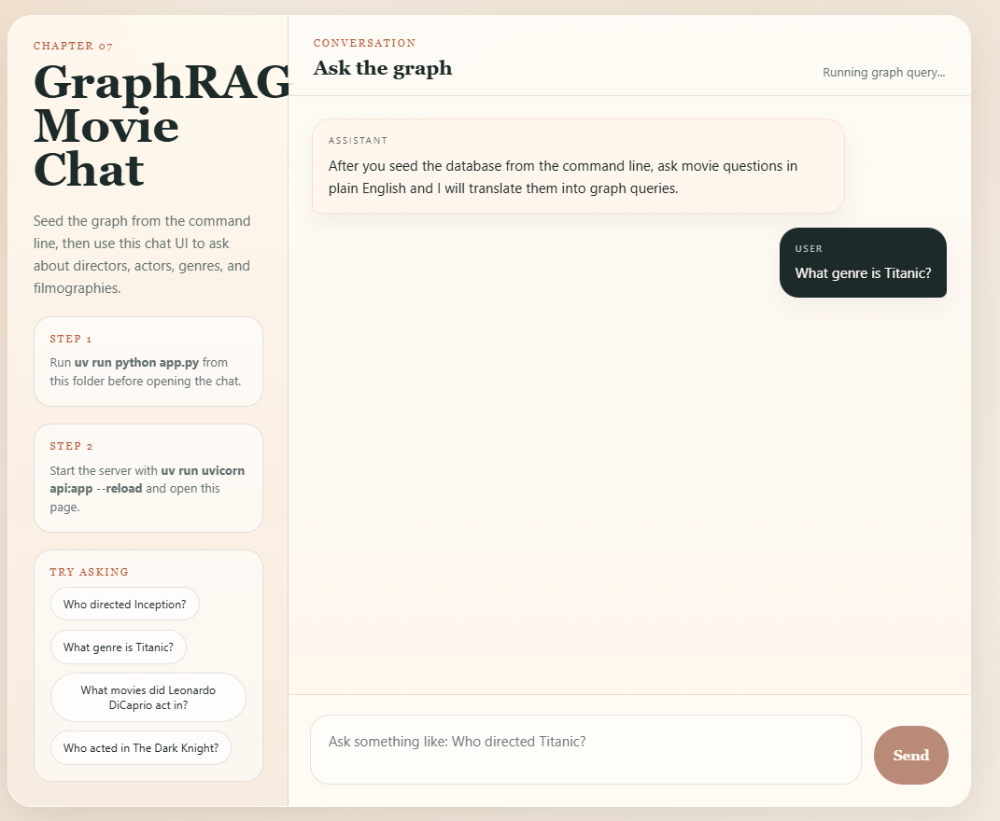

# GraphRAG Assignment

This assignment extracts a movie knowledge graph from `data/domain.txt`, stores it in a local `graphqlite` database, and exposes a FastAPI app with a small chat UI for asking questions about the graph.

## What It Does

- Seeds a graph database from the text in `data/domain.txt` using `app.py`
- Uses Ollama to:
	- extract entities and relationships
	- translate a user question into a query plan
- Runs Cypher queries against the graph
- Serves a browser chat interface from FastAPI

## Requirements

- Python 3.12+
- Ollama installed and running locally
- The model `llama3.1:latest` available in Ollama

If the model is not installed yet:

```powershell
ollama pull llama3.1:latest
```

## Install

From the `Chapter-07-Advanced-RAG/assignment` folder:

```powershell
uv sync
```

If you prefer `pip` instead of `uv`:

```powershell
python -m venv .venv
.\.venv\Scripts\Activate.ps1
python -m pip install -U pip
pip install fastapi graphqlite ollama pydantic uvicorn
```

## Seed The Graph

Run the seeding step from the `Chapter-07-Advanced-RAG/assignment` folder:

```powershell
uv run python app.py
```

This rebuilds `my_graph.db` from `data/domain.txt`.

During seeding, inspect the entity and relationship logs before starting the web app. For the sample data, labels should use only `Movie`, `Director`, `Actor`, and `Genre`, while relationships should use only `DIRECTED_BY`, `ACTED_IN`, and `BELONGS_TO_GENRE`. These logs are the first checkpoint between LLM extraction and database storage.

If you want to append to the existing database instead of resetting it first:

```powershell
uv run python app.py --no-reset
```

## Run The Web App

Start the FastAPI server from the `Chapter-07-Advanced-RAG/assignment` folder:

```powershell
uv run uvicorn api:app --reload
```

Then open:

```text
http://127.0.0.1:8000
```

## How To Use It

1. Run `uv run python app.py` to create the graph database.
2. Start the FastAPI server.
3. Open the web app in your browser.
4. Ask questions in the chat window.

Example questions:

- `Who directed Inception?`
- `Who acted in The Dark Knight?`
- `What genre is Titanic?`
- `What movies did Leonardo DiCaprio act in?`



## API Endpoints

### `GET /`

Serves the HTML chat client.

### `GET /api/health`

Simple health check.

### `POST /api/chat`

Accepts a natural-language question and returns the query plan, generated Cypher, rows, and a short answer.

Example request:

```json
{
	"prompt": "Who directed Inception?"
}
```

Example response:

```json
{
	"prompt": "Who directed Inception?",
	"plan": {
		"intent": "director_of_movie",
		"movie_title": "Inception",
		"person_name": null
	},
	"cypher": "MATCH (m:Movie)-[:DIRECTED_BY]->(d:Director) WHERE m.title = 'Inception' RETURN m.title AS movie, d.name AS director LIMIT 10",
	"rows": [
		{
			"movie": "Inception",
			"director": "Christopher Nolan"
		}
	],
	"answer": "Christopher Nolan directed Inception."
}
```

## Troubleshoot Empty Results

If every question returns no rows, verify each pipeline boundary before changing the code:

1. Stop the web app if it is running.
2. Run `uv run python app.py` without `--no-reset` to delete and rebuild `my_graph.db`.
3. Check the seeding logs for the expected entity and relationship labels.
4. Restart the web app and send `Who directed Inception?`.
5. Inspect the `/api/chat` response. The plan should contain `director_of_movie`, the Cypher should use `DIRECTED_BY`, and `rows` should contain Christopher Nolan.

Do not use `--no-reset` after changing the extraction prompt or graph schema. Appending can mix old labels such as `Film` with the expected `Movie` label, and a Cypher query for `Movie` will not match those older nodes.

## Files

- `app.py`: graph extraction, graph seeding, and shared query utilities
- `api.py`: FastAPI app and chat endpoint
- `index.html`: browser chat interface that assumes the graph is already seeded
- `data/domain.txt`: source text used to build the graph

## Notes

- The graph database file is created as `my_graph.db` in this folder.
- If the graph database does not exist yet, the chat endpoint will fail until you run `uv run python app.py`.
- If Ollama is not running, both seeding and chat requests will fail until it is started.