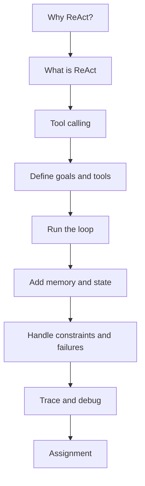
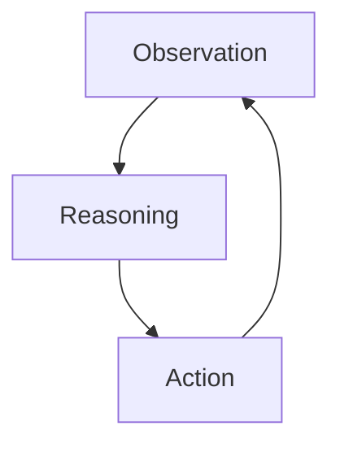
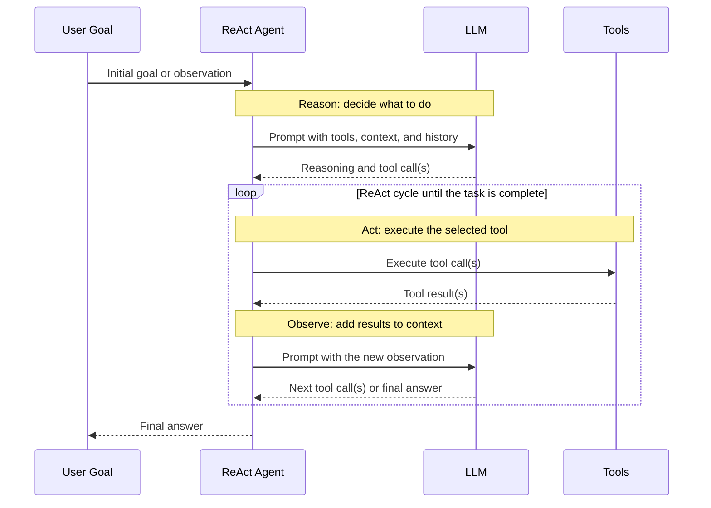

# The ReAct Pattern

So far, you've been taught to build LLM apps. You've seen how these apps can become more capable by adding tools to them and you've even seen how adding RAG can make your LLM apps have capabilities like search. That's all well and good, but this is a good moment to take a step back and ask why I'm introducing all these topics? It's simple really, it's so you understand what building blocks agents can use.

Now that we have all that, and I would dare say you're able to build some quite interesting AI powered apps, how then do we take the next step towards agents? That's the right question to ask, we need to start with an architecture that models what most agentic frameworks out there uses. If we understand said architecture we're better set up for success using these frameworks (You're more likely to use a framework than build your own). The architecture used is called ReAct, which stands for Reason and Act.

In this chapter, you will learn to:

- Grasp core concepts like Thought, Action and Observation.
- Build Observe -> Reason -> Act loops that call tools.
- Use state so an agent can remember what has happened.
- Implement error recovery with retries, fallback actions, and guardrails.
- Structure reasoning traces for debugging and transparency.
- Evaluate the tradeoffs of ReAct compared to direct tool calling.

## Quick chapter map

To orient you before we dive into details, the next diagram shows the path this chapter follows from concept to implementation.



*Fig: High-level chapter flow from motivation to hands-on practice.*

## ReAct vocabulary (beginner quick reference)

| Term | Plain-language meaning | Example |
| --- | --- | --- |
| Observation | New information the agent sees | "AAPL is $395" |
| Thought/Reasoning | Internal decision step | "Price is below threshold" |
| Action | A concrete operation the agent performs | `buy_stock(symbol="AAPL", shares=10)` |
| Tool | A callable function or API | `get_stock_price` |
| State | Structured current snapshot | cash balance, holdings |
| Memory | What is retained over time | last action, summary of past cycles |

## What is ReAct?

ReAct is a powerful architecture for building agentic applications. What makes it powerful is its simplicity. ReAct stands for Reasoning and Acting, and it describes a pattern where an agent alternates between reasoning about its environment and taking actions based on that reasoning.

A thermostat offers an intuitive starting example. It behaves like an agent that:

- Senses the current temperature (observation).
- Reasons about whether to turn the heating on or off (reasoning).
- Takes action to adjust the temperature (action).

A thermostat maps neatly to ReAct: it observes the environment, reasons about what to do, and then acts. The same structure scales to much more complex agents.

For a second example, consider a financial bot that manages a stock portfolio. It could:

- Observe the current stock prices and your portfolio (observation).
- Reason about which stocks to buy or sell based on market trends and your investment goals (reasoning).
- Take action to execute trades (action).

Many real-world and software workflows can be modeled this way using ReAct.

Beyond the basic loop, ReAct is also about how you structure interactions between these components. The next section turns that into concrete tool-calling behavior.

Here is the core ReAct cycle at a glance before we move into implementation details.



*Fig: ReAct feedback loop where each action produces the next observation.*

## Tool Calling in ReAct

If you are new to agents, this mental model is enough to get started:

1. Observe: gather facts from events or tools.
2. Reason: decide what to do next.
3. Act: call one or more tools.
4. Repeat: use tool results as the next observation.

With the previous chapters in fresh memory I bet you're thinking right now how to map this knowledge to a ReAct based app. An "observation", that has to be something listening for an event. "Reasoning" that has to be an LLM figuring out what this event means and what to do. Taking "action", that has to be an LLM calling a tool right? You're right, this is pretty much what a ReAct agent does. It observes the environment, reasons about what to do, and then takes action by calling tools.

To make this concrete, here is a minimal finance-agent example:

```python
SELL_THRESHOLD = 450.0
# make periodic calls to a finance API on a specific stock
def observe():
    price = get_stock_price("AAPL")
    return price

# take action
def execute_trade(action):
    if action == "SELL":
        sell_stock("AAPL")
    elif action == "HOLD":
        pass
    else:
        raise ValueError("Unknown action")

# figure out what to do given rules you've been given
while True:
    price = observe()
    if price > SELL_THRESHOLD:
        action = "SELL"
    else:
        action = "HOLD"
    execute_trade(action)
```

In this snippet, the agent:

- **Observed** the stock price by calling a finance API using `observe()`.
- **Reasoned** about whether to sell or hold based on a simple rule. That's something we solve through a simple `if` statement, but it could just as well be an LLM that reasons about the best course of action given a more complex set of rules and constraints.
- **Acted** by executing a trade if the price is above a certain threshold. Here we call a tool to execute the trade, but again it could have been an LLM calling a tool to execute the trade.

> [!NOTE]
> The `if`/`else` block simulates reasoning with a hardcoded rule; Python, not an LLM, chooses the action. In a true ReAct agent, an LLM generates the next response dynamically, the application parses that response for tool calls, and each tool result is sent back to the LLM for the next reasoning step. The next section builds that feedback loop.

This example is intentionally simple and might not even require an LLM. LLMs become more useful when inputs are unstructured, ambiguous, or spread across long documents instead of clean API fields.

## Defining an Agent with LLMs and Tools

Now assume you have an LLM and a set of tools. How do you define an agent that can use them to complete a task? Start by defining a clear goal prompt:

```python
GOAL = "You are a financial agent. Your goal is to manage a stock portfolio. Check the current price of AAPL and your balance. If the price is below 400, you should buy. If the price is above 450, you should sell."
```

The next step is to define the tools that let the agent achieve that goal. For a financial agent, that might look like:

```python
TOOLS = [
    get_stock_price,
    get_balance,
    buy_stock,
    sell_stock
]
```

Here is what each tool does:

- **get_stock_price**: This tool takes a stock ticker as input and returns the current price of that stock.
- **get_balance**: This tool returns the current balance of the agent's portfolio.
- **buy_stock**: This tool takes a stock ticker and an amount as input and executes a buy order for that stock.
- **sell_stock**: This tool takes a stock ticker and an amount as input and executes a sell order for that stock.

Next, we make the assumption that the agent will have a context window where it can see the goal, and how things develop towards that goal. Because we're using ReAct, we can assume this context window might look something like this to begin with:

```text
Goal: You are a financial agent. Your goal is to manage a stock portfolio. Check the current price of AAPL and your balance. If the price is below 400, you should buy. If the price is above 450, you should sell.
```

Then the observation happens and the agent sees something like:

```text
Agent: I should check the current price of AAPL and my balance.
Tool Call: get_stock_price("AAPL") -> 460
Tool Call: get_balance() -> 10000
Observation: The current price of AAPL is 460 and your balance is $10,000.
```

After that, the agent reasons about what to do:

```text
Agent: The price of AAPL is 460, which is above the sell threshold of 450. I should sell some AAPL stock to take advantage of the high price.
Tool Call: sell_stock("AAPL", 10) -> "Sold 10 shares of AAPL at $460 each."
Observation: You sold 10 shares of AAPL at $460 each. Your new balance is $14,600.
```

At this point, we have a full cycle from observation to reasoning to action. The agent observed the environment, reasoned about what to do, and then took action by calling a tool. This cycle can repeat as the agent continues to manage the stock portfolio.

What might the Agent main loop look like? It might look something like this:

```python
tools = [get_stock_price, get_balance, buy_stock, sell_stock]
GOAL = "You are a financial agent. Your goal is to manage a stock portfolio. Check the current price of AAPL and your balance. If the price is below 400, you should buy. If the price is above 450, you should sell."

agent = ReActAgent(tools=tools, model="llama3.1:latest")

while True:
    agent.run_agent_loop(observations=[GOAL])
```

Creating the agent before the outer loop keeps its model, tools, and any state attached to the instance available across cycles. Recreating it inside the loop would discard that instance-level state every time a new cycle starts.

That captures the high-level behavior. Next, this sequence diagram shows the runtime interaction between goal, model, and tools.



*Fig: Turn-by-turn ReAct exchange across agent, model, and tool layer.*

The labels make the pattern visible in the runtime exchange: the model **reasons**, the agent **acts** through a tool, and the tool result becomes the next **observation**. That observation starts another cycle unless the model has enough information to return a final answer.

The important behavior sits inside `run_agent_loop`. Let's introduce that method on its own first. It repeatedly asks the LLM what to do, stops when the response contains no tool calls, and otherwise appends tool results to the context before asking the LLM again:

```python
def run_agent_loop(self, observations, max_steps=8):
    final_answers = []

    for observation in observations:
        current_context = observation
        steps_remaining = max_steps

        while steps_remaining > 0:
            prompt = f"""
            Please analyze the situation and decide what actions to take.
            Use the tools available to you.

            Current context:
            {current_context}
            """

            reasoning = self.llm.generate(prompt)
            tool_calls = self.parse_tool_calls(reasoning)

            if not tool_calls:
                final_answers.append(reasoning)
                break

            for tool_call in tool_calls:
                tool_name = tool_call["tool"]
                tool_params = tool_call["params"]
                tool = self.get_tool_by_name(tool_name)
                tool_result = tool(**tool_params)

                current_context += (
                    f"\nCalled tool {tool_name} with params {tool_params}."
                    f"\nObservation: {tool_result}"
                    "\nContinue reasoning based on these results."
                )

            steps_remaining -= 1
        else:
            raise RuntimeError("Agent exceeded the maximum number of steps")

    return final_answers
```

This method enables the feedback loop that distinguishes ReAct from a one-time tool call:

- A response without tool calls is treated as the final answer for that observation.
- A response with tool calls causes the application to execute each tool and add its result to `current_context`.
- The updated context goes back to the LLM on the next pass.
- `max_steps` prevents a model from calling tools forever.

Now we can integrate the method into the small agent class introduced earlier:

```python
class ReActAgent:
    def __init__(self, tools, model):
        self.tools = tools
        self.model = model
        self.llm = LLM(model, tools=tools)

    def run_agent_loop(self, observations, max_steps=8):
        final_answers = []

        for observation in observations:
            current_context = observation
            steps_remaining = max_steps

            while steps_remaining > 0:
                prompt = f"""
                Please analyze the situation and decide what actions to take.
                Use the tools available to you.

                Current context:
                {current_context}
                """

                reasoning = self.llm.generate(prompt)
                tool_calls = self.parse_tool_calls(reasoning)

                if not tool_calls:
                    final_answers.append(reasoning)
                    break

                for tool_call in tool_calls:
                    tool_name = tool_call["tool"]
                    tool_params = tool_call["params"]
                    tool = self.get_tool_by_name(tool_name)
                    tool_result = tool(**tool_params)

                    current_context += (
                        f"\nCalled tool {tool_name} with params {tool_params}."
                        f"\nObservation: {tool_result}"
                        "\nContinue reasoning based on these results."
                    )

                steps_remaining -= 1
            else:
                raise RuntimeError("Agent exceeded the maximum number of steps")

        return final_answers
```

Above, the agent:

- **Initializes** with a set of tools and an LLM model.
- **Runs an agent loop** where it takes in observations, reasons about what to do, parses the reasoning to extract tool calls, executes those tool calls, and then sends the updated context back to the LLM for the next reasoning step.
- **Stops deliberately** when the model returns a final answer or when the loop reaches its step limit.

In practice, the agent is straightforward and follows these steps:

1. Takes in an observation (which includes the goal and any new information).
2. Uses the LLM to reason about what to do given that observation.
3. Parses the reasoning to extract any tool calls that the LLM wants to make.
4. Executes those tool calls and gets the results.
5. Updates the observation with the results of the tool calls for the next reasoning step.

Of course, at this point, we might want to add some error handling, logging, and other features to make the agent more robust and easier to debug, but this is the basic structure of a ReAct agent.

See this code for a simple [ReAct agent implementation](./code/simple-agent.py).

### When should you use ReAct?

| Situation | ReAct fit | Why |
| --- | --- | --- |
| Multi-step task with uncertainty | High | Agent can iteratively gather facts and adapt. |
| Single deterministic tool call | Low | Direct tool calling is simpler and cheaper. |
| Requires auditability | High | Traces and state snapshots are natural in ReAct. |
| Strict latency budget | Medium/Low | Multiple loops can increase response time. |
| Dynamic external systems (APIs, devices) | High | Observe-act loops handle change well. |

Next, we will discuss memory and state, which are core parts of a practical ReAct agent.

## State and memory

The simple ReAct agent created so far is capable of taking a single observation, a goal, and then reasoning about what to do and taking action using the tools it was provided with. While that Agent implementation works, it's lacking. There are two cases to consider:

- **Memory only last through one iteration of observe, reason, act**: While this conserves the context window and uses less tokens, it also means that the agent has no memory of what happened in previous iterations. This can be a problem if the agent needs to remember information from previous observations. Take a finance agent that needs to remember the price of a stock from a previous observation or need to remember that it already bought a stock, if the agent forgets that information, it might make bad decisions.
- **Memory persists across iterations**: On the flip side, if the agent has memory that persists across iterations, it can remember information from previous observations and use that information to make better decisions. However, this also means that the context window can get filled up with too much information, which can lead to token limits being hit and too much context being sent to the LLM, which can lead to increased costs and slower response times and the agent being confused by too much information.

So how do we balance this tradeoff? A middle path usually works best: persist important context across iterations, but not everything. Common strategies include:

- **Summarization**. You can summarize the information from previous iterations and only keep the summary in the context window. This way, you can keep the most important information without filling up the context window with too much information.
- **Selective memory**. You can selectively choose which information to keep in memory and which information to forget. For example, in a finance agent you might want to remember the current price of a stock and your balance, but you might not want to remember every single action you took in the past.
- **External memory**. You can use an external memory store, like a database or a vector store, to store information from previous iterations. So then, depending on who and what uses this information you can pull in context as needed. In this strategy you keep quite a lot of information, which you might need to tracing and legal reasons.

| Memory strategy | Best for | Tradeoff |
| --- | --- | --- |
| Summarization | Long-running tasks | May lose fine detail |
| Selective memory | Cost-sensitive systems | Requires careful policy design |
| External memory | Compliance and analytics | More architecture and storage complexity |

So what about state? State is similar to memory, but it's more structured. State is a way to keep track of the current situation of the agent, for example if it's about to execute a trade. It might be worth not only keeping track of everything that has taken place but also what the next action is in case you want to resume later.

Speaking of keeping track of things like state. You also want to consider things like constraints and side effects. For a finance agent a constraint can for example be that you can only call the finance API a limited number of times per day, and a side effect can be that executing a trade has an effect on your portfolio. Regardless, you want to stay on top of these situations and make sure you consider limitations and more. Let's discuss this more on the next section.

### Handling constraints and side effects

Choosing actions means that you try to choose actions carefully to achieve a specific goal. This is especially important when you have constraints, like limited API calls, or when the actions have side effects that you need to consider. Let's keep working on our financial example and let's say you can only call the finance API a limited number of times per day. Things to consider here is whether you can do any of the following:

- **Batching**: If you need to check multiple stocks, you can batch those API calls together to reduce the number of calls you make.
- **Prioritization**: You can prioritize which stocks to check based on certain criteria, like which ones are more volatile or which ones you have more invested in.
- **Fallbacks**: If you hit your API limit, you can have fallback actions, like using cached data or using a different data source. For your specific example, the quarterly report feels like a good candidate to cache and the historical data.

What about side effects, if you execute a trade, that has a side effect on your portfolio, so you need to consider that when planning your actions. You might want to check the stock price before executing a trade to make sure it's still a good idea to execute that trade. These values change often. You might also want to check the stock price after executing a trade to see if it had the desired effect.

### Guardrails for tool use

When you are building agents for real users, add guardrails before executing tools:

- **Input validation**: Ensure tool arguments match schema and allowed ranges.
- **Policy checks**: Block unsafe actions (for example, selling more shares than owned).
- **Confirmation gates**: Require user confirmation for high-impact actions.
- **Rate limiting**: Prevent loops from repeatedly calling the same expensive tool.
- **Audit logging**: Record who triggered the action, what was called, and why.

## Implement error recovery

For many services, we speak of uptime meaning how often the service is available and working. An Agent that encounters a service that fails either completely or intermittently is something an Agent needs to deal with and have a plan for. So what should happen if an error occurs and how do we recover? Well, there are some strategies:

- **Retries**: Usually services aren't down permanently but there can be a temporary glitch. For these scenarios retrying that request in a certain time window is what we want to start with. It's a good idea to reflect what happened in the agent's state so it knows to retry.
- **Fallback option**: If what we're trying to call seems to be down on a more permanent basis, we should have a fallback meaning a secondary API to call or see if we can respond with cached response.
- **Graceful degradation**: If the service is down and we don't have a fallback, we can degrade gracefully by providing a response that indicates that the service is currently unavailable and maybe provide some alternative options or suggestions to the user.

In short, we cannot assume external APIs are always available. Agents need a clear recovery plan so failures are handled without creating a poor user experience.

## Traces

So far our focus has been on getting the Agent to work, to understand its instructions and calling that right tools. There's however another very important aspect of this namely traces. Traces are a way to keep track of what the agent has done, what it has observed, what it has reasoned, and what actions it has taken. Traces are important for two reasons:

- **Debugging**: If something goes wrong, you want to be able to look at the traces to see what happened and why it happened. This can help you identify bugs in your agent's logic or in the tools it's calling.
- **Transparency**: If your agent is making decisions that affect users, you want to be able to explain those decisions. Traces can help you provide an explanation of why the agent took a certain action based on what it observed and reasoned.

It's good to structure your traces in a way that makes it easy to understand and analyze. You can use a simple format like JSON or you can use a more structured format like a database. A good trace entry usually looks something like this:

```json
{
    "observation": "The current price of AAPL is 460 and your balance is $10,000.",
    "reasoning": "The price of AAPL is 460, which is above the sell threshold of 450. I should sell some AAPL stock to take advantage of the high price.",
    "actions": [
        {
            "tool": "sell_stock",
            "params": {
                "ticker": "AAPL",
                "amount": 10
            },
            "result": "Sold 10 shares of AAPL at $460 each."
        }
    ]
}
```

This is a useful trace because it captures the observation, the reasoning path, the chosen action, and the result. If something goes wrong, you can reconstruct exactly what happened and why. In some domains, such as finance and healthcare, this level of detail can also be a legal requirement.

It's recommended traces are stored in a way that they can be easily queried and analyzed, for example in a database. This way, you can easily look up all the traces for a specific user or for a specific time period. You can also use the traces to analyze the performance of your agent and to identify areas for improvement.

Point being, think about tracing early on and make sure you have a good structure for it.

## Assignment

For this assignment, you will build a simple ReAct agent. Make sure you build it in such a way that you can easily build different types of agents on top of the same architecture. Here's some ideas for how you can create agents in two different domains. Note how each agent takes in different observations and has different tools, but they all follow the same ReAct architecture.

```python
def run_stock_trading_example():
    """Run a stock trading decision agent"""
    print("\n" + "█"*70)
    print("█" + " Stock Trading ReAct Agent Example ".center(70, "█"))
    print("█"*70)
    
    agent = LLMReActAgent(tools=STOCK_TOOLS, model="llama3.1:latest")
    
    agent.run_agent_loop([
        (
            "You are a stock trading agent. Your goal is to make good trading decisions. "
            "Check the current price of MSFT and your balance. If the price is below 400, "
            "you should buy. If the price is above 450, you should sell."
        ),
        (
        "The market has changed. Check the current situation and decide if you should take any actions."
        ),
    ], num_actions_per_cycle=4)

def run_thermostat_example():
    """Run a thermostat control agent"""
    print("\n" + "█"*70)
    print("█" + " Thermostat Control ReAct Agent Example ".center(70, "█"))
    print("█"*70)
    
    agent = LLMReActAgent(tools=THERMOSTAT_TOOLS, model="llama3.1:latest")
    
    agent.run_agent_loop([
        (
            "You are a thermostat control agent. Your goal is to maintain a comfortable temperature. "
            "Check the current temperature and decide if you should turn the heating or cooling on or off."
        ),
        (
            "The environment has changed. Check the current situation and decide if you should take any actions."
        ),
    ], num_actions_per_cycle=3)
```

## Solution

[Solution](./assignment/README.md)

## Summary

In this chapter, we aimed to introduce the ReAct pattern, which stands for Reasoning and Acting. We discussed how it all starts with an observation followed by reasoning about what to do given that observation, and then taking action based on that reasoning. Additionally, we talked about how to handle memory and state in a ReAct agent, how to deal with constraints and side effects, how to implement error recovery, and the importance of traces for debugging and transparency.

In our next chapter, we'll look at building an AI assistant that looks more like something you want to use in an enterprise context. So we'll take our learnings on architecture and design but also robustness and error handling and apply it to building an assistant that can be used in a real world context.
