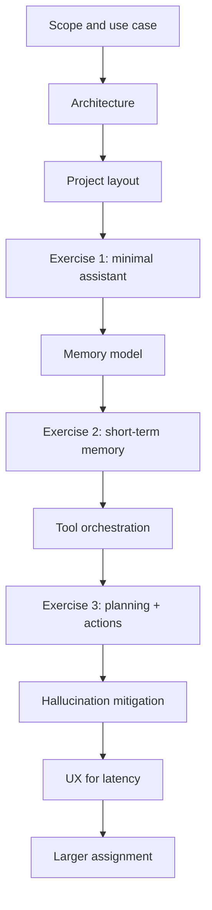
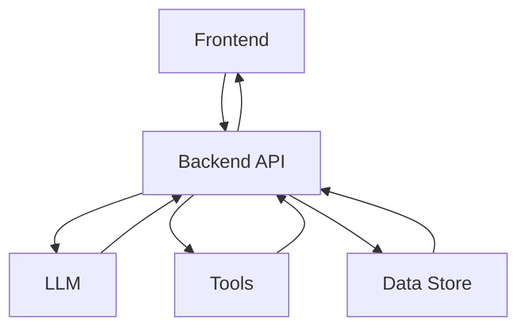
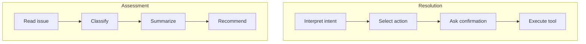
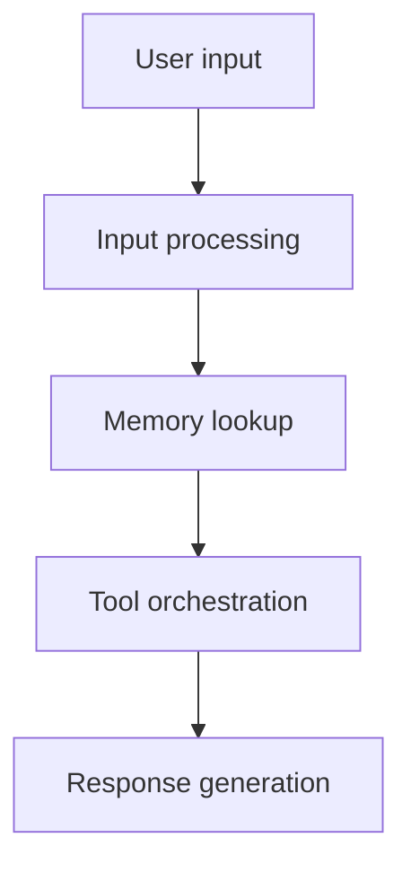
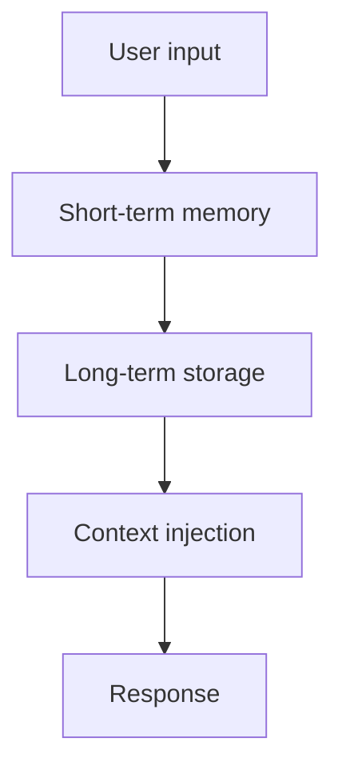

# Building an AI Assistant

In earlier chapters, you learned core building blocks such as tool calling, retrieval, and ReAct. Great, but at some point you need to put those pieces together into one application that feels like a real product and not just a series of isolated demos.

This chapter brings those capabilities together through architecture: how the assistant processes input, manages conversation memory, orchestrates tools safely, and returns useful responses.

It's also worth being explicit about where this chapter sits in the broader arc of the book. We are still building an assistant, not a fully autonomous agent. That distinction matters because it sets expectations correctly: the system will remember context, call tools, and coordinate actions, but it will still operate inside rules that you define in code.

In this chapter, you will learn to:

- Design an assistant architecture that can handle realistic user requests.
- Separate application architecture from assistant behavior architecture.
- Add short-term and long-term memory with clear design tradeoffs.
- Orchestrate tools using linear, decision-tree, and planner patterns.
- Add practical hallucination safeguards and UX patterns for slower AI responses.

## Quick chapter map

Before we go section by section, it helps to see the shape of the chapter at a glance:



**Fig 1: This chapter map shows the progression from scope and architecture to implementation exercises, safeguards, and the final assignment.**

This way, when we zoom in on details, you always know where you are in the bigger picture.

If you are reading this chapter in one sitting, a practical approach is:

1. Read architecture and layout sections first without coding.
2. Implement each exercise right after its section.
3. Return to orchestration and memory sections when behavior feels unclear.

This read-then-build rhythm tends to work better than trying to memorize everything up front.

With that map in mind, let's make the scope of the chapter very concrete.

## Chapter scope

The focus here is system shape: where responsibilities live, how requests flow, what the assistant remembers, and how tools are governed. Advanced production concerns such as resilience engineering, authorization hardening, compliance, and monitoring pipelines are covered in Chapters 18 and 19.

With the goals on the table, let us anchor them in a concrete scenario we can build around.

## What you will build

You will design and practice with an IT support assistant that can:

- Classify a request
- Summarize context
- Recommend next steps
- Run a diagnostic action only with user confirmation

Humans still own final decisions in sensitive situations. The assistant helps with speed and consistency, not unchecked autonomy.

This boundary keeps the system useful, transparent, and predictable while you learn how its parts work together.

## Use case: IT support assistant

IT support is a strong fit for assistant systems because requests usually involve triage, context gathering, and decision support.

Your assistant helps with:

- **Finding information**: docs, known fixes, runbooks.
- **Performing actions**: diagnostics and scripted checks.
- **Providing advice**: prioritized recommendations.

Core capabilities:

- **Classifier**: label the issue type, such as network, software, or hardware
- **Summarizer**: produce a compact state summary for the current ticket
- **Advisor**: suggest concrete next steps

If this sounds familiar, that is a good thing. It mirrors how support teams already work in practice: identify, summarize, decide.

These capabilities reduce repetitive triage work and improve consistency. Human operators still own final decisions.

This use case also works well for learning because it contains both low-risk and higher-risk behavior. Looking up information is one thing. Running a diagnostic or taking a system action is another. That contrast helps us teach orchestration and confirmation in a way that feels grounded instead of theoretical.

With the use case in place, the next step is architecture.

If architecture sounds abstract, think of it this way: architecture is the set of decisions that prevents your app from becoming a pile of one-off scripts.

## Architectural overview

When building assistant apps, it helps to think in two layers, application architecture and assistant architecture. Each architecture type addresses different concerns. Here's how to think about them:

- Application architecture: frontend, backend, storage, APIs
- Assistant architecture: input processing, memory, orchestration, response generation

A useful mental model is this: application architecture is the skeleton, assistant architecture is the behavior engine.

Keeping these layers separate lets the behavior become more capable without requiring you to rebuild the application shell around it.

### Application architecture

In this chapter, we use plain HTML/CSS/JS for the frontend and Python with FastAPI for the backend.
The next diagram shows how those parts connect at runtime.



**Fig 2: This figure presents the client-server architecture where the backend coordinates model calls, tool usage, and storage.**

At first glance this looks like a normal web app, and that is true. The difference is what the backend now orchestrates: model calls, tool execution, and context injection.

That means that many of the engineering habits you already know still matter. Clear routes, predictable models, testable services, and stable data boundaries do not disappear just because an LLM is involved. If anything, they become more important because the system has one more layer of variability to manage.

### Assistant architecture

Given our IT support use case, we can describe two flows: assessment flow and resolution flow. The idea is that the assessment flow happens first as it helps the operator "assess", i.e figure out what this issue is and what recommendations there could be. The other flow to take place is therefore the resolution flow where an operator looks at the recommendations and act on those or takes a different action. 

Here's the flows:

- **Assessment flow**: understand the issue and propose next steps.
- **Resolution flow**: request confirmation, then run an action.

The following diagram illustrates how those two flows relate.



**Fig 3: This figure contrasts the assessment path for understanding issues with the resolution path for executing confirmed actions.**

Separating these flows is not just a design preference, it is a safety pattern. Assessment helps users understand. Resolution can change system state, so it should require explicit confirmation.

You can also think of these flows as answering two different questions. Assessment asks, "What is happening here?" Resolution asks, "What should we do next, and are we allowed to do it?" Keeping those questions separate reduces confusion in both code and user experience.

To support these flows, we need four core assistant components:

- **Input processing**: where the assistant takes user input, detects intent, and extracts relevant details.
- **Conversation memory**: where the assistant keeps context for the current issue and persisted history.
- **Tool orchestration**: where the assistant decides which tools to call and in what order.
- **Response generation**: where intermediate outputs are turned into a clear, grounded user response.

Each issue can have its own conversation memory. That keeps context scoped and avoids cross-ticket confusion.

Now, zoom in one level further and look at the core loop each turn follows:



**Fig 4: This figure shows the core assistant loop from input processing and memory lookup through orchestration and response generation.**

Once you have this loop, debugging and extending the assistant becomes much easier because each step has a clear responsibility.

For example, if answers are irrelevant, you can inspect memory retrieval. If the wrong tool was called, you inspect orchestration logic. If output tone is off, you inspect response generation. Clear boundaries make failures easier to locate.

This is one of the quiet but important differences between a toy demo and a real assistant application. In a demo, everything can be blended into one prompt and still look impressive. In a real system, you need to know where a mistake came from so you can fix it without rewriting everything.

With architecture settled, let us map it to an actual codebase layout.

### Architecture decision checkpoints

Before you start coding, it helps to lock in a few decisions explicitly:

- **Where will orchestration live**: in routes or in a dedicated assistant service?
- **What memory is required**: for this chapter only, and what is deferred?
- **Which actions require confirmation**: before execution?
- **Which outputs should always reference evidence**:?

You do not need perfect answers at the start. You do need explicit answers so behavior is consistent, meaning you can iterate on one design instead of bouncing between multiple patterns.

Those decisions are also helpful because they expose which responsibilities belong to code and which belong to the model. A lot of confusion disappears once you realize that not every decision should be delegated to the LLM.

## Suggested project layout

A key aspect of designing any app is to ensure you have a file and folder layout that scales as the app grows. Below is a suggestion on how to lay out your app:

```text
assistant-app/
├── backend/
│   ├── main.py                  # FastAPI entry point + routes
│   ├── assistant.py             # Orchestrator: classify -> summarize -> advise
│   ├── schemas.py               # Pydantic models + enums
│   ├── services/
│   │   ├── classifier.py        # Internal inference step
│   │   ├── summarizer.py        # Internal inference step
│   │   └── advisor.py           # Internal inference step
│   ├── tools/
│   │   ├── issue_lookup.py      # Reads from an external system
│   │   └── network_action.py    # Performs a confirmed action
│   ├── memory/
│   │   ├── short_term.py
│   │   └── long_term.py
│   ├── utils/
│   │   ├── config.py
│   │   └── llm_client.py
│   └── tests/
│       ├── test_services.py
│       ├── test_tools.py
│       ├── test_assistant.py
│       ├── test_routes.py
│       └── test_memory.py
├── frontend/
│   ├── index.html
│   ├── styles.css
│   └── app.js
├── data/
│   └── sample_tickets.json
├── pyproject.toml
└── README.md
```

Here's why this layout works:

- **Behavior Separation**: Keeps assistant behavior separate from API routing
- **Service and Tool Isolation**: Separates internal inference steps from capabilities that read or change external systems
- **Model Flexibility**: Makes it easier to swap model providers later

In many first-time projects, responsibilities get mixed quickly, for example route handlers directly calling tools, updating memory, and formatting user output in one place. That works for a while, but becomes hard to test and hard to evolve.

By splitting concerns early, you gain two benefits:

- **You can test behavior in isolation**, such as memory logic without touching API endpoints.
- **You can replace parts of the stack without rewriting everything**, such as swapping model clients or adding a second frontend.

There is also a third benefit that beginners often feel only later: readability. When your folders reflect your system responsibilities, the project becomes easier to reason about. That lowers the cost of coming back to the project after a break.

### Folder walkthrough

Let us briefly walk through why each backend area exists:

- `main.py` is transport and API glue. Keep it thin.
- `assistant.py` is system behavior. It should read like the policy of the app.
- `services/` contains internal steps such as classification, summarization, and advice. The orchestrator calls these as part of its pipeline.
- `tools/` contains capabilities that cross the application boundary to retrieve data or change system state. Give each tool clear inputs, outputs, and side-effect rules.
- `memory/` hide storage details from the rest of the code.
- `schemas.py` define canonical request and response models.
- `tests/` include both unit and flow-level tests so regressions are caught early.

The important takeaway is not this exact tree, but the principle: isolate behavior boundaries so the app can grow safely.

If you are new to larger projects, here is the key idea: folder structure is architecture made visible.

Now let us go from design to practice with three exercises.

## Exercise 1: Minimal terminal assistant

The goal of this first exercise is not to build something impressive. The goal is to establish a baseline and to notice what is missing when memory and orchestration are not there yet.

To make the exercise easier to follow, let's first look at the core idea in a few lines of code. At this stage, the assistant is little more than a terminal loop plus a single function that sends the user's message to the model.

Notice what is *not* present yet: there is no memory, no tool routing, and no planning. That simplicity is the point, because we want a baseline that is easy to reason about.

```python
def ask_model(client, user_input: str) -> str:
    response = client.chat(
        model=OLLAMA_MODEL,
        messages=[
            {"role": "system", "content": "You are a helpful IT support assistant."},
            {"role": "user", "content": user_input},
        ],
    )
    return response.message.content.strip()


while True:
    user_input = input("You: ").strip()
    answer = ask_model(client, user_input)
    print(f"Assistant: {answer}")
```

What this shows is the minimal assistant loop: `user_input` is read, `ask_model()` calls the model, and `answer` is printed. If the user asks a follow-up in the next turn, the assistant will not remember anything unless we explicitly add memory ourselves.

Open [code/exercise/1-assistant.py](code/exercise/1-assistant.py) and run from the exercise folder:

```bash
uv run 1-assistant.py
```

Tasks:

- Change the system prompt so the assistant sounds more formal.
- Add a `/model` command that prints model name and host.
- Ask several IT support questions and observe stateless behavior.

Success checklist:

- Assistant responds consistently to direct questions
- `/model` returns useful metadata
- You can clearly see that context is not preserved between turns

This exercise is intentionally simple. It gives you a baseline so you can feel why memory matters in the next section.

If the model gives a good answer in one turn and then forgets it in the next, that is not a model quality failure, it is a system design failure. This is exactly what Exercise 1 helps you observe.

### Common mistakes in Exercise 1

Typical beginner mistakes here include:

- **Too much logic in the system prompt**: Packing too much logic into the system prompt instead of starting simple.
- **Adding tools too early**: Trying to add tools before verifying baseline conversational loop behavior.
- **Skipping manual tests**: Skipping manual tests and assuming one correct answer means the setup is stable.

If your responses are inconsistent, reduce variables. Keep one model, one prompt, and repeat a small set of representative test questions.

Now that we have a baseline for a stateless assistant, we can move to the next capability that makes the system feel far more real: memory.

## Conversation memory

If your assistant forgets everything after each turn, it feels broken in real support scenarios. Users naturally refer to earlier context.

For this use case, memory is per issue or ticket, and we need two horizons:

- **Short-term memory**: active conversation context
- **Long-term memory**: persisted history for future retrieval

To make this concrete, here is a simple memory-flow view.



**Fig 5: This figure depicts how user input moves through short-term and long-term memory before context is injected into response generation.**

At this point, many builders ask a good question: "Do I really need long-term memory yet?" The answer is: maybe not for your first implementation, but you should still design for it. Even a simple placeholder model now saves rework later.

It is also helpful to be precise about what we mean by memory in assistant systems. We do not mean that the model itself permanently remembers. We mean that our application stores useful state and selectively feeds it back into the model at the right time.

Design decisions to make:

- **What to store**: messages, tool calls, outputs, recommendations
- **How to index**: issue ID, tags, timestamps, severity
- **How to retrieve**: recent turns first, optional semantic lookup for older context
- **How to retain**: cleanup and archival rules

Example memory record:

```json
{
  "issue_id": "12345",
  "category": "network_issue",
  "keywords": ["slow internet", "wifi"],
  "summary": "Intermittent packet loss in office network",
  "vector": [0.1, 0.2, 0.3]
}
```

Do not aim for a perfect memory store on day one. Aim for a memory model that supports your next decision.

That phrase, "supports your next decision", is a useful test. Memory should not be collected because it feels advanced. It should be collected because it improves the next classification, the next recommendation, or the next action choice.

### Memory design for this use case

For IT support requests, useful memory is not only the raw chat transcript. You usually also want structured state that the assistant can reason over. For example:

- Current issue category and confidence
- Most recent diagnostic actions taken
- Key constraints, such as user permissions or environment details
- Recommended next step and whether it was accepted or rejected

You can store this in relational tables, documents, or JSON blobs. The storage choice matters less than retrieval ergonomics. Ask this question: when generating the next response, can the assistant quickly fetch the right context without dragging in irrelevant history?

In practice, teams often use a hybrid retrieval strategy:

- Metadata filtering for precision, such as `issue_id` and `category`
- Semantic lookup for recall, such as finding similar incidents

This gives you a practical balance between speed and relevance.

To see the difference between useful retrieval and noisy retrieval, imagine two follow-up questions from a user. In one case, the assistant remembers that the user already rebooted the router and avoids repeating that recommendation. In another case, it pulls in an old unrelated network issue from last month and confuses the current diagnosis. Both cases involve retrieval, but only one improves the interaction.

That is why retrieval policy matters as much as storage. Storing more is easy. Retrieving the right context is the real design task.

### What to remember vs what to summarize

A practical memory tension is this: full history gives detail, but too much history hurts response quality and cost. Summaries reduce context size but can lose nuance.

One pragmatic strategy is:

- Keep the most recent N turns in full detail.
- Maintain a rolling summary for older context.
- Preserve critical facts as structured fields.

For example, user permissions, environment details, and unresolved blockers should usually be stored as structured state, not only in free text summaries.

Before we move to the next exercise, notice the broader pattern here. We are not only making the assistant remember more. We are deciding what kind of information deserves to survive and in what format it should survive. That is a design question as much as a coding question.

## Exercise 2: Add short-term memory

The purpose of this exercise is to make memory visible in behavior. You should be able to feel the difference between a one-turn demo and a conversation that actually carries context forward.

Before jumping into the exercise file, study the small pattern below. The key change is that we keep prior turns in a `memory` list and send them back to the model on each request.

That one change is enough to make the assistant feel more conversational. The model still does not "remember" on its own. Our application remembers and replays the relevant context.

```python
memory: list[dict[str, str]] = []


def chat_with_memory(client, memory, user_input: str) -> str:
    messages = [{"role": "system", "content": SYSTEM_PROMPT}]
    messages.extend(memory)
    messages.append({"role": "user", "content": user_input})

    response = client.chat(model=OLLAMA_MODEL, messages=messages)
    return response.message.content.strip()


answer = chat_with_memory(client, memory, user_input)
memory.append({"role": "user", "content": user_input})
memory.append({"role": "assistant", "content": answer})
```

Read that carefully, because it captures the whole concept. `chat_with_memory()` builds `messages` by combining the `SYSTEM_PROMPT`, the existing `memory`, and the current `user_input`, then stores both the user turn and the assistant `answer` back into `memory`.

Open [code/exercise/2-assistant.py](code/exercise/2-assistant.py) and run it.

Tasks:

- Ask a follow-up that depends on something from two turns earlier.
- Run `/history` and inspect stored turns.
- Run `/summary` and compare with the real conversation.
- Add `/clear` to reset session memory.

Success checklist:

- Follow-up answers use prior context correctly
- `/history` reflects the current session
- `/clear` empties conversation state

Once this works, your assistant stops feeling stateless and starts feeling conversational.

Another benefit appears quickly: summaries become better because the model has an actual conversation state to compress instead of trying to infer context from one prompt.

You also unlock continuity between turns. A user can say, "Use the same approach as before," and the assistant has a real reference point instead of guessing.

So what comes next? The assistant now remembers context, but it still needs to decide what actions to take.

### Common mistakes in Exercise 2

The most frequent issues are:

- Treating memory as a plain string blob and losing role metadata
- Forgetting to clear state between test runs
- Sending entire history every turn without bounds

If quality drops over longer sessions, inspect what context is being injected. Often the fix is not "better prompting" but better context selection.

With memory in place, the assistant can now remember. The next question is whether it can make good decisions about what to do.

## Tool orchestration

Tool calling is awareness. Orchestration is control.

- Tool calling: the model knows tools exist
- Orchestration: your system controls sequencing, fallbacks, confirmation gates, and errors

This difference is critical. A model that can call tools is not automatically a reliable assistant app.

A reliable app defines when tools can be called, in what order, with what safeguards, and what to do when they fail.

Another way to think about orchestration: it is your operational policy layer. The model proposes, your system governs.

In Chapter 5, you saw tool calling and how to make the model aware of available tools. In a production-style assistant, awareness is only the beginning. We need orchestration: the ability to sequence multiple tool calls, handle dependencies between them, and recover from failures.

### End-to-end walkthrough: one request through the system

Before we continue with patterns, let us walk one request through the full system so the architecture feels concrete.

Imagine the user says:

"My internet has been unstable all morning and Zoom keeps dropping."

A practical flow might look like this:

1. Input processing extracts intent and entities.
The assistant identifies this as a likely network issue and notes key hints such as "unstable" and "Zoom drops".

2. Memory lookup checks recent context.
If the same issue exists in prior turns, the assistant fetches previously attempted steps, such as "router reboot already tried".

3. Tool orchestration selects a path.
The assistant chooses a sequence like classify -> summarize -> network diagnostics -> recommendation.

4. Confirmation gate checks risk.
If the next action could change system state, for example restarting a network service, the assistant asks for explicit user confirmation.

5. Response generation combines outcomes.
The final response includes what was observed, what was checked, what is recommended next, and where uncertainty remains.

Notice what happened here: we did not ask the model to do everything in one step. We gave the system a structure where each component contributes one kind of value. That is exactly the shift from a prompt demo to an assistant app.

Simple tool example:

```python
import requests


def tool_issue_lookup(issue_id: str) -> str:
    response = requests.get(f"https://api.itsupport.com/issues/{issue_id}", timeout=10)
    if response.status_code == 200:
        return response.json().get("details", "No details found.")
    return f"Error: unable to retrieve issue {issue_id}."
```

Now the important question is not only "can I call a tool?" but "which orchestration pattern should I choose?"

Before we choose a pattern, let us break orchestration into concrete parts.

### Tool selection

Tool selection means mapping a user request to the right capability. In simple systems, this is mostly intent classification. In more advanced systems, it can include state checks, policy checks, and confidence thresholds.

Tool descriptions matter a lot. If your tool contract is vague, selection quality drops. At minimum, define:

- What the tool does
- Required inputs and input constraints
- What success looks like
- What failure looks like

A model can only choose well if the tool surface is clear.

As you can see, details matter. Be explicit about what the tool does, how to call it, and what to expect from output.

Here is a practical tool contract template you can follow when documenting tools:

- **Name**: verb + noun, clear and specific.
- **Purpose**: one sentence of intent.
- **Inputs**: typed fields with constraints.
- **Output**: typed success payload.
- **Errors**: expected failure modes and messages.
- **Side effects**: what the tool changes.

Even if you do not formalize this as JSON schema immediately, writing these fields forces clarity.

It also helps to classify tools by risk, because not every tool should be governed in the same way. A simple lookup tool is very different from a diagnostic tool, and both are very different from a tool that changes system state. If you make that distinction early, your confirmation rules and error handling become much easier to reason about.

Here is a simple mental model for tool categories in this chapter:

- **Information tools**: fetch facts, records, or documentation.
- **Diagnostic tools**: inspect state and report findings.
- **Recommendation tools**: generate or rank next steps.
- **Action tools**: change state or trigger an external effect.

The more a tool can change the world outside your process, the more explicit your control logic should be.

### Sequencing

Some tasks are naturally ordered. Others are flexible. You should be explicit about which is which.

For a strict workflow, plain code sequencing is often best:

```python
def book_trip():
    book_flight()
    book_hotel()
    book_rental_car()
    pay_for_everything()
    send_confirmation_email()
```

For IT support, sequencing can be softer. You might classify and summarize in either order, then choose a diagnostic action based on both outputs.

Given the nature of LLMs, behavior is not perfectly predictable. So ask yourself whether you are okay with that variability for a given path, or whether you should skip model-based sequencing and rely on explicit code.

The key idea: if order is critical, encode it explicitly. If order is flexible, a planner can help.

Beginners often feel that planners sound more advanced and therefore automatically better. In practice, planners are valuable when variability is real and the cost of a wrong sequence is acceptable. If those conditions are not true, explicit sequencing is usually the better engineering choice.

A useful sequencing question is: "What must be true before this tool runs?"

For instance, if an action tool requires elevated permissions, your sequence should include policy check -> confirmation -> execution, never direct execution.

### Error handling

If tools touch real systems, failures are normal, not exceptional. Plan for them.

Common failure categories include:

- Network or timeout issues
- Bad inputs or schema mismatches
- Empty or low-quality tool outputs
- Policy violations or missing permission

For each category, define behavior:

- Retry or not
- Fallback response
- Escalation path
- Logging fields for debugging

When users see graceful failure behavior, trust increases even when operations fail.

A good sign of a robust system is how it behaves when things go wrong. Failures will happen. The goal is to fail clearly, safely, and in a recoverable way.

Consider a simple failure response format in your app logic:

```json
{
    "status": "error",
    "category": "transient_timeout",
    "user_message": "I couldn't complete that step right now. I can retry or suggest a manual step.",
    "retryable": true
}
```

This helps your frontend and assistant logic handle errors consistently.

It also helps your users understand what happened. A vague failure message makes the system feel unreliable. A clear failure category plus a practical next step makes the system feel manageable even when something breaks.

### Pattern comparison

Let's compare these patterns so we understand when to best apply them but also existing tradeoffs. Here's a table below to sum this up for us:

| Pattern | Best for | Tradeoff |
|---|---|---|
| Linear flow | Predictable steps in fixed order | Low flexibility |
| Decision tree | Branching by issue type | Branches grow quickly |
| Planner | Dynamic sequencing by context | Harder to keep deterministic |

Is there a general guidance we can follow for pattern selection. Well, start simple. Move to a more dynamic pattern only when your use case truly requires it.

That advice is not about avoiding sophistication forever. It is about earning complexity. A linear flow you understand is better than a dynamic planner you cannot debug.

A practical progression is:

1. Linear flow first. It is the simplest and most predictable. You can always add branches later.
2. Add decision branches when categories diverge.
3. Add planner only when context variability demands it.

That progression keeps complexity proportional to real requirements.

### Choosing patterns with a simple decision rule

If you are unsure which orchestration style to pick, use this rule of thumb:

- If the task is stable and repetitive, start with linear flow.
- If the task branches by category, move to a decision tree.
- If the task has many valid paths that depend on context, use planner-assisted flow.

Then ask one more question: what is the cost of being wrong?

- Low cost of being wrong: planner flexibility is often acceptable.
- High cost of being wrong: prefer deterministic code paths and strict validation.

This one question prevents a common mistake: overusing planners in high-risk paths where explicit rules are safer and easier to debug.

If you want a quick rule of thumb, think of planners as proposal engines, not permission engines. They can be great at suggesting a path. They should not be the only thing standing between your system and a risky action.

### Pattern as code examples

Here's some pseudo code for each pattern to make it more concrete. Also so it's easier to compare their code approach:

**Linear flow**:

```python
def process_issue(issue: str) -> str:
    category = classify(issue)
    summary = summarize(issue)
    return advise(category, summary)
```

**Decision tree**:

```python
def route_issue(issue: str) -> str:
    category = classify(issue)
    if category == "network_issue":
        return run_network_checks(issue)
    if category == "software_issue":
        return run_software_checks(issue)
    if category == "hardware_issue":
        return run_hardware_checks(issue)
    return "Unknown issue type. Please provide more details."
```

**Planner sketch**:

```python
def plan_issue_resolution(issue: str) -> list[str]:
    prompt = f"""
You are an IT support planner.
Given this issue, output tools in order:
{issue}
"""
    return planner_llm(prompt)
```

Planner-based systems are powerful, but less deterministic. For high-risk paths, keep hard rules in code.

To make the grounding idea more concrete, compare these two responses:

**Ungrounded response**: "The problem is probably packet loss. Restart the network service."

**Grounded response**: "The network diagnostic tool reported intermittent packet loss and high latency. Based on that result, the next recommended step is to restart the network service, but this requires confirmation before execution."

The second answer is not only safer. It is easier for a user to trust because it explains where the recommendation came from.

One useful compromise is a hybrid approach:

- Planner proposes a plan
- Rule engine validates the plan
- Execution layer enforces confirmation for risky actions

This gives flexibility without handing full control to model output.

There is no single right orchestration style forever. As your app matures, you may use different patterns in different paths.

- High-risk actions: deterministic flow with strict checks
- Mid-risk troubleshooting: decision tree
- Open-ended analysis: planner-assisted flow

What about error handling? That is the next critical topic.

### Minimal error-handling rules

It's good if we can define some simple rules for how the system should respond when tools fail. Here are some practical rules to start with:

- Retry transient failures with a short backoff.
- Provide a safe fallback when a non-critical tool fails.
- Escalate to a human path if execution is high-risk or unclear.

These rules are intentionally minimal for this chapter. In Chapters 18 and 19, you will expand them with stronger runtime reliability and operating practices.

If you want one additional lightweight rule right now, make actions **idempotent** where possible. An idempotent action can run more than once with the same intended result, rather than repeating its side effects. For example, if a timeout causes the assistant to retry a request to restart a network service, the retry should confirm that the service is already running instead of starting a second restart operation.

Another lightweight rule is tool budget limits. For example, restrict a single request to a maximum number of tool calls to avoid runaway loops.

One more practical guardrail is "timeout tiering". That means we can set different timeouts for different tool types based on expected latency and user expectations:

- **Fast tools (classification, lightweight lookups)**: short timeout
- **Medium tools (diagnostics)**: moderate timeout
- **Slow tools (remote dependency chains)**: longer timeout with clear user messaging

When everything uses the same timeout, user experience becomes inconsistent. Tiered timeouts make failures more predictable and easier to explain in the UI.

With those orchestration ideas in mind, we are ready for the third exercise where the pieces start to work together as one system.

## Exercise 3: Add planning and orchestration

The purpose of this exercise is to make the assistant feel architectural rather than incidental. You are now combining classification, memory, tool selection, confirmation, and response generation into one bounded flow.

At this point, it helps to see the orchestration shape in simplified code before you dive into the full exercise. The pattern is no longer just "ask model, print answer". Now the system first classifies the request, then selects a tool flow, then optionally asks for confirmation before an action runs.

This is the first point in the chapter where the assistant starts to feel like a small governed system instead of a direct chat wrapper.

```python
classification = classify(client, user_input)
category = classification["category"]
findings = []

if category == "network_issue":
    findings.append(tool_network_check())
    if classification["needs_action"]:
        confirm = input("Assistant: Simulate network fix? (yes/no): ")
        if confirm == "yes":
            findings.append(tool_apply_network_fix())

answer = generate_answer(client, user_input, classification, findings)
print(f"Assistant: {answer}")
```

There are a few important ideas packed into this small snippet. First, `classify()` is used to produce `classification`, not to execute anything directly. Second, `findings` is initialized before routing, so every category can safely pass a list to `generate_answer()`. Third, `category` determines the tool path in code, and the side-effecting `tool_apply_network_fix()` call is guarded by the `confirm` check before it runs.

Open [code/exercise/3-assistant.py](code/exercise/3-assistant.py) and run it.

Tasks:

- Describe a disk-space problem and inspect selected category/tool.
- When prompted for a network fix, type `yes` and inspect simulated output.
- Add category `hardware_issue` and function `tool_hardware_check()` with fake diagnostics.

Success checklist:

- Classification maps to the expected tool
- Confirmation gate blocks execution until approved
- New category path runs end-to-end

At this point you have connected all major ideas in one flow: input processing, memory, orchestration, and guarded execution.

That is the transition from "LLM demo" to "assistant application design".

This is also where the chapter's architecture focus pays off. You are not just adding features; you are building a system shape that can handle growth.

### Common mistakes in Exercise 3

Watch out for these:

- Allowing action execution without confirmation checks
- Blending classification, planning, and execution into one opaque prompt
- Not logging selected category and chosen tool for debugging

If behavior seems random, log intermediate decisions. Observability starts with simple structured logs.

Also, keep in mind that "working once" is not enough for orchestration logic. Run at least a small matrix of scenarios:

- Straightforward network issue
- Ambiguous issue that could be network or software
- Known category with simulated tool failure
- Request that triggers confirmation path

If all four behave sensibly, your orchestration is much more likely to hold up under realistic usage.

At this point, the chapter has introduced the system shape. The next two sections focus on two things that make the same system more trustworthy in practice: reducing hallucination risk and handling latency in a user-friendly way.

## Hallucination mitigation (practical level)

LLMs can produce confident but wrong answers. Why does that happen? LLMs are essentially next-word predictors. They do not have a built-in fact-checking mechanism. If the prompt and context lead them to generate something plausible but incorrect, they will do so without hesitation and with a high degree of confidence.

What do we do about that at this stage? Add practical guardrails:

- **Confidence cues**: ask the model to show uncertainty when evidence is weak.
- **Evidence requirement**: attach source or tool output to factual claims.
- **Prompt policy**: forbid guessing for critical actions.
- **Fallback behavior**: when uncertain, ask clarifying questions or escalate.

For this chapter, keep safeguards straightforward and explicit in prompt plus code-level checks.

That combination is important. Prompting alone is rarely enough for high-value safeguards. If something truly matters, such as whether a tool ran or whether evidence exists, your application should verify it rather than merely asking the model to behave.

At the end of the day, you are working with a prediction engine. That is powerful, but it also means you need guardrails to protect both users and system outcomes.

Here is a practical guardrail prompt pattern you can adapt:

```text
If evidence is insufficient, say "I don't know based on current data".
Never fabricate tool results.
For high-impact actions, ask for confirmation before execution.
When possible, cite which tool or memory record supports your answer.
```

Even simple guardrails like this improve consistency substantially for beginners.

You can also pair guardrails with lightweight post-response checks. For example, if a response includes a factual recommendation but no supporting source, ask the model to revise with evidence.

Notice how this ties back to the earlier architecture discussion. Hallucination mitigation is not a separate magical feature. It is the result of how you design memory, tools, prompts, and validation to work together.

## UX considerations for AI latency

Assistant features are often slower than traditional web API calls. If you ignore that, users think your app is broken.

With a normal web app, users are used to responses in under a second. AI-assisted behavior changes that expectation window, so your UX has to actively manage perception and trust.

This is one reason assistant architecture and frontend design cannot be treated as separate worlds. The backend may be doing useful multi-step work, but if the UI stays silent, the user experiences only delay and uncertainty.

### Perceived responsiveness strategies

Even if an action is long running, you can apply a set of strategies to ensure the user doesn't perceive the app as broken. Because if they do they might either abandon the app altogether or retry operations and you suddenly have a ton of requests to deal with. 

Practical UX strategies:

- **Show progress states with clear messages**: Here's some messages you could be showing "Classifying issue...", "Running diagnostics...", "Generating recommendations...".
- **Keep the UI responsive while long tasks run**: Ensure users can interact with other parts of the app while waiting for results.
- **Use streaming responses when possible**: Display partial results as they arrive to reassure users that the assistant is working.
- **Set expectations for longer operations**: Inform users about potential delays and provide estimated completion times.

Perceived responsiveness is often as important as raw model quality.

One more practical note: streaming is not only a technical optimization, it is a communication strategy. Seeing partial output reassures users that the assistant is working.

It also mirrors the system stages we already discussed earlier in the chapter. If the backend moves through classification, memory lookup, diagnostics, and recommendation, the UI can expose that same progression in a simple and reassuring way.

### Progressive disclosure for longer operations

Another helpful pattern is progressive disclosure:

- **Immediate acknowledgement**: Show a short immediate acknowledgement to state something like "Started operation".
- **Intermediate status**: Show intermediate status for long operations. If you can show an indication that you've progressed, for example by a text saying "5/10 items processed" or similar.
- **Wrap-up**: Show final structured result when complete.

That pattern makes longer model latency feel intentional rather than broken.

If you plan a web UI, consider these concrete UI signals:

- **Stage-level status text**, such as "Classifying issue" or "Running diagnostics"
- **Distinct styling** for assistant reasoning vs confirmed actions
- **Clear confirmation prompt** UI before side-effect tools run

These small cues make the app feel much more dependable.

We are almost at the assignment now. Before we get there, it is useful to pause and summarize what the chapter has established.

## Chapter recap

Before moving to solutions and the larger assignment, let us recap what you now have:

- A clear two-layer architecture model
- A maintainable folder layout for growth
- A baseline assistant loop that evolves through three exercises
- A practical memory model with short-term and long-term horizons
- Multiple orchestration strategies and when to use each
- Early guardrails for hallucinations and latency-aware UX

If you can reason about those pieces as one system, you are ready for more advanced hardening in later chapters.

## Design checklist before the assignment

Before you start the larger assignment, run through this checklist once:

- Can you describe where each responsibility lives: route, assistant logic, tools, memory?
- Do you have at least one confirmation gate before any side-effect action?
- Does your assistant have a bounded short-term memory strategy?
- Can you explain how failures are reported back to users?
- Can you identify at least one place where evidence should be shown?

If any answer is "not yet", that is fine. Fix those gaps first and your assignment implementation will be much smoother.

With that checklist in place, you are ready to move from guided exercises to a larger implementation.

## Exercise solutions

Working solutions for all three exercises live in [code/exercise/](code/exercise/).

Run from that folder:

```bash
uv sync
uv run <file>
```

If your output differs from expected behavior, revisit each exercise checklist before moving on. Those checklists are designed to catch common beginner mistakes.

## Assignment

Build a simple assistant app that combines:

- Memory
- Tool orchestration
- Confirmation before actions
- A basic web UI

Target outcome: a beginner-friendly, real-app architecture that you can harden further in the production preparation and operations chapters.

### How to self-review your result

When you finish, ask yourself these three questions:

1. If a tool fails, does the system still behave like a helpful assistant?
2. If a user asks a follow-up, does memory improve answer quality?
3. If an action is risky, does the app pause and ask for permission?

If your answer is yes to all three, you have captured the core of this chapter.

If you can explain how requests move through your assistant, where context is stored, how tools are selected, and where confirmation is enforced, then you have learned the main goal of this chapter.

There is also a broader lesson here. You are not only learning how to connect an LLM to a UI. You are learning how to design a system where model behavior, application code, and user experience support one another.

## Solution

[Solution](./assignment/README.md)

## Summary

In this chapter, we've covered how to create an assistant architecture that scales, meaning it has a file structure that is well laid out. It also has clear responsibility boundaries between components, and it has a clear flow for how requests move through the system.

We also covered how to add memory and orchestration capabilities, and how to mitigate hallucinations and manage latency in the user experience.

Just as importantly, we clarified where control should live. Some responsibilities belong to the model, such as summarization and flexible language generation. Other responsibilities belong to the application, such as confirmation, validation, sequencing for high-risk steps, and failure handling.

That separation is what makes this chapter an important bridge. You are still building an assistant, but you are doing it in a way that prepares you for more agentic systems later without giving up control too early.

In our next chapter, we'll cover how to go from Assistants to Agents and what that means for architecture and generally on how our app should act.
