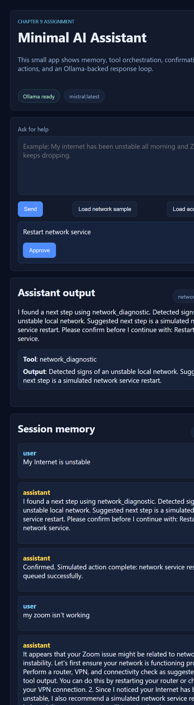
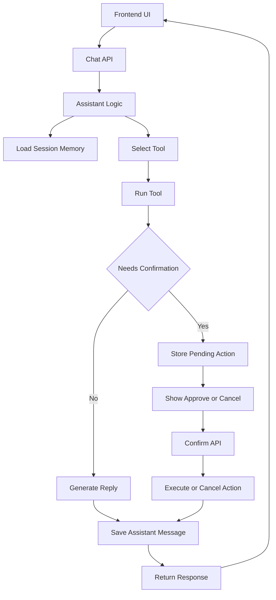

# Assignment

This assignment is a minimal assistant application that demonstrates the core architecture patterns from Chapter 9 without adding extra complexity. The app is intentionally compact, but it still includes short-term memory, simple tool orchestration, confirmation before a state-changing action, and a basic web UI.

The goal is to provide a clean implementation you can read end to end in one pass. That way, you can focus on how requests flow through assistant logic, memory, and tools before moving on to more advanced production concerns.

## Pre req

Before you install and run the app, make sure your local environment has the required runtime and model service available. The backend uses Ollama directly, so the model service must be running.

1. **Python**: Install Python 3.12 or newer.
2. **uv**: Install `uv` for dependency management and running the project.
3. **Ollama**: Install Ollama locally.
4. **Model**: Pull the default model used by this assignment:

```bash
ollama pull mistral
```

With prerequisites in place, you can install dependencies for the assignment project.

## Install

From the assignment folder, install all dependencies into the local virtual environment. This creates `.venv` and makes the backend ready to run.

```bash
uv sync
```

After installation, start Ollama if it is not already running in another terminal.

```bash
ollama serve
```

Once dependencies are installed and Ollama is online, you can run the web app.

## Run

Start the FastAPI server from the assignment folder. You can use reload mode during development, or run without reload for a simpler process model.

```bash
uv run uvicorn backend.main:app --reload --port 8012
```

Then open the app in your browser:

```text
http://127.0.0.1:8012
```

Use the UI to send a support message, inspect selected tool output, and confirm or cancel pending actions when prompted.



With the app running locally, it helps to understand exactly how each core requirement is implemented in this assignment. The implementation is intentionally small, so each component is easy to trace from request to response.

The following section maps the four assignment requirements directly to the backend and frontend behavior.

## Implementation Walkthrough

At a high level, each user message enters the API, passes through assistant logic, optionally triggers a tool and confirmation branch, and then updates session memory before returning to the UI. This sequence keeps behavior predictable while still demonstrating agent-like flow control.

The diagram below shows the runtime path for a single interaction.



Now that the flow is clear, the next sections describe each assignment requirement in concrete terms.

### Memory

Memory is implemented as short-term, in-process session state, keyed by `session_id`. This keeps the assignment simple while still showing how context is preserved across turns.

The memory layer stores messages and pending action state so that both conversational context and confirmation gating survive across requests.

- **Where it lives**: `backend/memory/short_term.py` with `ShortTermMemoryStore` and `SessionMemory`.
- **What is stored**: message history (`user` and `assistant`), `pending_action`, and `pending_action_label`.
- **How it is used**: `Assistant.handle_message()` appends user/assistant turns and reads recent context via `summary_text()`.
- **How UI sees it**: frontend calls `GET /api/session/{session_id}` to render the memory panel.

With memory in place, the assistant can route requests through tools while still retaining context.

### Tool orchestration

Tool orchestration is rule-based in this assignment, which keeps behavior deterministic for beginners. The assistant first chooses a tool from message content, then executes that tool to produce structured output.

This design shows orchestration control in code instead of relying on an opaque, all-in-one prompt.

- **Tool selection**: `select_tool(message)` maps message keywords to `network_diagnostic`, `account_lookup`, or `general_guidance`.
- **Tool execution**: `run_tool(tool_name, message)` returns `ToolResult` with output and optional confirmation metadata.
- **Assistant coordination**: `Assistant.handle_message()` orchestrates memory update, tool choice, tool run, and final reply composition.
- **Fallback behavior**: if LLM generation fails, assistant returns tool-backed text fallback instead of crashing.

Once tool orchestration identifies a potentially state-changing step, the flow moves into explicit confirmation.

### Confirmation before actions

Confirmation is implemented as a two-step interaction: first request proposes the action, second request approves or cancels it. This mirrors real-world safety gates without requiring external systems.

The confirmation state is stored in memory, which prevents accidental execution on unrelated turns.

- **Proposal step**: tool sets `requires_confirmation=True` and includes `action_type`/`action_label`.
- **Pending state**: assistant stores the pending action in session memory.
- **User decision**: frontend reveals Approve/Cancel and calls `POST /api/confirm`.
- **Execution path**: `confirm_action()` runs `execute_confirmed_action()` on approval or clears pending state on cancel.

After this safety gate, the final piece is the UI that exposes these states to the user.

### A basic web UI

The web UI is a single-page interface designed to make backend decisions visible with minimal complexity. It lets users send prompts, view tool evidence, see memory updates, and resolve confirmations.

This keeps the assignment focused on architecture instead of frontend framework setup.

- **Layout**: `frontend/index.html` has three functional areas: composer, assistant output, and session memory.
- **Client logic**: `frontend/app.js` calls `/api/chat`, `/api/confirm`, and `/api/session/{session_id}`.
- **State cues**: tool badge, memory status, and confirmation box make orchestration decisions explicit.
- **Styling**: `frontend/styles.css` provides a lightweight panel-based layout for readability.
