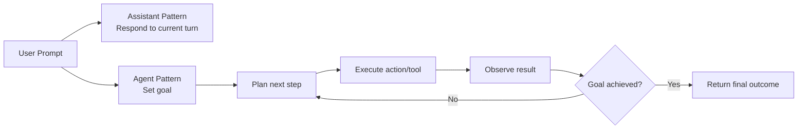
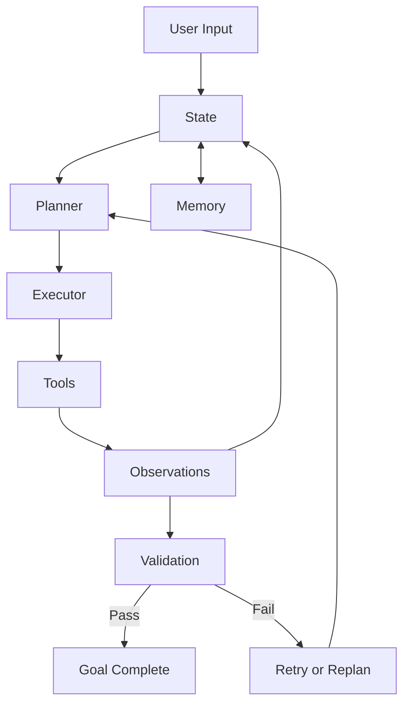
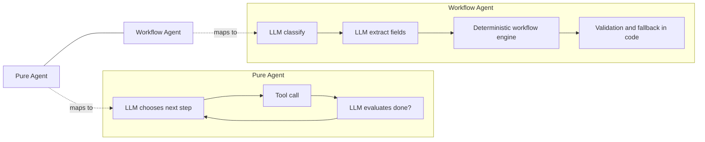

# Agent Architecture: From AI Assistants to Agents

In Chapter 9, you built an assistant that could do useful work with tools and short-term memory. That was a big step, but the behavior was still mostly response-oriented. In this chapter, we shift from "good response generation" to "goal-directed behavior over multiple steps."

What changes in practice? Architecture becomes the main design problem. By the end, you should be able to inspect an agent design and decide whether it fits low-risk creative work, structured business workflows, or high-impact decision paths.

In this chapter, you will learn to:

- **Define core components**: Identify state, planner, executor, tools, memory, and validation as separate responsibilities.
- **Differentiate assistant vs agent**: Explain the shift from single-turn response quality to iterative control toward a goal.
- **Implement a control loop**: Build plan-act-observe-evaluate-replan behavior in code.
- **Evaluate reliability limits**: Understand where pure LLM-driven loops fail and why workflow-driven agents are often safer.

Before writing code, let's make success explicit. This chapter works best when you can validate understanding section by section instead of waiting until the final assignment.

Use these success checks as you move through the chapter:

- **Conceptual check**: You can explain the difference between an assistant and an agent in 2-3 sentences using initiative, control loop, and goal pursuit.
- **Architecture check**: You can identify state, planner, executor, tools, memory, and validation in both `00-agent.py` and `01-agent.py`.
- **Execution check**: You can run both examples and describe one reliability risk in the pure loop and one reliability guardrail in the workflow loop.
- **Design check**: You can justify which pattern to use for a low-risk creative task versus a business workflow task.

## Architecture decisions

Before diving into examples, set a decision lens first. You will use these ideas repeatedly when comparing pure-agent and workflow-agent approaches.

- **Core components**: You will work with state, planner, executor, tools, memory, and validation as separate responsibilities rather than one blended loop.
- **Control loop mindset**: You will evaluate systems as plan-act-observe-evaluate cycles, including when to retry and when to replan.
- **Risk-aligned architecture**: You will choose between pure-agent and workflow-agent patterns based on reliability needs, not just implementation speed.
- **Execution reliability**: You will look for deterministic step ordering, explicit validation, and fallback behavior when correctness matters.
- **Planning handoff**: You will use this chapter as the architecture foundation before going deeper into planning strategy in Chapter 11.

Let's start by revisiting ReAct from Chapter 8, because that pattern is the conceptual bridge into architecture.

## How this connects to ReAct

Two chapters ago, ReAct introduced a loop where the system reasons, acts, and observes. That is the loop we now harden into architecture. In code, it looked roughly like this:

```python
response = input("What is the weather in New York?")
reasoning = reason_about(response)
action = decide_action(reasoning)
observation = execute(action)
# do something with observation, maybe loop back to reasoning or finish response generation
```

This gave you multi-step behavior, but the framing was still response generation.

In Chapter 9, you also built tool use and short-term memory into an assistant. It was capable, and it could orchestrate actions, but its optimization target was still "answer this prompt well."

In this chapter, we take the same ReAct ingredients -- reasoning, acting, and observing -- and organize them into explicit architectural responsibilities. The key shift is that the loop is no longer "respond well now" but "move toward goal completion reliably over time."

That puts us right at the key shift: goals. Let's move there next.

To anchor the shift visually, the following flow shows how we move from a single-turn assistant posture to iterative agent control toward a goal.



**Fig 10.1: Conceptual bridge from single-turn assistant response generation to iterative goal-driven agent control.**

## Assistant vs. agent

An assistant is usually optimized for this turn. An agent is optimized for the outcome, even when that takes several steps, tool calls, and correction cycles. Let's use one prompt and compare the behavior.

```text
User: I need to plan a trip to Paris next month. Can you help me with that?
```

**Assistant response**: The assistant might provide initial information about planning a trip to Paris, such as popular attractions, the best times to visit, or a checklist of decisions. It may also offer to help find flights or hotels, but it waits for another direct request before continuing. One response might look like this:

```text
Assistant: Sure! Here are some things to consider when planning your trip to Paris:
1. Flights: You can search for flights on websites like Expedia or Google Flights.
2. Accommodations: Consider staying in areas like Le Marais or Saint-Germain for a great experience.
3. Attractions: Don't miss the Eiffel Tower, Louvre Museum, and Notre-Dame Cathedral.
4. Transportation: The Paris Metro is a convenient way to get around the city.
If you want, I can help you find flights or hotels. Just let me know what you need!
```

The corresponding assistant code keeps the same single-turn shape:

```python
class Assistant:
    def __init__(self, model):
        self.model = model

    def generate_response(self, user_input: str) -> str:
        response = self.model.generate(user_input)
        return response

assistant = Assistant(model)

user_input = "I need to plan a trip to Paris next month. Can you help me with that?"
response = assistant.generate_response(user_input)
print(response)
```

An agent can take more initiative in pursuing the user's goal. Instead of responding once, it treats the request as a multi-step objective:

1. **Goal Understanding**: The agent identifies the user's goal as "plan a trip to Paris next month."
2. **Planning**: The agent creates a plan that includes steps like researching flights, finding accommodations, creating an itinerary, and setting reminders for important dates.
3. **Execution**: The agent starts executing the plan by first researching flights, then finding accommodations, and so on. It may use tools to search for flights, book hotels, and create calendar events.
4. **Observation and Replanning**: As the agent executes each step, it observes the outcomes. If it encounters an issue (e.g., no flights available on the desired dates), it can replan and find alternative solutions without needing further user input.

The agent therefore needs explicit planning, execution, observation, and recovery state:

```python
class Agent:
    def __init__(self, model, tools):
        self.model = model
        self.tools = tools
        self.goal = None
        self.plan = []
        self.history = []

    def set_goal(self, user_input: str):
        self.goal = self.model.extract_goal(user_input)

    def create_plan(self):
        # Create a plan based on the goal
        self.plan = self.model.create_plan(self.goal)

    def execute_plan(self):
        for step in self.plan:
            action = self.model.decide_action(step)
            observation = self.tools.execute(action)
            record = {
                "step": step,
                "action": action,
                "observation": observation,
            }
            self.history.append(record)
            if not self.validate_observation(record):
                self.replan(
                    failed_step=step,
                    failed_action=action,
                    observation=observation,
                )
                break

agent = Agent(model, tools)
user_input = "I need to plan a trip to Paris next month. Can you help me with that?"
agent.set_goal(user_input)
agent.create_plan()
agent.execute_plan()
```

Because the model and tools can return different results, the exact output will vary. With simulated travel tools, one run might look like this:

```text
Agent: Goal identified: Create a practical plan for a trip to Paris next month.
Agent: Plan created:
    1. Ask for travel dates, departure city, and budget
    2. Search for suitable flights
    3. Search for accommodations near the preferred area
    4. Build a day-by-day itinerary
    5. Present the plan for approval before making reservations
Agent: I need your departure city, preferred dates, and approximate budget before I search.
User: Seattle, from the 12th to the 18th next month, with a budget of $3,000.
Agent: Searching for flights and accommodations...
Agent: Observation: The lowest-priced direct flight exceeds the flight budget.
Agent: Replanning: Compare one-stop flights and hotels in a less expensive area.
Agent: I found two options that fit the total budget. Here is the proposed itinerary and cost breakdown. Please confirm before I make any reservations.
```

This trace shows behavior that the assistant response did not include:

- The agent turns the request into an explicit goal and plan.
- It gathers missing information before using search tools.
- It observes a constraint, revises the plan, and continues toward the goal.
- It pauses for approval before taking an action with real-world consequences.

Both systems can look capable in a demo, but they optimize for different things. The assistant optimizes for response quality per turn, while the agent adds initiative, control flow, and validation to pursue goal completion.

The contrast is clear on paper. Next, we will run the patterns and inspect where each behaves well and where it breaks.

Before we do that, let's make responsibilities explicit. If you cannot point at a part and say what it owns, debugging gets messy fast.

## Core components of an agent

An agent is not "just an LLM with tools." It is a system where each part owns a specific job, and many design mistakes come from responsibility blur.

When components stay separate, failures are easier to diagnose and fix. When they blur together, you end up guessing whether the issue was planning quality, execution logic, state drift, or weak validation.

Because these pieces can otherwise feel abstract, this diagram makes the responsibilities and data handoffs concrete before we implement the loops.



**Fig 10.2: Core agent architecture with explicit roles for planning, execution, validation, and memory-backed state updates.**

- **State**: The current working context of the agent. This includes the goal, what steps have been completed, tool outputs, user-provided facts, intermediate results, and any flags that tell the system what still needs attention.
- **Planner**: The component that decides what should happen next at the task level. In a simple system, this might produce a short checklist. In a more advanced system, it may decompose goals, revise priorities, or generate a new plan when conditions change.
- **Executor**: The component that carries out the current step. It turns a plan item into action by calling a tool, asking the user for missing information, or invoking some deterministic business logic.
- **Tools**: The external capabilities the agent can use to affect the world or gather information. Search, database lookup, sending an email, booking a flight, or writing a file are all examples of tools.
- **Memory**: The information the agent preserves beyond the immediate step. Short-term memory might include conversation history or recent tool outputs. Longer-term memory might include user preferences, saved facts, or prior decisions the agent should not forget.
- **Validation**: The checks that determine whether a step succeeded, whether the output is trustworthy enough to continue, and whether the overall goal has actually been met. Validation is what keeps an agent from confidently moving forward on bad assumptions.

With those parts named, we can now build the smallest possible agent loop and inspect where each responsibility lives.

## The pure agent: LLM-driven control

To get a pure loop running, we only need a minimal set of pieces:

1. **Goal/Plan**: A clear objective for the agent to pursue.
2. **Action Loop**: A way for the agent to take actions iteratively.
3. **Evaluation**: A way to determine when the goal has been achieved.

Before running code, do a quick setup check so environment issues do not get confused with architecture issues.

- **Python**: Use Python 3.11+ and confirm with `python --version`.
- **Dependency runner**: Ensure `uv` is installed and available in your shell.
- **Working directory**: Run commands from `Chapter-10-Agent-Architecture-and-Planning-Systems`.
- **Sanity check**: Run `uv run python code/00-agent.py --help` to verify the script starts correctly.

### 1. Identifying a goal and a plan

The first job is goal interpretation. Given a prompt, the system needs to express a concrete goal and an initial plan before it can act. Let's use "Research the history of coffee and write a short summary" and implement goal extraction.

```python
tools = {
    "search_web": search_web,
    "take_notes": take_notes,
    "write_summary": write_summary,
}

def tools_description(tools: dict) -> str:
    return ", ".join(tools.keys())

def extract_goal(user_input: str) -> str:
    return model.generate(
        f"Produce a clear one-sentence goal and a short checklist of 3-5 steps. "
        f"Here are the tools you can use {tools_description(tools)}: {user_input}"
    )

user_input = "Research the history of coffee and write a short summary."
goal_and_plan = extract_goal(user_input)
print(f"Identified goal and plan:\n{goal_and_plan}")
```

Running this code, you might see something like this:

```text
User> Research the history of coffee and write a short summary.
Agent> Goal: Research the history of coffee and produce a written summary.
Agent> Plan:
  1. Search the web for the history of coffee
  2. Take notes on key findings
  3. Write a summary from collected notes
```

At this point, the planner is doing two things at once: goal identification and first-pass decomposition. State is still small, but it is already real: user request, goal, available tools, and soon a history of observations.

Memory starts simple as well. Persist the goal and observations, so each future decision is grounded in what has already happened.

That gives us enough structure to move into execution.

### 2. Action loop with observation and completion check

Now we turn the plan into an action loop: decide, execute, observe, and check completion.

```python
done = False
history: list[dict[str, object]] = []
completed: list[dict[str, object]] = []

while not done:
    # LLM decides which tool to call and with what parameters
    decision = llm_decide_next_action(goal, history, tools)

    # Execute the tool
    observation = tools[decision.tool](**decision.params)
    record = {
        "step": decision.step,
        "tool": decision.tool,
        "params": decision.params,
        "observation": observation,
    }
    history.append(record)
    completed.append(record)

    # LLM evaluates: are we done?
    done = decision.done
```

The loop now keeps two related views of state. `history` provides context for the next action decision, while `completed` gives evaluation an explicit record of successful steps. Each record keeps the step, tool, parameters, and observation together instead of storing an output whose origin is unclear.

In this design, the LLM still makes every control decision: tool choice, parameters, and done status. That gives flexibility, but every iteration is another model call. The full implementation is in [`code/00-agent.py`](code/00-agent.py).

Architecturally, planner, executor, and validator behavior are mixed into one loop. Flexible? Yes. Fragile under strict reliability requirements? Also yes.

Before moving on, let's make replanning explicit, because this is one of the real differences between an assistant and an agent.

### 3. Evaluation and replanning

Evaluation also sits in the loop. On each pass, we ask whether the goal is complete:

```python
evaluation_prompt = (
    f"Goal: {goal}. Steps completed: {completed}. "
    "Is the goal fully achieved?"
)
done = llm_json(
    messages=[{"role": "system", "content": evaluation_prompt}],
    schema={"type": "object", "properties": {"done": {"type": "boolean"}}},
)
```

If the answer is "not done," we need to know why. Sometimes we retry, sometimes we revise parameters, and sometimes we replan the sequence itself.

That distinction matters. Retry means "do the same kind of thing again, perhaps with different parameters." Replan means "the path itself needs to change because the environment, the information, or the result no longer supports the original sequence."

In pseudocode, replanning looks like this:

```python
if validation_failed:
    if can_retry(observation):
        action = revise_action(step, observation)
    else:
        plan = create_revised_plan(goal, history, observation)
        continue
```

For example, if an agent is booking a trip and discovers there are no flights in the requested month, retrying might mean searching a different airline. Replanning might mean changing the sequence entirely: ask the user for a different month before continuing with hotels or itinerary generation.

This works especially well for low-risk creative tasks. With three tools, the pure loop can identify a goal, execute steps, and decide when to stop. **Run it yourself:**

```bash
uv run python code/00-agent.py --verbose
uv run python code/00-agent.py --prompt "Write a short guide on sourdough bread"
```

### Exercise 1: Run and tweak `00-agent.py`

Now it's your turn to work directly with the pure loop. The point is to feel how behavior changes with prompt changes and where completion judgment becomes unstable.

1. Run `00-agent.py` once in verbose mode and observe each step the loop takes.
2. Run it again with a different prompt, for example a research task in a domain you know well.
3. Make one small adjustment in `code/00-agent.py`, such as changing the goal-extraction prompt from "3-5 steps" to "4-6 steps," then run it again and compare behavior.

As you run this, pay close attention to done decisions and how stable they are across prompts.

To evaluate your results, use this short rubric so you can distinguish "it runs" from "I understood the behavior":

- **Minimum pass**: You captured at least one full trace where you can point to plan, action, observation, and completion decision.
- **Reliability insight**: You identified one case where completion looked premature, unstable, or overly optimistic.
- **Prompt sensitivity insight**: You compared outputs before and after your prompt change and described one concrete behavior difference.
- **Architecture connection**: You explained in writing why this loop is flexible but riskier than deterministic execution.

Now that we've seen where it works, let's be explicit about where it fails.

## Where the pure agent breaks down

The pure agent works for low-risk, creative tasks like research and writing. But try applying this same pattern to a business workflow, for example booking a trip, processing an order, or handling a return, and problems appear quickly:

| Problem | What happens | Why it matters |
|---------|-------------|----------------|
| **Hallucinated tool calls** | LLM invents tools that don't exist or passes wrong parameters | A booking gets lost or made with wrong details |
| **Skipped steps** | LLM decides it's "done" after 2 of 5 steps | Hotel is booked but no flight |
| **Wrong ordering** | LLM tries to book before searching | Payment charged for unavailable option |
| **Non-determinism** | Same prompt produces different step sequences | Impossible to audit or debug |
| **Infinite loops** | LLM can't figure out it's stuck | Cost spirals, user waits forever |

The core issue is this: **every iteration is an LLM call, and every LLM call can go wrong.** For a 5-step workflow, you're making 5+ LLM decisions. Each one can hallucinate, skip, or loop. The error rate compounds.

This is not a flaw in the LLM. It is a mismatch between what LLMs are good at and what the task requires:

- **LLMs excel at**: Understanding intent, classifying requests, extracting structured data, generating text
- **LLMs struggle with**: Reliable multi-step execution, maintaining state across iterations, following exact sequences, never skipping steps

For low-risk work (writing, research, brainstorming), this is often good enough. For business workflows, where a missed step can cause a real-world error, we need stronger execution guarantees.

## The risk spectrum: choosing the right architecture

This leads to a practical architecture choice framework:

| Pattern | LLM Role | Execution | Best-fit context | Example |
|---------|----------|-----------|------------------|---------|
| **Pure agent** | Plans + acts + evaluates | LLM-driven | Low-risk, open-ended tasks | Writing, research, brainstorming |
| **Workflow agent** | Classifies + extracts | Deterministic code | Structured business workflows | Bookings, orders, form processing |
| **Human-in-the-loop** | Proposes actions | Human approves each step | High-impact decisions and actions | Financial transactions, medical, legal |

The key insight: **constrain the LLM to what it's good at, and let deterministic code handle what needs to be reliable.**

That naturally leads to workflow agents. We let deterministic code own sequence and state, and use the model where interpretation is actually useful.

From there, memory handling becomes concrete, because context has to survive across step boundaries.

With that in mind, let's move from diagnosis to implementation.

## The workflow agent: predictable execution

The workflow agent flips control ownership. Deterministic code drives execution, and the LLM is used for narrow interpretation tasks:

1. **Classification**: "What kind of request is this?" -> `book_trip` or `order_pizza`
2. **Extraction**: "What facts can I pull from the prompt?" -> `destination: Paris, month: June`

Everything else, including step order, state updates, validation, and fallbacks, lives in code. In practice, it looks like this:

```python
def run_agent(user_input: str) -> None:
    # LLM call 1: classify the request into a known workflow
    workflow_name = classify_workflow(user_input)  # "book_trip"

    # LLM call 2: extract structured data from the prompt
    state = initialize_state(user_input, llm_json)  # {destination: "Paris", month: "June"}

    # Everything else is deterministic
    workflow = build_workflow()  # predefined steps in code
    run_workflow(workflow, state, ctx)  # step-by-step execution
```

Compare the LLM usage:

| | Pure Agent | Workflow Agent |
|---|-----------|----------------|
| LLM calls per request | Often 5-15+ (one per iteration) | Typically 2 core calls in this implementation (classify + extract) |
| LLM decides step order | Yes | No - code defines the sequence |
| LLM can skip steps | Yes | No - every step runs |
| LLM can hallucinate tools | Yes | No - tools are hardcoded |
| Auditable / debuggable | Hard | Easy - deterministic trace |

### How the workflow engine works

The workflow is defined as a series of steps in code. Each step has a name, a key for tracking state, and a function that executes the step. Before looking at the full sequence, consider one concrete action: booking the flight the user selected.

```python
def book_selected_flight(ctx, state, step) -> None:
    option = str(state.get("select_flight", "")).strip()
    if not option:
        ctx.log_warn("Cannot book a flight without an explicit selected option.")
        return

    _run_tool(ctx, "book_flight", book_flight, option=option)
    state[step.key] = True
```

This step does not ask the model what to do. Instead, it applies three deterministic rules:

- Read the selected flight from structured state.
- Stop without booking when no explicit selection exists.
- Mark the booking step complete only after the tool returns.

Now place that action inside the larger trip workflow:

```python
TRIP_STEP_DEFINITIONS = [
    {"name": "destination", "key": "destination", "fn": collect_value},
    {"name": "travel month", "key": "month", "fn": collect_value},
    {"name": "search flights", "key": "search_flights", "fn": search_trip_flights},
    {"name": "select flight", "key": "select_flight", "fn": select_flight},
    {"name": "book flight", "key": "book_flight", "fn": book_selected_flight},
    {"name": "search hotels", "key": "search_hotels", "fn": search_hotels},
    {"name": "select hotel", "key": "select_hotel", "fn": select_hotel},
    {"name": "select car", "key": "select_car", "fn": collect_value},
    {"name": "book hotel", "key": "book_hotel", "fn": book_selected_hotel},
    {"name": "book car", "key": "book_car", "fn": book_selected_car},
    {"name": "create itinerary", "key": "create_itinerary", "fn": create_trip_itinerary},
]
```

Each function is a plugin with the same `(ctx, state, step)` contract. That shared contract lets you add or replace workflow actions without changing the engine.

The engine itself remains small because state determines the transition. It finds the first incomplete step, runs its function, and then evaluates state again:

```python
while True:
    checked, total = checklist_progress(workflow, state)
    if checked == total:
        return

    next_step = next(
        step for step in workflow.steps
        if not step_done(state, step)
    )
    next_step.fn(ctx, state, next_step)
```

What happens after each action is concrete and inspectable. For example, `search_trip_flights` stores its tool output under `search_flights`; `select_flight` cannot run meaningfully without that value; and `book_selected_flight` changes `book_flight` to `True` only after execution. The engine then advances to hotel search, hotel selection, car selection, bookings, and itinerary creation in the declared order. No LLM decides that sequence at runtime.

At this point, memory is not abstract anymore. In workflow systems, it is often explicit structured state that gets updated and reused across steps.

```python
state = {
    "destination": "Paris",
    "month": "June",
    "preferences": {"seat": "aisle", "hotel_area": "near metro"},
    "history": [],
}

state["history"].append({"step": "search flights", "selected_flight": "AF123"})
# Later steps reuse memory instead of asking again
seat_pref = state["preferences"]["seat"]
```

See the full implementation: [`code/01-agent.py`](code/01-agent.py) (the agent), [`code/workflow.py`](code/workflow.py) (the engine), and [`code/trip-booking-workflow.py`](code/trip-booking-workflow.py) (the workflow definition).

```bash
uv run python code/01-agent.py --verbose
uv run python code/01-agent.py --prompt "Order me a pepperoni pizza"
```

## Assignment

Now you will turn this into a hands-on assignment. You move from running a predefined workflow to designing one you own, validating it, and handling a failure path.

1. Run `01-agent.py` with the existing workflows and observe how each step is executed and tracked.
2. Add a new workflow file in `code/`, for example `meeting-planner-workflow.py`, with 3-4 steps such as collect date, collect participants, suggest slots, and confirm.
3. Register your workflow in `01-agent.py` (or its workflow loader), then run the agent with a prompt that should route to your new workflow.

Use the following requirements to keep implementation aligned with the chapter goals:

- **Planner-executor flow**: Ensure the system classifies the request, initializes state, and then executes deterministic steps in order.
- **Traceability**: Record step-by-step transitions for plan, action, observation, and status so execution is inspectable.
- **Recovery path**: Add one fallback path for failures, such as retrying a step, selecting an alternate action, or stopping with a clear explanation.

When you finish, score your result with this rubric so you can evaluate both correctness and design quality:

- **Functional correctness**: The new workflow routes correctly from a realistic prompt and completes all required steps.
- **State quality**: State values are explicit, updated per step, and reusable by downstream steps without re-asking the user.
- **Validation quality**: At least one step has an explicit success/failure check tied to observable output.
- **Recovery behavior**: Failure handling is deterministic and user-visible (retry, alternate branch, or clear stop condition).
- **Trace quality**: Logs make it easy to reconstruct what happened at each stage (plan, action, observation, status).

To close the chapter, this final visual compares how control is distributed in pure-agent and workflow-agent designs.



**Fig 10.3: Side-by-side control pattern comparison showing iterative LLM control in pure agents versus deterministic orchestration in workflow agents.**

## Summary

In this chapter, you moved from response-centric assistant behavior to goal-centric agent behavior. You also saw how ReAct becomes much more useful once responsibilities are explicit: state, planner, executor, tools, memory, and validation.

You compared two execution styles in practice. Pure agents can be flexible and fast for low-risk creative work, while workflow agents provide stronger reliability, clearer traceability, and better recovery behavior when correctness matters.

With this foundation in place, you're ready for Chapter 11, where we go deeper into planning quality: decomposition strategy, dependencies, and replanning policy.
