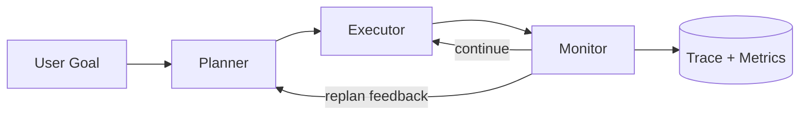
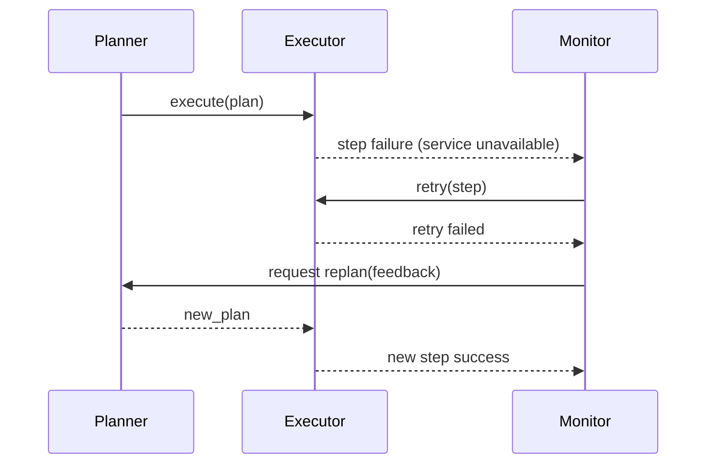
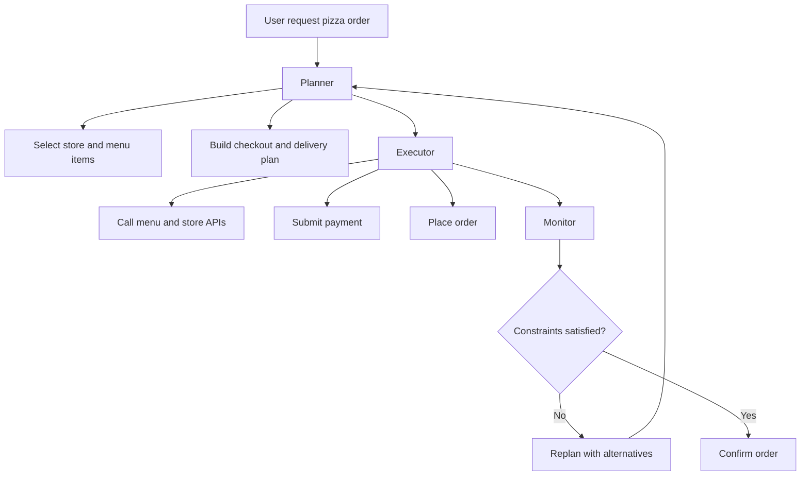
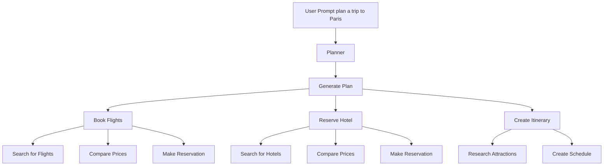
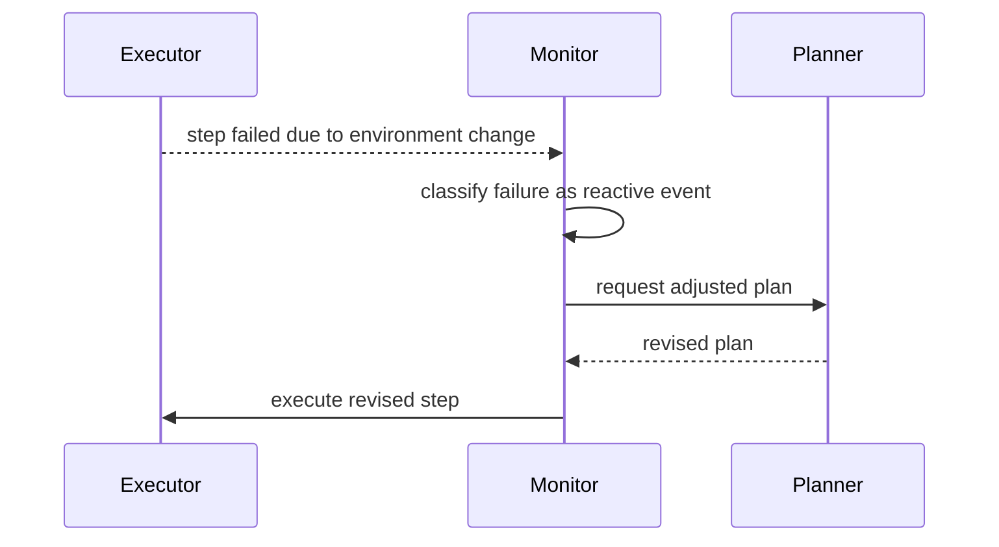
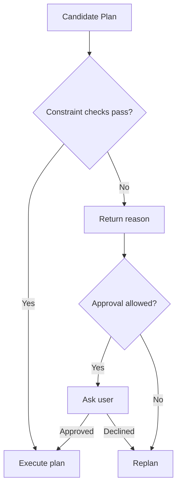
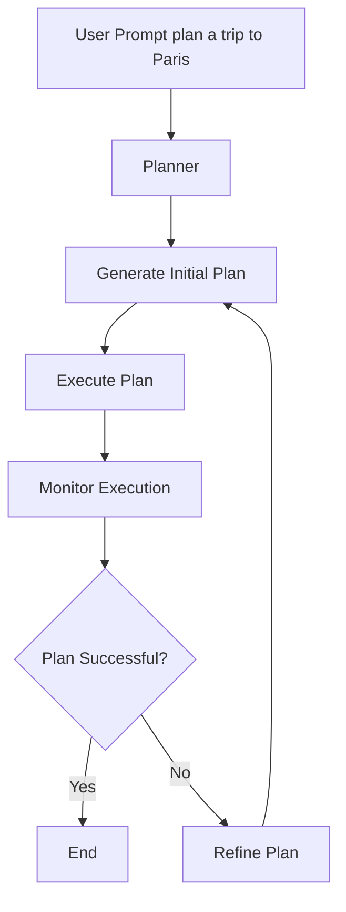
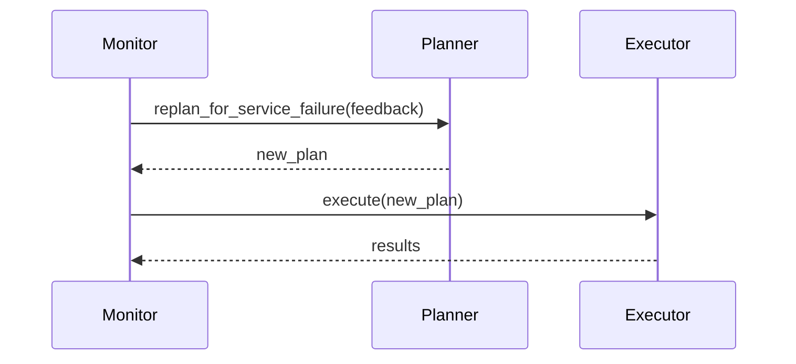
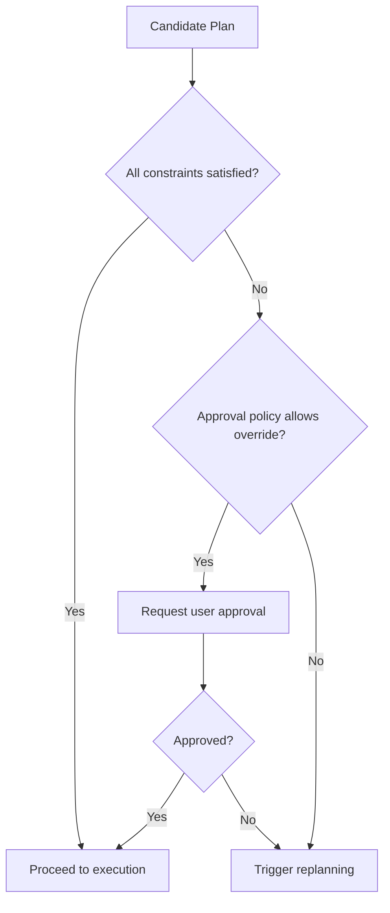
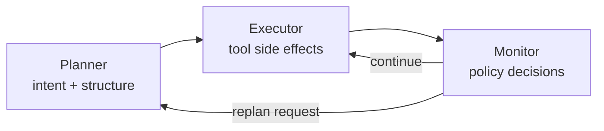

# From agent architecture to planning systems

In Chapter 10, you learned how agents differ from assistants and why reliable behavior depends on clear roles for state, planning, execution, memory, and validation. That gives us the architecture, but it also raises the next question: why do we need to talk about planning systems in more detail?

The short answer is simple: agents fail when they treat every task like one big response. They drift, repeat work, miss constraints, and keep going with stale assumptions after the world has changed. This chapter breaks that down and shows how planning systems turn vague goals into clear, executable work you can validate and revise.

In practical terms, this chapter moves you from "I understand the components" to "I can run, diagnose, and improve a planning loop under failure and constraints".

In this chapter, you will learn to:

- Describe the roles of Planner, Executor, and Monitor in a planning system.
- Explain when and why dynamic replanning is needed.
- Add constraints to a working agent and enforce them in monitor policy flow.
- Measure run quality using execution metrics and trace data.

The learning map below connects each concept to the practical output you will build:

| Topic | Primary question | Practical output |
|---|---|---|
| Planning loop | How does an agent adapt during execution? | Replanning flow |
| Role boundaries | Who owns what decision? | Cleaner architecture |
| Constraints | How do we enforce policy? | Constraint checks + approvals |
| Measurement | How do we know if we improved? | Metrics + traces + tests |

Assumptions for this chapter:

- You are comfortable with Python functions, classes, exceptions, and basic async syntax.
- You are new to agent architecture, policy-driven control flow, and production reliability patterns.
- We focus on decision architecture and run behavior, not Python syntax training.

Before we get into each subsystem, it helps to anchor on the tiny runtime shape that appears throughout the chapter.
This setup is intentionally minimal so you can focus on control flow and ownership, not framework noise.
A minimal setup looks like this:

```python
planner = Planner(...)
executor = Executor(...)
monitor = Monitor(...)
```

With this map in mind, let's define what a planning system is in operational terms.

## Planning Systems for Agents

So what is a planning system in practice?

It is the part of your agent that turns a broad goal into executable steps, then keeps adjusting those steps as execution produces new information.

Why is this important? Because once your agent moves past toy prompts, success depends less on one "smart" answer and more on steady decision quality across a full run.

Without a planning system, an agent usually tries to solve everything in one pass. That is where brittle behavior shows up: missed constraints, repeated work, and weak recovery when a tool fails.

What matters to you as a developer is that planning is not only "plan creation". It is a loop of:

1. generating a plan,
2. executing it,
3. monitoring outcomes,
4. revising when reality changes.

For example, "plan a trip to Paris" may start as direct flight + hotel, but during execution the flight API can fail or exceed budget. A planning system is what turns that disruption into an alternate plan instead of a dead end.

You might be wondering: can't I just use a framework like LangChain?

The short answer is yes, frameworks help a lot, but they are not your architecture.
Frameworks give you useful building blocks such as tool wrappers, agent runners, and integrations. What they do not give you is your decision architecture: what constraints matter, how plans are revised, when to escalate, and how success is measured.

So yes, use frameworks. They speed up implementation.
But do not outsource policy correctness to them.

Think of it this way: a framework gives you components, while you still own system behavior.

Framework responsibilities vs architect responsibilities:

| Concern | Framework can help with | You still own |
|---|---|---|
| Tool execution | Adapters, retries, connectors | Which tools are allowed and when |
| Planning flow | Agent loops, graph orchestration | Plan quality criteria and decomposition strategy |
| Constraints | Validation hooks, middleware | Which constraints are business-critical |
| Recovery | Callback/event plumbing | Retry vs replan vs escalate policy |
| Observability | Tracing/logging APIs | Which metrics indicate real success |

A minimal architecture decision layer, regardless of framework, can look like this:

```python
policy = {
    "max_budget": 1200,
    "max_stopovers": 1,
    "on_service_failure": "retry_then_replan",
    "approval_required_over_budget": True,
}
```

Framework translation note:

If you are using LangChain or LangGraph, keep this mapping in mind:

- framework graph/agent runner = orchestration mechanism,
- your planner policy = how plans are formed and revised,
- your monitor policy = when to retry, replan, approve, or stop,
- your constraints = product and business correctness rules.

In other words, framework primitives execute your design, they do not replace design ownership.

Planning loop at a glance:

| Phase | Owner | Output |
|---|---|---|
| Plan | Planner | Structured steps |
| Execute | Executor | Tool results |
| Evaluate | Monitor | Continue/retry/replan |
| Revise | Planner + Monitor | Updated plan |

To make the planning loop concrete, it helps to read it as a sequence of responsibilities rather than a single function.
The snippet below is not a full implementation, but it captures the exact handoff points you should preserve.
A loop skeleton looks like this:

```python
plan = planner.generate_plan(user_prompt)
results = executor.execute_plan(plan)
decision = monitor.evaluate(results)
```

To make the control loop visually explicit, here's the end-to-end architecture at runtime:



**Fig 1: Runtime planning architecture showing planner, executor, monitor, and feedback edges.**

Now let's break down the components that make this loop work.

## Core components of a planning system

Before we dive into patterns, it helps to understand why these components are split in the first place.

If you blur these roles, the system becomes hard to debug because every component can quietly affect every outcome. Clear boundaries give you observability and safer iteration.

These are the three core roles:

- **Planner**: The planner is responsible for generating a plan based on the given goal and constraints. It takes into account the available tools, resources, and any relevant information to create a structured plan that can be executed.
- **Executor**: The executor is responsible for carrying out the plan generated by the planner. It executes each step of the plan, interacts with tools, and collects results.
- **Monitor**: The monitor oversees the execution of the plan, checking for success and handling any issues that arise. If a step fails or if new information becomes available, the monitor can trigger replanning to adjust the plan accordingly.

If you remember one thing from this section, remember boundaries:

- planner owns intent and structure,
- executor owns side effects,
- monitor owns policy decisions.

Concrete example: if a flight booking fails, the executor should report the failure, not improvise a new plan. The monitor decides policy, and the planner generates the revised route.

Responsibility matrix:

| Component | Owns | Must not own |
|---|---|---|
| Planner | Goal decomposition | Tool side effects |
| Executor | Tool invocation and result capture | Policy decisions |
| Monitor | Retry/replan/escalation policy | Tool internals |

Before we move into planning patterns, focus on one thing: clear handoffs. At the boundary level, what matters is who calls whom and in what order. This contract-level snippet is a quick architecture check when you add features.

An interface-level contract can be written like this:

```python
initial_plan = planner.generate_plan(prompt)
execution_report = monitor.oversee_execution(initial_plan, planner, executor)
```

In this contract, the monitor is the orchestration authority and invokes execution through the executor when needed. Keeping this explicit avoids accidental double execution of the same plan.

## State: What Flows Through The Loop

Before building anything, you need to answer one question: what travels from the planner through the executor to the monitor and back?

That's your agent's state. It is not memory, not the trace, not the database. State is the working context that governs the next decision.

For a trip planner, state looks like this:

```python
state = {
    "user_goal": "plan a trip to Paris under $1200",
    "constraints": {
        "max_budget": 1200,
        "max_stopovers": 1,
        "preferred_airlines": ["SAS", "KLM"],
    },
    "decisions_made": {
        "selected_flights": ["SK123", "SK456"],
        "hotel_choice": "Hotel ABC",
    },
    "budget_remaining": 200,
    "failed_step": None,
}
```

State flows like this:

1. Planner reads state (goal + constraints) and generates a plan
2. Executor reads state + plan and executes each step, updating `decisions_made`
3. Monitor reads state + results and decides: continue, retry, replan, or escalate
4. If replan: monitor updates `state` with failure reason and calls planner again
5. New plan respects updated state

Here's the critical part: when the monitor calls for a replan, it updates state with what failed:

```python
if not plan_successful:
    state["failed_step"] = "Book flights"
    state["failure_reason"] = "Preferred airline no longer has availability"
    state["budget_remaining"] = current_budget
    # Now planner generates new plan with this context
    new_plan = planner.generate_plan(state)
```

Without state threading, replanning loses context. Your new plan might make the same mistake or ignore constraints that the first plan discovered.

Design principle: state is not optional. Define it before you write any code. Make it explicit and immutable (or copy before mutating). This is how you avoid silent context loss across replans.

## Planning system design patterns

Planning systems are usually built around one dominant pattern. The pattern you choose changes how replanning works, how much state you keep, and how failures are handled.

Why this section matters: two systems can solve the same user request and still behave very differently under stress. Pattern choice decides what happens when tools are slow, data is stale, or constraints collide.

Pattern comparison at a glance:

| Pattern | Best for | Trade-off |
|---|---|---|
| HTN | Structured decomposition | More up-front modeling |
| Reactive | Fast adaptation to events | Harder to reason about globally |
| Constraint-based | Policy-heavy domains | Requires clear constraint encoding |
| Iterative | Progressive improvement | Can be slower per mission |

In real projects, teams often need a quick routing rule for choosing a planning strategy at runtime.
The goal here is not perfection. The goal is to make the decision explicit and testable.
One simple pattern-routing sketch looks like this:

```python
if environment_is_volatile:
    strategy = "reactive"
elif strict_policy_constraints:
    strategy = "constraint_based"
else:
    strategy = "iterative"
```

The table above is enough context to make a first implementation choice. The simplest starting point is **iterative**: generate a plan, execute it, check results, revise if needed. That's what we'll build now. Once you have it running, you'll meet the other patterns in context — after the baseline exercise, where they'll make sense from experience rather than theory.

### Implementing a Planner

Now let's turn pattern discussion into code.

Why this implementation section matters: beginners often overcomplicate planner data models. Starting with a small plan schema makes behavior easier to inspect and improve.

Let's implement a minimal planner using the iterative pattern.

Before generating plans from model output, define a plan shape that is explicit and stable.
For beginners, the key is to avoid over-modeling at this stage and focus on fields that influence execution decisions.
Start with an ordered list of steps where each step includes description, tool, and params.

```python
class PlanStep:
    def __init__(self, description, tool=None, params=None):
        self.description = description
        self.tool = tool
        self.params = params or {}

class Plan:
    def __init__(self, steps):
        self.steps = steps
```

With `PlanStep` and `Plan` defined, the planner can map user intent into structured steps. Pass the language model client into the function explicitly so the planner does not depend on hidden global state. This also lets tests provide a predictable fake client.

Example prompt to test with: "Plan a trip to Paris under $1200 with one checked bag." If your schema is too weak, you will lose these constraints early.

```python
def generate_plan(user_prompt, llm) -> Plan:
    # Let the LLM create the plan structure
    plan: Plan = llm.generate(
        prompt=f"Generate a plan for the following user prompt: {user_prompt}",
        schema=Plan,
    )

    return plan

plan = generate_plan("Plan a trip to Paris for me.", llm)
```

The caller now supplies the configured model client. In production, that can be your real SDK client; in a unit test, it can be a fake that returns a known `Plan`. If your SDK returns dictionaries instead of typed objects, add a parse step immediately after generation to convert into `Plan`.

Now let's execute the plan.

## Executor

The executor is where plans meet reality.

Why this matters in practice: planner quality does not help if execution cannot reliably run tools, collect outputs, and surface failures in a machine-actionable form.

This is also where many agent systems quietly become unreliable. On paper, plans look coherent. At runtime, APIs time out, payloads drift, and dependencies respond in surprising ways.
So the executor has two jobs: do the work, and report what happened in a form the monitor can reason about.

Execution behavior matrix:

| Situation | Executor action | Monitor implication |
|---|---|---|
| Tool success | Store result and continue | No intervention |
| Tool timeout | Capture error payload | Retry/replan decision |
| Invalid params | Return structured failure | Possibly escalate |

Even a helper this small is useful because it centralizes the execution call surface.
A minimal execution helper is:

```python
def run_step(step):
    return call_tool(step.tool, step.params)
```

The Executor takes the plan and performs tool calls. Its three duties are simple: execute each step, collect results, and report failures for monitor policy handling.

Start with a straightforward executor that runs each step in order.
An initial executor implementation can look like this:

```python
def execute_plan(plan: Plan):
    results = {}
    for step in plan.steps:
        if step.tool:
            result = call_tool(step.tool, step.params)
            results[step.description] = result
        else:
            # Handle steps that don't involve tool calls, if necessary
            pass
    return results
```

This is the happy path. In production, you also need explicit failure handoff to the monitor.

Once the happy path is clear, add structured failure handoff to monitor policy logic.
A failure-aware executor variant can look like this:

```python
def execute_plan(plan: Plan):
    results = {}
    for step in plan.steps:
        try:
            if step.tool:
                result = call_tool(step.tool, step.params)
                results[step.description] = result
            else:
                # Handle steps that don't involve tool calls, if necessary
                pass
        except Exception as e:
            # Communicate failure to the Monitor
            results[step.description] = f"Error: {str(e)}"
            monitor.handle_failure(step, results)
            # Optionally, we could also raise an exception here to stop execution
            # raise e
    return results
```

The important design point is that the executor reports failure; it does not decide policy.

```python
monitor.handle_failure(step, results)
```

### When The Executor Should Stop

Here's a question beginners miss: should the executor continue after a step fails?

The answer is: it depends on what failed.

Consider two scenarios:
- Step "Get flight options" times out → retry makes sense, continue after retry
- Step "Process payment" fails with insufficient funds → continuing to "Place order" is a disaster

Define halt rules explicitly. Add this to your executor:

```python
# Steps that cannot continue after failure
CRITICAL_STEPS = {"process_payment", "place_order", "confirm_booking"}

async def execute_plan(plan: Plan):
    results = {}
    for step in plan.steps:
        try:
            if step.tool:
                result = await call_tool_async(step.tool, step.params)
                results[step.description] = result
        except Exception as e:
            results[step.description] = f"Error: {str(e)}"
            monitor.handle_failure(step, results)
            
            # Stop here if this is a critical step
            if step.tool in CRITICAL_STEPS:
                break
            # Otherwise continue to next step (logging the failure)
    return results
```

This distinction matters in production. If you silently skip payment processing, your user thinks they ordered but never paid. Then weeks later they see an unexpected charge because the order finally went through.

Don't leave halt behavior implicit. Ask yourself for each step: if this fails, can we skip it? If not, it's critical. Mark it.

Another practical concern is async tool execution.
Even if some tools are sync today, an async-first structure keeps control flow consistent as network calls increase.
An async executor shape can be written like this:

```python
import asyncio

async def execute_plan(plan: Plan):
    results = {}
    for step in plan.steps:
        try:
            if step.tool:
                result = await call_tool_async(step.tool, step.params)
                results[step.description] = result
            else:
                # Handle steps that don't involve tool calls, if necessary
                pass
        except Exception as e:
            # Communicate failure to the Monitor
            results[step.description] = f"Error: {str(e)}"
            monitor.handle_failure(step, results)
    return results
```

Using one async-first execution model keeps control flow consistent as the system grows.

With execution mechanics covered, the next question is how to decide what to do when execution outcomes are uncertain.

Key takeaway from this section: executor reliability is about explicit result capture and explicit failure handoff, not hidden decision logic.

## Monitor

If planner is intent and executor is action, monitor is judgment.

Why this matters for production behavior: most failures are policy failures, not syntax failures. The monitor is where you encode "what to do next" when outcomes are uncertain.

When people say "the agent did something weird," that usually means policy intent was unclear, not that a function crashed.
The monitor removes ambiguity by making continuation, retry, replanning, and escalation explicit.

Policy decision table:

| Signal | Policy action | Goal |
|---|---|---|
| Transient API failure | Retry with backoff | Recover without replanning |
| Persistent service outage | Replan via alternate provider | Keep mission moving |
| Constraint breach | Ask approval or reject | Preserve policy compliance |

To show monitor behavior under real failures, the sequence below captures retries, escalation, and replanning:



**Fig 7: Monitor-controlled failure handling sequence with retry and planner re-entry.**

Policy dispatch is where monitor intent becomes a concrete control-flow decision.
A policy dispatch sketch is:

```python
action = monitor.classify_and_route(step_result)
if action == "retry":
    ...
```

The Monitor is the control authority. It decides whether execution should continue, retry, replan, or stop.

In the trip scenario, the monitor should check for success, handle failures, and validate results against constraints.

Before adding complex policies, anchor on the smallest monitor control loop.
At a high level, monitor logic looks like this:

```python
results = executor.execute_plan(plan)
monitor.validate_results(results)
if monitor.plan_successful():
    print("Plan executed successfully!")
else:
    print("Plan execution failed. Handling failure...")
    monitor.handle_failure()
```

Notice the branch shape: failure handling runs only in the failure branch.

Treat monitor logic as policy, not logging. It needs explicit rules for uncertain conditions.

In practice, this means you should be able to point at a branch and answer three questions: why did we continue, why did we retry, and why did we ask the planner for a new plan?

At minimum, define policy for:

- **Explicit rules**: define retry/replan logic for known failures.
- **Thresholds**: define cutoffs for cost, latency, or confidence.
- **Escalation paths**: define when to ask a human.

This demonstrates the core loop: detect failure -> apply policy -> retry or replan -> continue execution.

After seeing the runtime trace, map that behavior to a minimal policy object.
A minimal policy-oriented monitor can be modeled like this:

```python
class Monitor:
    def __init__(self):
        self.rules = {
            "flight_booking_failure": self.handle_flight_booking_failure
        }
        self.thresholds = {
            "flight_price": 500  # Example threshold for flight price
        }

    def validate_results(self, results):
        # Validate results and check for failures
        if "Book flight" in results and "Error" in results["Book flight"]:
            self.rules["flight_booking_failure"]()

    def handle_flight_booking_failure(self):
        print("Detected failure in step: Book flight.")
        print("Applying retry strategy for flight booking...")
        # Implement retry logic here
        # If retries fail, escalate to human operator
```

With monitor policy in place, you are ready to implement and test the full planner-executor-monitor flow.

Key takeaway from this section: monitor quality determines whether failures become controlled transitions or user-visible chaos.

## Paper Exercise - Pizza Ordering Domain

Before writing more code, let's run one architecture drill on paper.
This helps you check whether you truly understand role boundaries and policy flow, not just implementation details.

Exercise prompt:

You are designing an agent for pizza ordering.
On paper, define:

1. What the planner should plan.
2. What the executor should execute.
3. What the monitor should decide.
4. Which constraints must be enforced.
5. When human approval is required.

Use these domain constraints in your design:

- store opening hours,
- delivery radius,
- allergy-safe ingredients,
- payment failure handling,
- maximum acceptable delivery time.

Pause for one minute and sketch your version before revealing the suggested answer.

<details>
<summary>Suggested answer (compare with your own)</summary>

One reasonable architecture for this domain is:



**Fig 8: Paper solution for pizza ordering showing planner intent, executor side effects, and monitor policy gates.**

Role and policy mapping:

| Layer | Responsibilities | Example decisions |
|---|---|---|
| Planner | Build order strategy and fallback paths | Choose alternate store when out-of-radius |
| Executor | Call APIs and perform order side effects | Price lookup, payment charge, order placement |
| Monitor | Enforce policy and decide retry/replan/escalate | Retry payment once, replan if delivery ETA exceeds max |

Constraint examples:

| Constraint | Enforced by monitor as |
|---|---|
| Store hours | reject/replan if closed |
| Delivery radius | replan to nearer store |
| Allergy constraints | hard fail unless safe substitution approved |
| Payment failures | one retry, then escalate to user |
| Max delivery time | replan or ask user approval |

</details>

With this paper architecture exercise complete, you are ready to implement the same reasoning in code.

## Exercise - Implement a simple planning system with a Planner, Executor, and Monitor.

This exercise is your baseline. Build it lean so you can observe the planner-executor-monitor handshake before adding complexity. Later, when you extend it, you'll have a stable reference point to check whether changes improved or broke behavior.

Baseline checklist:

| Requirement | Verification |
|---|---|
| Plan generated | Planner output shown |
| Steps executed | Executor logs per step |
| Failures handled | Monitor decision output |
| Run summarized | Metrics or trace recorded |

Before extending anything, run the baseline once so you can observe default behavior.
That gives you a stable reference point for every change that follows.
Use this command for the baseline run:

```bash
uv run main.py
```

Now the time has come to practice what we've learnt. The goal here is to first get a baseline run working, then add one new capability that is not yet covered in the sections below.

### Run the baseline first

Start with the reference implementation to see the planner-executor-monitor flow working end-to-end: [Exercise 1 solution and setup](./code/exercise1/README.md). Run it and watch the output—you'll see planning, execution, and monitor decisions in sequence.

### Then add one extension

Now pick one extension and implement it yourself. Keep the change small so you can trace whether it helped or broke things.

Available extension exercises:

1. [01 Add New Step](./code/exercise1/extensions/01_add_new_step/README.md): add a new tool step to the plan flow.

Here's the workflow: (1) run the baseline and observe the flow, (2) choose an extension, (3) implement and test it, (4) compare your result against the solution.

Now that you have a working loop, it's worth naming the patterns behind what you just built. You'll recognize them as the replanning and constraint sections introduce more complexity.

## Planning system design patterns in depth

The baseline exercise you just ran used the iterative pattern: generate, execute, monitor, revise. But planning systems come in four flavors, and knowing which to reach for changes how you handle failures, state, and policy.

Pattern comparison at a glance:

| Pattern | Best for | Trade-off |
|---|---|---|
| HTN | Structured decomposition | More up-front modeling |
| Reactive | Fast adaptation to events | Harder to reason about globally |
| Constraint-based | Policy-heavy domains | Requires clear constraint encoding |
| Iterative | Progressive improvement | Can be slower per mission |

A simple routing rule when picking a strategy at runtime:

```python
if environment_is_volatile:
    strategy = "reactive"
elif strict_policy_constraints:
    strategy = "constraint_based"
else:
    strategy = "iterative"
```

### Hierarchical Task Networks (HTN)

HTN is about decomposition discipline. It is useful when your domain already has natural sub-goals and dependencies.

Imagine the goal "plan a trip". An HTN planner decomposes it into subtasks like "book flights", "reserve hotel", and "create itinerary". Each subtask can then be decomposed again into smaller operations.

One useful way to see HTN is as layered decomposition from intent to concrete operations:



**Fig 2: HTN tree decomposition from user goal to executable sub-steps.**

Use HTN when the task naturally has a tree structure and each level can be validated independently.

### Reactive Planning

Reactive planning is about adapting quickly when conditions change.

Why this is operationally important: in real systems, failures are often external and time-sensitive. If your planner can only react at the end of a run, users feel delays and brittle outcomes.

Reactive planning generates a plan and then adapts quickly when the environment changes. If a preferred flight disappears, the system can switch provider or route without restarting from scratch.

Typical reactive triggers:

| Trigger | Example signal | Immediate reaction |
|---|---|---|
| Service outage | 503 from booking API | Retry then switch provider |
| Data invalidation | Route no longer available | Request route-adjustment replan |
| Time-sensitive event | Airport closure notice | Reroute with policy checks |

A compact reactive sequence looks like this:



**Fig 3: Reactive planning sequence with event detection and immediate plan adjustment.**

Reactive behavior becomes real when the monitor can classify an event and trigger a specific replanning path.
A reactive policy hook can look like this:

```python
if monitor.is_environment_change(error):
    feedback = monitor.build_feedback(error)
    plan = planner.replan_for_service_failure(feedback)
```

Example: if a weather API returns an airport closure mid-run, the monitor can trigger immediate route adjustment instead of waiting for a full refinement cycle.

### Constraint-Based Planning

Constraint-based planning is about policy compliance, not just finishing tasks.

A plan can be technically executable and still unacceptable. Constraint-based planning encodes what "acceptable" means before side effects happen — budget limits, date limits, preferred providers, stopover caps, and so on.

A practical constraint matrix might look like this:

| Constraint | Example value | Enforcement point |
|---|---|---|
| Budget cap | `max_total=1200` | monitor cost validation |
| Stopover limit | `max_stopovers=1` | route validation pre-booking |
| Airline allowlist | `['SAS', 'KLM']` | provider selection guard |

Constraint enforcement flow:



**Fig 4: Constraint-based planning gate with validation, approval, and replanning branches.**

A constraint validator can look like this:

```python
ok, reason = enforce_budget(policy, estimated_total)
if not ok:
    monitor.request_approval_or_replan(reason)
```

Example: two users ask for "Paris this weekend". One accepts one stopover and a budget airline. The other requires direct only and a premium carrier. Same intent, different feasible plans.

### Iterative Planning

Iterative planning is the most common starter pattern: generate, execute, inspect results, refine, repeat. It's what you ran in the baseline exercise.

How is it different from reactive planning? Iterative planning is cadence-driven — refinement happens in scheduled loops. Reactive planning is event-driven — adjustments fire on change events.

If we trace iterative planning as a feedback cycle, it looks like this:



**Fig 5: Iterative planning loop where execution feedback drives repeated refinement.**

The practical takeaway: iterative planning helps you converge over time, reactive planning helps you survive disruptions. Most real systems combine both.

With these patterns named and a working baseline in place, the next section shows how the architecture handles plans that need to change mid-flight.

## Dynamic replanning

This section is the first place where the architecture proves itself when conditions change.

Why this matters under runtime pressure: static plans can look correct at time zero and fail minutes later. Dynamic replanning is what keeps the mission alive after first contact with the real world.

Dynamic replanning decision table:

| Event | Immediate step | Replanning needed? |
|---|---|---|
| Temporary timeout | Retry | Not yet |
| Provider unavailable | Trigger alternate-service plan | Yes |
| Route invalidated | Generate new route structure | Yes |

Another helpful view is the monitor-to-planner handoff that happens when replanning is truly required:



**Fig 9: Dynamic replanning sequence from monitor feedback to execution of a revised plan.**

The key moment in dynamic replanning is the trigger boundary.
You want one readable condition that moves control from monitor evaluation to planner revision.
A replanning trigger can be expressed like this:

```python
if monitor.should_replan(failure):
    plan = planner.replan_for_service_failure(feedback)
```

Dynamic replanning is what makes the system useful when reality changes. In this chapter's travel flow, the monitor does not just fail fast. It retries, asks for approval, and then asks the planner for a new plan when needed.

From the base exercise, this is the core handoff from monitor back to planner:

```python
feedback = "Primary flight booking service unavailable after retry"
new_plan = planner.replan_for_service_failure(feedback)
new_results = executor.execute_plan(new_plan)
```

This keeps planning and execution connected by feedback, not assumptions.

What this means in practice:

- a transient API failure can trigger a retry and then a service switch,
- a route failure can trigger a structurally different plan (for example, one-stop instead of direct).

What matters to you as a developer are two things:

1. You need at least one fallback path your planner can generate.
2. You need monitor rules that clearly decide when to retry, when to replan, and when to escalate.

If either is missing, replanning becomes accidental instead of repeatable.

Now let's make those paths concrete in an exercise you can run end to end.

## Exercise - dynamic replanning

This exercise is about making failure paths intentional.
You are designing controlled transitions from one plan to another.

Why this exercise matters: teams often ship "error handling" that only logs failures. This exercise forces policy-backed transitions that keep the mission alive.

Scenario matrix:

| Scenario | Expected behavior |
|---|---|
| Service outage | Retry then replan to alternate provider |
| Route unavailable | Replan to two-leg route |

Keep test execution as close to the extension folder as possible so behavior stays local and reproducible.
Use this test command:

```bash
uv run --with pytest pytest -q test_extension.py
```

There are two useful failure paths to implement and test here: service outage and route-content failure.

Run this exercise in the following order:

1. Start with the base implementation in [Exercise 1 solution and setup](./code/exercise1/README.md).
2. Run the base flow once and trigger outage handling:
    - enter any destination and date,
    - when asked to approve provider switch, select approve,
    - verify that the monitor calls replanning and executes a new plan.
3. Add a second failure mode for route content and verify that the new plan differs structurally from the first.

If you want implementation references before coding:

- For retry and outage strategy patterns, see [05 Retry Strategies](./code/exercise1/extensions/05_retry_strategies/README.md).
- For policy-driven failure behavior, see [02 Config-Driven Policies](./code/exercise1/extensions/02_config_driven_policies/README.md).

Definition of done:

1. You can demonstrate both failure paths on demand.
2. The outage path retries, then replans.
3. The route-content path replans into a two-leg route.
4. Monitor output clearly states which path was taken.

With replanning behavior established, the next step is to enforce constraints in a similarly explicit way.

Key takeaway from this section: replanning is only reliable when trigger conditions and fallback plan paths are explicit and testable.

Before continuing, choose the route that matches how you learn best. The remaining sections add constraints, reinforce component contracts, and introduce measurement before the final assignment. You do not need to implement every exercise in one sitting.

| Route | What to do | Best when |
|---|---|---|
| Guided practice | Complete each exercise as it appears, then build the assignment | You want repetition and smaller implementation steps |
| Integrated build | Read the examples, note each definition of done, then implement those requirements in the assignment | You already understand the baseline loop and prefer one larger build |

For example, on the integrated route you can record “budget constraint, monitor approval gate, replan count” as assignment requirements instead of stopping to build three separate variants now. Both routes reach the same planner-executor-monitor behavior.

## Constraint-aware planning

Constraint-aware planning is where "can execute" becomes "acceptable to user and business policy".

Why this matters in deployment: many agent runs are technically successful but still invalid because they violate budget, timing, or preference constraints.

Constraint categories:

| Constraint type | Example | Typical action on breach |
|---|---|---|
| Budget | Total cost > cap | Replan or request approval |
| Time | Arrival after deadline | Replan |
| Preference | Disallowed airline | Replan |
| Routing | Too many stopovers | Reject or replan |

To reason about constraint enforcement consistently, use a simple gate-style flow:



**Fig 10: Constraint gate combining validation, approval, and replanning decisions.**

A good constraint check should communicate both outcome and rationale.
A constraint check can be implemented like this:

```python
ok, reason = enforce_constraint(plan, policy)
if not ok:
    monitor.request_approval_or_replan(reason)
```

Constraints are where planning becomes practical. Without constraints, plans can be valid but unusable. You can represent constraints as policy config, contextual approvals, and budget checks.

In the trip example, constraints could be:

- **Budget limit**: Check estimated cost against limit during monitor validation; if over, ask for approval or replan with cheaper options.
- **Preferred airlines**: Let the planner know which airlines are allowed; monitor rejects flights from unlisted carriers and requests replanning.
- **Travel dates**: The planner sees exact dates required; monitor catches bookings that fall outside the window and triggers correction.
- **Stopover limits**: Set a max stopover count; monitor flags multi-leg routes and initiates a direct-flight replan.

You already apply these constraints when booking trips yourself. Now encode them so your agent respects the same boundaries.

A budget constraint can be as simple as validating estimated cost against a limit:

```python
ok, reason = enforce_budget(policy, estimated_total)
if not ok:
    # trigger replanning with cheaper options
```

Most constraints are user inputs that must stay visible through planning, execution, and monitoring.

### How Constraints Reach The Planner

Here's the tension: monitor validates constraints, but planner needs to KNOW about them before generating a bad plan in the first place.

If monitor only validates, you waste compute: planner generates a plan violating constraints, executor might start working on it, then monitor rejects it. Start over. Inefficient and frustrating.

Instead, pass constraints to the planner upfront. There are three patterns:

**Pattern 1: Constraints in system prompt**

Tell the LLM the rules before asking for a plan:

```python
constraints_prompt = f"""
Constraints for this plan:
- Budget cap: ${state['constraints']['max_budget']}
- Preferred airlines: {state['constraints']['preferred_airlines']}
- Max stopovers: {state['constraints']['max_stopovers']}
Generate a plan that respects all of these.
"""

plan = llm.generate(
    prompt=user_goal + constraints_prompt,
    schema=Plan,
)
```

**Pattern 2: Constraints as part of state**

Pass the full state object (including constraints) to planner. The planner SDK or prompt handler extracts them:

```python
plan = planner.generate_plan(
    goal=state["user_goal"],
    constraints=state["constraints"],
    decisions_so_far=state["decisions_made"],
)
```

**Pattern 3: Constraints as schema validation**

After LLM generates a plan, validate it against constraints before monitor even sees it:

```python
plan = llm.generate(prompt=user_goal, schema=Plan)

# Validate early
for step in plan.steps:
    if step.tool == "book_flight":
        airline = step.params.get("airline")
        if airline not in state["constraints"]["preferred_airlines"]:
            # Ask LLM to regenerate instead of waiting for monitor rejection
            plan = llm.generate_again(prompt=user_goal + "Avoid airlines: ...")
```

Most production systems use **Pattern 1** (constraints in prompt) because it's the simplest: LLM sees the rules, respects them. Monitor still validates as a safety net, but most plans already comply.

The key principle: if a constraint is not in the planner's input, assume the plan will violate it. Threading constraints from state → prompt → validation keeps your system efficient.

Next, apply this by implementing one explicit constraint and validating both pass and fail paths.

## Exercise - constraint aware

This exercise trains you to encode one business rule end-to-end: pick one constraint from above, add it to the monitor policy, and test both the passing and failing path.

If a constraint is not explicit and testable, it will regress silently when you extend the system later.

Constraint implementation checklist:

| Step | Output |
|---|---|
| Define constraint | Config or dataclass |
| Validate plan | `(ok, reason)` result |
| Enforce policy | Replan/approval/stop decision |
| Verify behavior | Passing test + clear monitor output |

When introducing a new constraint, start with a stub so you can wire end-to-end flow before enforcing logic.
A validator stub can start as:

```python
def validate_max_stopovers(plan, limit):
    return (True, "")
```

In this exercise, your task is simple: take your existing travel agent and add one new constraint of your choice.

Good examples of constraints:

- maximum number of stopovers,
- latest allowed arrival date/time,
- preferred airline list,
- max hotel price per night,
- avoid specific transit airports.

Run this exercise in the following order:

1. Start from the base implementation in [Exercise 1 solution and setup](./code/exercise1/README.md).
2. Add your chosen constraint (from user input or config), evaluate it, and trigger replanning or approval on violation.
3. Re-run with one passing case and one failing case.
4. Confirm that monitor output clearly explains why it continued, replanned, or stopped.

If you want inspiration before coding, review these extensions:

- [02 Config-Driven Policies](./code/exercise1/extensions/02_config_driven_policies/README.md) for externalized policy behavior.
- [03 HITL On Specific Step](./code/exercise1/extensions/03_hitl_specific_step/README.md) for conditional approval flows.
- [04 Budget Constraints](./code/exercise1/extensions/04_budget_constraints/README.md) for concrete constraint checks and gate logic.
- [05 Retry Strategies](./code/exercise1/extensions/05_retry_strategies/README.md) for policy-driven failure behavior that can pair with constraints.

Recommended implementation pattern:

1. Represent your new constraint explicitly (small dataclass or config object).
2. Add one validator function that returns `(ok, reason)`.
3. Enforce it in monitor policy flow before final success.
4. Emit the reason into run summary or trace.

With constraints in place, the next section reinforces the contracts that keep these changes maintainable.

Key takeaway from this section: constraints define acceptable outcomes, not just possible outcomes.

## Planner-executor-monitor coordination

Coordination is the difference between modular architecture and accidental coupling.

Here's where it breaks: when the executor decides policy on failure, or the monitor mutates tool state directly, you lose the ability to reason about what's happening. Weak contracts create silent side effects and hours of debugging. Strong contracts keep the system predictable as it grows.

Real example: A booking agent's executor catches a "hotel unavailable" error and silently retries three times, then rewrites the plan to use a different hotel. Weeks later, the monitor's retry policy breaks because it has no idea the plan was already modified. Now you're debugging a system that violated its own rules and left no audit trail. With strong contracts, the executor reports failure, the monitor decides retry vs. replan vs. escalate, and the decision is traceable.

Coordination contract table:

| Layer | Inputs | Outputs | Allowed decisions |
|---|---|---|---|
| Planner | Goal + context | Plan | Structure only |
| Executor | Plan step | Step result | Execution only |
| Monitor | Results + policy | Retry/replan/escalate | Control flow only |

Seen as an architecture boundary diagram, coordination looks like this:



**Fig 11: Coordination boundaries showing ownership and allowed control-flow transitions.**

When coordination contracts are healthy, the call chain is short and predictable.
A coordination call chain should look like:

```python
plan = planner.generate_plan(prompt)
report = monitor.oversee_execution(plan, planner, executor)
```

If you choose an executor-first design instead, keep that as a separate explicit contract and avoid calling a monitor method that executes the same plan internally.

The table and diagram define the ownership contract. Now connect that contract to the base implementation's control flow:

```python
planner = Planner(...)
executor = Executor(...)
monitor = Monitor(...)

initial_plan = planner.generate_plan(...)
monitor.oversee_execution(
    plan=initial_plan,
    planner=planner,
    executor=executor,
)
```

Common anti-patterns to avoid:

- Executor silently modifies or replans the plan.
- Planner directly executes tools.
- Monitor mutates tool internals instead of using policies and hooks.

If you avoid these three anti-patterns, your extension work stays local.

Now test that contract by extending executor behavior without changing planner/monitor ownership.

### Exercise: Contract Preservation

This is a contract-preservation exercise: add capability without breaking ownership boundaries.

1. Add one new executor tool handler.
2. Keep planner and monitor interfaces unchanged.
3. Verify that replanning still only originates from monitor flow.
4. Write one short note listing what changed and what did not change.

This exercise prepares you for measurement work where architectural boundaries and observability need to align.

Anti-patterns Python developers often hit when moving into agents:

| Anti-pattern | Why it hurts | Better pattern |
|---|---|---|
| Executor decides policy on failure | Blurs ownership and hides behavior | Executor reports; monitor decides |
| Planner executes tools directly | Breaks testability and contracts | Planner outputs intent only |
| Constraints embedded in random tool calls | Policy becomes non-auditable | Centralize checks in monitor policy flow |
| Metrics added only at the end | Hard to compare revisions | Emit structured metrics per run |

## Measuring planning quality and execution success

If you cannot measure behavior, you cannot improve behavior.

Why this matters: logs tell you what happened once. Metrics and traces show whether your system is getting better across many runs.

Teams often underestimate this section because one run "looks fine" in terminal output.
But when you compare many runs, measurement separates confidence from guesswork.

Measurement model:

| Metric type | Example | Use |
|---|---|---|
| Mission outcome | Mission success rate | Product-level reliability |
| Step outcome | Step efficiency rate | Operational execution quality |
| Recovery quality | Replan frequency | Planning robustness |
| Friction | Approval rate | Policy/user experience impact |

Metrics are most useful when emitted as structured data that can be compared across runs.
A metric payload example is:

```python
trace.record("metrics", {
    "mission_success_rate": mission_success_rate,
    "step_success_rate": step_success_rate,
})
```

If you do not measure runs, you cannot improve them. The base exercise already records run metrics and trace events, and the extensions add targeted tests.

At this point, add lightweight runtime reporting so each run is inspectable without opening raw traces.
These two lines separate mission completion from step-level efficiency.
Run summary output in monitor:

```python
agent_print(f"[MONITOR] Mission success rate: {mission_success_rate:.1f}%")
agent_print(f"[MONITOR] Step efficiency rate: {step_success_rate:.1f}%")
```

For longitudinal analysis, persist the trace after the run completes so later comparisons are possible.
Trace persistence in main:

```python
trace.record("system", "run_finished")
trace_path = trace.save(trace_output_dir)
```

Finally, keep extension tests close to each extension folder so behavior remains local and easy to rerun.
A simple per-extension test command is:

```python
uv run --with pytest pytest -q test_extension.py
```

Example metric pairing:

- planning quality metric: percent of runs that required replanning,
- execution reliability metric: percent of tool calls completed without retry.

With measurement in place, you can now integrate all pieces into a final assignment.

Key takeaway from this section: without explicit metrics and traces, architecture decisions are guesses, not evidence-backed improvements.

### Exercise: Measurement Feedback Loop

Use this exercise to turn measurement into engineering feedback.

Choose metrics that would actually change a future design decision.

1. Define one planning quality metric and one execution reliability metric.
2. Add both to run summary or trace payload.
3. Write or update a test to validate the new metric behavior.

Quick production readiness checklist (use before moving on):

| Check | Yes/No |
|---|---|
| Planner outputs explicit, testable plan structure | |
| Executor reports failures with enough context for policy decisions | |
| Monitor retry/replan/escalate rules are explicit | |
| At least one user-approval gate is clearly defined | |
| Constraint checks are centralized and observable | |
| Mission and step-level metrics are emitted per run | |
| Success/failure/replan paths are covered by tests | |

## Assignment

This assignment combines everything in the chapter into one integrated build.

The goal is not to maximize features. The goal is to produce a constrained, observable, and adaptable planning loop you can explain and test.

Why this matters: this is where isolated concepts become a single engineering artifact that can be reviewed, tested, and improved.

For this assignment, build a **web-based pizza ordering system** where an agent guides the user through ordering.

Your design should explicitly define:

1. What the planner decides.
2. What the executor executes.
3. What the monitor enforces and when it intervenes.
4. Which constraints are hard-stop versus approval-gated.

Suggested architecture skeleton:

```python
def run_order_turn(user_input, state):
    plan = planner.build_plan(state, user_input)
    result = monitor.oversee(plan, executor, state)
    return result
```

Suggested scope for your pizza web system:

1. Build a web UI where the user chats with the agent through an ordering flow.
2. Planner should decide next step (collect fields, validate progress, request confirm).
3. Executor should run tools/operations (constraint checks, payment step, place order).
4. Monitor should apply policy (retry, block, replan, ask approval).
5. Add constraints such as:
   - store hours,
   - delivery radius,
   - allergy-safe ingredients,
   - payment failure handling,
   - max delivery time.
6. Demonstrate at least one blocked path and one successful order path.

### Solution

The completed reference implementation is included in the `assignment` directory. It contains the application code, browser UI, tests, dependency configuration, and run instructions:

- [Assignment solution (web pizza agent with Ollama + uv)](./assignment/README.md)

Once this assignment is complete, you will have a working reference for production-style planning loops, not just an academic example.

## What We Learned Building The Assignment

The assignment surfaced a set of practical patterns worth calling out before moving to orchestration. These are decisions that directly improved reliability, maintainability, and debuggability while implementing the pizza and bagel flows.

If you build your own variant of this system, these guardrails will save time during iteration.

- **Agent-first extension model**: treat a new flow as a new agent type, not only a new planner class.
- **Clear ownership boundaries**: planner handles intent, executor handles side effects, monitor handles policy.
- **Structured extraction contract**: keep extraction schema-constrained and trace-friendly.
- **Deterministic fallback policy**: use fallback only as a resilience path, not a silent default.
- **Trace and compatibility discipline**: trace every turn and keep thin compatibility exports during refactors.

With these implementation lessons in place, the production readiness note below is worth reading before moving on.

## Production Readiness: What This Chapter Covers vs. What's Missing

You might be wondering: if I follow this chapter exactly, will my agent work in production? The honest answer is: yes, for the happy path. But the real world is not the happy path.

This chapter gives you a solid foundation. Role boundaries, failure handling, constraint threading, measurement — these are the patterns that separate reliable agents from brittle ones. Once you have them working, that's exactly the moment to ask yourself: what's still missing before real users touch this?

If you've worked through the exercises and built the assignment, you already handle many common failures: retries, replans, constraint checks. But there are a few nasty edge cases we addressed directly in this chapter that are worth recalling:

- **Context loss across replans**: State disappeared between planner turns (solved by State Management section).
- **Wasted compute on invalid plans**: Planner generated plans that violated constraints, monitor rejected them, planner started over (solved by Constraint Threading section).
- **Silent step skips**: Executor skipped critical steps like payment processing without telling anyone (solved by Executor Halt Rules section).

Once those are in place, here are the concerns to consider next as your system grows:

- **Timeout and cancellation policies**: What happens if a step takes > 60 seconds? How do you cancel in-flight transactions before they drift?
- **LLM hallucination handling**: What if the planner generates a malformed step (invalid tool name, missing required fields)? When do you regenerate vs. escalate?
- **Tool availability discovery**: Does the planner query what tools are available, or just assume they exist? Hallucination often stems from this assumption.
- **Observability for debugging**: Which logs and traces actually help you diagnose why planning went sideways? What noise can you cut?
- **User intent changes mid-execution**: Can users modify or cancel mid-flow? How do you replan or refund?
- **Multi-user state isolation**: How do you prevent one user's agent state from leaking into another user's session?
- **Graceful degradation**: What do you return to the user when no valid plan exists and you've exhausted retries and replans?

None of these require rearchitecting. If you have the patterns from this chapter working correctly, adding production concerns is mostly adding guards and observability on top of a design that already holds.

## Summary

In this chapter, you moved from architecture theory to operational agent design.

You worked with:

- planner intent and decomposition,
- executor side effects and result capture,
- monitor policy decisions under uncertainty,
- constraints that define acceptable outcomes,
- metrics and traces that convert guesswork into evidence.

The key takeaway is that robust agents are not built from model calls alone. They are built from explicit control flow, explicit policy, and explicit observability.

In the next chapter, we will build on this by looking at **agent orchestration**: how multiple agent roles and planning stages coordinate reliably when a single loop is no longer enough.