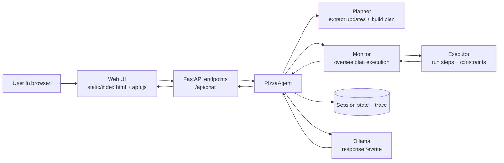
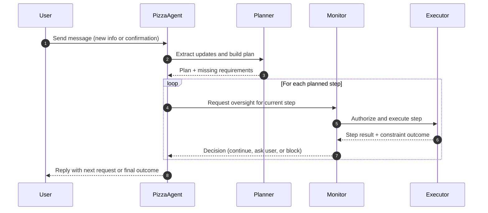
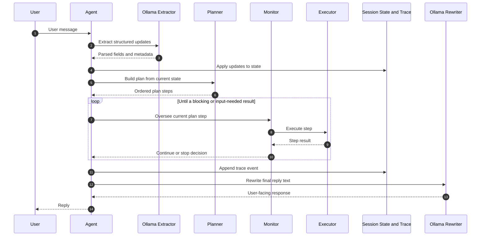
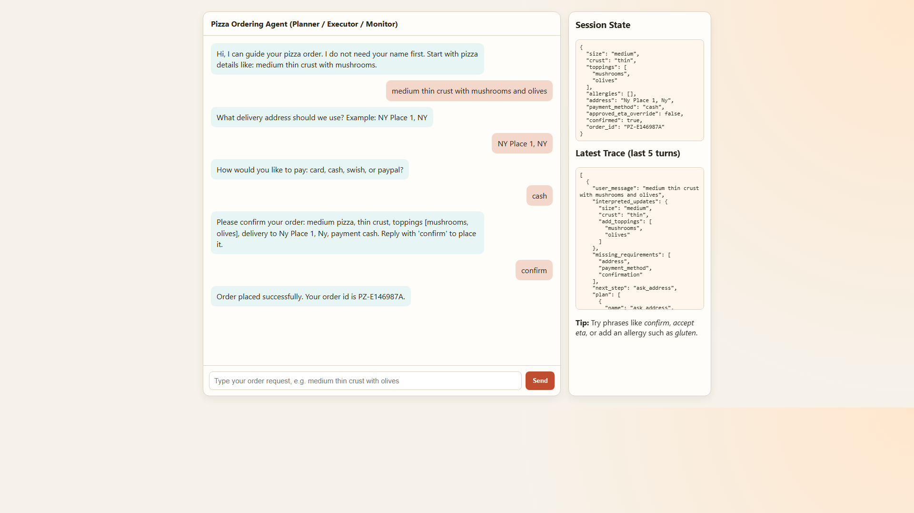

# Chapter 11 Assignment Solution - Pizza Ordering Agent (Web)

This assignment solution implements a web-based pizza ordering agent using a Planner, Executor, and Monitor architecture.

The app guides a user through order collection, runs constraint checks, and only places the order when policy gates are satisfied. In the current version, the natural-language extraction step is handled by the local LLM, which returns structured JSON that the planner then normalizes and applies.

To keep the code maintainable, the implementation is now split into focused modules instead of a single large `main.py`. The `main.py` file remains as a compatibility entrypoint for `uvicorn` and test imports.

- **`app_models.py`**: shared dataclasses and Pydantic request/response and extraction schemas.
- **`ollama_client.py`**: Ollama request handling, retries/error classification, and structured extraction.
- **`planner.py`**: pizza and bagel planners plus optional deterministic fallback extraction.
- **`execution.py`**: monitor plus `BaseExecutor`, `PizzaExecutor`, and `BagelExecutor` implementations.
- **`agents.py`**: orchestration for `PizzaAgent` and `BagelAgent` turn loops.
- **`webapp.py`**: FastAPI app wiring and HTTP routes.
- **`main.py`**: thin compatibility layer exporting `app` and public symbols.

If you look inside `planner.py`, `Planner` is now a reusable base class and `PizzaPlanner` and `BagelPlanner` are concrete subclasses. This keeps the shared planning pipeline in one place while letting each flow define its own extraction and fallback rules. It also makes it much easier to add new flow types without copying the whole planner implementation.

## Adding Your Own Agent Type

When you add a new flow, think in terms of implementing a full agent type, not just a planner. In this project, an agent is the unit that coordinates extraction, planning, execution, monitoring, and trace updates for a specific domain flow.

The planner is one important part, but the complete implementation contract is: state model + planner + executor + agent orchestration + web flow wiring.

- **Define state model**: add a flow-specific state dataclass in `app_models.py` with fields your flow needs to collect.
- **Implement planner subtype**: subclass `Planner`, define `REQUIRED_FIELD_STEPS`, and implement `_extract_with_llm(...)` plus `_fallback_extract_from_text(...)`.
- **Implement executor subtype**: subclass `BaseExecutor` and implement flow-specific step handling and constraint checks.
- **Implement agent orchestration**: create an agent class in `agents.py` that applies updates, runs planner/monitor/executor, and writes trace events.
- **Wire flow routing**: register your agent in `webapp.py` and ensure session creation/select logic supports the new `flow` value.
- **Expose in UI**: add the flow option and labels in `static/index.html` and `static/app.js` so users can select and run it.

After this section, the rest of the README walks through the existing pizza flow architecture and runtime behavior.

## What this demonstrates

- **Planner**: decides what step to do next (ask size, ask crust, check constraints, confirm, place order).
- **Executor**: performs side effects and operational steps (constraint checks, payment charge, order placement).
- **Monitor**: evaluates results and decides when to continue, block, or request user input/approval.
- **Constraints**: store hours, delivery radius, allergy compatibility, payment behavior, and delivery ETA gate.

Before the planner decides on the next step, the app first asks the LLM to turn the user's message into structured order fields. The extractor now uses Ollama structured outputs with Pydantic schemas, so the model is constrained to return the expected shape before normalization is applied.

The side panel now also exposes that extraction work in the trace so you can inspect what the model returned on each turn and compare it with the normalized updates that were applied to session state.

- **Structured extraction**: the LLM returns schema-constrained JSON (Pydantic) for fields such as size, crust, toppings, address, payment method, and confirmation state.
- **Deterministic control flow**: the planner, monitor, and executor still decide what happens next and whether the order can proceed.
- **Inspectable trace**: the latest trace entries include the extractor metadata alongside the interpreted updates and state transitions.

## Architecture overview

The diagram below shows the major runtime components and how requests flow through the planner-executor-monitor loop.



**Fig 1: Major components of the assignment solution and the control/data flow between them.**

## High-level interaction flow

The sequence below highlights responsibility handoffs during a single user turn.



**Fig 2: Responsibility flow per turn: Planner decides structure, Executor performs actions, Monitor governs safety/progress.**

When you are teaching or reviewing agent architecture, it helps to see the agent internals as a single control loop. The diagram below focuses on one user turn and makes it explicit which parts are involved from input parsing to final response text.

It is especially useful for explaining how deterministic control logic and model calls work together, rather than as separate systems.



**Fig 3: Single-turn agent execution path showing extraction, planning, oversight, execution, state updates, and response rewrite.**

## Prerequisites

1. Python 3.11+
2. [uv](https://github.com/astral-sh/uv)
3. [Ollama](https://ollama.com/) installed and running locally
4. An Ollama model pulled locally (default extraction model in this project: `qwen2.5:7b`)

## Setup

From this folder:

```bash
uv sync --extra dev
```

The `dev` extra installs `pytest` alongside the application dependencies declared in `pyproject.toml`.

> **NOTE:** On Windows, Smart App Control may block part of the Python or test toolchain. If that happens, review Microsoft's [Smart App Control guidance](https://support.microsoft.com/en-gb/windows/smart-app-control-has-blocked-part-of-this-app-0729fff1-48bf-4b25-aa97-632fe55ccca2) before changing security settings.

If you need to pull the default model:

```bash
ollama pull qwen2.5:7b
```

## Test

Run the unit tests without requiring a live Ollama endpoint:

```bash
uv run pytest -q -m "not integration"
```

Tests marked `integration` require Ollama to be running with the configured extraction model available.

## Run

Start the web server:

```bash
uv run uvicorn main:app --reload --port 8000
```

Open:

- http://127.0.0.1:8000

## Optional environment variables

- `OLLAMA_HOST` (default: `http://127.0.0.1:11434`)
- `OLLAMA_EXTRACT_MODEL` (default: `qwen2.5:7b`)
- `OLLAMA_REWRITE_MODEL` (default: same as `OLLAMA_EXTRACT_MODEL`)
- `OLLAMA_TIMEOUT_SECONDS` (default: `20`)
- `OLLAMA_EXTRACT_RETRIES` (default: `1`)
- `OLLAMA_MODEL` (legacy fallback alias for extraction model)

Example:

```bash
set OLLAMA_EXTRACT_MODEL=qwen2.5:7b
set OLLAMA_REWRITE_MODEL=llama3.1:8b
uv run uvicorn main:app --reload --port 8000
```

## How to try the flow

1. Say your size and crust (for example: `medium thin crust`).
2. Add toppings.
3. Provide delivery address.
4. Choose payment method.
5. Review the structured order summary.
6. Use `reject` or `change ...` if you want to revise the order.
7. Confirm order with `confirm`.

## Example run screenshots

After entering pizza details, address, payment, and `confirm` (chat scrolled to latest messages):



Try constraint scenarios:

- Mention `gluten` allergy but use non-gluten-free crust.
- Use an address containing `outside` to trigger delivery-radius block.
- Use `accept eta` when the monitor asks for ETA override.

As you test the interface, notice that the chat now shows a visible in-progress indicator while the model is extracting and phrasing the next turn. That makes the slower LLM round-trip easier to read during demos and teaching.

## Notes

- **Planning logic**: the Planner and Monitor remain deterministic and explicit by design for teaching purposes.
- **LLM role**: Ollama is used both for structured order extraction and, when appropriate, concise response phrasing.
- **Fallback behavior**: this version expects the LLM extraction step to succeed; if extraction fails, the trace will show the error and the order state will not advance on that turn.
