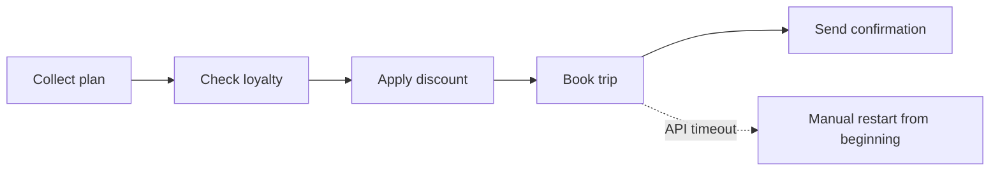
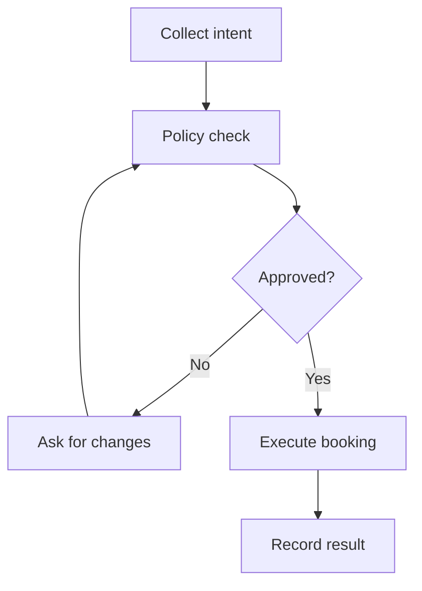
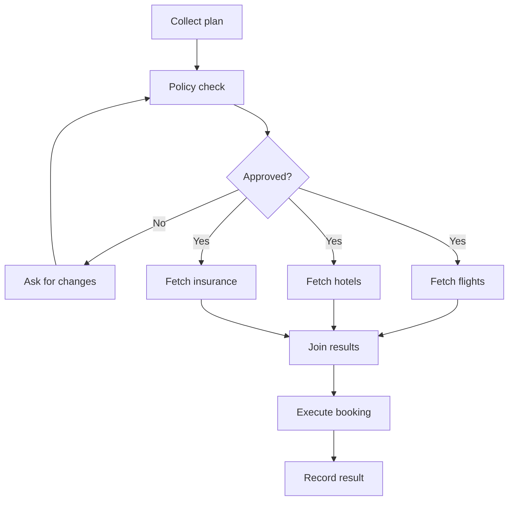
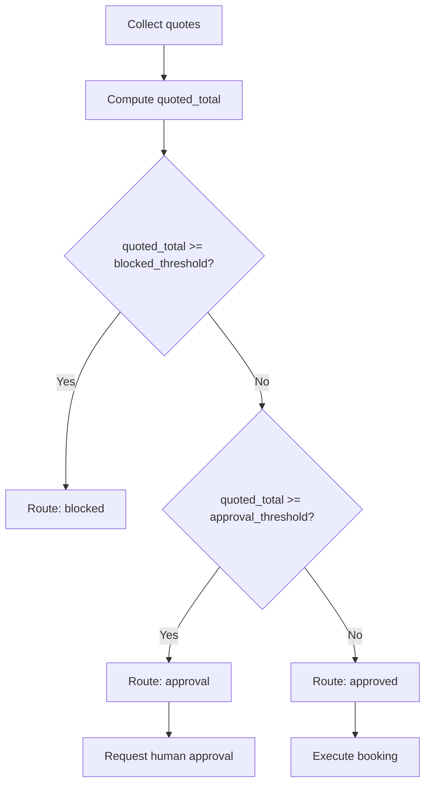
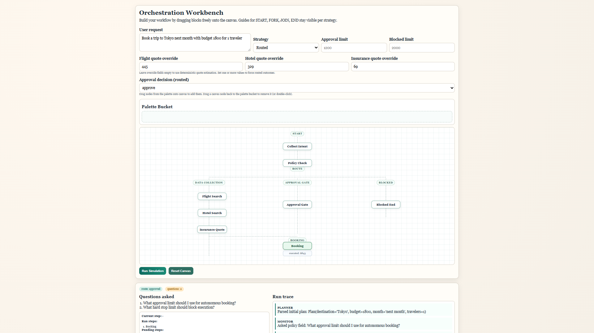
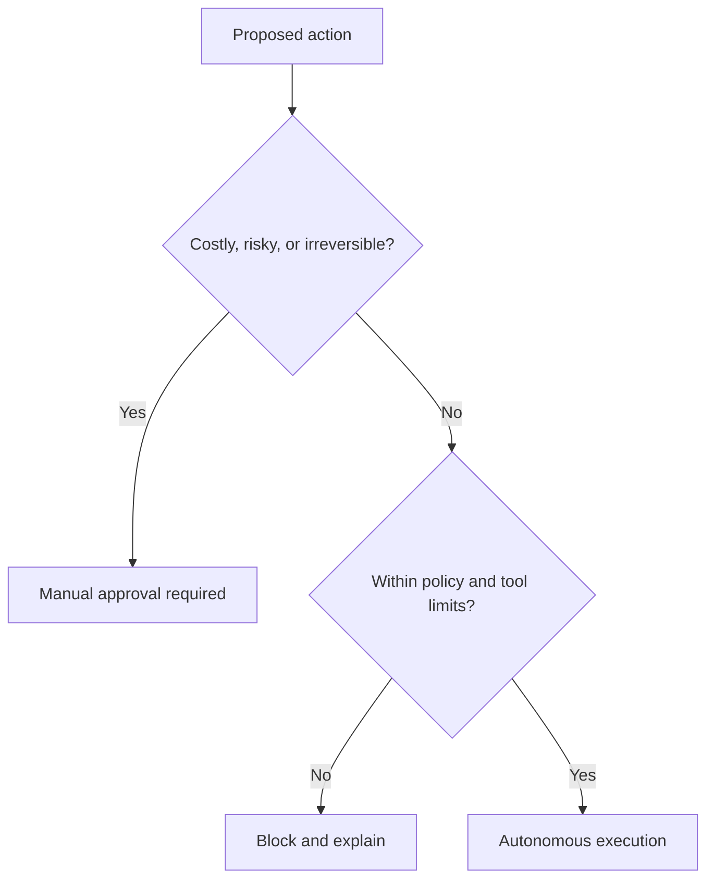
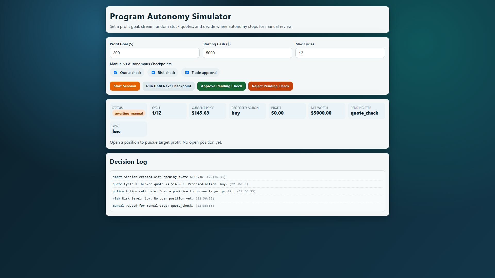
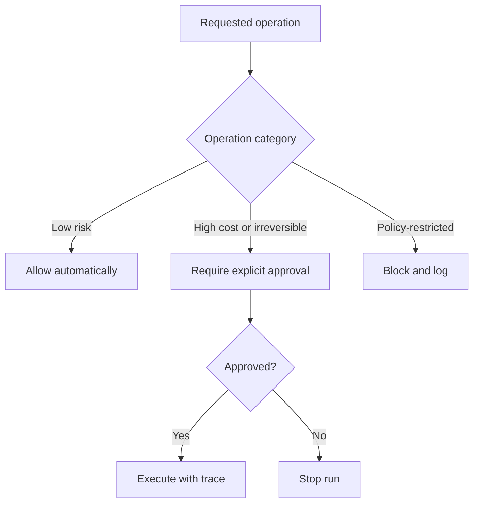
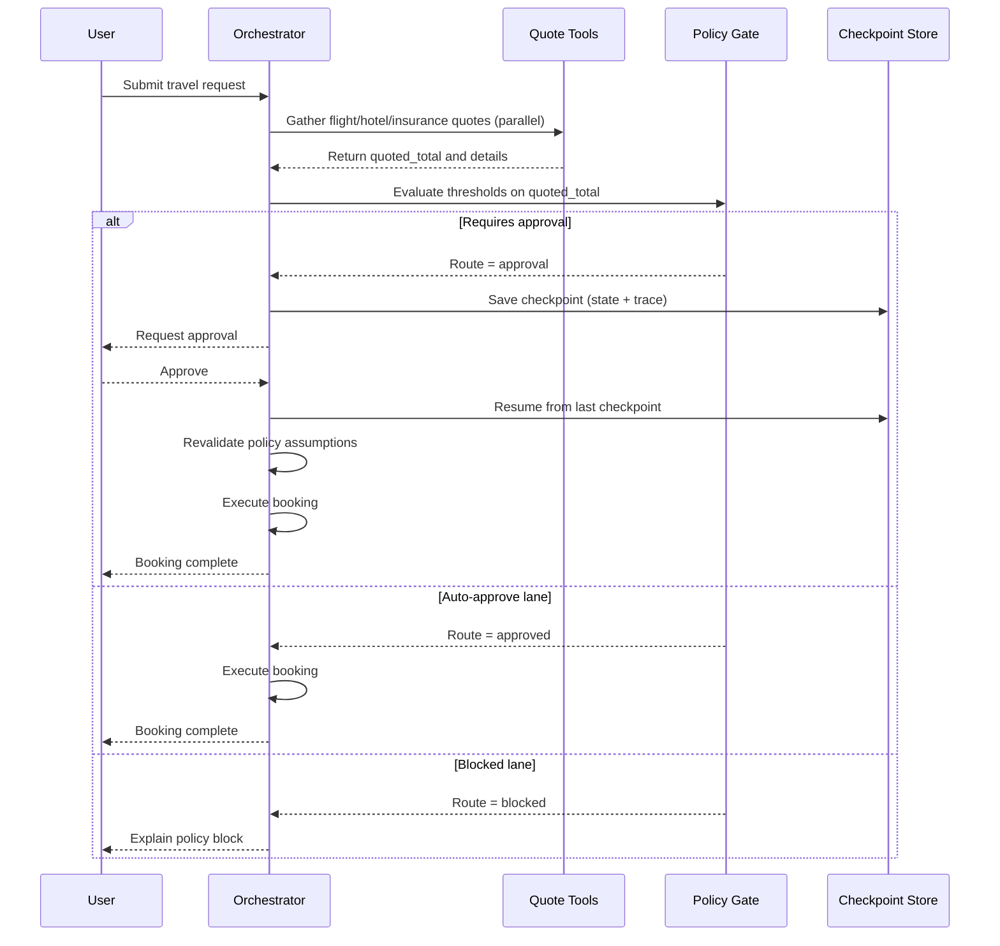

# Agent Orchestration and Autonomy

In Chapter 11, you learned how a single planning loop works: a planner breaks down the goal, an executor carries out the steps, and a monitor decides what to do when reality does not match the plan. That gives you the core loop. This chapter takes the next step and asks a harder question: what happens when one loop is not enough?

The answer is "orchestration". Once your agent needs to coordinate multiple steps, multiple tools, or even multiple sub-agents, you need a way to move work forward without losing control of state, safety, or observability. Autonomy is the other side of that same problem. The more independent you make the system, the more careful you need to be about when it should continue on its own and when it should stop for approval.

Before we go further, let's make the distinction explicit:

- **Orchestration is about workflow shape**: sequence, parallel branches, routing, retries, and handoffs.
- **Autonomy is about decision authority**: who is allowed to decide at each point, under what policy.

A simple memory hook for this chapter is: orchestration determines what runs next; autonomy defines who has authority to continue.

In this chapter, you will learn to:

- Describe orchestration patterns for multi-step autonomous workflows.
- Explain autonomy levels and decide when to keep a human in the loop.
- Add checkpoints and recovery so work can resume after interruption.
- Define safe execution boundaries and policy enforcement points.
- Make autonomous decisions observable with traces, logs, and run summaries.

By the end, you will have moved from controlling one dependable planning loop to coordinating a chain of runs without losing track of the mission.

## A Control-Layer Roadmap

To coordinate that chain safely, you need to make five control decisions explicit. This roadmap connects each decision to the practical artifact you will build or define in the chapter.

Here is the map for the chapter:

| Topic | Primary question | Practical output |
| --- | --- | --- |
| Orchestration | How do we coordinate multiple steps or agents? | A workflow that moves work forward cleanly |
| Autonomy | How much should the system decide on its own? | A human-in-the-loop policy |
| Checkpoints | What do we save so work can resume safely? | Durable recovery points |
| Safety | What must the system never do on its own? | Guardrails and approval gates |
| Observability | How do we explain autonomous choices? | Traces, logs, and reviewable run summaries |

You can also frame this chapter as a two-axis design problem:

| Axis | What changes | Typical question |
| --- | --- | --- |
| Workflow shape (orchestration) | step ordering and branching | What should run next? |
| Decision authority (autonomy) | human vs system control | Who is allowed to decide? |

Why this is important: these axes are related, but independent. You can have complex orchestration with low autonomy, and simple orchestration with high autonomy.

How to use this chapter quickly:

| If you want to... | Read this first | Then do this |
| --- | --- | --- |
| Understand the control problem | Orchestration patterns + autonomy levels | Checkpoints and recovery |
| Build a safer workflow | Safe execution boundaries + approval gates | Observability section |
| Prepare for production | Observability + exercise sections | Larger Assignment |

Assumptions for this chapter:

- You are comfortable with Python functions, classes, control flow, and basic async syntax.
- You already understand the planner, executor, and monitor roles from Chapter 11.
- You want to design systems that can continue safely after partial failure or interruption.

Python-to-agent mental mapping:

| Python concept you already know | Agent-system equivalent in this chapter |
| --- | --- |
| Function chaining | Workflow orchestration |
| Exception handling | Recovery and fallback |
| Saving state to disk | Checkpoints and resumability |
| Assertions and tests | Policy boundaries and approval rules |
| Logging | Autonomous decision traceability |

Before we get into orchestration patterns, it helps to establish the simplest possible description of the problem.
When the system only has one decision point, autonomy is easy to reason about.
When the system has several, you need a structure that keeps ownership and state visible.

Let's start with a simple line of code:

```python
orchestrator = WorkflowOrchestrator(...)
```

Above, you see `WorkflowOrchestrator` being built. That is the key abstraction for this chapter. It is the part of the system that owns:

- **Sequencing rules**: which steps run when, and in what order?
- **State management**: what information is saved, when, and where?
- **Decision boundaries**: when does the system need to stop for review, and when can it continue on its own?

Now that the framing is in place, let's get practical and look at why orchestration matters so much.

## Why Orchestration Matters

Orchestration is the discipline of deciding what runs next, what gets saved, and what should stop for review.

When execution order is not explicit, things break.

Take our trip-booking example again, but now imagine it has to do more than just plan. It also has to check the user's loyalty status, apply discounts, call external APIs for booking, and then send a confirmation email. In earlier chapters, we focused on choosing flights and hotels. At this stage, we also need to coordinate everything that happens after that choice.

In practice, once you have more than one step, the hardest problem is no longer "can the model answer?" The harder problem is "can the system keep moving without losing the thread?"

The orchestrator therefore needs to remember flight and hotel choices, apply loyalty logic, call the booking API with the right parameters, and then send confirmation.

Before we touch implementation details, it helps to picture the failure-prone path we are trying to replace.



**Fig 12.1: Linear workflow without explicit orchestration, showing restart-from-zero behavior after a mid-run failure.**

Without an orchestrator, we might write the workflow as a simple series of function calls:

```python
plan = planner.create_plan(user_input)
loyalty_status = check_loyalty(plan)
if loyalty_status == "gold":
    apply_discount(plan)
booking_result = book_trip(plan)
send_confirmation_email(booking_result)
```

You might ask, what is wrong with that? The problem is that if any step fails, we have no clear recovery path. If the booking API is down, do we retry? Do we save the plan and continue later? If loyalty check fails, do we skip it or ask for more input?

An orchestration loop is meant to prevent that. It keeps the mission moving while preserving the boundaries between decision-making, execution, and oversight.

Think of orchestration as the conductor in an orchestra. The conductor does not play every instrument, but they decide when each instrument enters, when to pause, and when to stop the whole performance.

This model of using an orchestrator matters because autonomous workflows are easy to describe but hard to keep stable. A workflow that looks correct in a diagram can still fail if no one owns the sequencing rules.

The rest of the chapter will show you how to make that sequencing explicit.

Great, next let's look at what orchestration patterns actually show up in real systems and how to choose between them.

## Orchestration Patterns

Now that we have covered why orchestration matters, let's move to how to do it. You will see a few common patterns for multi-step workflows, and each comes with trade-offs in complexity, speed, and safety.

Choose a workflow shape that matches your dependency graph, not one that just looks nice in a diagram.

Keep this trade-off in mind: different orchestration styles create different failure modes. A workflow that is safe for one domain may be too rigid or too permissive for another.

Let's start with the sequential orchestration pattern. This is the most straightforward approach, where each step runs one after the other.

### Sequential orchestration

Sequential orchestration is the simplest pattern. One step finishes before the next step begins.

This is easiest to debug, but usually the slowest.

This is a good choice when the output of one step is clearly needed for the next step. For example, you might first collect intent, then check policy, then execute a side effect, and finally record the run.

To make it more concrete, let's take our travel booking again, but now we will write it in a sequential orchestration style:

You can visualize this pattern as a strict handoff where each stage must finish before the next one starts.



**Fig 12.2: Sequential orchestration with an approval loop before execution.**

1. **Collect the plan from the user input**, including the destination, budget, and travel dates.
2. **Check the plan against policy.** For example, does the user have travel restrictions, or does the budget exceed an approval threshold? The user might also specify approved airlines or a maximum budget of $2,000.
3. **If the plan is approved, execute the booking** by calling the relevant APIs to book the flight and hotel. If not, then we ask the user to modify their plan.
4. **Record the result** of the booking, whether it was successful or if there were any issues.

A sequential implementation might look like this. Because booking calls external APIs, `execute_booking` is a coroutine in both the sequential and parallel examples. The workflow therefore runs inside an `async` function and awaits the booking result:

```python
async def run_sequential_booking(user_input):
    plan = collect_plan(user_input)
    approved = False
    while not approved:
        if check_policy(plan):
            approved = True
        else:
            plan = ask_user_to_modify_plan(plan)

    booking_result = await execute_booking(plan)
    record_result(booking_result)
```

The `await` does not make this workflow parallel. It pauses this workflow while the external booking operation completes, preserving the one-step-at-a-time sequence. This pattern is easy to debug because the path is obvious. The trade-off is that it can be slower when some parts could run in parallel.

### Parallel orchestration

Parallel orchestration runs independent work at the same time.

In plain English: run independent I/O together to gain speed, but pay the coordination cost.

In the travel example, we can fetch flight, hotel, and insurance options in parallel after collecting the initial plan. The sequential version performed all three lookups inside the `execute_booking` step instead.

Now let's make that concurrency shape explicit so you can see where the speedup comes from.



**Fig 12.3: Parallel orchestration with concurrent quote retrieval and explicit join before booking.**

Now let's modify the code to make that parallel work explicit:

```python
import asyncio

async def run_parallel_booking(user_input):
    plan = collect_plan(user_input)
    approved = False
    while not approved:
        if check_policy(plan):
            approved = True
        else:
            plan = ask_user_to_modify_plan(plan)

    # These independent I/O calls run concurrently.
    flight_options, hotel_options, insurance_options = await asyncio.gather(
        fetch_flight_options(plan),
        fetch_hotel_options(plan),
        fetch_insurance_options(plan),
    )

    # Continue once all required results are available.
    booking_result = await execute_booking(
        plan,
        flight_options,
        hotel_options,
        insurance_options,
    )
    record_result(booking_result)
```

This is useful when the workflow can gather information from several sources without waiting for each one to finish before starting the others. For example, a travel agent might fetch flight options, hotel options, and insurance options at the same time.

The benefit is speed. The risk is coordination complexity, because the orchestrator must wait for all required results before making the next decision.

The final pattern is routed orchestration, where policy determines which branch runs next.

### Routed orchestration

Routed orchestration means the workflow chooses between different next steps based on the current state.

Explicit routing rules prevent hidden behavior and policy surprises.

For example, after collecting pricing data (flight, hotel, insurance), the system can fork to a low-risk lane, a medium-risk approval lane, or a blocked lane.

How this shows up in travel booking is clearer if we separate data collection from routing:

1. Always run the quote collection bucket (flight + hotel + insurance).
2. Compare the collected total against policy thresholds.
3. Route based on that comparison.

For example, with an approval threshold of $1700 and a hard block threshold of $2200:

- If quoted total is $1500, continue automatically.
- If quoted total is $1700 or $1701, ask for approval.
- If quoted total is $2200 or more, block execution.

To keep this logic unambiguous, define non-overlapping intervals once and reuse them everywhere:

| Route | Interval |
| --- | --- |
| `approved` | quoted_total < approval_threshold |
| `approval` | approval_threshold <= quoted_total < blocked_threshold |
| `blocked` | quoted_total >= blocked_threshold |

Here's roughly what such code would look like:

```python
plan = collect_plan(user_input)
quoted_total = collect_quotes(plan)

if quoted_total >= blocked_threshold:
    stop_run("policy_blocked")
elif quoted_total >= approval_threshold:
    request_approval(plan)
else:
    await execute_booking(plan)
```

One implementation detail is easy to miss: use one shared policy value (quoted_total) for every threshold comparison in this branch.
That keeps quote collection and routing aligned, so your approval and block decisions are derived from the same data rather than from duplicated calculations. As in the earlier examples, this routing code runs inside an `async` orchestrator because `execute_booking` performs external I/O.

All of this hinges on explicit thresholds, so for example:

- **Low-risk lane (auto)**: quoted total is below the approval threshold.
- **Medium-risk lane (approval)**: quoted total is at or above the approval threshold and below the hard block threshold.
- **Blocked lane**: quoted total is at or above the hard block threshold.

At this point, a routing diagram makes the threshold logic much easier to reason about than prose alone.



**Fig 12.4: Routed orchestration decision flow using non-overlapping policy thresholds.**

If you blur these routing rules, the workflow becomes harder to reason about. Branches start appearing implicitly inside tools or helper functions, which makes debugging and policy review much harder.

No single pattern is always best. Choose the pattern that matches the decision structure of the task.

Now that workflow shape is clear, we need a separate policy for who is allowed to move the work forward at each point.
That is what autonomy levels give us.

## Exercise 1: Patterns

In this exercise, run the three pattern demos in `code/`, then compare their behavior in the visual workbench.

If you want the shortest path, start here first:

- **Exercise 1 running solution (CLI)**: [code/solutions/exercise-1-patterns.md](./code/solutions/exercise-1-patterns.md)

If you want extra context after that first run:

- **Pattern demos guide**: [code/README.md](./code/README.md)
- **Workbench guide**: [code/workbench/README.md](./code/workbench/README.md)

Why this order works:

- **CLI first**: you get deterministic, step-by-step output that is easier to verify and debug.
- **UI second**: you build intuition by seeing flow shape and routing behavior visually after you already trust the baseline run.

As you run this, notice what changes: same request, different workflow shape, different behavior.

This is the fastest way to understand orchestration because you see the same request under different control-flow strategies.

Start with this concrete request in all runs:

```text
Book a trip to Tokyo next month with budget 1800 for 1 traveler
```

Before you run it, orient yourself in the code bundle. Each entry point uses the same travel request, but each one changes who controls the next step and when independent work can begin:

| Code path | What it controls | What to watch while it runs |
| --- | --- | --- |
| `code/sequential.py` | Executes one stage after the previous stage finishes | The strict order of intent, policy, execution, and recording |
| `code/parallel.py` | Starts independent quote lookups together with `asyncio.gather()` | The join point where all quotes must arrive before booking continues |
| `code/routed.py` | Compares one quoted total with approval and block thresholds | The selected `approved`, `approval`, or `blocked` branch |
| `code/workbench/app.py` | Computes questions, routes, visited blocks, and outcomes in `simulate()` | The server-side decision that drives the visual trace |
| `code/workbench/static/app.js` | Streams progress and paints each visited block in the browser | The connection between backend events and the canvas |

This map matters because the interface is not a separate toy implementation. It visualizes the same orchestration concerns that the three smaller command-line examples isolate.

### Step 1: Run sequential orchestration

From `Chapter-12-Agent-Orchestration-and-Autonomy/code`:

```bash
uv run sequential.py --request "Book a trip to Tokyo next month with budget 1800 for 1 traveler"
```

Look for: one stage finishing before the next stage starts.

### Step 2: Run parallel orchestration

From the same folder:

```bash
uv run parallel.py --request "Book a trip to Tokyo next month with budget 1800 for 1 traveler"
```

Look for: option-gathering work being grouped and executed concurrently.

### Step 3: Run routed orchestration

From the same folder:

```bash
uv run routed.py --request "Book a trip to Tokyo next month with budget 1800 for 1 traveler" --approval-limit 1200 --blocked-limit 2500
```

Look for: quote collection happening before route selection, then a policy-based route (`approved`, `approval`, or `blocked`) and whether execution pauses for explicit approval.

One naming detail is worth calling out before you continue. In this chapter we use route labels (`approved`, `approval`, `blocked`) to explain policy decisions. In the assignment app, runtime state names are a bit more descriptive because they represent user-facing lifecycle states.

Use this quick map so the chapter language and app behavior line up in your head:

| Concept in chapter | Runtime status in assignment |
| --- | --- |
| `approved` route selected (auto lane) | `completed` |
| approval granted after `approval` route | `ready_to_resume` then `completed` |
| `approval` route selected | `awaiting_approval` |
| `blocked` route selected | `blocked` |
| collecting inputs before route | `collecting_intent` |

### Step 4: Compare behavior in the web workbench

From `Chapter-12-Agent-Orchestration-and-Autonomy/code/workbench`:

```bash
uv run uvicorn app:app --reload --port 8012
```

Open `http://127.0.0.1:8012/`, then run the same request with `sequential`, `parallel`, and `routed` selected.

The following screenshot shows a completed routed run. The request produced three quote components, passed the policy checks, and reached the booking block:



Read the screen from top to bottom:

1. **Inputs define the experiment.** The request, strategy, thresholds, and quote overrides let you change one orchestration variable at a time.
2. **The canvas shows possible paths.** Data collection, approval, and blocked lanes remain visible even though one run visits only a subset of them.
3. **Node state shows the actual path.** The booking node displays its executed amount, making the side effect distinct from branches that were available but not selected.
4. **The lower panel explains the decision.** The route badge, questions, and run trace connect the visual path back to planner, monitor, router, and executor events.

Why this matters: a workflow diagram usually shows what *could* happen. The workbench adds runtime evidence of what *did* happen and why.

Compare:

1. Which questions are asked first.
2. When policy checks happen.
3. Whether approval is requested before booking.
4. How many steps are completed before a pause.

### Mini change to try

Make one small policy change in `code/routed.py`: lower the approval threshold from `1200` to `900`.

Then rerun the same request and verify that the workflow enters the approval path earlier and asks for human approval more often.

What just happened:

- You changed decision authority without changing workflow shape.
- You saw how policy thresholds shape routing decisions.
- You validated the change in both CLI output and the visual workbench.

Teaching note: in this first exercise, approval gates are a preview, not the main target. The goal here is to see how workflow shape behaves. You will implement approval-gate behavior directly in the next exercise.

## Autonomy Levels

Once you understand orchestration patterns, the next question is how much the system should decide on its own.

Autonomy is about authority, not sequence.

Orchestration answers a flow question: what runs next?
Autonomy answers an authority question: who is allowed to make that next decision?

Autonomy is not a binary. A system can be fully manual in one branch, partially autonomous in another, and fully automatic in a low-risk branch. Treating all decisions the same is how teams create surprise behavior.

Let's give an example with travel booking again by identifying parts that could be manual and other parts that could be made autonomous:

- **Manual**: the user must explicitly request the booking and provide the destination, dates, and budget. Requiring those details helps prevent accidental purchases.
- **Partially autonomous**: the system can suggest a plan based on the user's input, but the user must confirm it before execution. For example, the system might suggest a flight and hotel based on the user's preferences, but the user has to approve the suggested plan before it is booked.
- **Fully autonomous**: the system can automatically apply loyalty discounts or choose between flight options based on the user's past behavior without asking for approval. This is because these actions are low-risk and can enhance the user experience by providing personalized recommendations.

Think of autonomy as a policy choice with levels:

| Level | Behavior | Human involvement |
| --- | --- | --- |
| Assisted | The system suggests, but does not act | High |
| Supervised | The system acts after approval gates | Medium |
| Autonomous | The system acts within defined policy limits | Low |

You are already thinking about autonomy when you design a workflow, even if you do not call it that yet. The question is whether you made those boundaries explicit and can explain them later.

Here's another concrete example: a support agent might automatically summarize a ticket, but require approval before sending a refund. That is not inconsistency. That is deliberate autonomy control.

A good way to decide autonomy is to ask three questions:

1. What can happen without approval?
2. What must always wait for approval?
3. What must never happen automatically?

To make those authority boundaries concrete, here is a compact autonomy decision flow you can reuse in your own systems.



**Fig 12.5: Autonomy-level gate that separates autonomous execution, manual approval, and blocked actions.**

Before we switch domains, notice what stays constant: the policy mindset does not depend on travel booking.
Switching to a stock simulation helps isolate the autonomy boundary itself, because risk and authority are easier to see when actions are explicitly financial.

To make this mindset concrete, let's run a short thought exercise. Imagine we are designing a system that buys and sells stock with a target profit of $10,000. Start by identifying which actions are low-risk and which are high-risk:

- **Low-risk actions**: checking stock prices, analyzing market trends, and generating trade recommendations. These actions can be done autonomously because they do not involve any financial transactions and can provide valuable insights to the user.
- **High-risk actions**: executing trades, especially large ones, and making decisions that could lead to significant financial loss. These actions should require explicit user approval to ensure that the user is aware of the risks involved and can make informed decisions.
- **Never automatic**: making trades without any user input or approval. This is because it could lead to unintended consequences and financial loss for the user.

This is why risk is the right lens for autonomy. The higher the cost of a mistake, the more valuable a human checkpoint becomes.

### Try the same authority boundary in other systems

The stock simulation makes risk visible, but the autonomy pattern is useful well beyond trading. The reusable design move is to separate actions that gather or analyze information from actions that create an external side effect.

Why this matters: when you start with a domain you care about, autonomy stops being an abstract scale and becomes a set of buildable policy choices.

For example, imagine a release agent. It can run tests and summarize failures autonomously, but production deployment still requires a maintainer to approve the exact version and environment. The workflow keeps moving without giving away the final high-impact decision.

Here are a few more systems you could sketch or build:

| System idea | Safe to run autonomously | Require approval | Never automatic |
| --- | --- | --- | --- |
| Incident-response assistant | Gather logs, correlate alerts, draft a diagnosis | Restart a service or fail over traffic | Delete evidence or disable audit logging |
| Content operations agent | Classify submissions, check links, draft edits | Publish externally under a person's name | Invent approvals or hide policy violations |
| Home energy optimizer | Read sensors and shift flexible loads within limits | Change comfort or cost limits | Disable safety controls |
| Dependency maintenance agent | Detect updates, run tests, prepare a pull request | Merge a major-version upgrade | Bypass failed security or compatibility checks |

Pick one row and draw its three lanes: autonomous, approval required, and blocked. Then ask what event you would need to record so a reviewer could reconstruct every lane change. That small design exercise prepares you for both the simulator and the observability sections later in this chapter.

## Exercise 2: Autonomy Levels and Approval Gates

For this exercise, keep workflow shape stable and change only decision authority.
You will use a stock-trading simulation where the user sets a profit goal and the system proposes actions.

If you want the shortest path, start here:

- **Exercise 2 running solution (CLI)**: [code/solutions/exercise-2-autonomy-gates.md](./code/solutions/exercise-2-autonomy-gates.md)

If you want extra context after that first run:

- **Autonomy app guide**: [code/autonomy/README.md](./code/autonomy/README.md)

Why this order works:

- **CLI first**: you can reproduce each pass exactly and compare pause behavior from stable inputs.
- **UI second**: you can explore toggles interactively once you understand the expected policy effects.

Keep the same workflow, then change who is allowed to approve what.

This is the first exercise where approval gates are the main objective, so watch closely for where and why the run pauses.

Use the autonomy web app in `Chapter-12-Agent-Orchestration-and-Autonomy/code/autonomy`:

```bash
uv run uvicorn app:app --reload --port 8013
```

Open `http://127.0.0.1:8013/`.

Before changing the toggles, connect the interface to the implementation:

| Code path | Responsibility | Visible result |
| --- | --- | --- |
| `begin_cycle()` in `code/autonomy/app.py` | Gets a quote, proposes an action, assesses risk, and builds the checkpoint queue | Current price, proposed action, risk, and pending step |
| `run_until_pause_or_finish()` | Advances automatic work and returns as soon as a manual step is reached | The `awaiting_manual` status |
| `manual_decision()` | Applies an approval or rejection to the pending checkpoint | The next pause or completed cycle |
| `code/autonomy/static/app.js` | Sends API requests and renders session state and events | KPI values and the decision log |

The app below is paused at the first quote check with all three manual controls enabled:



Notice what the screen tells you before any trade executes:

- The three checkboxes define decision authority without changing the cycle itself.
- `awaiting_manual` and `quote_check` identify exactly why progress stopped.
- The proposed action and risk assessment remain visible while execution waits.
- The decision log records the quote, rationale, risk result, and pause as separate events.

That separation is the heart of supervised autonomy: the system can prepare a decision and explain it without automatically carrying out the side effect.

Run this as a three-pass drill:

1. **All manual checks ON**
Set all manual toggles enabled and run a short session.
Observe where the workflow pauses (`quote check`, `risk check`, `trade approval`).

2. **Mixed authority**
Turn OFF manual quote checks, keep `trade approval` manual.
Run the same target goal and cycle count.
Observe that workflow shape stays the same, but pause frequency changes.

3. **Higher autonomy within policy**
Turn OFF `manual risk check` too, keep only `trade approval` manual.
Run again and compare the event log.

What to record after each run:

- Number of pauses.
- Which step requested manual input.
- Whether proposed trade actions changed.
- Whether the system reached target faster or with more risk.

Expected learning outcome:

- Orchestration shape can stay constant while autonomy level changes.
- Approval gates are authority controls, not flow-shape controls.
- You can raise autonomy gradually instead of flipping to fully automatic.

## Checkpoints and Recovery

Now that autonomy is framed, we need a way to survive interruption.

Without checkpoints, long-running autonomy eventually means starting over from zero.

Operationally: autonomous workflows fail in the middle more often than they fail at the beginning. A long-running task might lose network access, hit a timeout, or be paused for later review. If you do not save state, you lose progress.

That is what checkpoints solve. A checkpoint is a durable snapshot of what the workflow knows at a meaningful moment in time.

You can think about checkpoints as the difference between a run that can resume and a run that must start over.

```python
from datetime import datetime, timezone

checkpoint = {
    "step": "policy_review",
    "inputs": current_inputs,
    "decisions": current_decisions,
    "timestamp": datetime.now(timezone.utc).isoformat(),
}
save_checkpoint(checkpoint)
```

The timestamp is an ISO 8601 string in UTC, so the checkpoint is portable across machines and does not depend on an undefined helper function. This is not just a storage detail. It is an operational design choice.

If your checkpoint is too shallow, the resumed workflow will not know enough to continue safely.
If your checkpoint is too large, you make storage and replay harder than they need to be.

The practical goal is simple: save enough context to continue, but not so much that the checkpoint becomes another source of complexity.

Recovery usually has three parts:

- detect that the workflow stopped,
- load the last safe checkpoint,
- continue or ask for approval from that point.

This recovery path is easier to build when you can see exactly where stale data checks and approval gates happen after resume.

```mermaid
flowchart TD
    A[Run interrupted] --> B[Load last checkpoint]
    B --> C{Checkpoint valid?}
    C -->|No| D[Escalate for manual review]
    C -->|Yes| E[Revalidate time-sensitive data]
    E --> F{Policy still satisfied?}
    F -->|No| G[Route to approval or revision]
    F -->|Yes| H[Resume execution]
```



**Fig 12.6: Checkpoint resume flow with revalidation and post-resume policy decision.**

That pattern lets you recover from failures without replaying every previous step blindly.

A practical checkpoint policy is to decide which data should be persisted, which can be recomputed, and which must be re-validated before action:

| Decision type | Store in checkpoint? | Recompute on resume? | Why |
| --- | --- | --- | --- |
| User intent and approved constraints | Yes | No | These are explicit commitments and should be stable |
| Tool outputs that are time-sensitive (quotes, prices) | Optional metadata only | Yes | Data may be stale when resuming |
| Policy decisions tied to stale tool data | No | Yes | Route decisions should reflect current data |
| Human approvals with timestamp and scope | Yes | No (but verify scope) | Needed for auditability and safe continuation |

For production thinking, there are two more details that make resume paths safer and easier to audit. The first is preventing duplicate side effects after retries or resume. The second is recording enough trace metadata to explain exactly why a decision was made.

In the assignment scaffold, traces are intentionally minimal so the flow is easy to understand first. Treat the fields below as production extensions you add after the baseline chapter behavior is working.

Resume safety checklist:

- **Idempotency key**: Attach a stable operation key to side effects (for example booking) so resume or retry does not execute the same irreversible action twice.
- **Stale-data revalidation**: Re-fetch time-sensitive data (prices, availability) and re-run policy checks before executing after resume.
- **Decision trace fields**: Include `policy_version`, `checkpoint_id`, `decision_reason`, and `decision_outcome` in trace events so policy behavior is reviewable across runs.

You can model this as a two-level contract:

| Trace contract level | Fields |
| --- | --- |
| Required in scaffold | step, decision/action reason, and resulting state |
| Recommended for production | `policy_version`, `checkpoint_id`, `decision_reason`, `decision_outcome`, correlation/run id |

## Safe Execution Boundaries

With checkpoints in place, the next question is what the workflow is allowed to do without supervision.

Boundaries are where automation stops and human control starts.

Safety takeaway: autonomy without boundaries is just uncontrolled execution. Safe execution boundaries tell the system where policy ends and action begins.

In a real workflow, boundaries usually include things like:

- requiring approval for high-cost actions,
- blocking irreversible operations without a confirmation step,
- preventing a sub-agent from changing shared state directly,
- constraining what tools can be used in a given stage.

The important thing is that the boundary should be visible in the code and visible in the trace.

Here is a simple way to think about it:

| Boundary type | Example | Reason |
| --- | --- | --- |
| Financial | Anything above budget needs approval | Prevent costly mistakes |
| Operational | Destructive actions need confirmation | Prevent irreversible damage |
| Policy | Restricted data cannot be accessed automatically | Protect compliance |
| Workflow | A later stage cannot run until earlier checks pass | Preserve sequencing |

In other words, a safe boundary is not just a guard clause. It is a documented rule that the workflow can explain later.

When you formalize boundaries, this simple decision flow is the one that prevents unsafe automatic actions from slipping through.



**Fig 12.7: Safe execution boundary flow separating automatic, approval-gated, and blocked operations.**

That matters when you need to answer a user, a reviewer, or an auditor who asks why the system stopped.

## Observability for Autonomous Decisions

Once the workflow can decide and recover, you need to explain what happened.

Core rule: if you cannot explain a decision, you cannot trust or improve it.

Trust angle: an autonomous system that cannot explain itself is hard to trust, hard to test, and hard to improve. Observability is what turns a run from a black box into something you can review.

You should be able to answer questions like:

- What step was running when the workflow paused?
- Which checkpoint did it resume from?
- Why did it ask for approval at that point?
- Which policy caused the branch to change?

Traces become especially useful here. A good trace should show the sequence of decisions, not just the final result.

```python
trace.record("decision", {
    "step": "approval_gate",
    "reason": "cost_above_threshold",
    "action": "request_approval",
})
```

That kind of event gives you something concrete to compare across runs. It also helps you spot when autonomy changed in ways you did not intend.

One practical rule is worth keeping in mind: if a decision matters enough to affect the workflow, it matters enough to appear in the trace.

Now let's make that traceability requirement concrete with one complete run from user request to final outcome.
Seeing the full path in one place helps beginners connect routing, checkpointing, approval, and execution as one system rather than four separate ideas.
This final sequence ties all earlier decision flows together into one observable run.



**Fig 12.8: End-to-end Chapter 12 workflow with quote collection, policy routing, approval gating, checkpoint resume, and final execution.**

What matters in this flow is the order of responsibility handoffs and safety checks.
If you can narrate this sequence from memory, you are already thinking like a workflow designer rather than only a prompt writer.

- **Data Before Decision**: Quote collection completes before policy routing.
- **Decision Before Action**: Routing determines whether execution can proceed.
- **Checkpoint Before Pause**: Approval waits only after state is durably saved.
- **Resume Before Execution**: In production, recovered state is revalidated before acting. In the assignment scaffold, resume is simplified so you can focus on checkpoint flow first.

These exercises are meant to turn the chapter concepts into control-flow habits.

This section is where you prove your policies and flow design actually work under pressure.

Why this section matters: orchestration and autonomy are easy to nod along with and hard to internalize. A small implementation exercise is usually the fastest way to see whether the boundaries are real.

## Exercise 3: Add checkpointing

For this exercise, extend a workflow so it can resume after interruption.

In plain English: define exactly what state is required to resume safely, then save only that.

Start with a single flow that saves progress after a meaningful step, such as policy review or tool completion.

1. Choose one place where a checkpoint should be saved.
2. Save the minimum state required to continue safely.
3. Reload the checkpoint and resume the workflow.
4. Write a short note describing what can be resumed and what still needs to be recomputed.

What you should learn here is that recovery design begins with deciding what "safe to resume" actually means.

## Exercise 4: Add an approval gate

For this exercise, add a human approval point for a high-risk action.

A useful rule here is: if an action is costly or irreversible, it should never execute silently.

Use a situation where the system can continue automatically for low-risk work, but must pause before something expensive or irreversible happens.

1. Define the condition that requires approval.
2. Block the action until approval is granted.
3. Record the decision in a trace or run log.
4. Test both approval and rejection paths.

The main lesson is that autonomy becomes trustworthy only when its limits are explicit.

## Assignment

The larger assignment combines orchestration, autonomy, checkpoints, and observability into one build.

Build a system that can keep moving, pause safely, and justify every important decision.

Your goal is not to maximize complexity. Your goal is to build a workflow that can continue safely, stop when needed, and explain its choices.

Where this becomes real: this is the point in the book where theory becomes a system that can actually survive interruptions and policy constraints.

This repository now includes a starting scaffold in `Chapter-12-Agent-Orchestration-and-Autonomy/assignment`.
It uses a travel-booking workflow so you can stay inside the same domain as the earlier pattern demos while adding approval, checkpointing, resume, and trace visibility.

If you are using this chapter as a build-along, start there before inventing a bigger system. The scaffold already gives you one approval gate, one checkpoint boundary, and one visible trace, which is enough to make the chapter concepts concrete before you add more complexity.

Read these files first (beginner path):

- **assignment/README.md**: run order, endpoints, and expected behavior.
- **assignment/orchestration.py**: routing, approval gate, checkpoint save/resume logic.
- **assignment/webapp.py**: API surface for session, chat, approval, and resume.
- **assignment/app_models.py**: state model and response contracts used across the app.
- **assignment/tests/test_assignment.py**: concrete behavior checks for approval and resume paths.

For the assignment, build or extend an autonomous workflow with checkpoints, approval gates, and full tracing.

Suggested assignment shape:

1. Start with a small multi-step workflow.
2. Add checkpointing after one meaningful decision point.
3. Add one approval gate for a high-risk action.
4. Add traces that explain the path taken.
5. Demonstrate at least one resume path and one approval path.

If you want to make the assignment concrete, think of a workflow that plans a task, pauses for review when risk is high, and resumes from the last checkpoint after approval.

If you want to start from the included scaffold, follow this order:

1. Run the assignment app in `assignment/`.
2. Trigger the approval gate with a higher-cost trip.
3. Approve the run and resume from the saved checkpoint.
4. Inspect the checkpoint JSON and trace log before making any extensions.

## Solution

[Solution](./assignment/README.md)

## Summary

In this chapter, you moved from one planning loop to multiple coordinated decisions.

Orchestration is the route, autonomy is permission to drive each segment of that route.

You learned how orchestration keeps work moving, how autonomy levels control when the system can act on its own, how checkpoints make recovery possible, how safe execution boundaries prevent uncontrolled behavior, and how observability makes autonomous decisions reviewable.

You should now have a clear split:

- Orchestration is workflow shape.
- Autonomy is decision authority.

The real takeaway is simple: autonomy is not about removing control. It is about placing control at the right points so the system can move forward safely.

In the next chapter, we will extend this idea into **multi-agent collaboration and communication**: how separate agents coordinate their work without stepping on one another.
