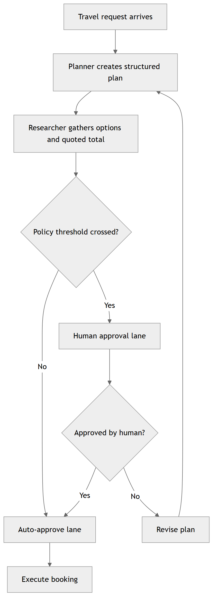
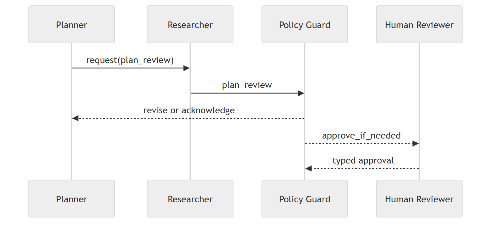
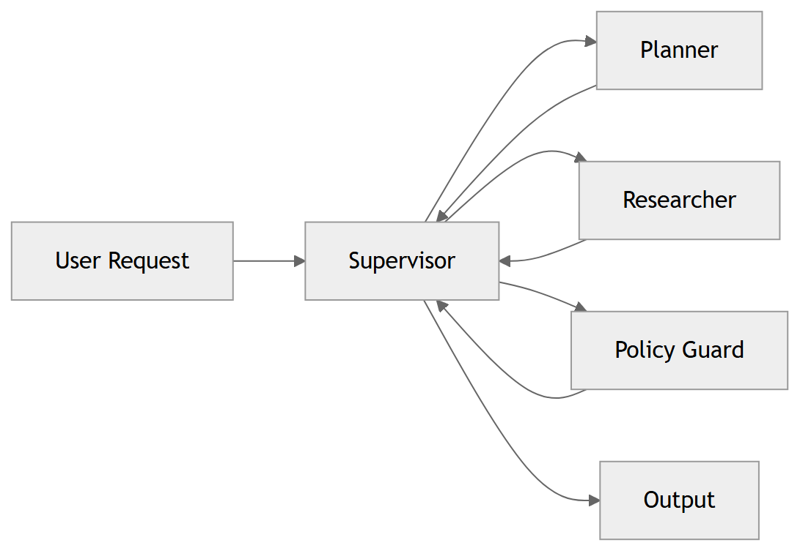
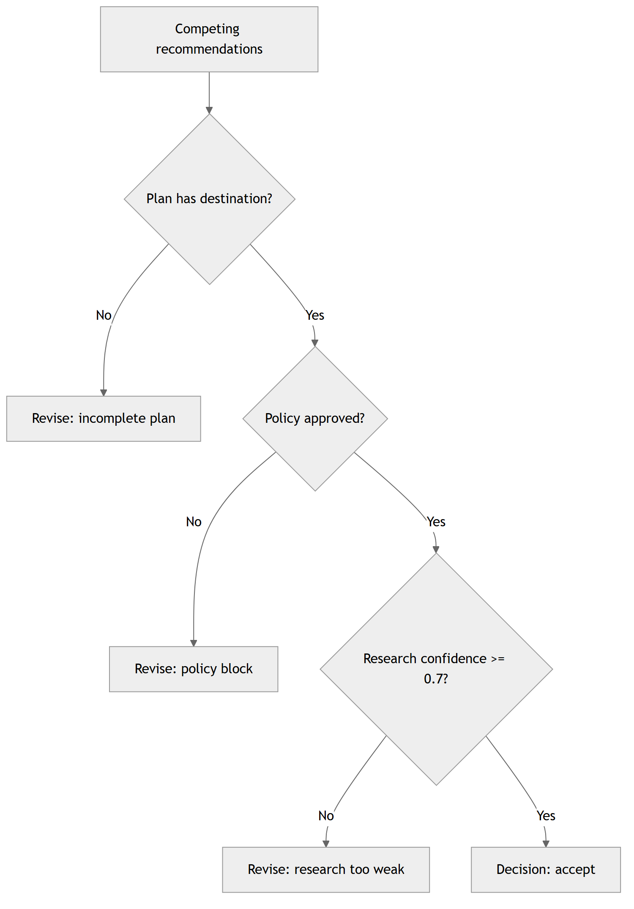
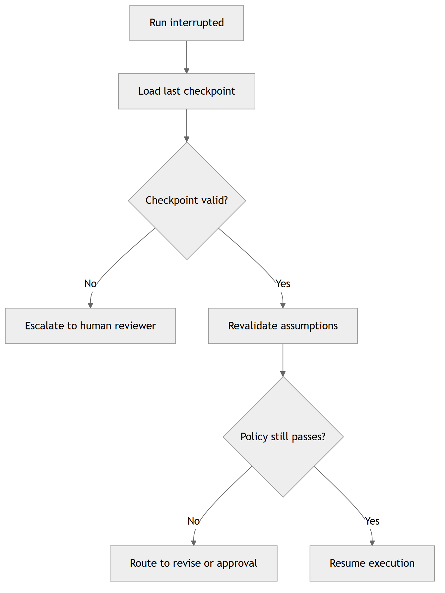
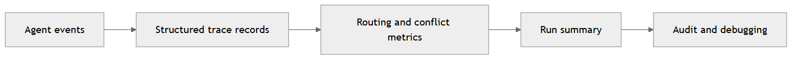

# Multi-Agent Collaboration and Communication

In Chapter 12, you learned how orchestration and autonomy let one workflow pause, resume, and make safe decisions. That was the right foundation. This chapter asks the next question: what changes when one agent is not enough and the work has to move across a team?

In a multi-agent system, the conversation becomes part of the system. A planner might shape the request, a researcher might compare options, a policy agent might stop the run, and a coordinator might decide what happens next. If those roles are not explicit, the whole thing turns into guesswork.

Let's make the split concrete:

- **Single-agent design is about one reasoning loop**: one agent plans, decides, and executes inside one control surface.
- **Multi-agent design is about a shared working process**: several agents contribute partial work through explicit handoffs.

Here's the memory hook I want you to keep in mind as you read: one agent can solve a task, but a team of agents can operate a process.

That is the shift this chapter is trying to teach. You are moving from "I can build one capable agent" to "I can build a team that stays understandable while it works."

In this chapter, you will learn to:

- **Decompose Work Into Roles**: identify when to split one broad task into specialized agents such as planner, policy guard, and booking worker.
- **Design Agent Communication Contracts**: define message envelopes, shared state boundaries, and handoff expectations between agents.
- **Select A Coordination Model**: choose between supervisor-led routing, shared blackboard coordination, or peer-to-peer collaboration based on task shape.
- **Resolve Conflicts Predictably**: implement tie-break and arbitration rules when agents disagree on plans, costs, or policy outcomes.
- **Recover From Partial Failure**: design retry, fallback, checkpoint, and escalation behaviors so failures do not collapse the whole workflow.

As you work through the chapter, keep one question in mind: "Can I explain exactly why this agent exists, what authority it has, and how it fails safely?" If you cannot answer that in plain language, the architecture is not ready yet.

Chapter 12 focused on controlling autonomous workflow decisions. Chapter 13 focuses on making multiple specialized decisions work together without creating chaos.

## From one agent to a team

You already have the Chapter 12 foundation, which means you know how to pause a workflow, save state, and resume when the timing is right. That matters here because multi-agent systems still need all of that. They just need it across more than one role.

Once one agent becomes a team, the challenge is not just reasoning quality. It is coordination quality under pressure: handoffs, disagreements, retries, and shared state drift.

That is why this chapter reads like a path instead of a reference sheet. Each stop solves the next real bottleneck you hit when moving from one capable agent to a team that still explains itself clearly.

Here is the path we will follow:

- **Defining the mission**: sets the ground truth for requests, constraints, and success criteria.
- **Building the team**: defines roles, ownership boundaries, and why each agent exists.
- **Establishing the language**: makes handoffs explicit so agents can coordinate without ambiguity.
- **Choosing the control style**: determines how work moves through the team.
- **Handling disagreement**: defines how to resolve collisions predictably.
- **Surviving failure**: adds recovery behavior so partial failures do not collapse the run.
- **Making it explainable**: makes decisions inspectable and measurable.
- **Proving it works**: exercises and assignment turn the design into working, testable implementation.

## Defining the mission

Let's make the scenario concrete. A traveler asks for a three-day work trip to Copenhagen, wants to stay under budget, prefers morning flights, and needs any booking at or above a policy threshold to be reviewed before purchase. That one request already contains planning, policy, and coordination pressure, which is exactly why it works so well for this chapter.

Once the request is concrete, every later decision has something real to point back to. The planner can shape it, the researcher can compare it, and the policy agent can judge it without inventing extra context.

Here is the kind of request we will keep returning to:

```json
{
	"destination": "Copenhagen",
	"dates": { "depart": "2026-08-12", "return": "2026-08-15" },
	"budget": 2200,
	"preferences": ["morning flight", "hotel near downtown"],
	"policy": { "approval_threshold": 1800 }
}
```

This request gives us a useful baseline:

- **The planner** needs to turn an open-ended request into a structured trip plan.
- **The researcher** needs to compare options and surface tradeoffs.
- **The policy agent** needs to decide whether the plan can move forward as-is.

Once we know what success looks like, the rest of the chapter becomes easier to reason about because every later section can answer one question: does this move the travel request closer to a safe decision?

To anchor that idea, here is the mission-level decision flow that the rest of the chapter keeps implementing in more detail.



**Fig 13.1: Mission-level decision flow from request intake through policy gating, revision, and execution.**

Here are three versions of the same travel request so you can see how the system grows with complexity:

| Request | Example | Expected output |
| --- | --- | --- |
| Simple | "Book a short work trip to Copenhagen next month." | A basic plan with one or two reasonable options. |
| Medium | "Book Copenhagen with a budget under $2200 and a morning flight." | A plan plus a comparison of options and a policy check. |
| Complex | "Book Copenhagen, but only if total cost stays under policy, the hotel is downtown, and the final choice is approved by a human." | A coordinated run with review, revision, and traceable handoff state. |

The policy side of the problem needs its own guardrails too. Here we are not talking theory anymore. We are talking about the rules that decide whether the trip keeps moving or has to stop and ask for help.

| Constraint | Example rule | What it changes |
| --- | --- | --- |
| Budget cap | Keep the trip under $2200 | Triggers comparison and possible revision |
| Approval threshold | Anything at or above $1800 needs review | Adds a human-in-the-loop step |
| Preferred carriers | Prefer morning flights | Shapes the research agent's ranking |
| Safety or policy rules | Do not book outside approved vendors | Can block the workflow entirely |

The system also has a few non-functional requirements that matter just as much as the travel details themselves:

- **Latency**: you should expect parallel research where it makes sense, not a slow serial chain for independent lookups.
- **Traceability**: every handoff should be visible in the trace so the workflow can be explained later.
- **Auditability**: the final decision should be reconstructible from the recorded conversation and policy checks.
- **Retry limits**: temporary failures should retry a small number of times, then stop and escalate instead of looping forever.

To transition into design, we will now convert requirements into agent responsibilities. That is where the chapter starts to feel like an actual team instead of a collection of ideas.

## Building the team

Now that the mission is clear, the next question is simple: who should do what?

If the roles are fuzzy, the handoffs are fuzzy too. Once that happens, you can no longer tell whether a bad outcome came from the planner, the researcher, the policy check, or the coordinator.

The travel planner is a good example of why specialization helps. One agent is good at shaping the trip, another is good at comparing prices, and yet another is good at saying whether the plan is allowed. If we ask one agent to do all three jobs, it keeps switching modes, and the handoff points that matter most stay hidden.

We are not splitting roles because it sounds sophisticated. We are splitting them because different jobs fail in different ways, and the only way to reason about those failures is to make the boundaries visible.

Think of the team this way:

- **Planner**: turns the user request into a trip strategy and task list.
- **Researcher**: gathers flight, hotel, and maybe ground-transport options.
- **Policy guard**: checks the plan against budget and approval rules.
- **Coordinator**: keeps the work moving and decides what happens next.
- **Human reviewer**: steps in when the system needs typed approval, clarification, or a decision that should not be automated.

That gives us a simple mental model for the rest of the chapter. We are not building a crowd of chatty agents; we are building a small team with clear responsibilities and clear limits, and that keeps the coordination overhead from growing faster than the value of the extra help.

Here's the useful part for you as a builder: when the roles are clear, you can test each one in isolation and understand the failure when it shows up.

```python
from dataclasses import dataclass


@dataclass
class AgentRole:
	name: str
	responsibility: str
	can_decide: bool = False


team = [
	AgentRole("planner", "shape the travel request into a plan"),
	AgentRole("researcher", "collect options and compare tradeoffs"),
	AgentRole("policy", "approve, revise, or block the plan", can_decide=True),
	AgentRole("coordinator", "route handoffs and keep shared state consistent", can_decide=True),
]

# Human reviewer is added when policy requires typed approval or clarification.
```

The code is intentionally simple. The point is not to build the full system here; the point is to make the roles visible before we start wiring agents together.

Here is a simple role card for each member of the travel team:

| Role | Mission | Inputs | Outputs | Permissions | Failure mode |
| --- | --- | --- | --- | --- | --- |
| Planner | Turn the request into a trip plan | User request, preferences | Structured plan | Can propose routes and options | Over-generalizes or misses constraints |
| Researcher | Compare travel options | Plan, destination, dates | Candidate flights, hotels, costs | Can query sources and rank choices | Returns stale or incomplete options |
| Policy guard | Enforce rules and approvals | Plan, cost, policy thresholds | Approve, revise, or block | Can veto unsafe or over-budget choices | Needs clarification when rules conflict |
| Coordinator | Move the workflow forward | Agent messages, trace state | Next-step decision | Can route, retry, or escalate | Deadlocks or loses state if trace is weak |
| Human reviewer | Provide typed approval or clarification | Escalation, proposed plan | Approval, rejection, or corrected input | Can override automation | Delayed response or ambiguous input |

The rule of thumb is simple: split roles when a task has a different failure mode, a different permission boundary, or a different kind of expertise. Merge roles when the split would only add handoffs without adding clarity.

For this chapter, the minimum viable team is planner, researcher, policy guard, and coordinator, with a human reviewer entering the loop whenever the policy threshold is crossed or the system needs typed approval.

Here is what each agent class looks like in practice. The key insight is that each class owns one role's logic:

```python
class Planner:
	def run(self, message):
		return {"agent": "planner", "status": "plan_created"}


class Researcher:
	def run(self, message):
		return {"agent": "researcher", "status": "options_gathered"}


class PolicyGuard:
	def run(self, message):
		return {"agent": "policy", "status": "approved"}


class HumanReviewer:
	def run(self, message):
		return {"agent": "human reviewer", "status": "awaiting_input"}
```

Each agent is just a class with a `run` method that takes a message and returns a result. The class name itself tells you the role. We'll add the actual business logic once we understand the structure.

Now that roles are clear, pause here and choose the team for the travel request before writing any code.

If you keep the team small at first, the trace stays readable and the behavior stays teachable. That is usually the better place to start.

## Exercise 1: choose the travel team

Take the Copenhagen travel request and decide which agents you actually need before you write any code. That means choosing the team shape first and explaining why each role earns its place.

- **Exercise 1 - Team Selection**: identify the smallest useful set of agents for the travel workflow and explain what each one is responsible for.

For a simple trip, you might only need a planner, researcher, and policy guard. For a more involved request, you may want a coordinator and a human reviewer as well. The important part is not the size of the team; it is the reasoning behind the split.

Write down the answer in plain language before you build anything. If you cannot explain why a role exists, the system probably does not need that role yet.

When you are done, compare your answer with the end-of-chapter [solution guide](code/solutions/README.md) and the [Exercise 1 notes](code/solutions/exercise-1-team-selection/README.md).

Once that team choice is clear, we can move into communication with a much better sense of what the control flow needs to support.

## Establishing the language

Once the team is in place, the next problem is the language they use to pass work to one another.

Here is the shape of the problem: the planner should not have to guess what the researcher meant, and the policy agent should not have to infer which booking option was approved. If the handoff is vague, every downstream agent starts making assumptions, and that is where the system gets fragile.

If the message says only "look good," that is not a handoff. If it says who sent it, who should read it, and what it contains, the next agent has something useful to work with.

For this chapter, we can standardize on a simple message envelope:

```json
{
	"trace_id": "trip-2048",
	"from": "researcher",
	"to": "policy",
	"type": "plan_review",
	"payload": {
		"quoted_total": 1975,
		"options": ["flight A", "hotel B"],
		"notes": "morning departure requested"
	}
}
```

That small envelope does a lot of work:

- **Traceability**: the `trace_id` lets us follow the request through the whole team.
- **Clarity**: `from`, `to`, and `type` tell us exactly what kind of handoff this is.
- **Shared meaning**: the `payload` contains the minimum state the next agent needs.

You can think of this as the grammar of the system. Once the grammar is clear, the agents can disagree on the answer without disagreeing on what the conversation means, and that is what keeps a multi-agent workflow debuggable.

The chapter works best if every message uses the same small set of shapes:

```json
{
	"type": "request | plan_review | ack | reject | revise",
	"trace_id": "trip-2048",
	"from": "planner",
	"to": "researcher",
	"payload": {
		"goal": "book Copenhagen trip",
		"constraints": ["budget under 2200", "morning flight"]
	}
}
```

Keep one ownership rule in mind while you implement this. The coordinator owns the canonical workflow state and trace, while each specialist agent owns only its local working context for its task.

That is enough to support the conversation without flooding every agent with the full history. The rule is to pass only the state the next step actually needs. In practice, the coordinator keeps the full story, while the researcher gets the dates, constraints, and current goal.

The danger to watch for is an implicit assumption that never gets written down. For example, if the researcher assumes the budget is flexible and the policy agent assumes it is fixed, both agents can be correct in isolation and wrong together. The easiest way to catch that is to force each handoff to include the same explicit fields and to reject any message that arrives without them.

Now let's build the coordinator. Start with the simplest version.

This section teaches the explicit message-envelope supervisor pattern because it is the clearest way to learn handoffs. The assignment scaffold later in this chapter uses a linearized orchestrator state machine for easier end-to-end practice. Both are valid; this section focuses on the communication pattern first. In the assignment README, the Lesson Mapping section shows exactly how each concept maps to the scaffold code, including the threshold defaults used by the runnable scaffold.

```python
class Coordinator:
	def __init__(self, agent_registry):
		self.agent_registry = agent_registry

	def run(self, message):
		# For now, just dispatch to the right agent
		agent_name = message["to"]
		agent = self.agent_registry[agent_name]
		return agent.run(message)
```

That's a coordinator in its simplest form—it just looks up the agent by name and runs it. Now add validation.

Track three checks: every message must declare message type, carry a trace identifier, and include sender/receiver plus payload. The goal is to fail fast when the envelope is incomplete, instead of letting downstream agents guess.

```python
def validate_message(self, message):
	"""Coordinator validates all incoming messages."""
	required = {"type", "trace_id", "from", "to", "payload"}
	missing = required - set(message)
	if missing:
		raise ValueError(f"Missing fields: {sorted(missing)}")
```

This method validates five things before dispatch: message type, trace ID, sender, receiver, and payload. If any field is missing, it fails fast with a clear error so the problem is caught at the boundary.

Now tuck that method into the coordinator and call it from `run`:

```python
class Coordinator:
	def __init__(self, agent_registry):
		self.agent_registry = agent_registry

	def validate_message(self, message):
		"""Coordinator validates all incoming messages."""
		required = {"type", "trace_id", "from", "to", "payload"}
		missing = required - set(message)
		if missing:
			raise ValueError(f"Missing fields: {sorted(missing)}")

	def run(self, message):
		self.validate_message(message)
		agent_name = message["to"]
		agent = self.agent_registry[agent_name]
		return agent.run(message)
```

Now add routing intelligence so the coordinator can decide what happens next based on message type.

This step is about decision policy, not syntax. If the destination is explicit and known, trust it. If the destination is missing or malformed, apply safe fallbacks by message type so the workflow stays understandable.

```python
def select_next_agent(self, message):
	"""Coordinator decides which agent should handle the message."""
	# Prefer explicit destination when it maps to a known agent
	if message["to"] in self.agent_registry:
		return message["to"]

	# Fallbacks for unsupported or malformed destinations
	if message["type"] in {"request", "revise"}:
		return "planner"
	if message["type"] == "plan_review":
		return "researcher"
	return "human reviewer"
```

This method answers one question: "Given this message, who should act next?" It first respects explicit destinations, then applies safe fallback policy when destinations are invalid.

Now tuck it into the coordinator and use it from `dispatch_next_agent`:

```python
class Coordinator:
	def __init__(self, agent_registry):
		self.agent_registry = agent_registry

	def validate_message(self, message):
		"""Coordinator validates all incoming messages."""
		required = {"type", "trace_id", "from", "to", "payload"}
		missing = required - set(message)
		if missing:
			raise ValueError(f"Missing fields: {sorted(missing)}")

	def select_next_agent(self, message):
		"""Coordinator decides which agent should handle the message."""
		# Prefer explicit destination when it maps to a known agent
		if message["to"] in self.agent_registry:
			return message["to"]

		# Fallbacks for unsupported or malformed destinations
		if message["type"] in {"request", "revise"}:
			return "planner"
		if message["type"] == "plan_review":
			return "researcher"
		return "human reviewer"

	def dispatch_next_agent(self, message):
		agent_name = self.select_next_agent(message)
		agent = self.agent_registry[agent_name]
		return agent.run(message)

	def run(self, message):
		self.validate_message(message)
		return self.dispatch_next_agent(message)
```

There's the full coordinator. It validates, decides which agent to call, and invokes it.

One detail is important for consistency with the exercise route: the fallback for `plan_review` goes to the researcher first, then policy receives the follow-up review with quoted totals and confidence. That keeps the default route aligned with `request -> planner -> researcher -> policy`.

Now let's add real logic to the agents. We will grow one method at a time: `Planner.run`, then `Researcher.run`, then `PolicyGuard.run`, and finally `HumanReviewer.run`.

First method: `Planner.run` turns raw request fields into a structured plan.

```python
class Planner:
	def run(self, message):
		request = message["payload"]
		plan = {
			"destination": request.get("destination"),
			"dates": request.get("dates"),
			"budget": request.get("budget"),
		}
		return {
			"agent": "planner",
			"status": "plan_created",
			"plan": plan,
		}
```

That method gives us a normalized plan object. Next, `Researcher.run` converts that plan into quoted options and confidence.

```python
class Researcher:
	def run(self, message):
		plan = message["payload"]
		# Simulate research results
		quotes = {
			"flight": 750,
			"hotel": 500,
			"insurance": 40,
		}
		return {
			"agent": "researcher",
			"status": "options_gathered",
			"quoted_total": sum(quotes.values()),
			"confidence": 0.85,
		}
```

Now `PolicyGuard.run` applies thresholds to that quoted total and returns the decision status.

```python
class PolicyGuard:
	def __init__(self, approval_limit=1800):
		self.approval_limit = approval_limit

	def run(self, message):
		quoted_total = message["payload"].get("quoted_total", 0)
		if quoted_total >= self.approval_limit:
			return {
				"agent": "policy",
				"status": "needs_approval",
				"approved": False,
				"reason": f"${quoted_total} is at or above limit ${self.approval_limit}",
			}
		return {
			"agent": "policy",
			"status": "approved",
			"approved": True,
		}
```

Finally, `HumanReviewer.run` is the escalation endpoint when automated policy cannot complete the decision.

```python
class HumanReviewer:
	def run(self, message):
		return {"agent": "human reviewer", "status": "awaiting_input"}
```

With each method introduced, the full class block is easier to read in one place.

Read this block as four role upgrades: planner structures intent, researcher estimates options, policy enforces limits, and human reviewer handles escalation. If each role returns a stable shape, the coordinator can stay simple.

```python
class Planner:
	def run(self, message):
		request = message["payload"]
		plan = {
			"destination": request.get("destination"),
			"dates": request.get("dates"),
			"budget": request.get("budget"),
		}
		return {
			"agent": "planner",
			"status": "plan_created",
			"plan": plan,
		}


class Researcher:
	def run(self, message):
		plan = message["payload"]
		# Simulate research results
		quotes = {
			"flight": 750,
			"hotel": 500,
			"insurance": 40,
		}
		return {
			"agent": "researcher",
			"status": "options_gathered",
			"quoted_total": sum(quotes.values()),
			"confidence": 0.85,
		}


class PolicyGuard:
	def __init__(self, approval_limit=1800):
		self.approval_limit = approval_limit
	
	def run(self, message):
		quoted_total = message["payload"].get("quoted_total", 0)
		if quoted_total >= self.approval_limit:
			return {
				"agent": "policy",
				"status": "needs_approval",
				"approved": False,
				"reason": f"${quoted_total} is at or above limit ${self.approval_limit}",
			}
		return {
			"agent": "policy",
			"status": "approved",
			"approved": True,
		}


class HumanReviewer:
	def run(self, message):
		return {"agent": "human reviewer", "status": "awaiting_input"}


# Set up the team
agent_registry = {
	"researcher": Researcher(),
	"policy": PolicyGuard(),
	"planner": Planner(),
	"human reviewer": HumanReviewer(),
}

coordinator = Coordinator(agent_registry)
```

Now put it all together with a real example:

```python
# Step 1: Planner shapes the request
message_1 = {
	"type": "request",
	"trace_id": "trip-2048",
	"from": "user",
	"to": "planner",
	"payload": {
		"destination": "Copenhagen",
		"dates": {"depart": "2026-08-12", "return": "2026-08-15"},
		"budget": 2200,
	}
}

planner_response = coordinator.run(message_1)
# Output: {"agent": "planner", "status": "plan_created", "plan": {...}}

# Step 2: Researcher gathers options
message_2 = {
	"type": "plan_review",
	"trace_id": "trip-2048",
	"from": "planner",
	"to": "researcher",
	"payload": planner_response.get("plan", {}),
}

researcher_response = coordinator.run(message_2)
# Output: {"agent": "researcher", "status": "options_gathered", "quoted_total": 1290, "confidence": 0.85}

# Step 3: Policy guard decides
message_3 = {
	"type": "plan_review",
	"trace_id": "trip-2048",
	"from": "researcher",
	"to": "policy",
	"payload": {
		"quoted_total": researcher_response.get("quoted_total"),
		"confidence": researcher_response.get("confidence"),
	},
}

policy_response = coordinator.run(message_3)
# Output: {"agent": "policy", "status": "approved", "approved": True}
```

Before moving on, run a quick contract sanity check so each handoff stays compatible:

```python
assert message_1["type"] == "request"
assert message_2["type"] == "plan_review"
assert "destination" in message_2["payload"]
assert "quoted_total" in message_3["payload"]
assert message_3["to"] == "policy"
```

If these assertions pass, your envelope shape is consistent across planner, researcher, and policy.

Now you can trace exactly who did what at each step. The planner shaped the request, the researcher gathered options, and the policy guard made the decision. Each agent owns one piece, and messages carry state from one to the next.

You can picture the flow like this:



**Fig 13.2: Standard message handoff sequence across planner, researcher, policy, and human review.**

## Choosing the control style

With roles and language in place, we can answer the control question: who moves the work forward?

Who decides what happens next when the planner finishes, the researcher is still working, or the policy agent needs more context? The answer shapes throughput, explainability, and recovery behavior, so this is not a cosmetic choice.

Why this matters is easy to miss at first. If you choose the wrong control style, you can still make the system work, but it becomes harder to follow, harder to debug, and harder to recover when the run pauses.

For a travel planner, a supervisor pattern is often the easiest place to start. The coordinator watches the request, sends work to specialists, and gathers results before making the next move. A blackboard pattern can be useful when agents contribute to a shared plan incrementally. Peer-to-peer coordination makes sense when the agents are more equal and can directly negotiate the next step.

Those are the three shapes worth understanding first because they cover most of the tradeoffs you will run into while you are still learning the pattern.

The next diagram shows why supervisor-led control is such a practical default when you are optimizing for clarity and debuggability.



**Fig 13.3: Supervisor-led control model with centralized routing and specialist execution.**

That visual matters because it shows the simplest reliable pattern: one place makes routing decisions, and the specialists focus on their own work. We do not need a more complex coordination model until the workflow grows beyond what one coordinator can comfortably manage.

In practice, the control style should match the shape of the work, not the other way around.

The same travel request can look very different depending on how the team is wired:

- **Supervisor-led**: the planner and researcher report back to one coordinator, which is the easiest pattern to follow while you are still learning.
- **Blackboard**: each agent contributes to a shared travel board, which works well when plans are built incrementally.
- **Peer-to-peer**: agents negotiate directly with one another, which is flexible but harder to trace.

The decision comes down to complexity. If the trip is small and the team is still learning, a supervisor keeps the story readable. If the workflow is heavily collaborative, a blackboard can make shared state visible. If the agents are mature and the coordination cost is low, peer-to-peer can work, but it is the least forgiving pattern for a beginner to debug.

So the practical advice is simple: start with the pattern that gives you the clearest trace, not the most clever architecture.

Here is the simple decision matrix we will use in the chapter:

| Situation | Best fit | Why |
| --- | --- | --- |
| Small team, simple request | Supervisor | Easy to follow and debug |
| Shared evolving plan | Blackboard | Good for incremental collaboration |
| Specialized agents with equal authority | Peer-to-peer | Flexible when trust is already established |

Avoid the hidden central planner anti-pattern, where one agent secretly does everything while pretending to coordinate. Also avoid uncontrolled peer chatter, where every agent talks to every other agent and the trace becomes impossible to read.

Next, we will address what happens when these agents disagree or produce duplicate work.

Before we go there, it is worth pausing for a small implementation checkpoint. By this point, you have the mission, the team, the language, and the control style, which is enough to build a first working collaboration loop without feeling overloaded.

## Handling disagreement

This is where the system stops feeling neat and starts feeling real. One agent wants a cheaper hotel, another wants a better location, and the policy check may block both.

The researcher might find a cheaper hotel outside the preferred district, while the planner favors a better location, and the policy guard may block both if the total crosses the approval threshold. None of those answers is automatically wrong; they are just optimized for different concerns.

That is exactly why disagreement belongs in the chapter. A multi-agent system is useful because disagreement is visible enough to resolve without guessing.

The job of this section is to decide what wins when two agents do not agree.

Before the code, define your arbitration order explicitly: reject incomplete plans first, let policy outcomes outrank preferences, require sufficient research confidence, and only then accept the plan.

Start by writing the arbitration method we want to tuck into `Coordinator`:

```python
def resolve_conflict(self, plan, research, policy):
	"""Coordinator arbitrates when agents produce competing recommendations."""
	if not plan or not plan.get("destination"):
		return {"decision": "revise", "reason": "incomplete plan structure"}

	if not policy.get("approved"):
		return {"decision": "revise", "reason": "policy block"}

	if research.get("confidence", 0) < 0.7:
		return {"decision": "revise", "reason": "research too weak"}

	return {"decision": "accept", "reason": "plan is consistent"}
```

This method makes priority order explicit: plan structure first, policy second, evidence quality third, and acceptance last. Checking `destination` also shows why the coordinator receives the plan rather than treating it as unused context. That explicit order is what keeps conflicts inspectable instead of ad hoc.

Now tuck it into the class:

```python
class Coordinator:
	# ... (validation, routing methods above) ...

	def resolve_conflict(self, plan, research, policy):
		"""Coordinator arbitrates when agents produce competing recommendations."""
		if not plan or not plan.get("destination"):
			return {"decision": "revise", "reason": "incomplete plan structure"}

		if not policy.get("approved"):
			return {"decision": "revise", "reason": "policy block"}

		if research.get("confidence", 0) < 0.7:
			return {"decision": "revise", "reason": "research too weak"}

		return {"decision": "accept", "reason": "plan is consistent"}
```

The logic here is simple on purpose. A destination is the minimum structure needed for this travel plan to proceed. After that check, policy outranks preference, and confidence outranks guesswork. If two agents produce competing answers, the system should explain why it picked one rather than silently averaging them, because silent compromise is how brittle systems hide their mistakes.

That explanation matters just as much as the decision. If a reader can see why one path won, they can trust the system a little more and debug it a lot faster.

Here is a compact decision tree you can reuse when you need arbitration to be explicit and inspectable.



**Fig 13.4: Conflict arbitration flow where plan completeness, policy outcome, and research confidence drive the final decision.**

That sets us up for the next problem: once disagreement is manageable, what happens when the system simply cannot finish the job on the first try?

## Exercise 2: add a supervisor

This is a good place to extend your first loop, because the shape of the problem is already familiar and the new work is easy to spot.

- **Exercise 2 - Supervisor Routing**: add a coordinator agent that dispatches tasks based on intent and state.

The exercise should make the supervisor visible in the trace, not just in the code. When it works, you should be able to say, "the planner spoke here, the researcher answered there, and the supervisor decided what happened next." 

Use this acceptance check before you compare solutions:

- **Expected route**: `request -> planner`, `plan_review -> researcher`, then `plan_review -> policy`.
- **Expected trace**: at least three handoffs with one shared `trace_id`.
- **Expected decision**: policy-style outcome is explicit and explainable. In the assignment scaffold, this maps to `completed`, `awaiting_approval`, or `blocked`, each with a clear reason in trace output.

When you are done, compare your answer with the [Exercise 2 solution](code/solutions/exercise-2-supervisor-routing/solution.py).

Now that routing is working and visible, we can deepen the model with disagreement handling.

Conflicts usually fall into four buckets:

- **Factual conflict**: agents disagree about a number, date, or option.
- **Policy conflict**: the policy guard says no, even if the plan looks good.
- **Resource conflict**: two agents want the same budget, booking slot, or external API call.
- **Timing conflict**: one agent is ready while another is still waiting on input.

The arbitration flow should match the severity of the conflict. Small factual disagreements can be resolved automatically by confidence or rule order. Policy conflicts should go to the supervisor or human reviewer. Resource conflicts need reservation tokens so the same trip is not booked twice.

In the next snippet, focus on one behavior only: preventing duplicate work. The method should return a clean boolean so the caller can branch immediately without extra state inspection.

Start with the reservation method itself:

```python
def reserve_task(self, trace_id, task_name):
	"""Coordinator prevents duplicate work by reserving task slots."""
	key = f"{trace_id}:{task_name}"
	if key in self.reservations:
		return False
	self.reservations.add(key)
	return True
```

This method validates one operational rule: the same logical task should not be claimed twice for the same trace.

Now tuck it into the class with the `reservations` state:

```python
class Coordinator:
	# ... (earlier methods) ...

	def __init__(self, agent_registry):
		self.agent_registry = agent_registry
		self.reservations = set()

	def reserve_task(self, trace_id, task_name):
		"""Coordinator prevents duplicate work by reserving task slots."""
		key = f"{trace_id}:{task_name}"
		if key in self.reservations:
			return False
		self.reservations.add(key)
		return True
```

This is the trick that prevents duplicate work from quietly becoming duplicate booking attempts. If the same trip is already reserved, the coordinator should stop the second attempt and route you back to the existing trace.

Once conflict is managed, we can harden the system for real-world breakage.

## Exercise 3: add a conflict rule

By now you have seen coordination, so this is the moment to introduce a disagreement and let the system choose between competing recommendations.

Treat this as a hygiene/safety check that runs after initial routing and before final execution. The purpose is to prevent mixed signals from silently advancing the workflow.

In plain terms, the conflict is this: one signal says "go" while another says "slow down" or "stop." Your rule makes the tie-break explicit so the trace shows exactly why one path won.

- **Exercise 3 - Conflict Handling**: implement at least one arbitration strategy when recommendations disagree.

The important part is not the specific rule; it is seeing how a conflict changes the path of the workflow. A good trace should show why one option was accepted and the other was set aside.

Use this acceptance check before you compare solutions:

- **Expected arbitration behavior**: at least one conflicting recommendation is resolved by an explicit rule.
- **Expected trace evidence**: the trace includes both the losing option and the reason it lost.
- **Expected output**: conflict result contains a machine-readable decision and a human-readable rationale.

When you are done, compare your answer with the [Exercise 3 solution](code/solutions/exercise-3-conflict-handling/solution.py).

Once that feels clear, the next step is to make sure the workflow survives a partial failure instead of starting over.

## Surviving failure

A multi-agent system must still work when something goes wrong. A timeout, a partial booking, or a dead coordinator should not force the whole trip to restart.

If the researcher times out while fetching fares, the whole workflow should not collapse. If the policy agent rejects the plan, the system should not throw away the entire trace. If the coordinator crashes halfway through, we need enough state to resume from the last safe point instead of starting over blindly.

This is the kind of failure that matters in practice. Not dramatic failure, just ordinary interruption. The chapter is teaching you how to keep the workflow useful when that happens.

That is why checkpoints matter. A checkpoint is just a durable snapshot of where the trip planning run was when it paused. In a travel scenario, that might include the original request, the candidate options, and the last decision that was made.

```python
checkpoint = {
	"trace_id": "trip-2048",
	"stage": "awaiting_policy",
	"plan": plan,
	"research": research_results,
}

# Pseudocode helper to emphasize intent.
save_checkpoint(checkpoint)
```

Once you can save the state, you can recover the state. That is the difference between a nice demo and a system you can trust when the network hiccups or an API fails.

The key idea is not to eliminate failure. The goal is to make failure local, understandable, and recoverable.

If you keep that frame in mind, the retry logic stops feeling like plumbing and starts feeling like part of the control design.

A recovery diagram makes the checkpoint logic easier to reason about before you code retries and escalation paths.



**Fig 13.5: Checkpoint-resume decision flow with validation, policy recheck, and escalation fallback.**

## Exercise 4: checkpoint and resume

This is the final practice step because it brings together the earlier coordination and conflict choices under an actual failure.

Treat this as an execution hygiene/safety layer around unstable operations. It runs at failure-prone points (for example external API calls) so temporary failures do not force a full restart.

The timing should be explicit: save checkpoint -> attempt work -> retry with backoff if needed -> resume from the last safe stage.

- **Exercise 4 - Failure Recovery**: add checkpoint-and-resume for one recoverable failure scenario.

You should be able to stop the workflow halfway, resume it, and see the trace pick up from the saved state instead of rerunning everything from scratch.

Use this acceptance check before you compare solutions:

- **Expected checkpoint behavior**: state snapshot is written before pause.
- **Expected resume behavior**: workflow restarts from checkpoint stage, not from first step.
- **Expected reliability behavior**: retry attempts are bounded and failed runs are escalated.

When you are done, compare your answer with the [Exercise 4 solution](code/solutions/exercise-4-failure-recovery/solution.py).

Temporary failures need a small, bounded retry policy so the system can recover without spinning forever:

Set the expectation: retries should only run a fixed number of times, wait longer between attempts, and raise the original failure when the limit is reached. This keeps recovery deliberate instead of accidental.

The pattern below demonstrates exactly that bounded behavior.

Start by writing the retry method first:

```python
def retry_with_backoff(self, action, attempts=3):
	"""Coordinator retries failed operations with exponential backoff."""
	delay = 1
	for attempt in range(1, attempts + 1):
		try:
			return action()
		except Exception:
			if attempt == attempts:
				raise
			time.sleep(delay)
			delay *= 2
```

This method enforces three guarantees: bounded retries, increasing wait between tries, and explicit failure once the retry budget is exhausted.

Now tuck it into the class:

```python
import time

class Coordinator:
	# ... (earlier methods) ...

	def retry_with_backoff(self, action, attempts=3):
		"""Coordinator retries failed operations with exponential backoff."""
		delay = 1
		for attempt in range(1, attempts + 1):
			try:
				return action()
			except Exception:
				if attempt == attempts:
					raise
				time.sleep(delay)
				delay *= 2
```

If the run still fails after the retry window, the coordinator should save a checkpoint and move the task into a dead-letter path for later review. That gives the human reviewer a real place to step in instead of forcing the system to fail silently.

```python
checkpoint = {
	"trace_id": "trip-2048",
	"stage": "awaiting_policy",
	"plan": plan,
	"research": research_results,
	"attempts": 3,
}
```

The checkpoint is the rescue point; the dead-letter queue is the holding area for work that needs manual attention. In a travel workflow, that might mean a payment failure, a vendor outage, or a review request that needs a typed answer before the trip can continue.

## Making it explainable

If you ask why the system chose one hotel over another, the answer has to be visible in the trace. If the system fails, or if it succeeds for the wrong reason, that evidence has to be in the trace.

Here is a simple trace record we might write during the travel planner run:

```json
{
	"trace_id": "trip-2048",
	"stage": "policy_review",
	"decision": "revise",
	"reason": "quoted_total exceeded approval threshold",
	"agents": ["planner", "researcher", "policy"]
}
```

That little record tells us three useful things: what happened, who was involved, and why the system made the choice it made. Once you have that, you can test, debug, and explain the workflow without guessing.

The telemetry only needs a few fields to be useful. If you keep the fields small and consistent, the trace stays readable instead of turning into another source of confusion.

| Event | Fields |
| --- | --- |
| Agent message | trace_id, from, to, type, timestamp |
| Routing decision | trace_id, chosen_path, reason |
| Conflict outcome | trace_id, winner, loser, rationale |
| Recovery event | trace_id, checkpoint, retry_count, result |

Here is a short example trace for a single trip:

1. The user submits a Copenhagen request.
2. The planner turns it into a structured plan.
3. The researcher returns flights and hotels.
4. The policy guard flags the total as needing review.
5. The human reviewer types approval.
6. The coordinator resumes from checkpoint and completes the booking path.

That trace gives us enough detail to answer the questions that matter: did the handoff succeed, did the system resolve conflict quickly, and did it recover when something failed?

To close the loop, this observability flow shows how raw events become explainable outcomes you can audit later.



**Fig 13.6: Observability pipeline from agent events to auditable run-level explanations.**

Starter evaluation checks:

These are not meant to be fancy metrics. They are the first questions to ask when checking whether the team is actually collaborating well.

- **Handoff success rate**: how often messages arrive with all required fields.
- **Conflict resolution latency**: how long it takes to settle competing recommendations.
- **Recovery success**: how often a checkpoint leads to a clean resume.
- **Human escalation rate**: how often the reviewer is needed, which tells us where automation is still weak.

With the practice loop complete, the chapter can now move into the assignment that pulls the pieces together.

## Proving it works

This is where everything comes together. You should now be able to build a workflow that shows a request entering the system, being split across specialist agents, being reviewed by policy, and either being approved, revised, or paused for recovery.

The assignment should feel like a small end-to-end travel desk. The goal is not to write isolated agent demos; it is to show that a team of agents can share a mission, pass work cleanly, and survive mistakes without losing the thread.

If the chapter has done its job, the assignment should not feel like a surprise. It should feel like the next step in the same story.

For the assignment, keep the team small and readable:

- **The planner** frames the trip.
- **The researcher** gathers options.
- **The policy agent** decides whether the trip can move forward.
- **The coordinator** keeps the entire run visible and recoverable.

Your implementation should satisfy four concrete requirements:

- **Core Requirement**: build planner, researcher, and policy responsibilities with explicit state transitions.
- **Coordination Requirement**: use one clear coordination style and justify why it fits this travel workflow.
- **Reliability Requirement**: implement one checkpoint/resume path plus policy-gated pause/continue behavior.
- **Evaluation Requirement**: produce trace output that shows workflow decisions and final rationale.

If you want to stretch beyond the scaffold, implement explicit envelope validation and conflict arbitration using the companion examples in `code/solutions`.

When the assignment works, you should be able to explain the full journey from request to decision in plain language. That is the real sign the chapter has done its job.

If you can do that, the chapter is teaching the right thing.

## Solution

The solution for this chapter is here [Solution](./assignment/README.md), which includes the scaffolded implementation and detailed guidance on multi-agent routing, policy-gated decisions, and checkpoint-resume recovery. For standalone runnable examples focused on message envelopes and conflict handling, use the companion files in [code/solutions](code/solutions/README.md).

## Summary

This chapter showed how a single agent becomes a team of agents without turning the system into chaos. The important idea is not that more agents are automatically better; it is that specialized agents, explicit handoffs, and durable state make complex work safer and easier to reason about.

That is why the chapter kept returning to the same few design questions: What role does each agent play? What message does it send? Who gets to decide next? What happens if the run stops halfway through? Those questions are the backbone of multi-agent collaboration, and they are why the chapter separates planning, routing, policy, and recovery into distinct concerns.

If those questions feel repetitive by the end, that is intentional. Repetition is what makes the design stick.

If you remember one thing from this chapter, remember that collaboration only stays useful when the team can explain itself. A system with clear roles, explicit envelopes, and durable checkpoints is easier to trust than a larger system whose behavior is hidden inside vague agent conversations.

If Chapter 12 taught you how to control one autonomous workflow, Chapter 13 taught you how to coordinate several of them without losing safety or traceability. Next, we move on to broader multi-agent patterns and communication structures, where the focus shifts from a single collaboration flow to larger ways of organizing agent teams.