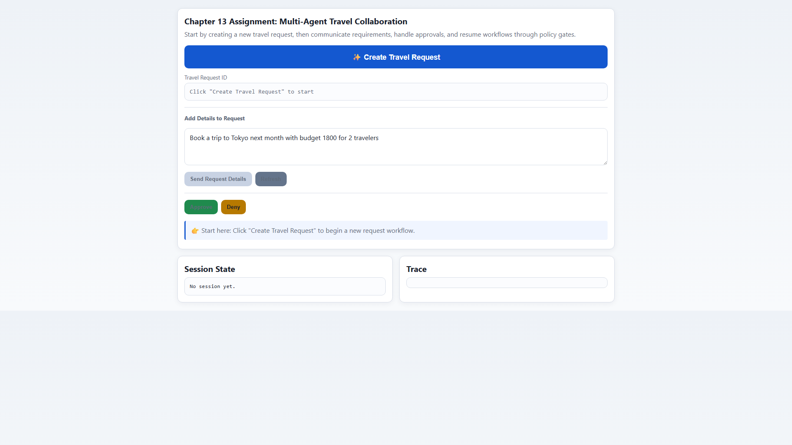
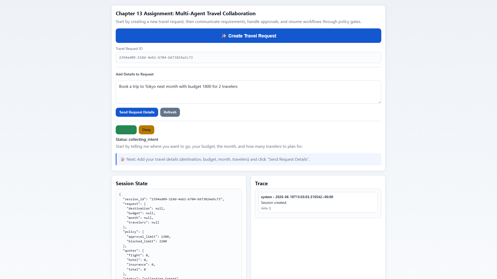
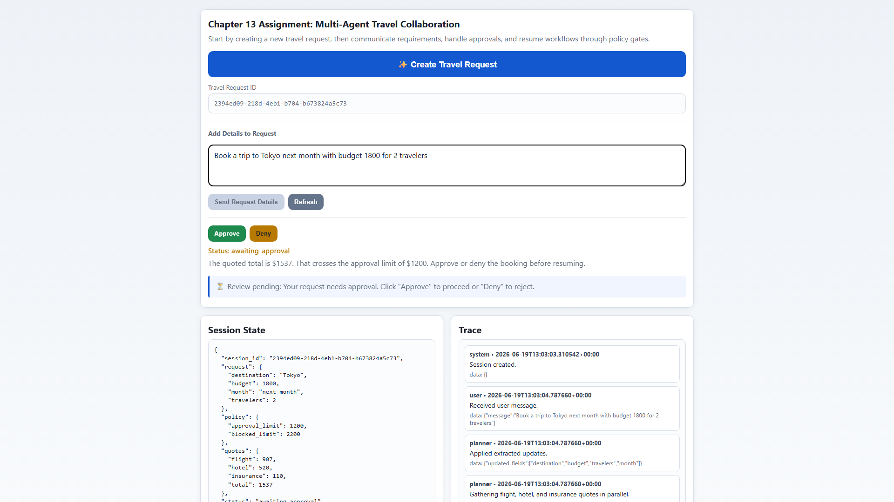
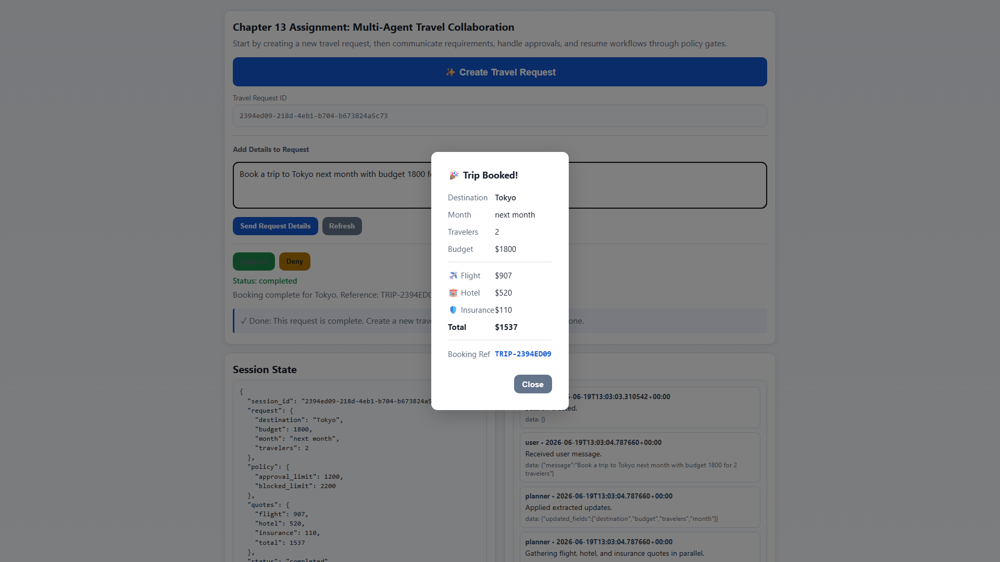
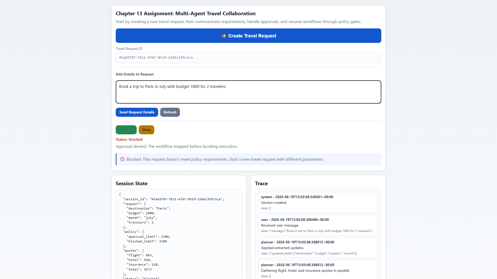

# Chapter 13 Assignment: Multi-Agent Travel Collaboration

## What This Assignment Covers

In Chapter 13, you are no longer thinking about one agent making one set of decisions. You are thinking about a small team: one agent shapes the request, another researches options, another checks policy, and a coordinator keeps the work moving. That shift is the heart of this assignment.

Why does that matter? Because once the work moves across roles, the important questions change. It is no longer enough to ask whether the model is “smart.” You also need to know whether the handoff was clear, whether the right agent had authority, and whether the system can recover when the run stops halfway through.

Here is the simple story to keep in mind as you work:

- **Planner**: turns a loose travel request into a structured trip.
- **Researcher**: gathers candidate options and assigns a confidence score.
- **Policy Guard**: decides whether the trip can continue, must pause, or must stop.
- **Coordinator**: keeps the workflow readable and routes the next step.
- **Human Reviewer**: steps in when the system needs a typed decision.

That is the whole point of the scaffold. It gives you a concrete place to see multi-agent collaboration, coordinator-driven state transitions, route decisions, and checkpoint recovery working together in one small system.

## Premise of This Assignment

This assignment is intentionally focused on control flow clarity, not model cleverness. The premise is simple: once multiple roles are involved, safety and explainability come from explicit routing rules and visible state transitions.

In practice, two checkpoints matter most:

- **Routing checkpoint**: after quotes are gathered, policy decides whether the run is `completed`, `awaiting_approval`, or `blocked`.
- **Recovery checkpoint**: when the run pauses, state is saved so resume can continue from a safe point instead of restarting from zero.

Nothing “mysterious” is happening between steps. The coordinator applies deterministic thresholds and records the reason in trace events.

## Why This Matters

The reason this assignment is useful is that multi-agent systems fail in very specific ways. A planner can miss a constraint. A researcher can return weak options. A policy check can block the run even when the proposal looks fine. If you do not make those boundaries visible, the system becomes hard to trust and even harder to debug.

This assignment keeps the workflow deterministic on purpose. That lets you focus on control flow instead of model noise. You can see exactly where the state changes, where the checkpoint is saved, and where the run pauses for approval.

The chapter also teaches an explicit message-envelope supervisor pattern. This scaffold uses a linearized coordinator state machine so you can practice end-to-end behavior with less setup. Treat this as the practical baseline, then use `code/solutions` if you want to extend toward full envelope-driven dispatch.

## When This Happens In The Flow

Use this timeline to visualize where each control decision occurs:

1. User message is parsed into structured fields (destination, budget, month, travelers).
2. Quotes are gathered in parallel and written to state.
3. Policy gate runs on the quoted total.
4. If needed, checkpoint is saved and the run pauses for approval.
5. Resume reloads checkpointed state, revalidates policy, then completes or pauses again.

Why this sequence matters:

- **Safety**: no booking executes before policy checks.
- **Traceability**: each step emits trace entries with a reason.
- **Recoverability**: approval pauses do not discard prior work.

## File Map

Before you run anything, it helps to know where each piece lives. The code is split so each responsibility stays easy to inspect. That matters here because the chapter is teaching separation of concerns as much as it is teaching collaboration.

- **main.py**: ASGI entrypoint for `uvicorn`.
- **app_models.py**: request, response, state, and message models.
- **orchestration.py**: the multi-agent control loop, including routing and policy-threshold decisions.
- **checkpoint_store.py**: JSON persistence for state snapshots.
- **webapp.py**: FastAPI routes for creating sessions, sending messages, approving, and resuming.
- **tests/test_assignment.py**: behavior tests for the approval path, blocked path, resume path, and autonomous completion path.
- **static/index.html**: the browser UI for creating a session, sending chat input, approving or denying, and resuming.

The key thing to notice is that the assignment is not organized around one giant function. It is organized around the role boundaries that make the workflow understandable.

## Lesson Mapping

This map helps you connect chapter concepts to the scaffold implementation:

- **Establish The Language**: structured request extraction and explicit state fields in `app_models.py` and `orchestration.py`.
- **Choose The Control Style**: coordinator-led state transitions in `evaluate_workflow()`.
- **Handle Disagreement**: policy-threshold outcomes (`completed`, `awaiting_approval`, `blocked`) in `evaluate_workflow()`.
- **Survive Failure**: checkpoint save/restore and resume safety checks in `checkpoint_store.py` and `handle_resume()`.
- **Make It Explainable**: step-by-step trace events via `add_trace()` and UI trace rendering in `static/index.html`.

For clarity while testing: scaffold defaults are `approval_limit=1200` and `blocked_limit=2200`. The chapter often uses 1800 as an illustrative policy number in narrative examples.

## Run the Assignment

Let's start with the fastest path to a working run. First install the project dependencies, then start the app, then try one request that exercises the planner/researcher/policy flow.

```bash
cd Chapter-13-Multi-Agent-Collaboration-and-Communication/assignment
uv sync
uv run uvicorn main:app --reload --port 8015
```

Open the browser at <http://127.0.0.1:8015> and use the built-in controls to create a session, send a request, and run approval or resume actions. Then send a request like this:

```text
Book a trip to Tokyo next month with budget 1800 for 2 travelers
```

That request is a good first test because it gives the system something concrete to work with: a destination, a budget, a month, and a number of travelers. Once that state is visible, the rest of the workflow has something real to reason about.

What you should expect is simple:

- **Planner**: extracts the request into structured state.
- **Researcher**: simulates flight, hotel, and insurance options.
- **Policy Guard**: decides whether the run can continue autonomously, needs approval, or is blocked.
- **Checkpoint Store**: saves the state before the workflow pauses.
- **Coordinator**: resumes or completes the run after the decision.

Concrete input-to-route examples with scaffold defaults (`approval_limit=1200`, `blocked_limit=2200`):

- **Autonomous complete**: quoted total below 1200 -> route `completed`.
- **Approval required**: quoted total from 1200 to 2199 -> route `awaiting_approval`.
- **Blocked**: quoted total 2200 or above -> route `blocked`.

On resume, policy is revalidated before execution. If limits changed while paused, the route can change accordingly.

If you want to see the approval path, try a more expensive destination, a peak month, or more travelers. If you want to see the blocked path, push those same demand factors higher so the quoted total crosses the hard stop threshold. The value of the scaffold is that you can force each outcome on purpose and read the trace afterward.

## What To Try

Now that the app is running, use the same request shape to drive the system down different paths. This is where the assignment starts to teach you something practical instead of just showing you a code path.

Try these three cases:

- **Autonomous path**: keep destination, month, and traveler count low enough that the trip completes without a pause.
- **Approval path**: push the quoted total into the review range, then approve it. The booking completes automatically.
- **Blocked path**: push the quoted total past the hard stop and confirm that the workflow refuses to continue.

As you test, keep an eye on the trace. The trace is doing important work here. It tells you which agent acted, what decision it made, and why the system moved to the next step.

## Walkthrough: How to Use the App

This section shows every step from opening the app to completing or rejecting a booking. Follow these steps in order the first time through.

### Step 1 — Open the app

Navigate to `http://127.0.0.1:8015` after starting the server. All buttons except **Create Travel Request** are disabled. The Travel Request ID field shows a placeholder until a request exists.



**Fig 1: The app on first load. Only "Create Travel Request" is active.**

---

### Step 2 — Create a travel request

Click **✨ Create Travel Request**. The system creates a new session and populates the Travel Request ID with a UUID. The **Send Request Details** and **Refresh** buttons unlock.



**Fig 2: A travel request has been created. The ID label shows the UUID and the form is now active.**

---

### Step 3 — Describe your trip

Type your trip requirements into the text area and click **Send Request Details**. The planner agent extracts destination, budget, month, and traveler count. The researcher then gathers flight, hotel, and insurance quotes. If the quoted total crosses the approval limit (default: $1,200), the workflow pauses and status changes to `awaiting_approval`.



**Fig 3: Status is `awaiting_approval`. The quoted total of $1,537 crossed the $1,200 limit. Approve and Deny are now active.**

---

### Step 4a — Approve the booking

Click **Approve**. The system resumes from the saved checkpoint, revalidates policy, and completes the booking. A **🎉 Trip Booked!** modal appears with the full itinerary: destination, dates, quote breakdown, and booking reference.



**Fig 4: Booking complete. The itinerary modal shows destination, traveler count, cost breakdown, and booking reference.**

---

### Step 4b — Deny the booking

If instead you click **Deny**, the workflow stops immediately. No booking is made. Status changes to `blocked` and the hint message tells you to start a new request with different parameters.

Before clicking Deny, the state looks identical to Step 3 — the same `awaiting_approval` screen. After denying:



**Fig 5: Status is `blocked` after denial. The workflow has stopped. Click "Create Travel Request" to start a new one.**

---

### What the Trace tells you

Every agent action is recorded in the Trace panel on the right. Each entry shows the agent name, timestamp, message, and any data passed between agents. Reading the trace is how you verify that the planner extracted the right fields, that the researcher ran quotes, and that the policy gate made the correct routing decision.

## Test the Assignment

The tests are intentionally narrow. They are not trying to prove that the UI is pretty or that the app can handle every possible input. They are checking the control points that matter for this chapter.

Run them like this:

```bash
uv run --with pytest pytest tests/test_assignment.py -v
```

The expected outcomes are straightforward:

- **Approval required**: the workflow pauses and writes a checkpoint.
- **Approval denied**: the workflow stops before booking.
- **Approval granted and resumed**: the saved checkpoint loads and the workflow finishes booking with the granted approval.
- **Low-risk request**: the workflow completes without human intervention.

That last point is worth paying attention to. The chapter is not trying to make every request slower. It is trying to make the right requests safe, explainable, and recoverable.

## Suggested Study Questions

Before you start changing code, it is useful to slow down and ask what the scaffold is already teaching you. A good assignment is not just something you run. It is something you can explain back to yourself.

Think about these questions:

1. **Where does the planner stop and the researcher begin?** That boundary tells you whether the roles are actually separate.
2. **Why does the system save a checkpoint before asking for approval?** That boundary tells you whether the workflow can recover cleanly.
3. **What does crossing the approval or blocked threshold change in the route decision?** That answer tells you whether the team is applying policy consistently instead of guessing.
4. **Which trace events would help you explain a bad outcome to a reader?** That answer tells you whether the workflow is truly observable.

If you can answer those questions clearly, you understand the assignment. If not, read the trace again and follow one run from session creation to final decision.

## Next Step

Once this assignment feels familiar, the natural next step is to extend it carefully. You could add more conflict rules, introduce a stronger human approval flow, or replace the simulated research with a real external service. The important thing is to preserve the same shape: clear roles, explicit messages, visible routing, and durable recovery.

That is the teaching shape of Chapter 13, and this scaffold is built to make it easy to see.
