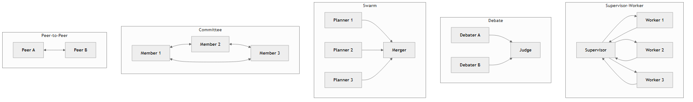
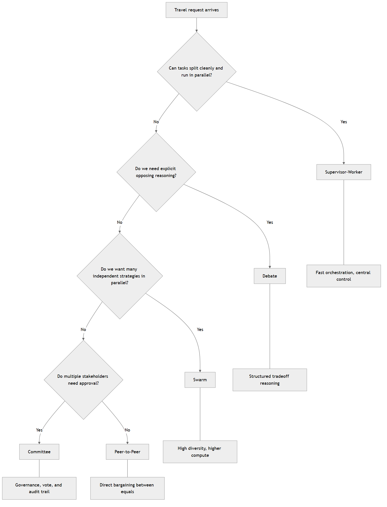
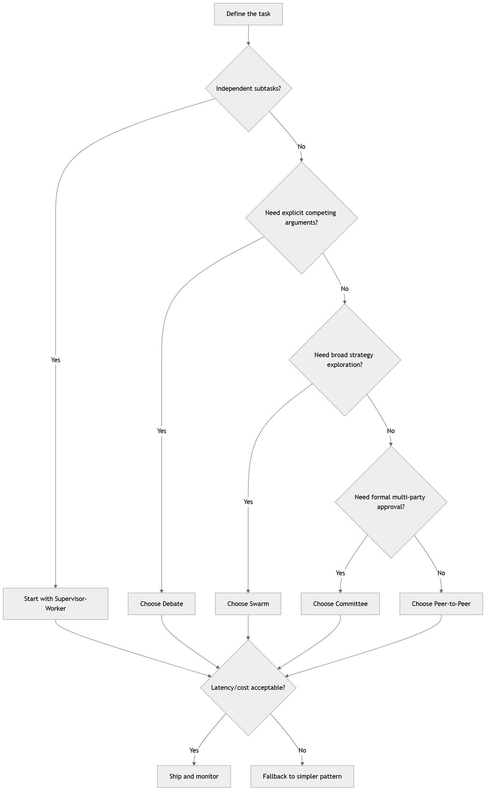
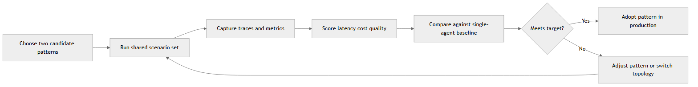
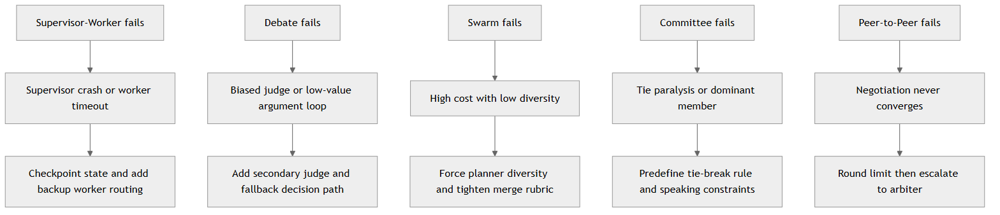
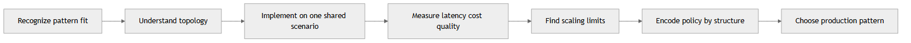

# Multi-Agent Patterns

<!-- markdownlint-disable MD024 -->

In Chapter 13, you learned how to build a team: define roles, set up communication contracts, and handle failures. That's a needed foundation. This chapter asks the next question: if you have a team, how do you set it up so it solves your problem better than one agent could?

Not all team structures solve the same problem. The Supervisor-worker pattern, for example, is a good match for independent parallel tasks. The Debate pattern, on the other hand, fits explicit tradeoff reasoning. The Committee pattern fits multi-party approval. It's important to choose the right structure so that the pattern's team collaboration adds value. Choosing the wrong one creates coordination overhead and hurts quality and speed. You'll read more about these patterns later in this chapter.

Here's what I want you to remember from this chapter: each pattern solves a different coordination problem. Your job is to name the problem you're facing and pick the pattern that solves it.

This moves you from "I can build a multi-agent system" to "I can pick the right structure for the work at hand."

In this chapter, you will learn to:

- **Recognize Pattern Fit**: identify when supervisor-worker, debate, swarm, committee, and peer-to-peer structures solve the problem at hand.
- **Map Coordination Topology**: understand how communication flows through each pattern and why some scale better than others.
- **Calculate Tradeoffs**: weigh latency, cost, and output quality for each pattern on realistic tasks.
- **Design For Scaling**: know how each pattern breaks down as team size grows.
- **Evaluate Collaboration Quality**: measure whether the pattern is producing better outcomes than a single-agent fallback.
- **Build In Safety By Structure**: let the pattern itself enforce guardrails instead of adding them as extra rules.

Chapter 13 focused on making the team structure explicit and the handoffs predictable. This chapter focuses instead on choosing the right team structure in the first place and knowing when to change it. Let's dive in.

## Where You Are And The Next Problem

If you read all the chapters up to this point, then you know how to decompose a problem into agent roles, define communication contracts, and build recovery behavior. That's the team-building part. Now we're getting into another question in this chapter: which team structure actually works better than a single agent?

Once you move beyond one agent, you hit real pressure points. Sometimes the problem naturally decomposes into independent pieces. That's when, for example, the supervisor-worker pattern shines. Sometimes you need multiple perspectives before deciding, and that's when the Debate or Committee pattern makes more sense. Sometimes you need stakeholders to negotiate directly, and for that scenario the peer-to-peer pattern is appropriate. Each pattern is designed to solve a different pressure point.

The patterns in this chapter answer real questions like:

- When is one agent actually better than many?
- When does having one coordinator give you control?
- When do you need competing viewpoints before deciding?
- When do multiple parties need to sign off?
- When should agents negotiate directly?

Each pattern solves a different problem. Your job is to recognize which problem you have and pick the pattern that solves it. It may sound simple when said like that, but it is a skill that takes practice.

Here is the path we will follow:

- **Understand Pattern Families**: learn the five major coordination families and one representative pattern from each.
- **See Patterns Work Concretely**: walk through the same travel-booking scenario with each pattern so you see how they differ in practice.
- **Match Patterns To Problems**: use a decision framework to pick patterns based on problem shape and constraints.
- **Measure Which One Works**: run benchmarks to see which pattern gives you the latency, cost, and quality you need.
- **Know When They Break**: understand the scaling limits and failure modes so you know when to switch.

To make things easier to remember, we've grounded each pattern in one familiar domain: travel booking. We've also grouped the patterns into families so you can see how they relate to each other.

## Understand the Core Patterns and Families

Before you pick a pattern, you need to see them all side-by-side so you can recognize which one fits the problem you're solving. Think of these patterns as different ways to wire up multiple agents so they work together instead of getting in each other's way.

One agent can improvise, but many agents need structure. Without structure you get overlap, conflicting decisions, and wasted tokens. The goal is to choose the right pattern so it works for you instead of against you.

There are quite a few patterns out there, so let's start with the family tree. Each pattern family has many patterns in it, but we will focus on one representative pattern per family to not overload you. Here are the five families and one pattern from each:

- **Decomposition And Routing Family**: represented by Supervisor-Worker. In this family, one agent orchestrates work by routing tasks to specialists and collecting results.
- **Deliberation Family**: represented by Debate. Here multiple agents take opposing views, and a judge selects the best argument.
- **Parallel Exploration Family**: represented by Swarm. A Swarm of agents explores the same problem in parallel, and a merger combines or ranks their outputs.
- **Governance And Approval Family**: represented by Committee. Agents discuss in a shared conversation, voice concerns, and vote on the final decision.
- **Negotiation Family**: represented by Peer-to-Peer. Agents negotiate directly without a central coordinator. Each agent has its own authority and constraints, and they bargain until they agree (or timeout).

Before we dive into each pattern in depth, it helps to see the communication shapes side by side. This visual is not about picking the best pattern yet. It's about helping you quickly recognize the shape of things, since it predicts where bottlenecks, delays, and governance pressure will show up. Keep this map open as a reference while you move through the next sections.



**Fig 14.1: Communication shape snapshot for all five patterns before implementation details.**

> TIP: Here's a common mistake to avoid: don't pick a pattern because it sounds sophisticated. Pick the one that solves your actual problem. If one agent could decide alone, supervisor-worker is overkill. If you don't have clear tradeoffs to expose, debate adds cost for no benefit. The right pattern is the one that pays for itself in latency, cost, or quality.

Let's get back to the travel-booking scenario to see how each pattern works in practice. Here's the request we will use as a running example: "Book Copenhagen for Aug 12-15, budget $2200, morning flights preferred, and any booking above $1800 needs policy approval." This is a realistic request that has multiple dimensions: cost, timing, and policy. Each pattern will handle this request differently, and we'll see how the choice of pattern affects the outcome.

Here's a quick reference for when to use each pattern in the travel-booking scenario:

- **Supervisor-Worker**: Choose this when tasks split cleanly (flights, hotels, policy) and parallel speed matters.
- **Debate**: Choose this when two valid priorities conflict (cheapest vs. best connection quality) and you need a judged tradeoff.
- **Swarm**: Choose this when you want multiple independent plans and can afford extra compute to explore diversity.
- **Committee**: Choose this when multiple stakeholders must approve and explain the decision together.
- **Peer-to-Peer**: Choose this when stakeholders negotiate directly without a central authority.

To make those conditions easier to remember, here is a visual you can scan in a few seconds before you design your workflow. This gives you one stable picture you can revisit while implementing and benchmarking each pattern. If you are deciding quickly, use this as your first pass and then confirm with the matrix later in the chapter.



**Fig 14.2: Travel booking pattern selection map from problem shape to coordination topology.**

Great, now keep that image in mind as you test your own instincts with the first exercise. But before you jump into pattern deep-dives, here's one tiny working example to anchor your hands-on intuition.

## Quick Start: One Working Example

Here's one minimal working example so your concrete intuition forms before concepts pile up. In this Quick Start, we will stay mostly conceptual: one travel scenario, one supervisor-worker flow, and one clear sequence of what happens.

### Start Here (15 Minutes)

If this is your first time building a multi-agent flow, use this exact path:

1. Read the 6-step quick-start flow below once.
2. Open and run [Chapter-14-Multi-Agent-Patterns/code/solutions/exercise-1-supervisor-worker/tool_calling_solution.py](code/solutions/exercise-1-supervisor-worker/tool_calling_solution.py).
3. Confirm you can explain the trace in one sentence: request -> workers -> aggregation -> policy.
4. Move to Exercise 1 and implement your own small variant.

Expected first success:

- You can run one pattern end-to-end.
- You can see a recommendation and a basic trace.
- You can explain which component made the final decision.

You need this baseline so later benchmark numbers are meaningful when you compare real parallel supervisor-worker execution, debate, swarm, and committee variants.

Why this matters before implementation details: if you understand the runtime choreography first, the code in the solutions folder feels obvious instead of overwhelming.

Use this prompt for the walkthrough:

> "Book Copenhagen Aug 12-15, budget 2200 USD, morning flights preferred, policy approval required above 1800 USD."

What happens step by step:

1. Request intake.
   The supervisor receives one structured request object with destination, dates, budget, and policy threshold.

2. Routing to specialist workers.
   Then, the supervisor sends flight search to the flight worker and hotel search to the hotel worker. Each worker calls a specific tool method.

3. Tool execution.
   The flight and hotel tools call their API clients, return structured options, and apply basic constraints such as morning departure preference and budget guardrails.

4. Aggregation.
   Now that the flight and hotel options are available, the supervisor combines worker outputs and selects a recommended flight-hotel combination with a total cost.

5. Policy check.
   At this point, the supervisor routes total cost to the policy worker, which calls the policy tool and returns compliant versus requires-approval.

6. Final response and trace.
   The system returns recommendation, total cost, policy status, and a trace of routing and decision events.

If you're interested in what this could look like in code, here is a minimal working example of the supervisor-worker flow for this travel booking scenario:

- Full runnable example: [Chapter-14-Multi-Agent-Patterns/code/solutions/exercise-1-supervisor-worker/tool_calling_solution.py](code/solutions/exercise-1-supervisor-worker/tool_calling_solution.py)

NOTE: This Quick Start is intentionally conceptual. The linked solution file is the implementation-first companion.

What we meant to illustrate was the actors involved, supervisor and workers, and the flow of requests and responses. It helps to think of things in terms of who and how requests flow through the system.

### Tiny Glossary (Read Once)

- **Worker**: a specialist component that performs one focused task.
- **Supervisor**: the orchestrator that routes work and combines outputs.
- **Judge**: the component that selects between competing arguments in Debate.
- **Merger**: the component that scores or combines parallel outputs in Swarm.
- **Dissent**: a non-winning viewpoint that is still recorded for auditability.
- **Convergence**: when negotiation participants reach an acceptable agreement.
- **Escalation**: a fallback handoff when a pattern cannot decide in bounds.

### Scoring Card: Evaluate Each Pattern on Your Problem

It's a good idea to come up with a scoring system before you decide which pattern to use. It's a common mistake to run experiments and then retroactively decide what "better" means.

You decide up front what matters most: latency, cost, output quality, or explainability. Then you can run each pattern and score it against your chosen dimensions. If your team cares most about latency, let latency dominate your decision. If auditability is mandatory, a pattern with better reasoning traces may win even if it is slower. You get the idea.

For example, use this simple 1-5 scale after you build each pattern (Exercises 1-5) to decide which one wins for your domain. Rate each pattern on your chosen problem:

| Dimension | 1 (Poor) | 5 (Excellent) | Your Pattern |
| --- | --- | --- | --- |
| **Latency** | >5s to response | <500ms to response | ___ |
| **Cost** | 5x+ token overhead | <1.2x single-agent cost | ___ |
| **Output Quality** | Lower than single agent | 2x improvement over single agent | ___ |
| **Explainability** | "I don't know why" | Full audit trail visible | ___ |
| **TOTAL** | Sum scores | Max 20 | ___ |

Higher total score = better pattern for your problem.

Now that you have a way to score each pattern vs your problem, let's finally dive into the deep-dive sections for each pattern. Each section will give you a clear understanding of when to use it, how it works, and what to watch out for.

## The Supervisor-Worker Pattern: Delegation and Task Routing

The supervisor-worker pattern is the simplest and most common. In fact, you've already seen it in the Quick Start example. One agent (the supervisor) receives a problem, breaks it into subtasks, routes each task to a specialist worker, and collects results. Think of it like a manager assigning work to the team and then gathering everyone's outputs into one answer. This is the pattern you use when you know the problem can be split into independent tasks and you have workers optimized for different kinds of work.

Supervisor-Worker is usually your fastest path when the problem is structurally separable. If your travel request is "Find options and rank by price and policy," this pattern is often better as you are trying to execute parallel retrieval and synthesis quickly.

We will pull all scenario-shift guidance into one dedicated decision section near the end of the chapter, so you can use it as a final pattern-picking checklist.

### When to Use It

So when should you use it? The first rule of thumb is: use it when the problem naturally decomposes into independent subtasks. If you can break the work into pieces that don't depend on each other, supervisor-worker is often the right choice. Also, if you have specialized workers that are optimized for different kinds of work like researchers, validators, or formatters, this pattern can leverage their strengths. Finally, if latency matters and you want to run tasks in parallel, supervisor-worker can give you a speed advantage.

Okay, but when should you not use it? Don't use it when there are dependencies between tasks, for example. Also, if it turns out you need input from multiple stakeholders to make a decision, supervisor-worker may not be the best fit.

Let's see how it works in practice with a concrete example.

### How It Works In Practice

Imagine a travel booking task. The supervisor receives a request like "Book a trip to Copenhagen in August." It breaks this into parallel work: "Find flights to Copenhagen", "Find hotels in Copenhagen", "Check policy approval." Each task routes to a specialist. The flight worker searches for options and ranks them. The hotel worker does the same. The policy worker checks if the total cost is within bounds. Once all workers report back, the supervisor sees the options, picks the best fit, and returns a recommendation.

The key insight is that the supervisor does not do the work. It orchestrates. It knows what questions to ask, who to ask, and how to use the answers.

```text
Request → Supervisor → [Worker A, Worker B, Worker C] → Aggregation → Response
            (routes)     (parallel work)            (combines results)
```

So your code ends up looking something like this:

```python
class Supervisor:
    def handle_request(self, request):
        flight_options = self.route_to_worker(find_flights, request)
        hotel_options = self.route_to_worker(find_hotels, request)
        policy_status = self.route_to_worker(check_policy, request)

        recommendation = self.aggregate_results(flight_options, hotel_options, policy_status)
        return recommendation

def main():
    request = get_request()
    supervisor = Supervisor()
    recommendation = supervisor.handle_request(request)
    return recommendation
```

What we're seeing is how a request is handled by the supervisor, routed to workers, and then aggregated back into a final recommendation. This is the essence of the supervisor-worker pattern: delegation and orchestration.

Finally, let's talk about communication and things to watch for when using this pattern.

### Final thoughts

Because the supervisor is such an important actor, we need to be careful about bottlenecks. If the supervisor is slow or fails, the whole system can stall. So it's important to monitor the supervisor's performance and have fallback strategies in place. Also, make sure workers are stateless and can handle retries if needed.

### Exercise 1: Build the Supervisor-Worker Baseline

Implement a supervisor that routes three tasks (`find_flights`, `find_hotels`, `check_policy`), aggregates results, and returns one ranked recommendation for Copenhagen travel.

1. Run the baseline implementation.
2. Add one failure path (worker timeout or worker exception).
3. Add one retry or fallback route.
4. Capture one trace showing request -> routing -> aggregation.

Done means:

- You can run one request and return one final recommendation.
- One failure path is handled without crashing the full flow.
- The trace shows routing and final aggregation clearly.

Try it first, then inspect the [Supervisor-Worker solution](code/solutions/exercise-1-supervisor-worker/solution.py).

## The Debate Pattern: Competing Viewpoints and Judgment

The debate pattern is what you decide on when the hard part is not collecting options, but choosing between competing values. In a travel booking context, this usually appears as a conflict between cost and quality: one option is cheaper, another is smoother or safer. If you force one agent to defend each side and let a judge evaluate both, you make the tradeoff explicit instead of hidden inside one answer.

Debate pattern is a stronger pattern choice than Supervisor-Worker when the real risk is making the wrong tradeoff and being unable to explain it later.

### When to Use It

Use debate when two priorities are both legitimate and you need to show why one priority won. If it's between finance and policy for example, or leadership will ask, "Why this one?", Debate gives you an answer that can be audited. You are paying extra rounds and extra tokens, but in return you get transparent reasoning which could be critical for accountability.

Avoid this pattern when one option is clearly best or when both debaters keep converging on the same argument. Only you know what "clearly best" means in your domain.

### How It Works In Practice

So how do we recognize Debate in practice? Well, imagine a travel booking scenario where the request is: "Keep total spend low, but avoid risky connections." Now what we have is a clear tradeoff between cost and quality. This will end up with two debaters: one arguing for the cheapest acceptable itinerary, and the other arguing for reliability and traveler comfort. A judge then compares those two positions and selects a winner with a written rationale.

The key insight is simple: you are being transparent about the tradeoff. Instead of one agent making a hidden decision, you have two agents exposing their reasoning that you can audit later.

```text
Request → Agent A (position 1) ⟋
          Agent B (position 2) → Judge → Selection + reasoning
```

The code for this situation would look something like this:

```python
class Debater:
    def __init__(self, position):
        self.position = position

    def argue(self, request):
        # Generate argument based on position
        return generate_argument(self.position, request)

class Judge:
    def evaluate(self, argument_a, argument_b):
        # Compare arguments and select winner
        return select_winner(argument_a, argument_b)

def main():
    request = get_request()
    debater_a = Debater(position="cheapest")
    debater_b = Debater(position="safest")

    argument_a = debater_a.argue(request)
    argument_b = debater_b.argue(request)

    judge = Judge()
    winner, rationale = judge.evaluate(argument_a, argument_b)

    return winner, rationale
```

What we're seeing is the actors involved are two debaters and a judge. Each debater generates an argument based on their position, and the judge evaluates those arguments to select a winner with a rationale.

### Final thoughts

What we need to consider is the quality of the judge. If the judge is weak or biased, the pattern can look strong while still producing poor decisions. So it's important to monitor the judge's performance. Also, make sure debaters are well-informed and can articulate their positions clearly. If either debater is weak, the debate may not be effective. You can make debaters stronger by providing more context or training on the subject matter.

Also, before you pick this pattern, it's worth restating that it's usually more costly in tokens and time than supervisor-worker. You are paying for multiple rounds of argument and evaluation. So make sure the tradeoff transparency is worth the extra cost.

### Exercise 2: Run a Debate on One Travel Tradeoff

Run a debate where Agent A optimizes cheapest flight and Agent B optimizes best connection quality. Use a judge to pick the winner and explain why.

1. Run one round and record the winner.
2. Add a second-round rebuttal when the judge is uncertain.
3. Compare result quality and latency against your supervisor-worker baseline.

Done means:

- You have two explicit arguments and one judge decision with rationale.
- Rebuttal only runs when uncertainty is high.
- You can state one quality gain and one cost tradeoff versus Supervisor-Worker.

Do your attempt first, then check the [Debate reference solution](code/solutions/exercise-2-debate-pattern/solution.py).

## The Swarm Pattern: Parallel Problem-Solving and Consensus

The swarm pattern is built for exploration. Instead of asking one orchestrator to decompose known tasks, you run multiple planners in parallel and let them search different parts of the solution space. This might be hard to imagine in a travel booking scenario, so let's connect the dots. Imagine you have three planners: one that prioritizes cost, one that prioritizes comfort, and one that prioritizes experience. Each planner runs independently and produces a candidate itinerary. A merger then scores each itinerary against a fixed rubric and selects the best one. As you can see, the swarm pattern performs almost an entire flow in parallel, and the merger is the only point of convergence.

Swarm is best when you are still discovering what good looks like and you want multiple candidate strategies before deciding. When trying to book your vacation, you might actually be here as an end user who doesn't know if they want a luxury weekend or a budget-friendly adventure.

### When to Use It

Use Swarm when diversity is the value. If several strategies might work and you are not sure which one will win, parallel planners give you broader coverage than a single route.

Avoid Swarm when budgets are tight or when planners keep producing near-identical outputs. In that situation, you are paying a compute premium without meaningful quality gain.

### How It Works In Practice

Let's get more hands on and apply this to travel planning. We now have three planners: cost-first, comfort-first, and experience-first. They run independently at the same time. A merger then scores the resulting plans against one rubric and selects the final recommendation.

Here's a prompt that leads to three distinct plans: "Book Copenhagen Aug 12-15, budget $2200, I don't know if I want cheapest, most comfortable, or most adventurous. Show me three options and pick the best one."

This can look like the following in code:

```python
class Planner:
    def __init__(self, strategy):
        self.strategy = strategy

    def plan(self, request):
        # Generate plan based on strategy
        return generate_plan(self.strategy, request)

class Merger:
    def merge(self, plans):
        # Score and select the best plan
        return select_best_plan(plans)

def main():
    request = get_request()
    planners = [Planner(strategy="cost-first"),
                Planner(strategy="comfort-first"),
                Planner(strategy="experience-first")]

    plans = [planner.plan(request) for planner in planners]
    merger = Merger()
    best_plan = merger.merge(plans)
    return best_plan
```

As you can see from the code above, we create three different planners, let each one work through its strategy, and then merge the results to select the best plan.

### Final thoughts

The major risk is weak merging logic: if scoring is poor, you can erase all the value gained from parallel exploration. Scoring can be poor due to misaligned rubrics, or if planners produce near-identical outputs. You can protect against this by ensuring the scoring rubric is well-defined and, for example, rejecting near-duplicate plans to preserve diversity.

Also, you can log diversity metrics and merger reasons with the final selection to improve observability. Observability enables you to inspect the decision-making process and understand why a particular plan was chosen over others, and it allows you to fix issues in the scoring or merging logic.

### Exercise 3: Compare Parallel Plans with Swarm

Create three independent planners (cost-first, comfort-first, experience-first), then merge their plans into one final recommendation.

1. Run all planners in parallel.
2. Score each output with the same rubric.
3. Explain why the merger picked the final plan.

Done means:

- At least three distinct plans are generated.
- The same rubric is applied consistently to all plans.
- Final selection includes one clear merger reason.

Try first, then validate with the [Swarm solution](code/solutions/exercise-3-swarm-pattern/solution.py).

## The Committee Pattern: Shared Discussion and Vote

The committee pattern is governance-first. Multiple stakeholders discuss options in shared context, then vote with explicit rationale and recorded dissent. What does that mean in a travel booking scenario you might ask? Well, imagine that policy, experience, and cost each have meaningful authority. The committee pattern turns those constraints into a first-class decision process. Each stakeholder can voice concerns, and the final vote is recorded with reasoning. This is especially useful when you need to show why a decision was made and who agreed or disagreed.

This might sound heavy to process from a cognitive standpoint but imagine a travel booking scenario where the user wants to book a trip to Copenhagen, but the cost is above policy threshold. The committee pattern allows policy, finance, and user experience stakeholders to discuss the options, voice concerns, and vote on the final decision. The final decision is then recorded with reasoning and dissent notes for transparency. All this ensures that the decision-making process is transparent and accountable.

### When to Use It

I'd like to think that a good use case for this is corporate travel. Here, you're dealing with trips that may exceed policy thresholds. We still want to see all choices and which choices were considered and which were recommended as we might end up picking a choice that is not the cheapest but is the best for the traveler.

If we zoom out a bit, we're saying that Committee is best when multiple stakeholders have authority and need to sign off on a decision. If you have a situation where one stakeholder can veto or approve, Committee is often the right choice.

### How It Works In Practice

Let's walk through a travel booking scenario where the request is: "Book Copenhagen Aug 12-15, budget $2200, policy approval required above $1800." In this case, we might end up with several different choices where some need policy approval and some don't. The pattern allows each stakeholder to discuss the options, voice concerns, and vote on the final decision.

Before building the full committee, let's define how it turns individual votes into one decision. Each vote contains a `choice`, and this first version selects the choice with the most votes:

```python
def aggregate_votes(self, votes):
    """Aggregate votes and return the winning choice based on majority rules."""
    vote_counts = {}
    for vote in votes:
        choice = vote.get("choice")
        vote_counts[choice] = vote_counts.get(choice, 0) + 1
    return max(vote_counts, key=vote_counts.get)
```

This method adds two concrete behaviors:

- It counts how many committee members selected each choice.
- It returns the choice with the highest count so `conduct_meeting` can produce a final decision.

For a production system, you would also define what happens when no votes are cast or when choices tie. Here, the example stays focused on the basic majority path.

Now let's integrate `aggregate_votes` into the committee and connect it to the discussion and voting flow:

```python
class CommitteeMember:
    def __init__(self, role):
        self.role = role

    def discuss(self, options):
        # Discuss options and voice concerns
        return generate_discussion(self.role, options)

    def vote(self, options):
        # Vote on the final decision
        return cast_vote(self.role, options)

class Committee:
    def __init__(self, members):
        self.members = members

    def aggregate_votes(self, votes):
        """Aggregate votes and return the winning choice based on majority rules."""
        vote_counts = {}
        for vote in votes:
            choice = vote.get("choice")
            vote_counts[choice] = vote_counts.get(choice, 0) + 1
        return max(vote_counts, key=vote_counts.get)

    def conduct_meeting(self, options):
        discussions = [member.discuss(options) for member in self.members]
        votes = [member.vote(options) for member in self.members]
        final_decision = self.aggregate_votes(votes)
        return final_decision, discussions, votes

def main():
    request = get_request()
    options = generate_options(request)
    members = [CommitteeMember(role="policy"),
               CommitteeMember(role="finance"),
               CommitteeMember(role="experience")]
    committee = Committee(members)
    final_decision, discussions, votes = committee.conduct_meeting(options)
    return final_decision, discussions, votes
```

Policy might say that this user must choose economy plus for trips over 7 hours. Finance might say the cost needs to be below 3000 USD, and experience might say that the traveler should have a comfortable flight. Each member discusses the options, votes, and the final decision is made based on the aggregated votes.

As an end user, you will see recommendations with reasoning and dissent notes. This ensures that the decision-making process is transparent and accountable which makes it easier to make an informed choice.

### Final Thoughts

The bottleneck of this pattern is speed, especially as member count grows. If you need fast responses and the governance burden is low, Committee may be overkill. However, if you need explicit sign-off from multiple stakeholders, this pattern is often the right choice.

### Exercise 4: Run a Committee Vote with Dissent

Simulate a committee with planner, policy, experience, and cost roles. Use weighted voting and capture dissent.

1. Run one committee discussion and vote.
2. Add weighted policy influence.
3. Record dissent notes for non-winning votes.

Done means:

- A vote result is produced with role-level rationale.
- Policy weighting affects at least one decision path.
- Dissent is captured and visible in output.

Attempt before reviewing the [Committee solution](code/solutions/exercise-4-committee-pattern/solution.py).

## The Peer-to-Peer Pattern: Negotiation and Direct Exchange

The peer-to-peer pattern is negotiation-first. Equal-authority actors exchange offers and counteroffers directly, without routing every move through a central coordinator. What does this mean in travel booking terms? Imagine a scenario where the budget owner and the traveler advocate both have veto power. They need to negotiate directly over itinerary options until they reach an agreement or hit a round limit. This pattern produces a negotiation transcript that can be audited later. You implement it as a negotiation flow where each agent can propose, counter, and respond until they either converge or escalate.

Peer-to-Peer is strongest when the work itself is bargaining between owners who can both block a decision.

### When to Use It

Use Peer-to-Peer when no single owner can decide by themselves and tradeoff settlement is the core task. With tradeoff settlement, you want to see the negotiation transcript for audit or postmortem.

Avoid this pattern when too many participants are involved or when goals are fundamentally incompatible like if one agent wants to maximize cost and the other wants to minimize it.

Without tight stopping rules, negotiation can loop indefinitely. An example of a stopping rule in a travel context could be: "If no agreement is reached after 5 rounds, escalate to a supervisor."

### How It Works In Practice

Let's dive into our travel booking scenario. The request is: "Book Copenhagen Aug 12-15, budget $2200, policy approval required above $1800." What happens with this pattern is that a list of itinerary options is generated and then the cost owner and experience owner negotiate directly over those options. They then exchange proposals and counterproposals until they either converge on an agreement or hit a limit of negotiation rounds and it escalates to a supervisor or arbiter.

Here's how it can flow:

1. System generates itinerary options.
2. Cost owner proposes an option for example, "Option A: $2100, 2 stops, 10 hours total." as that is within budget and meets policy.
3. Experience owner counters with "Option B: $2200, 1 stop, 8 hours total." because they prioritize fewer stops and shorter travel time.
4. Cost owner responds with "Option C: $2150, 1 stop, 9 hours total." at this point as they're trying to find a middle ground that balances cost and experience.
5. They continue until they either agree on one option or hit a limit of negotiation rounds, at which point it escalates.

Before assembling the full negotiation loop, let's define convergence. In this example, convergence means every negotiator proposes the same option in a round:

```python
def check_convergence(self, proposals):
    """Check whether all negotiators have agreed on a single proposal."""
    if not proposals:
        return False
    first_proposal = proposals[0]
    return all(proposal == first_proposal for proposal in proposals)
```

This method establishes two stopping rules:

- An empty proposal list cannot represent agreement.
- A round converges only when every proposal equals the first proposal.

Now let's integrate `check_convergence` into the complete negotiation flow, including the round limit and escalation path:

```python
def escalate_to_supervisor(negotiators):
    # Logic to escalate negotiation to a supervisor or arbiter
    return "Escalated to supervisor for final decision."

class Negotiator:
    def __init__(self, role):
        self.role = role

    def propose(self, options):
        # Generate proposal based on role and options
        return generate_proposal(self.role, options)

class Negotiation:
    def __init__(self, negotiators):
        self.negotiators = negotiators
        self.rounds = 0
        self.max_rounds = 5

    def check_convergence(self, proposals):
        """Check whether all negotiators have agreed on a single proposal."""
        if not proposals:
            return False
        first_proposal = proposals[0]
        return all(proposal == first_proposal for proposal in proposals)

    def run(self, options):
        while self.rounds < self.max_rounds:
            proposals = [negotiator.propose(options) for negotiator in self.negotiators]
            if self.check_convergence(proposals):
                return proposals[0]  # Agreement reached
            self.rounds += 1
        return self.escalate()  # Escalate after max rounds

    def escalate(self):
        # Escalation logic to supervisor or arbiter
        return escalate_to_supervisor(self.negotiators)

def main():
    request = get_request()
    options = generate_options(request)
    cost_owner = Negotiator(role="cost")
    experience_owner = Negotiator(role="experience")
    negotiation = Negotiation(negotiators=[cost_owner, experience_owner])
    final_decision = negotiation.run(options)
    return final_decision
```

What the above code describes is a negotiation process where two negotiators propose options based on their roles. They continue to exchange proposals until they either reach an agreement or hit a maximum number of rounds, at which point the negotiation escalates.

### Final thoughts

Under the hood, communication is direct. Proposals and counters move in iterative rounds until they converge, an agreement is reached, or a timeout occurs. The bottleneck is convergence quality and speed, which is why hard round limits matter. Convergence quality means the final agreed option is acceptable to both parties. Poor convergence can lead to dissatisfaction or suboptimal decisions. This can happen if the negotiation process is not well-structured or if negotiators are not effectively communicating their priorities. To remedy that, implement structured negotiation protocols, provide clear guidelines for proposals, and ensure both parties understand each other's priorities and constraints.

Finally, observability is critical. You want to store the negotiation transcript for audit, everything from proposals to counters to final agreement or escalation. This allows for postmortem analysis and helps improve future negotiations by learning from past experiences.

### Exercise 5: Negotiate a Travel Decision Peer-to-Peer

Run a negotiation between a cost-focused agent and an experience-focused agent for the same Copenhagen trip until agreement or timeout.

1. Run negotiation with round limits.
2. Add timeout escalation after N rounds.
3. Save a transcript that explains the final outcome.

Done means:

- Negotiation reaches agreement or timed escalation within bounds.
- Round limits are enforced and observable.
- Transcript clearly shows proposals, counters, and final outcome.

Do the implementation first, then compare with the [Peer-to-Peer solution](code/solutions/exercise-5-peer-to-peer-pattern/solution.py).

## Choose Your Pattern: A Decision Framework

You have seen the five patterns. The practical question is which one to pick for your problem.

This is the moment where architecture judgment matters more than syntax. In practice, teams rarely fail because they forgot a pattern definition. They fail because they picked a structure optimized for the wrong risk. A fast pattern applied to a governance-heavy decision creates compliance pain. A governance-heavy pattern applied to a simple retrieval task creates unnecessary latency and cost.

When your scenario shifts, the winning pattern often shifts with it. You should expect this shift. Pattern choice is not a one-time declaration for the whole product. It is a response to the current task shape, approval shape, and runtime budget. If it needs to change, it should change. Monitor the problem shape and be ready to pivot. The right pattern is the one that pays for itself in latency, cost, or quality.

The best recommendation I can give here is to think in terms of scenario progression. Start with a simple decomposition pattern, then layer in governance or negotiation as the problem shape demands it. As for changes, be prepared to adapt your pattern choice as the scenario evolves.

Use this travel scenario progression as your reference model:

- Scenario X: "Find best options under fixed budget and policy." Start with Supervisor-Worker.
- Scenario Y1: "Show explicit tradeoff between cheapest and most reliable." Shift toward Debate.
- Scenario Y2: "Explore multiple planning strategies before deciding." Shift toward Swarm.
- Scenario Y3: "Finance and policy both need auditable signoff." Shift toward Committee.
- Scenario Y4: "Budget owner and experience owner must directly settle conflict." Shift toward Peer-to-Peer.

Notice the pattern, the more the problem becomes about deliberation, governance, or negotiation, the less a pure decomposition pattern is enough on its own.

The answer depends on three things:

1. **How do you decompose the problem?** Can you split it into independent tasks, or does it need unified reasoning?
2. **Who needs to approve?** Do multiple parties need to sign off, or can one agent decide?
3. **What are your constraints?** How much latency can you afford? What is your compute budget?

Now that the scenario-shift logic is clear, use the matrix below as a summary tool. This is not a rigid rule; it's a guide to help you ask the right questions quickly and it's worth asking them when you first need to select a pattern but also later when the problem shape shifts.

| Pattern | Best for | Compute Cost | Latency | Who controls outcome | Best trace |
| --- | --- | --- | --- | --- | --- |
| **Supervisor-Worker** | Independent parallel tasks, delegation | Medium (N agents) | Fast (parallel) | One hub sees everything | Clear routing and task outcomes |
| **Debate** | Comparing approaches, exposing tradeoffs | Medium-High (2 agents + judge) | Medium (sequential rounds) | Judge selects winner | Both sides visible for audit |
| **Swarm** | Exploring solution space, diversity | High (N agents, N times compute) | Fast (parallel) | Merger selects best | Best solution from many attempts |
| **Committee** | Multi-party approval, policy enforcement | Medium-High (all agents discuss) | Slow (discussion + vote) | Multiple gatekeepers | All perspectives recorded |
| **Peer-to-Peer** | Stakeholder negotiation, conflicts | Medium (2-4 agents) | Slow (multiple rounds) | Agents negotiate | Negotiation transcript |

This visual below is useful during implementation because it encodes the same logic as the matrix, but in decision order. Use it together with Fig 14.2: the earlier map helps you classify the problem, and this one helps you commit to a runtime choice.



**Fig 14.3: Pattern decision flow from task shape through governance checks and runtime constraints.**

## Measure these: Latency, Cost, and Output Quality

Just because you think you've found the perfect fit does not mean you have. You need to measure and compare against a single-agent baseline. Check for latency, cost, and output quality. If you are not better than a single agent, you are wasting money and time. Be prepared to pivot if the pattern is not performing as expected.

Here's a simple checklist to track your metrics:

1. **Latency**: how long from request to final response?
2. **Cost**: total compute in tokens and dollars?
3. **Output quality**: is the decision better than a single agent could make?

Treat this as a loop, not a one-time report. Be prepared to re-run when requirements change.

Great, now one practical tip before you benchmark: do not wait for perfect instrumentation. Start with a lightweight pass that captures latency, token usage, and a simple quality rubric. Then add richer metrics once you identify your top two candidate patterns. This keeps momentum while still producing usable evidence.



**Fig 14.4: Benchmark loop for validating whether collaboration actually beats a single-agent baseline.**

This loop turns pattern preference into evidence and should be your default evaluation routine.

### Metrics You Should Track

The list below works best when paired with one explicit scoring rubric per task. For travel, that could be: policy compliance, itinerary quality, and justification quality. Without a rubric, quality scores drift between runs and between evaluators.

A useful habit is to run at least one "surprise scenario" in each batch, such as a last-minute price spike or a policy exception threshold. Surprise scenarios expose whether a pattern is robust or only tuned for normal cases.

For each pattern on each task, collect these data points:

- **Time to first result**: how fast do you get some answer?
- **Total execution time**: how long until the final decision is made?
- **Token count**: how many tokens did all agents consume in total?
- **Dollar cost**: total LLM cost for the run.
- **Output coverage**: how many options did the system consider?
- **User satisfaction**: did the pattern produce an outcome that feels right?
- **Error rate**: how often did the pattern produce a bad result?
- **Auditability**: can you reconstruct the decision from logs?

Run each pattern on 5-10 travel booking scenarios (mix easy, medium, and hard cases) and collect metrics in a structured table. Then you can compare.

## Know When Patterns Break: Scaling Limits and Failure Modes

Every pattern has a breaking point. Knowing where that point is allows you to plan for when to switch patterns or add safeguards.

It's less about "what can go wrong" and more about early warning signals. By the time a pattern visibly fails in production, you have already paid the cost. What you want is to recognize drift while outcomes are still acceptable and before user trust drops.

Use the limits below as directional thresholds, not rigid laws. The exact numbers depend on model quality, prompt design, and tool latency in your stack. Still, these limits are very useful for planning guardrails and fallback logic.

### Scaling Limits

Let's look at the scaling limits for each pattern. These are the points where the pattern starts to lose its effectiveness or efficiency. What we mean by scaling limits is the point where adding more agents or complexity does not yield better results and may even degrade performance.

Here's what it looks like pattern by pattern:

**Supervisor-worker** breaks when:

- Tasks become interdependent (workers need each other's output, so parallelism gains nothing).
- The supervisor becomes a bottleneck (too many workers competing for its attention).
- Aggregation logic becomes complex (combining results from many workers is no longer simple).

**Debate** breaks when:

- You add more than 2-3 debaters (the judge cannot fairly compare too many positions).
- Debaters converge to the same answer (debate becomes pointless if there's no disagreement).
- The debate goes infinite (debaters keep rebutting each other endlessly).

**Swarm** breaks when:

- Compute cost outweighs the benefit (running 10 agents costs 10x as much but does not always produce 10x better results).
- Agents converge to similar solutions (parallelism adds cost with no benefit).
- Merging becomes the bottleneck (ranking 10 solutions is faster than running 10 agents, but merge time adds up).

**Committee** breaks when:

- Committee size exceeds 5-7 (discussion becomes slow and unfocused, people stop listening).
- Agents have truly incompatible goals (committee becomes an argument with no resolution).
- One agent dominates the conversation (committee becomes theater; the outcome was decided before the vote).

**Peer-to-peer** breaks when:

- You add more than 4 agents (the number of negotiation pairs explodes, and coordination overhead grows quadratically).
- Agents have incompatible goals with no middle ground (they will negotiate forever).
- One agent has more power than the others (peer-to-peer becomes negotiation-theater with a hidden hierarchy).

You now have a practical sense of when each pattern is likely to break down. Use this knowledge to plan for scaling and refer to it when you need to switch patterns or add safeguards.

### Failure Modes and How to Avoid Them

For failure modes per pattern, we should understand what that looks like and what to do about it. Adding safeguards is about anticipating failure and designing the system to handle it gracefully.

Here's a visual map of failure symptoms to safeguards for each pattern. This is a practical tool for fast incident response in multi-agent systems.



**Fig 14.5: Failure symptom to safeguard map for fast incident response in multi-agent systems.**

With this in place, you can move from postmortem storytelling to fast, structural remediation and avoid repeating the same mistakes.

**Supervisor-worker failure**: If the supervisor crashes, all work is orphaned. If one worker fails, the aggregation might be incomplete. **Safeguard**: add checkpoints so you can resume work if the supervisor fails. Route failed tasks to backup workers.

**Debate failure**: If the judge is biased, the debate is pointless. If both debaters are wrong, debate just picks the wrong loser. **Safeguard**: have a secondary judge or a fallback to single-agent reasoning if debate quality looks suspicious.

**Swarm failure**: If all agents converge to the same mediocre solution, swarm adds cost with no benefit. **Safeguard**: add diversity incentives so agents explore different approaches, not all the same one.

**Committee failure**: If votes are split, you have a tie-breaking problem. If one agent vetoes everything, the committee is paralyzed. **Safeguard**: have a predetermined tie-breaker rule (weighted votes, majority wins, chair has final say).

**Peer-to-peer failure**: Agents might negotiate forever without reaching agreement. **Safeguard**: add a timeout. If they cannot agree in N rounds, escalate to a supervisor or make an executive decision.

## When to Pick What Pattern

Before you close the chapter, here is the compact decision lens in one place.

Why this matters: this is the practical shift from memorizing pattern names to making a good architecture call under pressure.

Watch how the same travel domain changes pattern choice as constraints change:

- If your scenario is "same traveler, fixed budget, straightforward constraints," choose Supervisor-Worker for speed and clarity.
- If the scenario shifts to "executive traveler, reliability vs cost conflict, justification required," move toward Debate.
- If it shifts to "multiple stakeholders must approve," move toward Committee.
- If it shifts to "we are unsure which strategy even works," move toward Swarm.
- If it shifts to "two owners must bargain directly," move toward Peer-to-Peer.

The core skill is reading how problem shape changes runtime structure. Keep this section bookmarked and reuse it as a pre-build checklist.

### Build in Safety By Structure: Design Patterns That Enforce Policy

Here's an important insight: some patterns naturally enforce policy better than others. Instead of bolting guardrails on as extra checks, you can design the pattern so that policy enforcement is baked in.

Why this matters is operational, not theoretical. External guardrails are often skipped under deadline pressure or bypassed by new flows. Structural guardrails are harder to bypass because they live inside the decision path itself. If policy checks are part of routing, voting, judging, or merging, compliance becomes a default behavior rather than a final afterthought.

In other words, topology is also a safety mechanism. When you choose a pattern, you are also choosing where policy can be enforced with the least friction and the highest observability.

**Supervisor-worker**: Easy to add policy checks at the aggregation point. The supervisor sees all results and can filter by policy before returning a recommendation. If policy is violated, the supervisor can retry with different constraints.

**Debate**: The judge can be a policy-enforcing agent. If both debaters propose something that violates policy, the judge refuses both and asks for new arguments.

**Committee**: Add a policy agent to the committee with veto power. If the vote violates policy, the policy agent vetoes and the committee reconsiders.

**Swarm**: The merger can filter results by policy before selecting. Only policy-compliant solutions are ranked.

**Peer-to-peer**: Add a timeout and escalation rule. If peers cannot agree in N rounds, escalate to a supervisor or policy arbiter who makes a binding decision.

The goal is to design the pattern so that policy enforcement happens as a natural part of the coordination flow, not as an extra check bolted on afterward. When policy is part of the pattern itself, it is harder to bypass and easier to audit.

Now that you have both selection and safety lenses, you are ready to run the larger assignment as a production-style evaluation, not just a coding exercise.

You now have a full progression: recognize pattern fit, implement each pattern in one known domain, benchmark tradeoffs, and encode policy structurally. The larger assignment below combines all of those skills into one production-style comparison.

Before you transition into the larger assignment, use this final map as a chapter recap. It compresses the full learning path into one sequence so you can verify you are carrying forward all the skills, not just code snippets. If you get stuck in the assignment, return to this map and diagnose where your pipeline is weak.



**Fig 14.6: Chapter 14 progression from pattern selection to production recommendation.**

## Assignment

Implement two patterns on one realistic task.

Your goal is to choose a domain and implement two pattern variants that solve the same problem.

### What to Build

1. Pick one problem domain (travel booking or your own realistic domain).
2. Implement two patterns that solve the same task.
3. Capture basic traces so the collaboration flow is visible.
4. Write a short note on when you would choose each pattern.

Optional extension:

- Run lightweight benchmarks if you want to compare latency, cost, and output quality.

Use these starting points while building:

- Scaffold and examples: [code README](code/README.md)
- Assignment scaffold: [assignment README](assignment/README.md)
- Run entrypoint: [assignment main entrypoint](assignment/main.py)
- Benchmark helper: [assignment benchmark helper](assignment/benchmark.py)

## Solution

After you complete your own implementation of two patterns, compare your work against the example solution:

- [assignment solution](assignment/solution/solution.py)

Use the assignment walkthrough in [assignment README](assignment/README.md) as the guided reference path.

## Summary

This chapter taught you how to choose a multi-agent pattern based on problem shape, governance needs, and runtime constraints rather than intuition alone. You moved from pattern recognition to implementation, then from implementation to evidence by measuring latency, cost, quality, and scaling behavior.

The key takeaway is that coordination topology is a design decision with operational consequences: it changes bottlenecks, failure modes, and policy enforcement options. If Chapter 13 taught you how to make agents collaborate safely, Chapter 14 taught you how to decide which collaboration structure should exist in the first place.

In Chapter 15, we will explore how to combine multiple patterns into a single hybrid architecture that can adapt to changing problem shapes and governance needs. If this chapter was about choosing the right pattern for a single task, Chapter 15 will be about orchestrating multiple patterns across a complex workflow.
