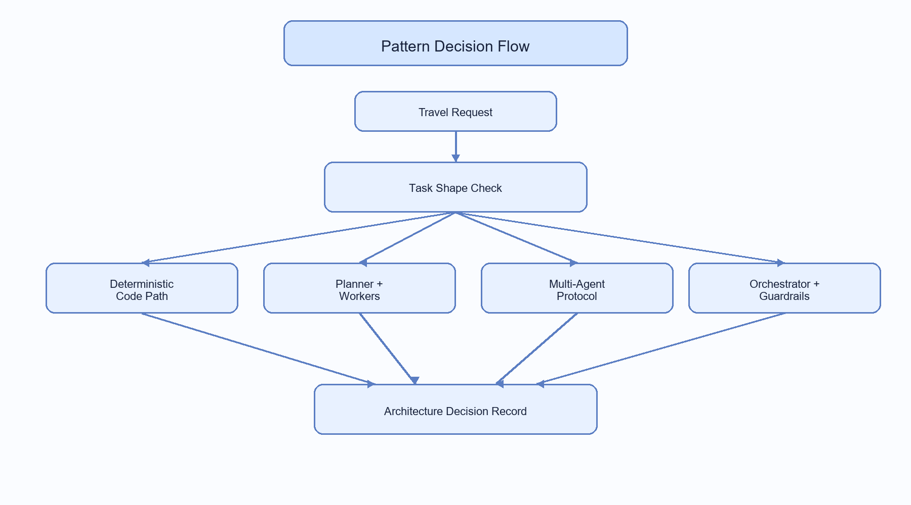
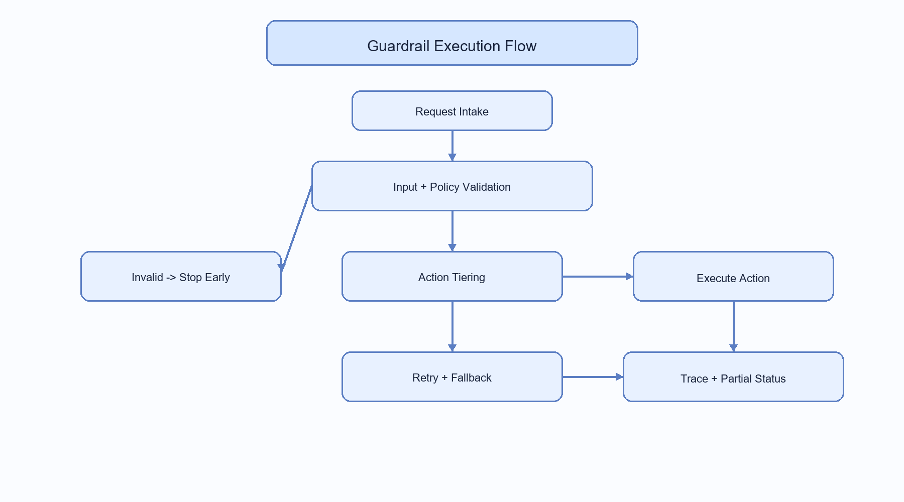
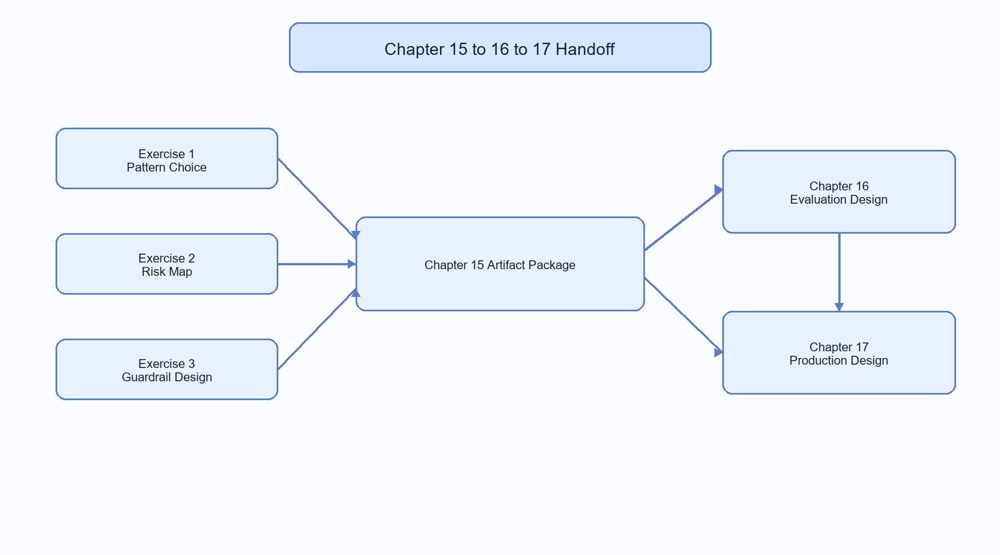

# Agent Design Patterns and Anti-Patterns

In the last few chapters, you built increasingly capable systems: first one agent, then coordinated agents, and finally structured multi-agent patterns. That is an important milestone. Now we face the harder pre-launch question: will this design still work when traffic, cost pressure, and safety requirements increase? The answer is rarely just "yes" or "no." It depends on risk, cost, task type, and failure tolerance.

This chapter is where decision quality improves. We are moving from "can I make this run" to "can I defend this design when response times rise, costs increase, and safety requirements tighten."

Upcoming Chapter 16 (Evaluation), Chapter 17 (Agent Harness), Chapter 18 (Production), and Chapter 19 (Operating and Improving Agents) only become useful when your architecture choices are explicit. If those choices are unclear, evaluation turns into random metric collection, harness controls become disconnected from risk, production becomes reactive firefighting, and operations lack a clear improvement loop.

In this chapter, you will learn to:

- Choose between common agent patterns based on task shape, risk, and cost.
- Spot anti-patterns early, before they become outages or trust failures.
- Add guardrails that make behavior observable, testable, and recoverable.
- Refactor a brittle workflow into a resilient, evaluation-ready architecture.

Here is the chapter flow to keep in mind:

1. **Pick architecture.** This is the first and most important decision. It is the one that multiplies latency, cost, and reliability across every downstream step.
2. **Predict failure.** Figure out what anti-patterns are likely to appear in your workflow and how to detect them early so that you can prevent them.
3. **Add controls.** Add checks and fallback rules so failures are contained instead of spreading.
4. **Define how you'll prove it works.** Establish metrics and evaluation criteria to validate your design choices. Remember, we'll focus on evaluation in Chapter 16, but you can start defining the metrics now.

By the end of this chapter, you should be able to explain not only what pattern you chose, but why that choice is defensible for your task, constraints, and risk profile.

To make the chapter easy to follow, we will use one running request throughout: book a policy-compliant trip to Copenhagen (Aug 12-15), keep total spend under 2200 USD, prefer morning flights, and require explicit approval above 1800 USD.

## Where You Are and the Next Design Problem

This is a decision chapter, not a heavy coding chapter. We are still technical, but the main output is architecture judgment, and that can be as valuable to a team as code.

Teams often keep adding code when quality issues appear. Often, outcomes improve faster when design decisions improve first.

Here is the way to get the most out of this chapter:

1. **Read for vocabulary first:** understand each pattern and anti-pattern in plain language.
2. **Read for diagnostics second:** map failure symptoms to likely design mistakes.
3. **Read for handoff third:** extract what you will evaluate in Chapter 16, enforce in Chapter 17's harness, and prepare for production in Chapter 18.

If you follow that sequence, you will not just know patterns. You will know when to choose them, when to reject them, and how to measure whether they are actually working.

## Choose the Right Pattern from the Problem Shape

Before we dive into the first decision example, this diagram gives you a quick visual map of how pattern choice follows task shape.

**Fig 15.1: Pattern decision flow showing how problem characteristics map to architecture choices.**

Let us start with a real project decision: should this be one agent (for example, a planner with workers) or a full multi-agent system? A common mistake is assuming the more advanced option is automatically better. In practice, the wrong pattern can make a simple workflow expensive, hard to debug, and fragile.

For the travel-booking request, use a simple breakdown: what the task is, what pattern fits best, and what pattern looks possible but is a bad fit.

- **Task**: plan a Copenhagen trip with budget, timing, and policy constraints.
- **Better fit**: planner + workers (parallel flight and hotel search, bounded merge, explicit policy step).
- **Poor fit**: open-ended peer-to-peer negotiation with no convergence rule. This pattern is overkill for the task shape and adds coordination risk without benefit.

Now we have a model of how to think, what to look for, what's a good fit and what's a poor fit. Next, let's discuss a selection matrix that makes this decision more systematic.

### Pattern Selection Matrix

This matrix is a quick guide for common task shapes and likely pattern choices. It does not cover everything, but it is a good starting point.

Here's the matrix:

| Situation | Prefer This Pattern | Why | Example |
|---|---|---|---|
| Single deterministic transform | Deterministic code path (non-agent) | Lowest overhead, easiest to test | A simple data transformation or retrieval task |
| Multi-step decomposition with clear subtasks | Planner + workers | Parallelism with controlled coordination | A multi-step booking process with separate flight and hotel searches |
| Specialized domains with distinct constraints | Multi-agent with explicit protocol | Strong separation of concerns | A system where different agents handle different aspects of a complex workflow, such as legal review, financial approval, and technical validation |
| High compliance or safety requirements | Orchestrator with strict guardrails | Centralized policy enforcement | A workflow that requires strict adherence to regulatory standards, such as medical or financial applications |

As you can see, the matrix gives you situation, preferred pattern, rationale, and a concrete example. This is a practical way to show design thinking. It is not a perfect science, but it is a strong starting point for team discussion.

It should be easy to express what you're about to build in one paragraph. If you cannot, it is usually a sign that the design is too complex and needs simplification.

## Exercise 1: Pattern Selection

Now that you have the selection matrix, let us test your pattern-fit instincts right away.

If you cannot select the right shape at this stage, every downstream guardrail and evaluation step gets harder than it needs to be.

Use the running travel-booking request from this chapter and complete the following:

1. Classify the workflow with the pattern selection matrix.
2. Write a short justification for your chosen pattern in 5 to 7 sentences.
3. Name one pattern that looks plausible but is actually a worse fit, and explain why.

Here's an example of what your output should look like:

- **Task**: Onboard a new employee
- **Better fit**: orchestrator + specialists 
- **Justification**: The onboarding process involves multiple distinct steps, such as account creation, training assignment, and policy acknowledgment. Each step has clear boundaries and can be handled by specialized agents. An orchestrator can manage the overall flow, ensuring that each specialist completes its task in the correct order. This pattern allows for centralized policy enforcement, which is crucial for compliance with company regulations. It also provides a clear audit trail of who completed each step, which is important for accountability. The orchestrator can handle exceptions and retries, improving reliability. Overall, this pattern balances control and specialization effectively. 
- **Worse fit**: planner + workers. While this pattern allows for parallel execution, it lacks the centralized control needed for compliance and auditability. The onboarding process requires strict adherence to policies, which is better managed by an orchestrator that can enforce rules and track progress across specialists.

Expected outcome:

- You can defend a pattern choice using task shape, risk, cost, and governance, not preference.

How did that go? If you found it hard to justify your choice, that is a signal to revisit the workflow and simplify it. If you found it easy on the other hand, you are ready to move on to anti-pattern detection and guardrail design.

Solution: [Exercise 1 solution](code/solutions/exercise-1-pattern-selection-solution.md)

## Understand the Core Design Patterns

Now that we can select patterns, let us look at reusable patterns. These patterns reduce risk because they have worked repeatedly in real systems.

Reusable patterns reduce variation in behavior. They help teams spend effort on product logic instead of reinventing control flow every sprint.

Before we dive in, keep this framing: each pattern decides where choices are made, where risk is limited, and where behavior is easiest to observe.

### Pattern 1: Orchestrator + Specialists

For our first pattern, we have orchestrator + specialists. One central coordinator manages flow and delegates specific tasks to focused workers. The coordinator handles routing, policy checks, and final synthesis, while specialists handle narrow tasks.

You often use this pattern for workflows with clear stages and constraints, such as trip booking with policy checks and approval steps.

When to use it:

- **Boundaries**. Tasks can be split into clear steps, such as flight search, hotel search, and policy checks.
- **Auditability**. You need auditability over who did what.
- **Constraint enforcement**. You want one place to enforce constraints.

What you get by choosing this pattern:

- **Fewer duplicated tool calls**. Central coordination reduces redundant requests.
- **Cleaner traces** for debugging and evaluation. You can more easily see what happened and in what order.

This pattern works well when policy enforcement must stay centralized instead of spread across many components.

### Pattern 2: Planner + Executor Loop (Bounded)

Our second pattern is planner + executor loop. The planner proposes short plans, and the executor runs steps. The loop must be bounded so it cannot run forever. That keeps cost and response time under control.

When to use it:

- **Work requiring decomposition**. Multi-step tasks can be split into manageable parts.
- **Steps may fail and need retries**. For example, a flight option disappears and the system must try an alternative.
- **You need controllable autonomy**. The system can make local choices, but only within clear limits.

What you get by choosing this pattern:

- **Better task completion on complex requests**: planning and execution are separated, so each step is clearer.
- **Predictability**: Predictable spend and latency through explicit limits.

The key word is "bounded." Without explicit iteration and token limits, the system can loop with little progress, driving up cost and uncertainty.

### Pattern 3: Retrieval-First Decisioning

The third pattern is retrieval-first decisioning. It gathers context first, then decides and acts.

When to use it:

- **Domain knowledge changes frequently**. Travel availability and pricing are good examples.
- **Hallucination risk is high**. In high-stakes domains, acting on wrong facts can cause real harm.
- **Tool actions have side effects**. For example, payment or booking APIs.

What you get by choosing this pattern:

- **Better factuality**. Decisions are based on fresher context.
- **Fewer invalid tool invocations**. Better context reduces bad tool calls.

Great, now you have three strong patterns to lean on. In the next section, we will look at what breaks when teams skip these design disciplines.

## Understand the Anti-Patterns That Cause Real Failures

Now we switch perspective from pattern selection to failure design. Ask: what kind of failure are we accidentally creating?

Most issues in agent systems come from design drift, not syntax bugs. Design drift means the system starts behaving in unintended ways, often due to unclear boundaries, changing requirements, or weak control points.

Therefore, recognize anti-patterns early, before they become critical issues.

This section describes four anti-patterns that are common in agent design. Each anti-pattern is described with its symptom, the risk it creates, and a refactor that restores control.

### Anti-Pattern 1: Unbounded Autonomy

Unbounded autonomy means the agent can keep planning or acting without clear stop conditions. Early on, this can look productive because the system is active, but cost and latency rise quickly.

Symptom:

- **No convergence**: the agent keeps planning or calling tools without reaching a stable result.

Risk:

- Runaway cost, latency spikes, and inconsistent outputs.

Refactor:

- Add max iterations, token budgets, and explicit stop conditions.

### Anti-Pattern 2: Tool Roulette

The second anti-pattern is tool roulette. Similar requests trigger different tool paths for no intentional design reason.

The danger is not only inconsistent output. You also lose predictability, which makes debugging and policy enforcement much harder.

Symptom:

- **Inconsistent tool usage**: Similar prompts trigger different tool sequences each run.

Risk:

- Nondeterministic behavior and hard-to-reproduce bugs.

Refactor:

- Add a deterministic routing contract (for example, a versioned routing table or state machine), plus input validation and tool eligibility checks.

### Anti-Pattern 3: Hidden State Coupling

The third anti-pattern is hidden state coupling. It means agent state is shared or mutated in ways that are not explicit, which creates unexpected cross-step behavior.

This can happen when agents share memory or state in ways that are not transparent, causing one agent's actions to inadvertently affect another's behavior. 

Imagine a scenario where one agent deals with flight bookings and another agent handles hotel reservations, but they share a common state that tracks user preferences. If one agent modifies this state without proper communication, it can lead to unexpected behavior in the other agent.

Teams usually discover it during regressions, when a harmless change in one step unexpectedly shifts behavior somewhere else. 

Symptom:

- One agent's implicit memory changes another agent's behavior unexpectedly.

Risk:

- Debugging becomes nearly impossible; regressions increase.

Refactor:

- Use explicit state contracts and immutable step outputs.

### Anti-Pattern 4: Evaluation Last

Our last anti-pattern is evaluation last. It is a sequencing mistake: teams build orchestration first and define success criteria afterward.

Symptom:

- Teams build orchestration first and define success criteria later.

Risk:

- Pass/fail criteria become ambiguous, and quality discussions turn into opinion debates.

Refactor:

- Define task, quality, safety, and cost criteria before implementation.

> TIP: Anti-patterns are easiest to fix when they are still "annoying" and not yet "critical." If you can identify how it fails early, you can usually fix it with one design constraint instead of a large rewrite.

## Exercise 2: Predict Failure

Let us practice anti-pattern detection before we move to guardrail design.

Teams often discover these failure shapes too late, after costs increase or user trust drops. Early detection is one of the highest-leverage habits in agent design.

For the same workflow you used in Exercise 1:

1. Identify at least three anti-pattern risks.
2. For each risk, document one observable symptom and one likely root cause.
3. Propose one concrete refactor per anti-pattern.

Here's the workflow again:

- **Task**: Book a policy-compliant trip to Copenhagen (Aug 12-15), keep total spend under 2200 USD, prefer morning flights, and require explicit approval above 1800 USD.

Expected outcome:

- You produce a risk map that can be reviewed by both engineering and product stakeholders.

Solution: [Exercise 2 solution](code/solutions/exercise-2-predict-failure-solution.md)

## Design Guardrails for Safety and Reliability

The next visual summarizes how guardrails should execute in order, from validation to controlled action and recovery.

**Fig 15.2: Guardrail execution flow from request intake through validation, action control, and fallback.**

When you design guardrails, aim for two goals at the same time: safety and reliability.

Safety means the system does not take harmful or policy-violating actions, especially when tools can create real-world effects like bookings being made, payments deducting actual money, or approvals triggering downstream actions.

Reliability means the system behaves consistently under normal and failure conditions. Similar requests should follow similar paths, and when something breaks, the workflow should recover in a controlled way instead of spiraling.

This is the key mindset: a guardrail is not a generic reminder like "be careful." A guardrail is a concrete control tied to a known failure shape.

For example, if your anti-pattern is tool roulette, a good guardrail is deterministic routing with eligibility checks. That directly reduces random tool paths and makes behavior easier to trust.

### Guardrail 1: Input and Policy Validation

Run this check first, before the system does serious planning or calls tools with side effects.

In plain terms, this step asks: "Is this request well-formed, and is it allowed by policy?" If the answer is no, stop early. Do not continue into deeper planning or tool execution.

Without this first check, the system can spend time and money planning a trip it should have rejected immediately. A Copenhagen request with missing travel dates and a budget above policy should be stopped right away with a clear error and a prompt to fix the input; once dates are present and the budget is compliant, the workflow can move forward to planning and tool calls.

In practice, this means:

- Validate schema and required fields before model calls.
- Check policy constraints before any tool with side effects.

### Guardrail 2: Action Confirmation Tiers

Action confirmation tiers decide when the system can act on its own and when it must pause for stronger checks. The goal is simple: keep low-risk work fast, but put real friction in front of actions that can cause costly mistakes.

For this trip request, reading flight options can run automatically, but confirming a booking above the approval threshold should stop and require human confirmation before anything is finalized.

A simple way to apply it:

- Tier 0: read-only actions auto-approve.
- Tier 1: low-risk write actions require rule-based checks.
- Tier 2: high-risk actions require human confirmation.
- Each action type maps to exactly one tier in a versioned policy table.

### Guardrail 3: Fallback and Containment

Think of this as your "what happens when things break" plan. If a planner step fails or a tool times out, you do not want the system to panic, loop forever, or return nonsense.

If planning keeps failing on this itinerary request, switch to a simpler deterministic path and still return a useful result. If a booking tool fails, retry with backoff, and if it still fails, return partial status clearly instead of pretending the whole request succeeded.

- On planner failure, degrade to a deterministic baseline path.
- On tool failure, retry with backoff, then return partial output with status.
- In degraded mode, keep policy checks and approval gates mandatory.
- Use idempotency keys for write actions (for example booking/payment) to prevent duplicate side effects during retries.

### Guardrail 4: Trace Everything Important

Trace coverage makes the system explainable after the fact. When something goes wrong, you should be able to answer what route was chosen, which tools were called, what they returned, and why the system decided to continue or stop.

During review of a travel run, this lets you prove whether the policy check ran before booking, whether approval was requested when total cost crossed the threshold, and where latency or failure started. Without this trace data, evaluation turns into guesswork.

- Store route decisions, tool inputs, tool outputs, and confidence signals.
- Include correlation IDs across all agent steps.

NOTE: If you cannot explain a decision from logs, you cannot reliably evaluate or operate the system.

## Exercise 3: Guardrail Design

You now have a pattern decision and a risk map. This is the moment where design decisions become operating rules.

The goal in this exercise is not to write more architecture prose. The goal is to define guardrails that clearly change runtime behavior.

Use the same workflow and risk map from Exercise 2:

1. Add two guardrails that address two different anti-pattern risks.
2. Explain what each guardrail enforces at runtime.
3. Show exactly how each guardrail applies to the Copenhagen booking story.

If helpful, use this response pattern:

- Guardrail name
- Anti-pattern addressed
- What is enforced
- How it appears in the Copenhagen flow

Solution: [Exercise 3 solution](code/solutions/exercise-3-guardrail-design-solution.md)

## How to Refactor a Brittle Design Using Patterns, Anti-Patterns, and Guardrails

Now that you have seen patterns (how we design), anti-patterns (how designs fail), and guardrails (how we control failure), let us combine them in one practical refactor flow.

The idea is simple: take a system you are building and walk it through these moves to make it more robust. You end up refactoring the architecture into something you can actually defend in design reviews and operate with confidence.

### Use Case

Start with the brittle version of the Copenhagen workflow. A single general agent is allowed to choose tools freely, so behavior drifts from one run to the next. Sometimes it retrieves flights first, sometimes it tries to price too early, and sometimes it loops while trying to reconcile constraints. Because there is no iteration cap, the planner can keep going when it should stop. Because there is no confirmation tier, side-effecting actions can happen without a proper pause. And because traces are unstructured, post-incident analysis becomes guesswork.

### Let's Refactor

We will now refactor that same workflow in deliberate layers so you can see exactly how the design becomes more stable.

1. **Establish orchestration control:** introduce an orchestrator that owns routing and policy checks, so requests are validated in one place and the next step is chosen intentionally instead of opportunistically.
	- ***Pattern choice:*** orchestrator-led coordination.
	- ***Anti-pattern avoided:*** tool roulette.
	- ***Guardrail placed:*** input and policy validation at entry.
	- ***Travel use case improvement:*** Copenhagen requests with missing dates or over-policy budget are stopped immediately, instead of failing later after unnecessary tool calls.
2. **Separate specialist responsibilities:** split execution into retrieval, analysis, and action specialists, where retrieval gathers data, analysis compares options against policy and user constraints, and execution runs only when the request is in a safe and approved state.
	- ***Pattern choice:*** planner plus specialists.
	- ***Anti-pattern avoided:*** hidden state coupling in one general agent.
	- ***Guardrail placed:*** clear stage boundaries before execution.
	- ***Travel use case improvement:*** flight and hotel options are gathered cleanly first, then evaluated against morning-flight and budget constraints before any booking step begins.
3. **Bound planner behavior:** add a maximum iteration count and token budget so open-ended loops become controlled failure modes you can detect and handle.
	- ***Pattern choice:*** bounded planning loop.
	- ***Anti-pattern avoided:*** unbounded autonomy.
	- ***Guardrail placed:*** runtime iteration and budget caps.
	- ***Travel use case improvement:*** if the planner keeps cycling between conflicting itinerary options, it exits with a controlled fallback instead of burning tokens and time.
4. **Enforce action confirmation tiers:** allow read-only operations to proceed automatically, but require approval for any booking or payment-like action above threshold.
	- ***Pattern choice:*** risk-tiered execution flow.
	- ***Anti-pattern avoided:*** unsafe side effects without checks.
	- ***Guardrail placed:*** confirmation gates for high-impact actions.
	- ***Travel use case improvement:*** searching fares stays fast and automatic, but any itinerary above the approval threshold pauses for explicit confirmation before purchase.
5. **Instrument the workflow with traces:** emit structured traces at each step so every decision, tool call, and guardrail outcome is observable; debugging then shifts from "what do we think happened?" to "what does the trace show happened?"
	- ***Pattern choice:*** observable workflow design.
	- ***Anti-pattern avoided:*** evaluation last and post-hoc guesswork.
	- ***Guardrail placed:*** mandatory structured trace events.
	- ***Travel use case improvement:*** when a Copenhagen itinerary is rejected, you can see whether policy checks, ranking logic, or approval thresholds caused the outcome and fix the right layer quickly.

In practice, this changes day-to-day operation in measurable ways: completion becomes more consistent, latency and cost variance drop, and root-cause analysis becomes faster because behavior is explicit rather than implicit.

## Carry Design Artifacts into Chapter 16 Evaluation

To make the chapter handoff concrete, this diagram shows what design artifacts move forward into evaluation.

**Fig 15.3: Chapter handoff flow showing how design outputs become measurable evaluation inputs.**

Now that the architecture is explicit, Chapter 16 can test decisions instead of just judging final answers.

Bring the following artifacts into evaluation:

- A simple task grouping (easy, medium, hard requests).
- Architecture assumptions (selected pattern and expected behavior).
- Success metrics:
	- Task completion rate.
	- Factuality or correctness.
	- Unsafe action rate.
	- Tool error rate.
	- Latency and cost per task.
- Failure buckets mapped to anti-patterns.

If these are ready before evaluation starts, you get a clean validation loop. If not, evaluation becomes guesswork and post-hoc interpretation.

## Carry Design Artifacts into the Final Chapters

With evaluation targets defined, you can now prepare for production behavior under real constraints.

Most incidents feel "surprising" only when budgets, fallback rules, and ownership are unclear.

Bring these artifacts forward into Chapter 17's harness, Chapter 18's production runtime, and Chapter 19's operating loop:

- Runtime limits (response time, token usage, and spend limits).
- Incident playbook per anti-pattern.
- Service goals tied to user outcomes (for example, response time and completion targets).
- Rollback and kill-switch strategy for unsafe behavior.
- Human-in-the-loop checkpoints for high-risk actions.

Now that Chapters 16 and 17 have concrete inputs, let us turn this into a full assignment artifact.

## Assignment

Design a production-ready architecture for this final travel-booking workflow:

- Traveler: sales lead attending partner meetings in Copenhagen (Aug 12-15).
- Constraints: total spend <= 2200 USD, hotel <= 320 USD/night, prefer flights arriving before 14:00 local time.
- Policy rule: any itinerary above 1800 USD requires explicit manager approval before booking.
- Reliability rule: if booking tools fail, return a partial plan with clear status instead of silently retrying forever.

Domain and goal:

- Treat this like a real handoff packet for a team shipping next sprint.
- Produce a short design brief that another engineer can review without extra context.
- This scenario is a final-iteration variant of the chapter storyline, so your artifact should still be comparable to Exercises 1-3.

What to submit:

1. Selected pattern and rationale (task shape, risk, cost, governance).
2. At least three anti-pattern risks and one mitigation for each.
3. Guardrail design covering input validation, action confirmation tiers, and fallback behavior.

Solution: [Solution](assignment/solution.md)

## Chapter Summary

In this chapter, you moved from building agent capability to making architecture decisions you can defend.

You now have three concrete outputs: how to select patterns, how to identify anti-patterns in a risk map, and how to design guardrails. That combination is what makes the next two chapters useful.

Chapter 16 will validate these decisions with repeatable evaluation workflows. Chapter 17 will enforce them in the agent harness, and Chapter 18 will extend that harness for production constraints. In other words, the work you did here is not setup for the sake of setup; it is the foundation for measurable quality and safer deployment across the next three chapters.