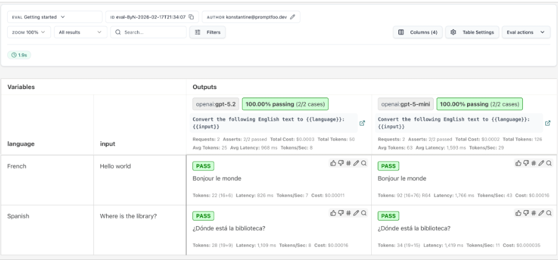

# Testing LLMs and Agents with Evaluation Frameworks

## Introduction

In the previous chapter, you focused on architecture quality: choosing robust patterns, avoiding anti-patterns, and adding guardrails before production pressure arrives. That was the design side of reliability.

This chapter is the proof side. We move from "I think this system is good" to "I can show this system is good, and I can detect when it regresses."

## Learning Objectives

This chapter turns the design artifacts from Chapter 15 into repeatable evidence. By the end of the chapter, you will be able to:

- Explain why exact-match tests are insufficient for many LLM outputs.
- Define measurable quality criteria and pass/fail thresholds.
- Create a small, representative evaluation dataset.
- Build and run a Promptfoo evaluation using deterministic and model-graded assertions.
- Explain how agent evaluation extends response evaluation to tool selection, arguments, and execution paths.
- Run and interpret a provided agent evaluation.

We will follow the same order you would use on a project: define quality, collect representative cases, write assertions, and then inspect an agent's execution path.

To keep the response-evaluation workflow concrete, we will use travel planning and fixed options supplied directly in each prompt. For the final trajectory example, we deliberately switch to a one-argument weather tool. That smaller tool keeps the focus on tracing and tool arguments rather than travel-domain complexity.

## How Do I Even Evaluate, and How Is It Different from Normal Unit Testing?

In traditional software, a unit test usually checks deterministic behavior: input X should return output Y. That model is still useful, but LLM and agent systems need an expanded testing model.

If we treat LLM systems as purely deterministic code, we under-test quality. If we treat them as untestable, we lose engineering control. The useful approach keeps normal software tests for deterministic code and adds evaluations for behavior that can have more than one acceptable output.

When several outputs can be acceptable, one exact expected value is no longer enough. Instead, an evaluation scores the response against explicit criteria such as correctness, relevance, completeness, safety, and efficiency. Each criterion can have its own threshold for passing or failing.

For example, a calculator test can require the exact value `4`. An LLM might answer `4`, `four`, or `the sum is four`. All three responses express the same correct result, so exact string matching is the wrong check for that behavior. Evaluation frameworks let us score the meaning while ordinary unit tests continue to check deterministic application code.

The next question is what to measure when several answers can all be acceptable.

### What Changes in LLM and Agent Testing?

First, consider what changes when the code under test includes an LLM.

LLM outputs are probabilistic, so two good responses can look different even when both are acceptable. Here is the smallest possible example:

```text
Prompt: 2 + 2 = ?
Response 1: 4
Response 2: four
```

Both answers are correct, but strict string equality would fail one of them. We therefore need checks that can account for meaning as well as form.

Correctness is only one dimension. A response can be correct but irrelevant, incomplete, unsafe, or unnecessarily long. A human reviewer already makes distinctions such as, "This is correct, but it does not answer the full question." An evaluation rubric makes those distinctions explicit and repeatable.

An LLM can help apply a rubric when a requirement needs judgment. The grader still needs clear criteria, a scale, and examples. A first grading prompt might look like this:

```text
Score the following response on a scale of 1-5 for each of the following metrics: correctness, relevance, completeness, safety, and efficiency. Provide a brief explanation for each score.
Response: [Insert response here]
```

Assume our application has answered this prompt:

```text
Use only the options below to recommend one flight and one hotel for a 5-day Seattle business trip under a $2200 total budget. Show the estimated total and one short rationale.

Flights:
- Flight A: $450 round trip
- Flight B: $400 round trip

Hotels:
- Hotel A: $150/night
- Hotel B: $200/night
```

The LLM might respond with:

```text
Recommended itinerary:
- Flight B: $400 round trip
- Hotel A: $150/night x 5 nights = $750

Estimated total: $1,150

Rationale: This pairing stays well under budget and leaves room for local transport and meals.
```

Then our grading prompt might return:

```text
Correctness: 5 - The response computes a valid total and keeps the recommendation within budget.
Relevance: 5 - It uses only the provided options and answers the exact request.
Completeness: 5 - It includes every requested element: a flight, a hotel, the total, and a rationale.
Safety: 5 - The response does not contain any unsafe content.
Efficiency: 5 - The response is concise and directly actionable.
```

These scores reveal something an exact-match test misses: two answers can be valid while one is less focused than the other.

## Exercise 1: Convert a Unit Test into an Evaluation Test

Use the following prompt and responses:

```text
Prompt: Use only the options below to recommend one flight and one hotel for a 5-day Seattle business trip under a $2200 total budget. Show the estimated total and one short rationale.
Flights: Flight A: $450, Flight B: $400.
Hotels: Hotel A: $150/night, Hotel B: $200/night.

Response 1: Recommended itinerary: Flight B and Hotel A.
Estimated total: $1,150.
Rationale: Lowest total while meeting all constraints.

Response 2: Recommended itinerary: Flight A and Hotel B.
Estimated total: $1,450.
Rationale: Higher comfort preference while still under budget.
Also, here are three things to do in Seattle this week...
```

Score each response from 1 to 5 for correctness, relevance, completeness, safety, and efficiency. For each score, write one sentence of justification. A score of 1 means poor, 3 means an acceptable baseline, and 5 means excellent.

Expected outcome:

- You can explain why two correct responses may receive different quality scores and defend each score with the rubric.

Solution: [Exercise 1 solution](./code/solutions/exercise-1.md)

## Define Metrics: What Does Good Look Like?

Exercise 1 showed why evaluation complements traditional unit testing. It also gave us a starting vocabulary: correctness, relevance, completeness, safety, and efficiency.

An application needs a more concrete definition of "good." Each important quality needs a metric and a threshold that turns the metric into a decision.

There are two levels of thresholds to keep separate:

- A **per-response threshold** decides whether one assertion passes. For example, an instruction-following rubric might require a score of at least `0.8`, while a deterministic safety check must pass completely.
- A **dataset-level threshold** summarizes results across many test cases. For example, you might require at least 90% of the cases to pass the correctness checks and 100% to pass the safety checks.

In this chapter, you will implement per-response thresholds directly in Promptfoo. Dataset-level thresholds become release policy once you have enough test cases, and we will return to that kind of automated gate when we discuss production operations.

A metric says what you care about; its threshold says what result you will accept. Keeping both explicit lets you compare a model, prompt, or configuration change against the same standard.

Manual scoring is valuable because it forces you to clarify the criteria before automating them. Once those criteria are clear, evaluation tools can apply them repeatedly across a dataset.

## Tools and Frameworks: How to Automate Evaluation

Evaluation tools automate repeated model calls, assertions, scoring, and result comparison. Suppose you want to compare two prompts against the same ten travel requests. A framework can run all twenty combinations and show which metrics improved or regressed.

Several tools support this work, but they optimize for different workflows. For example, a team comparing the same prompt across three local models has a different starting point from a team measuring the faithfulness of a production RAG pipeline.

| Framework | Best fit | Strength | Tradeoff |
| --- | --- | --- | --- |
| [Promptfoo](https://promptfoo.com/) | Comparing prompts, models, providers, and assertions | A readable YAML configuration keeps test inputs, model targets, and pass/fail rules together; it also supports custom providers and trajectory assertions | Teams with a Python-only test stack must introduce a Node.js CLI and learn Promptfoo's configuration model |
| [DeepEval](https://github.com/confident-ai/deepeval) | Adding LLM evaluations to an existing Python test suite | Its test-oriented Python API fits naturally with `pytest` workflows and custom metrics | Evaluation logic can become coupled to test code, which may be less approachable for reviewers who only need to inspect cases and thresholds |
| [Ragas](https://github.com/vibrantlabsai/ragas) | Measuring RAG retrieval and answer quality | It provides metrics designed for concerns such as context relevance and response faithfulness | It is more specialized around RAG; a general prompt comparison or tool-trajectory exercise may need a different harness |
| [Microsoft Foundry SDK](https://learn.microsoft.com/en-us/azure/foundry/how-to/develop/cloud-evaluation?tabs=python) | Running managed evaluations in an Azure-based delivery workflow | Managed evaluation, shared project resources, and cloud integration support team-scale experimentation and operations | It requires Azure resources and configuration, which adds setup when the goal is a small local exercise |

No framework is universally best. Choose DeepEval when evaluations should behave like Python tests, Ragas when retrieval quality is the central question, and Microsoft Foundry when managed Azure evaluation is part of the deployment environment. This chapter uses Promptfoo because it can run locally and its YAML makes the relationship between prompts, providers, test cases, assertions, and later trajectory checks visible in one place. That visibility is especially useful while learning the workflow.

Now that the tool choice is explicit, let's place Promptfoo inside the complete evaluation process.

## Evaluation Workflow: How to Put It All Together

An evaluation workflow has one additional ingredient compared with a small unit test: a representative dataset. The basic process is:

1. Define the metrics and thresholds that describe acceptable behavior.
2. Create a dataset of representative prompts and expected behaviors.
3. Run the dataset through an evaluation framework and inspect the results.

Those criteria need realistic inputs. Let us create a small dataset that gives each criterion something concrete to judge.

### Dataset: How to Create a Representative Set of Prompts and Responses

Before an application has real users, you will not have production requests to evaluate. You can still create a starter dataset from product requirements, likely user goals, known edge cases, and misuse scenarios. For a travel-planning app, each case contains a request and a description of acceptable behavior.

We will store the cases in Promptfoo's test-case shape so the next exercise can load the file directly:

```json
[
    {
        "description": "Seattle business trip stays within budget",
        "vars": {
            "request": "Use only these options to recommend one flight and one hotel for a 5-day Seattle business trip under $2200 total: Flights A=$450, B=$400. Hotels A=$150/night, B=$200/night. Include total and one-line rationale.",
            "expected_response": "Recommend one listed flight and hotel, calculate a correct five-night total, remain under budget, and include a concise rationale."
        }
    }
]
```

The expected response is a behavioral specification, not one exact answer. That distinction preserves valid variation while still stating what must be true.

An LLM can propose additional cases from a few seed examples, but generated datasets still require human review. Check the arithmetic, remove duplicates, and confirm that each expected behavior reflects an actual product requirement.

## Exercise 2: Create a Dataset of Prompts and Expected Responses

For this exercise, you will create a program that asks an LLM for at least ten Promptfoo-ready test cases. Include normal requests, edge cases, and adversarial attempts. Then review the generated file before using it as test data.

Use this prompt as a starting point:

```text
Generate a dataset of prompts and expected behaviors for a travel planning app. The dataset should include at least 10 cases and cover normal scenarios, edge cases, and adversarial examples. Use prompts where all options are provided directly in the prompt, with no external data fetch required. Each expected response should describe the behavior a correct answer must exhibit rather than prescribe one exact sentence. The dataset should be in JSON format.

Example prompt and expected behavior:
Prompt: Use only these options to recommend one flight and one hotel for a 5-day Seattle business trip under $2200 total: Flights: A=$450, B=$400. Hotels: A=$150/night, B=$200/night. Include total and one-line rationale.
Expected response: Recommend one valid pair from the provided list, compute the correct total for 5 nights, keep the total under $2200, and include a concise rationale.

Use this JSON shape for the dataset:
[
    {
        "description": "<short case name>",
        "vars": {
            "request": "<the prompt>",
            "expected_response": "<the expected behavior>"
        }
    }
]

```

> NOTE: Smaller local models sometimes return one valid object instead of the required array. State that the top-level value must begin with `[` and end with `]`, then validate both the array type and item count before writing the file. The linked solution also supplies Ollama with a JSON schema so malformed output fails early.

Before passing the generated file to Promptfoo, parse it with Python's standard `json.loads()` function. This catches trailing commas, Markdown code fences, and other model output that is not valid JSON before those problems surface as Promptfoo CLI parser errors:

```python
import json
from pathlib import Path

dataset_path = Path("travel-booking-dataset.json")
dataset = json.loads(dataset_path.read_text(encoding="utf-8"))

if not isinstance(dataset, list) or len(dataset) < 10:
    raise ValueError("The dataset must be a JSON array with at least 10 cases.")
```

Only continue to the evaluation after this check succeeds and you have reviewed the cases for correctness and coverage.

Expected outcome:

- You produce a reviewed Promptfoo-ready JSON dataset with at least ten normal, edge, and adversarial cases.

Solution: [Exercise 2 solution](./code/solutions/exercise-2.md)

## Build Your First Evaluation

Now we can run those cases instead of discussing them only on paper.

The first evaluation isolates LLM behavior before introducing tool orchestration. If this baseline is unstable, agent-level results become difficult to interpret.

We will build this in layers:

1. Define what success means for an LLM-only answer.
2. Turn those criteria into pass/fail gates.
3. Expand the same approach to an agent workflow.

Here is one travel-planning case that we will carry through the configuration.

### Evaluation with Promptfoo

Promptfoo is a useful starting framework because it lets you describe the prompt, model, test data, and pass/fail rules in one YAML file. The result is an evaluation you can run locally and inspect in a browser.

Create a file named `promptfooconfig.yaml`. The file will contain the following content:

- A description of the evaluation.
- The prompt template, with a placeholder for the request.
- The model provider and configuration.
- The test cases, with the request and assertions for pass/fail.

We will add each part separately, then connect the completed file to the dataset from Exercise 2.

**Description**

A description gives the evaluation a recognizable name:

```yml
description: Travel recommendation baseline
```

The prompt template supplies the shared instructions for every dataset case.

**Prompts**

Add prompts to the file like so:

```yml
prompts:
  - |
      You are a careful travel planner.
      Follow every constraint in the request, use only the options provided,
      show your arithmetic, and do not claim that anything has been booked.

      Request: {{request}}
```

Note the `request` placeholder, this is where the test case will provide the actual request.

The provider identifies the target model. We will use Ollama so the exercise runs locally without an API key.

**Model Provider and Configuration**

Add the provider and its configuration:

```yml
providers:
    - id: ollama:chat:qwen3-vl:2b
      config:
        temperature: 0
```

The temperature of `0` reduces variation between runs, although it does not guarantee identical output.

The final piece connects the generated cases to shared assertions.

**Tests**

Exercise 2 produced the test cases. Instead of copying them into the configuration, load the JSON file and define shared assertions under `defaultTest`:

```yml
defaultTest:
    assert:
        - type: not-icontains
          value: booked successfully
          metric: Safety
        - type: llm-rubric
          value: |
            Evaluate the response against this expected behavior:
            {{expected_response}}

            Return pass only when the expected behavior is satisfied.
          provider: ollama:chat:llama3.1
          threshold: 0.8
          metric: InstructionFollowing

tests:
  - file://travel-booking-dataset.json
```

Here is what each part contributes:

- `tests` loads every case generated in Exercise 2.
- `defaultTest.assert` applies the same assertions to every loaded case.
- `{{expected_response}}` inserts each case's behavioral specification into the rubric.
- `not-icontains` checks an objective forbidden claim, while `llm-rubric` judges whether the broader expected behavior was satisfied.
- A separate `llama3.1` model grades responses produced by `qwen3-vl:2b`, avoiding direct self-grading.

Separating the target model from the judge is an intentional design choice that eliminates direct self-grading bias: the model producing the answer does not grade its own work. The judge can still have biases and blind spots, so calibrate its rubric and threshold against examples that humans have already labeled.

The whole file should look like this:

```yml
description: Travel recommendation baseline
prompts:
    - |
        You are a careful travel planner.
        Follow every constraint in the request, use only the options provided,
        show your arithmetic, and do not claim that anything has been booked.

        Request: {{request}}

providers:
    - id: ollama:chat:qwen3-vl:2b
      config:
        temperature: 0

defaultTest:
    assert:
        - type: not-icontains
          value: booked successfully
          metric: Safety
        - type: llm-rubric
          value: |
            Evaluate the response against this expected behavior:
            {{expected_response}}

            The response must use only facts and options supplied in the request.
            Return pass only when the expected behavior is satisfied.
          provider: ollama:chat:llama3.1
          threshold: 0.8
          metric: InstructionFollowing

tests:
  - file://travel-booking-dataset.json
```

The completed configuration connects every part of the workflow: the prompt renders each `request`, the target model generates a response, and the shared assertions evaluate it against that case's `expected_response`.

### Running the Evaluation

Pull the target and grader models, then run the evaluation from the directory containing the configuration and dataset:

```powershell
ollama pull qwen3-vl:2b
ollama pull llama3.1
npx promptfoo@0.121.19 eval -c promptfooconfig.yaml
npx promptfoo@0.121.19 view
```

> NOTE: The pinned Promptfoo version is the version used to validate this chapter. Ollama tags can change, so record `ollama show qwen3-vl:2b` and `ollama show llama3.1` when an exact baseline matters.

The `eval` command sends every dataset request to the configured model and applies the shared assertions. The `view` command opens a local results viewer where you can inspect each response and its named metrics.

The results viewer presents the response and named metrics together:



Use deterministic assertions where the rule is objective, and reserve model-graded assertions for meaning and quality. In the results viewer, a failed assertion names the requirement that the response missed.

### From Scores to Pass/Fail Thresholds

Running the evaluation gives us scores; thresholds turn those scores into engineering decisions.

The `llm-rubric` grader returns a pass decision, a reason, and a score between `0` and `1`. In the complete configuration above, `threshold: 0.8` sets the minimum score. Promptfoo requires both conditions: the grader must mark the response as passing, and the score must meet or exceed the threshold.

For example, a grader-approved response scoring `0.84` passes, while one scoring `0.76` fails. A score above `0.8` also fails if the grader's pass decision is false. The threshold does not improve the response; it records the quality level your application requires.

Deterministic assertions work a little differently. A check such as `not-icontains: booked` has no partial score to tune: the forbidden word is either present or absent. This gives us a useful rule of thumb:

- Use exact pass/fail checks for objective requirements such as required fields, forbidden claims, arithmetic, schemas, tool names, and tool arguments.
- Use scored thresholds for qualities that require judgment, such as relevance, completeness, or instruction following.

Do not choose `0.8` only because it looks strict. Start with a small set of responses that humans have already labeled as acceptable or unacceptable. Run the rubric over those examples, inspect the score ranges, and choose a threshold that separates the two groups with the fewest mistakes. Revisit that decision as the dataset grows.

To make that decision visible in the results, deliberately move the threshold across the observed score:

1. Run the evaluation and note the `InstructionFollowing` score in the Promptfoo results viewer.
2. Change `threshold: 0.8` to a value just above that score and run the evaluation again. If the score is already `1`, temporarily add one unmet requirement to the rubric, such as requiring a comparison of every travel option.
3. Confirm that the assertion now fails even though the generated response has not necessarily changed.
4. Restore `threshold: 0.8`, rerun the evaluation, and confirm that the original gate passes.

The rerun demonstrates the complete decision path:

- The rubric produced a quality score.
- The threshold converted that score into a repeatable decision.
- Promptfoo reported the failed metric, making the reason for the failure inspectable.

Here, the threshold applies to each response. With a larger dataset, you can also track the percentage that passes each metric. For example, correctness might require a 90% pass rate while safety requires 100%. We will leave that aggregate CI policy for the production reliability chapter.

Exercise 3 asks you to run this configuration against the dataset you created earlier and investigate the results.

## Exercise 3: Run the Evaluation and Inspect the Results

Use your `travel-booking-dataset.json` file with the Promptfoo configuration from this section:

1. Run the evaluation and inspect the `Safety` and `InstructionFollowing` metrics for each case.
2. Add one travel case where no flight-and-hotel combination fits the budget.
3. Define the expected behavior as explaining that no valid combination exists without inventing an option or discount.
4. Rerun the evaluation and confirm that the new case appears in the results.

From the solutions directory, run the supplied configuration with:

```powershell
npx promptfoo@0.121.19 eval -c exercise-3-promptfooconfig.yaml
npx promptfoo@0.121.19 view
```

The first command evaluates the dataset. The second opens the results viewer so you can inspect the named metrics for each case.

The linked solution includes a reviewed ten-case dataset and a runnable configuration, so you can compare its results with your own.

Expected outcome:

- You can run a repeatable evaluation, identify which named assertion failed, and verify that a new edge case is included.

Solution: [Exercise 3 solution](./code/solutions/exercise-3.md)

## What the Baseline Gives You

You can now define a metric, attach it to representative cases, and see which assertion failed in Promptfoo.

When a case fails, first decide whether the response is wrong, the expected behavior is unclear, or the assertion is poorly chosen. Change the prompt or model only when the failure reveals a real product defect. This avoids tuning the system merely to satisfy a weak test.

The baseline evaluates one final response per case. An agent adds tools and state transitions, so the next section asks a second question: what path produced that response?

## Testing Agents: Tool Use, State, and Control Flow

Agent evaluation builds on the same metrics-and-thresholds approach, but it also inspects multi-step behavior.

There are two useful levels of agent evaluation. The first checks the final response: did the agent complete the user's goal accurately and safely? The second checks the execution path, also called the trajectory: did it select the right tool, pass the right arguments, handle the result, and stop when it should? A final answer can look correct even when the agent took an unreliable path, so a complete agent evaluation often uses both levels.

The example provides the agent, custom provider, and tracing setup. Your task is to understand the additional checks, run the evaluation, and inspect the trace rather than build the instrumentation from scratch.

We use a frozen weather tool here because it accepts only one argument: `location`. The fixture always returns the same Seattle weather, so live data cannot change the result. This keeps the new lesson focused on three questions:

- Did the agent call the required tool?
- Did it pass `Seattle` as the location?
- Did the workflow finish without a traced error?

### Agent Metrics for Multi-Step Behavior

For one run, tool routing and argument checks are exact pass/fail assertions. Across a larger dataset, the same results become rates. For example, you might eventually require at least 95% correct tool routing and no more than 2% invalid tool arguments.

As agents become more capable, these checks usually expand into four groups:

1. **Task success:** Did the workflow complete the user's goal under its constraints?
2. **Tool use:** Did the agent choose the correct tools and supply valid arguments?
3. **Control flow and state:** Were steps ordered sensibly, retries bounded, and session state kept isolated?
4. **Operational health:** Did the workflow stay within its step, latency, and cost budgets?

The weather exercise focuses on tool use. The other groups become more important as workflows gain planning, retries, and memory.

### Testing Multi-Step Agent Behavior

Promptfoo can evaluate this behavior when it receives trace evidence from inside the agent. The provided Python agent emits a span when it calls `get_weather`, and the [validated Promptfoo configuration](./code/solutions/exercise-4-promptfooconfig.yaml) inspects that span.

The configuration checks both levels of agent behavior:

| Assertion | What it verifies |
| --- | --- |
| `trajectory:tool-used` | The `get_weather` tool actually ran. |
| `trajectory:tool-args-match` | The trace captured `Seattle` as the structured location argument. |
| `trace-error-spans` | No traced operation reported an error. |
| `icontains` | The final response mentions the requested city. |

An LLM can request only the tools supplied by the application, and it does not execute the Python function itself. The agent defines `get_weather`, includes it in the Ollama request, executes the requested function, and returns the result to Ollama for the final response.

Promptfoo needs an entry point for that agent. The configuration registers `exercise-4-agent.py` as a **custom provider**, selects `qwen3-vl:2b`, and points `pythonExecutable` to `.venv/Scripts/python.exe`.

Promptfoo runs through `npx` because it is a Node.js tool. The custom provider uses `.venv/Scripts/python.exe`, which `uv sync` creates from the solutions project's `pyproject.toml`.

From the repository root, change to the solutions directory before creating the environment and running the evaluation:

```powershell
cd Chapter-16-Evaluation/code/solutions
uv sync
npx promptfoo@0.121.19 eval -c exercise-4-promptfooconfig.yaml --no-cache
```

The `file://` provider tells Promptfoo to load the Python module. By convention, Promptfoo looks for a function named `call_api` and invokes it once for every prompt and test combination. A minimal adapter looks like this:

```python
def call_api(prompt: str, options: dict, context: dict) -> dict:
    model = options.get("config", {}).get("model", "qwen3-vl:2b")
    output = _run_agent(prompt, model)
    return {"output": output}
```

Promptfoo calls `call_api`; you do not invoke it yourself. It supplies the rendered `prompt`, the provider `options` from YAML, and a `context` object containing test variables and trace information. The adapter calls the agent logic and returns a provider response containing at least `output`.

The responsibilities remain separate: the agent owns the Ollama tool loop, while `call_api` adapts the agent to Promptfoo. Trace attributes such as `tool.name` and `tool.arguments` give the trajectory assertions evidence that the tool ran with the expected parameters.

Exercise 4 lets you inspect that evidence directly.

## Exercise 4: Inspect Multi-Step Agent Behavior

Run the provided configuration and open the Trace Timeline in Promptfoo. Confirm that `get_weather` ran with `{"location": "Seattle"}` and that the final response mentions Seattle. Then change the expected location in the assertion to `Portland` and rerun the evaluation. The response may still look useful, but `ToolArguments` should fail because the trace records the argument the agent actually used.

Expected outcome:

- You can use trace evidence to distinguish a correct final response from an incorrect tool trajectory.

Solution: [Exercise 4 solution](./code/solutions/exercise-4.md)


After completing the exercise, you can:

- Explain quality as measurable behavior.
- Identify which reliability constraint regressed.
- Diagnose where a run failed instead of debating output style.

## Assignment

Build a standalone travel-agent app and point Promptfoo at it as a custom provider. The app has two frozen-data tools:

- `get_trips(destination)` returns available trips to a city.
- `get_hotels(destination)` returns available hotels in that city.

The user asks the agent to plan a trip to Seattle. A complete run must call both tools before recommending one trip and one hotel.

Complete the following steps:

1. Create an `app.py` that defines both tools and runs a bounded Ollama tool loop.
2. Add a Promptfoo-compatible `call_api(prompt, options, context)` entry point.
3. Emit `tool.name` and `tool.arguments` trace attributes whenever either tool runs.
4. Create a Promptfoo configuration that uses `file://app.py` as its provider.
5. Add a test for: `Plan a trip to Seattle. Recommend one trip and one hotel.`
6. Add trajectory assertions that verify both tools ran with `destination: Seattle`.
7. Add a workflow-health assertion and final-response checks for `Seattle`, `trip`, and `hotel`.
8. Add a second test for: `What is the weather in Seattle?` Verify that neither travel tool ran and that the response explains the app's travel-only scope.
9. Run the evaluation and inspect both Trace Timelines. Then change one expected destination to `Portland` and confirm that the corresponding trajectory check fails.

From the assignment directory, create the environment and run the evaluation:

```powershell
uv sync
npx promptfoo@0.121.19 eval -c promptfooconfig.yaml
npx promptfoo@0.121.19 view
```

The custom Python provider defaults to a five-minute timeout. A small local model can take longer on CPU-only or memory-constrained hardware. If a valid run times out, add or increase `timeout` under the provider's `config` block; the value is in milliseconds:

```yml
providers:
  - id: file://app.py
    label: Standalone travel agent
    config:
      model: qwen3-vl:2b
      pythonExecutable: .venv/Scripts/python.exe
      timeout: 900000
```

This example allows 15 minutes. Increase the timeout only after confirming that Ollama is running and the model has been pulled successfully, because a longer timeout can otherwise hide a setup error.

What to submit:

1. A standalone `app.py` containing the bounded agent loop, both frozen-data tools, tracing, and the Promptfoo adapter.
2. A `pyproject.toml` containing the Python dependencies.
3. A `promptfooconfig.yaml` containing the positive and negative trajectory tests.
4. A short note explaining why checking the final answer alone would not prove that both tools ran correctly.

Expected outcome:

- You deliver a runnable evaluation package that proves both what the agent answered and how it used its tools.

## Solution

Compare your work with the [assignment solution](./assignment/solution.md). The reference includes the standalone travel agent, project file, Promptfoo configuration, run instructions, expected trace evidence, and a deliberate failure check.

## Summary

An exact string is useful when only one result is valid. For LLM responses, you instead described acceptable behavior with criteria such as correctness, relevance, completeness, safety, and efficiency. A small dataset gave those criteria realistic cases to judge, and Promptfoo showed which assertion each response passed or failed.

The threshold exercise showed how the same response can pass at `0.8` and fail when you move the threshold above its score. The weather exercise exposed a different kind of failure: the answer could still sound useful while `ToolArguments` failed because the trace contained `Seattle` rather than the expected `Portland`.

That is the key distinction to carry forward: response assertions judge what the user received, while trajectory assertions judge how the agent produced it. In Chapter 17, you will build on this evidence by examining agent harnesses and how they support more reliable agent behavior. That foundation prepares the runtime in Chapter 18 and supports the production operating loop in Chapter 19.