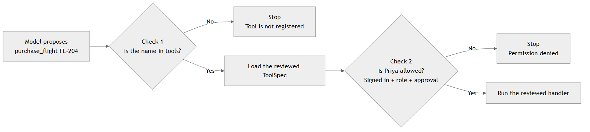

# Preparing Agents for Production

Priya opens the travel application and asks its agent to purchase flight `FL-204`. The agent finds the flight and asks for confirmation. Only after Priya approves the purchase may it contact the airline. If the same purchase appears a second time, the agent should return the first result rather than buy another ticket.

That is where we left the travel agent in Chapter 17. It could limit its work, require approval, call tools, remember progress, and record what happened.

Now place that agent in production.

Taking this agent into production means considering trusted identity, safe recovery, controlled tool access, and numerous other concerns. We will introduce them one at a time, when Priya's purchase makes each concern necessary. Each solution will extend the same `Agent` class.

Each numbered exercise has a starter `.py` file under `code/exercises` and a matching completed implementation under `code/solutions`. The pair intentionally repeats the code from earlier stages so each file can run on its own; the starter leaves only the current stage unfinished, while the solution shows that stage added to the cumulative `Agent`. Work in the exercise file first, then compare the relevant method with its solution rather than treating both files as separate exercises.

Chapter 19 will use the resulting records to monitor the deployed agent and investigate failures. Before we can do that, we need to make Priya's travel agent dependable enough to produce evidence we can trust.

## Learning Objectives

By the end of this chapter, you will be able to:

- Pass trusted identity, approval, time limits, and cancellation from the application into an agent run.
- Allow the agent to execute only registered tools that the signed-in user may use.
- Continue an interrupted run without exposing it to another user.
- Check an uncertain purchase with the airline instead of blindly trying it again.
- Prevent two workers from performing the same purchase.
- Save the agent's decisions and publish them after a temporary destination failure.

## Prepare an Agent for Production

Before we monitor a deployed agent, we need to trust the evidence it produces. In Priya's case, the runtime must know who approved `FL-204`, whether the airline created the booking, and where execution should resume after a crash. The application owns those facts; the model proposes what to do next.

### Add a Harness to the Test Run

Start with a test run of Priya's request to purchase `FL-204`. The model proposes the same purchase twice. The airline handler should run once, and the second proposal should receive the result already saved from the first purchase.

Here is what Priya's run reports:

```text
Termination reason: completed
Purchases: ['FL-204']
Events: ['run_started', 'model_requested', 'tool_requested',
		 'tool_completed', 'model_requested', 'tool_requested',
		 'tool_completed', 'model_requested', 'run_completed']
```

The first line, `Termination reason: completed`, tells the application why the run stopped. Other runs might end because policy denied an action or because the model used every allowed step. Recording that reason makes a stopped run explainable instead of leaving developers to infer what happened.

The two `tool_completed` events represent the original call and its replay. The `Purchases` list contains only one flight, so the handler bought one ticket even though the model proposed the action twice.

Chapter 17's harness already provides these boundaries. It limits the number and duration of model and tool calls, checks Priya's exact approval before a purchase, avoids repeating a completed purchase, and records the decisions made during the run. We will keep that behavior while adding the production responsibilities in this chapter.

Run the baseline checkpoint to reproduce the output. It uses fixed model responses, so you do not need to start Ollama:

```powershell
uv run python checkpoints/01_chapter17_baseline.py
```

This checkpoint gives us a stable starting point. If a later change causes two purchases or changes the event sequence unexpectedly, we know which stage introduced the problem.

The run still leaves a more basic question unanswered: who proves that the caller really is Priya?

The conversation cannot provide that proof. It may say that Priya wants to purchase `FL-204`, and the model may propose that action, but neither the conversation nor the model may identify the caller, assign her a role, or decide what she is allowed to do.

In production, the travel application answers that question before the agent runs. It identifies the signed-in user and supplies the trusted facts that the agent is allowed to use. The conversation can describe Priya's request, but it cannot grant the model Priya's identity or permissions.

### Add a Production Run Context

The application first needs to know that the request really belongs to Priya. Her name appearing in the conversation is not proof of identity. The travel application must identify the signed-in user and pass that trusted identity to the agent. Before buying a ticket, the agent can then check that Priya is allowed to use the purchase tool and that she approved this exact flight.

The purchase now has two inputs. The conversation says, "Purchase `FL-204`." A separate object says, "This request comes from the signed-in user `user-1842`, and these are the controls for her run."

That separate object is `RunContext`. It is **application context**: information that travels with the request but remains under application control. The model may use the conversation to propose an action, but the harness uses `RunContext` to decide whether that action may proceed.

Let's follow Priya's request through the system:

1. The travel application authenticates Priya as `user-1842` in the `travel` tenant.
2. The agent helps Priya search for a flight and presents `FL-204` as an option.
3. Priya confirms that she wants to purchase `FL-204`.
4. The application records her approval for the exact call `purchase_flight({"flight_id": "FL-204"})`.
5. The application places Priya's verified identity and approval in `RunContext`, along with the time and cancellation controls that later sections will use.
6. The model receives the conversation and available tool schemas, then proposes a `purchase_flight` call. No purchase has happened yet.
7. The harness verifies that the identity in `RunContext` matches the signed approval and that the proposed tool and arguments match the approved action. Only then does it execute the purchase.

The approval never becomes an instruction in the conversation. It stays in `RunContext`, where the harness can compare trusted evidence with the model's proposal.

If the model proposes `FL-204`, the proposal matches Priya's approval and the harness may execute it. If it proposes `FL-999`, the proposal describes a different purchase and the harness rejects it. The same rejection occurs if the approval belongs to another user, has expired, or has been modified.

The `RunContext` class collects the trusted information available during one run:

```python
@dataclass(frozen=True)
class RunContext:
	identity: Identity
	deployment: DeploymentInfo
	deadline: Deadline
	cancellation: CancellationToken
	approval: Approval | None = None
```

The class is small because it carries facts rather than performing the work itself. Each field answers a different question about the run:

| Field | Role | Reasonable value for Priya's run |
| --- | --- | --- |
| `identity` | Identifies the authenticated caller, their organization, and their roles. It is not a user profile written by the model. | Subject `user-1842`, tenant `travel`, role `traveler` |
| `deployment` | Records the exact agent configuration handling the request, including the code, model, prompt, policy, and tool versions. This is deployment metadata, not an instruction to deploy the agent. | Agent `travel-agent-2026.07.3`, model `qwen2.5:1.5b`, prompt `travel-system-v12`, environment `production` |
| `deadline` | Sets how long the application will wait for the run. Each boundary checks the remaining time before starting more work, but an external service may continue after the local wait ends. | 30 seconds from the start of the request |
| `cancellation` | Carries a stop signal from the application. Priya closing the request or an operator stopping the run can set this signal. | A new, uncancelled `CancellationToken` |
| `approval` | Proves that the authenticated user confirmed one exact side effect. It is narrower than general permission and may be absent for read-only work. | Approval for Priya to call `purchase_flight` with `flight_id="FL-204"`, valid for five minutes |

Here is the context the application creates before the proposed purchase reaches the harness:

```python
identity = Identity(
	subject="user-1842",
	tenant="travel",
	roles=frozenset({"traveler"}),
)

deployment = DeploymentInfo(
	agent_version="travel-agent-2026.07.3",
	source_revision="8f23c1d",
	model="qwen2.5:1.5b",
	prompt_version="travel-system-v12",
	policy_version="purchase-policy-v4",
	tool_schema_version="travel-tools-v7",
	evaluation_dataset="travel-critical-v9",
	environment="production",
)

approval = approval_authority.issue(
	identity=identity,
	tool="purchase_flight",
	arguments={"flight_id": "FL-204"},
	idempotency_key="purchase-FL-204-user-1842",
)

context = RunContext(
	identity=identity,
	deployment=deployment,
	deadline=Deadline.after(30),
	cancellation=CancellationToken(),
	approval=approval,
)
```

The conversation still describes what Priya wants. `RunContext` now tells the harness who made the request, which deployment handled it, how long the run may continue, whether it was cancelled, and which purchase Priya approved.

We will now evolve one small `Agent` class through six runnable snapshots. Each checkpoint file repeats the current class so you can run that stage independently, but the class is cumulative, meaning methods introduced in one stage remain in every later stage.

| Stage | Change to `Agent` | Runnable snapshot |
| --- | --- | --- |
| 1. Trusted context | Add `run(task, context)` | `02_run_context.py` |
| 2. Authorization | Add `authorize_tool` | `03_authorization.py` |
| 3. Reviewed tools | Add `execute_tool` and the `tools` lookup | `04_tool_isolation.py` |
| 4. Durable restoration | Add `load_or_create_run`, the store, and `run_id` | `05_durable_execution.py` |
| 5. Cancellation boundary | Add `invoke_tool`; make `execute_tool` delegate to it | `06_cancellation.py` |
| 6. Action records | Expand `invoke_tool` to claim and complete side effects | `07_action_records.py` |

The first revision makes one structural change: `run` requires `RunContext` alongside the task. At this stage, it reads only the trusted identity. Later revisions will use the deadline and cancellation fields at the boundaries where work can be stopped.

```python
class Agent:
	def run(self, task: str, context: RunContext) -> str:
		return f"{context.identity.subject}: {task}"
```

The agent is not yet authorizing tools. This revision only establishes how context enters the class. The [run-context checkpoint](./code/checkpoints/02_run_context.py) contains this version:

```powershell
uv run python checkpoints/02_run_context.py
```

```text
Context stage: user-1842: Purchase FL-204
```

Time to practice what we've learnt so far.

### Exercise 1: Inspect Priya's Run Context

Priya asks the agent to purchase `FL-204`, but the task text alone does not prove who sent that request. The agent must receive her verified subject from the travel application rather than infer it from the conversation.

Begin with the smallest production change: make the agent accept `RunContext`. In [the Exercise 1 starter](./code/exercises/exercise-1.py), implement `Agent.run` and return Priya's trusted subject with the task. The deadline and cancellation fields remain available for the later iteration that introduces those checks.

This is the first version of the class you will keep extending. Notice that the task text cannot replace the trusted subject in `RunContext`.

```text
Context stage: user-1842: Purchase FL-204
```

Solution: [Exercise 1 solution](./code/solutions/exercise-1.md)

Trusted identity and deployment information now reach the run boundary without passing through the conversation. Next, the harness must decide whether this signed-in user may purchase `FL-204`.

### Authenticate Users and Authorize Actions

Priya signs in and asks the agent to purchase `FL-204`. Her name in the conversation cannot prove her identity or permissions, so the travel application must verify her login before the agent acts.

The following illustrative snippet is self-contained: `FakeAccessToken` is a chapter-only test double, and `login_service` represents the application's identity provider adapter. Neither is imported from an earlier chapter or used by the runnable checkpoint. Together, they show the authentication step that happens before the agent receives a trusted `Identity`:

```python
@dataclass(frozen=True)
class FakeAccessToken:
	subject: str
	tenant: str
	roles: frozenset[str]
	expires_at: str
	signature: str


token = FakeAccessToken(
	subject="user-1842",
	tenant="travel",
	roles=frozenset({"traveler"}),
	expires_at="2026-08-02T15:05:00+00:00",
	signature="test-signature",
)

login_response = login_service.verify(token)
# {
#     "subject": "user-1842",
#     "tenant": "travel",
#     "roles": ["traveler"],
# }

identity = Identity(
	subject=login_response["subject"],
	tenant=login_response["tenant"],
	roles=frozenset(login_response["roles"]),
)
```

The token fields are not trusted until `verify` checks the expiry and signature. This response is a local teaching fixture, not a real security service. A deployed application would verify a signed token and load current roles from its identity or authorization system. The runnable [authorization checkpoint](./code/checkpoints/03_authorization.py) begins at that trusted boundary by constructing the resulting `Identity` directly, so it does not define `FakeAccessToken` or `login_service`. The important point is that the application supplies the identity; the model does not.

The tool declares its broad access rule with a decorator:

```python
@auth(logged_in=True, roles=["traveler", "travel_admin"])
def purchase_flight(flight_id: str) -> str:
	"""Purchase a selected flight after exact approval."""
```

`logged_in=True` requires a signed-in identity. The `roles` list allows Priya's `traveler` role to propose this action. `authorize_tool` reads that policy from the decorated tool and rejects a missing identity or an unlisted role.

This broad permission is not permission to buy any ticket. After Priya confirms `FL-204`, the application also issues approval for that exact purchase:

```python
approval = approval_authority.issue(
	identity=identity,
	tool="purchase_flight",
	arguments={"flight_id": "FL-204"},
	idempotency_key="purchase-FL-204-user-1842",
)
```

The decorator answers, "May this kind of user call this tool?" The approval answers, "Did this user confirm these exact arguments?" The idempotency key gives the approved purchase a stable name for later recovery. A proposal for `FL-999` fails even though Priya has an allowed role.

Now add `authorize_tool` to the same `Agent` class. The existing `run` method remains unchanged. This new method compares the trusted roles in `RunContext` with the application-owned tool policy, then verifies exact approval when the tool requires it. We will examine how `ToolSpec` is populated in the next section.

```python
class Agent:
	def __init__(self, approval_authority: ApprovalAuthority) -> None:
		self.approval_authority = approval_authority

	def run(self, task: str, context: RunContext) -> str:
		# Existing implementation omitted for brevity.
		...

	def authorize_tool(self, spec, arguments, context) -> None:
		if spec.auth_policy.logged_in and not context.identity.subject:
			raise PermissionError("Tool requires a signed-in user")
		if not context.identity.roles.intersection(spec.allowed_roles):
			raise PermissionError("Identity is not allowed to use this tool")
		if spec.requires_approval:
			self.approval_authority.verify(
				context.approval,
				context.identity,
				spec.name,
				arguments,
			)
```

`run` receives the context; `authorize_tool` decides whether the proposed call may proceed. Run this stage:

```powershell
uv run python checkpoints/03_authorization.py
```

```text
Authorization stage: approved purchase_flight
```

The decorator is a broad role check. A user who may purchase for one department should not automatically receive permission to purchase for every department. Add that narrower resource check at the tool boundary, not in the prompt.

> **NOTE:** Never place credentials in model context. The harness should inject credentials only when invoking the authorized tool, and the tool should receive the narrowest credential scope it needs.

### Exercise 2: Guard Priya's Purchase

Priya signs in as a traveler and approves `FL-204`. The model then proposes `purchase_flight` with those exact arguments. That call should pass, while the same tool with `FL-999` should fail because Priya did not approve that ticket.

The same `Agent` now needs to make that decision. Its new method must enforce both the broad role policy and the exact signed approval.

Implement `Agent.authorize_tool` in [the Exercise 2 starter](./code/exercises/exercise-2.py):

1. Enforce the decorated tool's login and role policy.
2. When the tool requires approval, verify the identity, tool name, and exact arguments.

```text
Authorization stage: approved purchase_flight
```

Solution: [Exercise 2 solution](./code/solutions/exercise-2.md)

Only Priya's exact `FL-204` request passes. We still need to control which implementation runs and what that code can access.

### Allow Only Reviewed Tools

Priya approves `FL-204`, and the model proposes `purchase_flight`. The authorization checks pass, but the model has supplied only a name and arguments. The application still has to decide which Python function that name may start.

Suppose the model instead proposes a plausible-sounding tool named `issue_airline_refund`. No such tool belongs to the travel application. If the harness tries to import a function or construct a request directly from that model-generated name, the model has gained control over which implementation runs.

Before any handler runs, the agent follows these two checks in order:



The application avoids that risk with a fixed `tools` dictionary. A name may run only when that dictionary connects it to a reviewed handler. `ToolSpec` holds that connection along with the tool's authorization and execution settings:

```python
@dataclass(frozen=True)
class ToolSpec:
	name: str
	schema: Callable[..., Any]
	handler: ToolHandler
	requires_approval: bool = False
	side_effecting: bool = False
	timeout_seconds: float = 5.0

	@property
	def auth_policy(self) -> AuthPolicy:
		return self.schema.auth_policy

	@property
	def allowed_roles(self) -> frozenset[str]:
		return self.auth_policy.roles
```

The authorization properties come from the reviewed schema's `@auth` decorator, so `ToolSpec` and `authorize_tool` use the same policy rather than maintaining two copies. The specification now exposes both attributes that `authorize_tool` reads.

Each entry in `tools` connects an allowed name to its schema and handler:

```python
tools = {
	"search_flights": ToolSpec(
		name="search_flights",
		schema=search_flights,
		handler=travel_tools.search_flights,
	),
	"purchase_flight": ToolSpec(
		name="purchase_flight",
		schema=purchase_flight,
		handler=travel_tools.purchase_flight,
		requires_approval=True,
		side_effecting=True,
	),
}
```

These entries say that `purchase_flight` requires approval and has side effects, while `search_flights` does not. The model receives the schemas so it can propose calls. It does not receive the handlers or credentials.

The application passes `tools` to the current `Agent` snapshot:

```python
agent = Agent(
	tools=tools,
	approval_authority=authority,
)
```

Now add the `execute_tool` method to the same class. The constructor receives `tools`. When the model proposes a tool name, this method looks it up in that dictionary rather than importing or executing arbitrary code. An unknown name stops immediately. A known name still has to pass `authorize_tool` before its registered handler runs:

```python
class Agent:
	def __init__(self, approval_authority, tools) -> None:
		self.approval_authority = approval_authority
		self.tools = tools

	def run(self, task: str, context: RunContext) -> str:
		# Existing implementation omitted for brevity.
		...

	def authorize_tool(self, spec, arguments, context) -> None:
		# Existing implementation omitted for brevity.
		...

	def execute_tool(self, name, arguments, context):
		spec = self.tools.get(name)
		if spec is None:
			raise PermissionError("Tool is not registered")
		self.authorize_tool(spec, arguments, context)
		return spec.handler(arguments, context)
```

This is still the same `Agent`: `execute_tool` builds on `authorize_tool`, which uses the `RunContext` accepted by `run`. The registered handler runs only after both checks pass.

Run the checkpoint to see the reviewed handler execute only after those checks pass:

```powershell
uv run python checkpoints/04_tool_isolation.py
```

```text
Isolation stage: Purchased FL-204 for user-1842
```

This checkpoint controls which handler may start. It does not restrict what that handler can access after it starts. In production, `purchase_flight` should receive a booking-only credential and access only the airline booking endpoint. Restrictions such as network rules, filesystem access, and process isolation surround the handler in the deployed service; they are not implemented by this `Agent` snapshot.

### Exercise 3: Reject Unregistered Tools

Priya's approved `purchase_flight` call should reach the reviewed airline handler. In the same run, the model proposes `issue_airline_refund`, a tool the application never registered. The harness must reject that invented name before any Python implementation runs.

The `tools` lookup creates that decision point. Every proposed call must appear in it, including calls that have a reasonable-sounding name.

Add `Agent.execute_tool` in [the Exercise 3 starter](./code/exercises/exercise-3.py):

1. Resolve the proposed name through `self.tools` and reject names that are absent.
2. Pass the registered specification through `authorize_tool` from Exercise 2.
3. Invoke only the registered handler.

With the expected entries in `tools`, the checkpoint prints:

```text
Isolation stage: Purchased FL-204 for user-1842
Unknown tool: Tool is not registered
```

Solution: [Exercise 3 solution](./code/solutions/exercise-3.md)

The invented tool never reaches Python code. Our next failure is different: the process stops, and a new worker needs to find Priya's last saved step.

### Make Execution Durable and Recoverable

The airline creates Priya's booking, but the agent process stops before saving the response. When the application starts again, it must continue from the saved run. It must also find out whether the airline completed the purchase. Simply trying again could buy Priya a second ticket.

The application therefore saves the run state in a database as the agent works. This is **durable execution**. A new process can load the latest **runtime checkpoint** and continue instead of reconstructing Priya's conversation from memory.

The application creates a stable `run_id` before the first checkpoint exists. Priya's first request therefore follows the create path:

```python
run_id = "run-priya-FL-204"  # Generated before the first save.
state = store.load_checkpoint(run_id)

if state is None:
	state = RunState(run_id=run_id, messages=[], ...)
	store.save_checkpoint(state)
```

The `run_id` names the run; it does not prove that a checkpoint is already stored. On the first call, `load_checkpoint` returns `None`, so the application creates the initial state. After a restart, the same ID finds that saved state.

This teaching adapter treats an unknown `run_id` as a new run. A production API should distinguish "create" from "resume" so a mistyped resume ID returns "not found" instead of silently starting over.

The saved state also has an owner. Before returning it, the agent must verify that its subject and tenant match Priya's current `RunContext`:

```python
def load_or_create_run(self, run_id, task, context):
	state = self.store.load_checkpoint(run_id)
	if state is not None:
		if (
			state.subject != context.identity.subject
			or state.tenant != context.identity.tenant
		):
			raise PermissionError("Run belongs to another identity")
		return state

	state = RunState(
		run_id=run_id,
		messages=[{"role": "user", "content": task}],
		subject=context.identity.subject,
		tenant=context.identity.tenant,
	)
	self.store.save_checkpoint(state)
	return state
```

This helper enables two paths through the same storage boundary. Priya's first request creates `run-priya-FL-204`; after an interruption, a later request supplies that ID and restores the saved messages and progress. The identity check prevents another user or tenant from resuming her run.

To wire this into our `Agent` class, add the helper and a durable store to the constructor. The `run` method receives `run_id` and calls `load_or_create_run` before continuing. The other methods remain unchanged:

```python
class Agent:
	def __init__(self, approval_authority, tools, store):
		self.approval_authority = approval_authority
		self.tools = tools
		self.store = store

	def run(self, task, context, run_id):
		state = self.load_or_create_run(run_id, task, context)

		# Continue model and tool execution from the restored state.
		return state

	def authorize_tool(self, spec, arguments, context) -> None:
		# Existing implementation omitted for brevity.
		...

	def execute_tool(self, name, arguments, context):
		# Existing implementation omitted for brevity.
		...

	def load_or_create_run(self, run_id, task, context):
		state = self.store.load_checkpoint(run_id)
		if state is not None:
			if (
				state.subject != context.identity.subject
				or state.tenant != context.identity.tenant
			):
				raise PermissionError("Run belongs to another identity")
			return state

		state = RunState(
			run_id=run_id,
			messages=[{"role": "user", "content": task}],
			subject=context.identity.subject,
			tenant=context.identity.tenant,
		)
		self.store.save_checkpoint(state)
		return state
```

The [durable checkpoint](./code/checkpoints/05_durable_execution.py) calls `run` twice with the same `run_id`: the first call saves Priya's state, and the second restores it.

```powershell
uv run python checkpoints/05_durable_execution.py
```

```text
Run resumed: run-priya-FL-204
```

The example assumes that one worker resumes the run at a time. It can recover Priya's conversation, but it still cannot prove whether the airline committed the purchase. We will store that evidence separately.

### Exercise 4: Resume Priya's Interrupted Run

The durable `run` path can now restore conversation state by `run_id`, but the identifier is not a secret. Imagine that another signed-in traveler learns Priya's run ID and tries to resume it. The saved owner must prevent that traveler from receiving or continuing Priya's conversation.

In [the Exercise 4 starter](./code/exercises/exercise-4.py), add `Agent.load_or_create_run`:

1. Restore a saved `RunState` only when its subject and tenant match the current context.
2. Otherwise create and save a new state for the current task.

The saved owner succeeds and the other identity is rejected:

```text
Checkpoint restored: run-priya-FL-204
Owner: user-1842
Different identity: Run belongs to another identity
```

Solution: [Exercise 4 solution](./code/solutions/exercise-4.md)

The owner can resume the run; another traveler cannot. Now place the interruption one step later, after the airline request has started.

### Handle Cancellations

Priya's run can stop early for two different reasons:

- Priya is tired of waiting and presses Cancel. This is **user cancellation**.
- Priya does nothing, but the run takes longer than the application allows. The **deadline expires**, so the application stops waiting.

When Priya presses Cancel, the application sets a signal rather than forcibly terminating the agent. The agent and its tools must notice that signal and stop before starting more work. This pattern is called **cooperative cancellation**.

A deadline uses a different signal. Priya does not request it; the application decides in advance how much time the run may use. Once that time is gone, the application prevents more work from starting.

`RunContext` carries both controls. Before sending the airline request, the agent checks each one:

```python
def invoke_tool(self, spec, arguments, context):
	context.cancellation.raise_if_cancelled()
	if context.deadline.remaining_seconds() <= 0:
		raise TimeoutError("Execution deadline exceeded")
	return spec.handler(arguments, context)
```

`raise_if_cancelled()` stops because Priya asked to stop. The explicit deadline check stops if the application has no time left. In either case, the handler never sends the purchase.

Now consider the same two events after the airline request has been sent. Priya might press Cancel, or the deadline might expire while the application waits. Either event can end the local wait, but neither can retract the request or force the airline to stop processing it.

The two paths now look like this:

```text
request sent -> Priya presses Cancel -> application stops waiting
                                      -> airline outcome is unknown

request sent -> deadline expires     -> application stops waiting
                                      -> airline outcome is unknown
```

The deadline limits how long the application waits. It does not limit how long the airline works. Likewise, cooperative cancellation cannot recall a request that has already reached the airline. Both paths need `status_unknown` because the application received no final answer; the next section checks the airline's evidence.

To wire the new boundary into `Agent`, `run` checks the controls when work begins, and `execute_tool` delegates the approved handler call to `invoke_tool`:

```python
class Agent:
	# authorize_tool and load_or_create_run remain unchanged.

	def run(self, task, context, run_id):
		context.cancellation.raise_if_cancelled()
		if context.deadline.remaining_seconds() <= 0:
			raise TimeoutError("Execution deadline exceeded")
		return self.load_or_create_run(run_id, task, context)

	def execute_tool(self, name, arguments, context):
		spec = self.tools.get(name)
		if spec is None:
			raise PermissionError("Tool is not registered")
		self.authorize_tool(spec, arguments, context)
		return self.invoke_tool(spec, arguments, context)

	def invoke_tool(self, spec, arguments, context):
		context.cancellation.raise_if_cancelled()
		if context.deadline.remaining_seconds() <= 0:
			raise TimeoutError("Execution deadline exceeded")
		return spec.handler(arguments, context)
```

Run the [cancellation checkpoint](./code/checkpoints/06_cancellation.py) with an already-cancelled context:

```powershell
uv run python checkpoints/06_cancellation.py
```

```text
Cancellation stage: Run was cancelled
```

The handler never starts. If cancellation arrives after the request begins, the application must check what the airline did rather than assume the purchase stopped.

### Exercise 5: Stop Before the Purchase Boundary

Priya cancels while the agent is preparing to purchase `FL-204`. The cancellation signal reaches the harness before the airline handler starts, so no booking request should leave the application.

The tool boundary must notice that signal before any airline request begins.

Add `Agent.invoke_tool` in [the Exercise 5 starter](./code/exercises/exercise-5.py). `execute_tool` now delegates to this method. Check the cancellation token first, verify that time remains, and only then call the registered handler.

```text
Purchase stopped: Run was cancelled
```

Solution: [Exercise 5 solution](./code/solutions/exercise-5.md)

No airline request starts after the harness observes cancellation. If the request had already crossed that boundary, the application would need evidence from the airline rather than another cancellation check.

### Recover the Purchase Separately

Priya cancels, the deadline expires, or the process stops while her purchase is underway. When the application resumes, the runtime checkpoint restores her conversation at "waiting for purchase result." That part is solved.

One question remains: did Priya get a ticket? At a high level, there are two possibilities:

1. The application already saved a successful purchase result. It can return that result without contacting the airline again.
2. The application has no final result. It must not purchase again until it asks the airline what happened.
	- If the airline finds the booking, save and return it.
	- If the airline confirms that no booking exists, another approved attempt is safe.

The application needs durable evidence to tell those possibilities apart. The shape of such a record should look like this:

```text
idempotency key: purchase-priya-FL-204
action fingerprint: purchase_flight + {flight_id: "FL-204"}
status: started
result: not recorded yet
```

The status changes as Priya's purchase moves through the application:

1. `claim_action` creates the record with `status="started"` before the worker contacts the airline. This means one worker currently owns the attempt. A competing call receives `ActionInProgress`; the application can try again later, but it must not reconcile or send another purchase yet.
2. If the airline responds successfully, the worker saves the result and changes the status to `completed`.
3. If the application stops waiting without receiving a reliable response, it changes the status to `status_unknown`. The airline may or may not have created the booking.
4. Reconciliation asks the airline about that unknown attempt. A booking changes the status to `completed`. An explicit answer that no booking exists changes it to `retryable`.
5. When another approved attempt claims a `retryable` action, it becomes `started` again because a worker now owns the new attempt.

A process crash needs special handling because a dead process cannot perform step 3. Its record remains `started`. After that worker's ownership period expires, a new worker changes the record to `status_unknown` and reconciles it. Expiry proves only that the original worker stopped reporting progress; it does not prove what the airline did.

Follow one failure through those states before considering all the branches. Worker 1 claims Priya's purchase, so it becomes `started`. The airline response disappears, so the worker records `status_unknown`. The airline first confirms that no booking exists, which makes the action `retryable`. Worker 2 then claims the approved retry, moving it back to `started`; when the airline finds the booking, the action becomes `completed`.

The complete lifecycle is:

```text
new purchase -> started -> completed
					   \-> status_unknown -> completed
										  \-> retryable -> started
```

The **idempotency key** names one intended purchase across repeated attempts. The application uses it to find the local action record. When the airline supports idempotent requests, the application also sends that key to the airline so it can later ask about the same purchase. The **action fingerprint** binds the key to `purchase_flight` and its typed arguments, so reusing it for `FL-999` is detected as a conflict.

Each successful claim also receives a **generation**, a number that increases when a later worker takes ownership. Store updates include that generation so an older worker cannot overwrite a result after its ownership has expired.

`reconcile_action` handles only the `status_unknown` branch. It checks the airline's response and changes the action to either `completed` or `retryable`:

```python
class Agent:
	# Earlier methods remain unchanged.

	def reconcile_action(self, claim, spec, arguments, context):
		airline_result = airline_service.check_purchase(claim.idempotency_key)
		if airline_result.exists:
			self.store.complete_action(
				context.identity.tenant,
				context.identity.subject,
				context.approval.idempotency_key,
				claim.generation,
				airline_result,
			)
			return airline_result
		else:
			self.store.mark_action_retryable(
				context.identity.tenant,
				context.identity.subject,
				context.approval.idempotency_key,
				claim.generation,
			)
			raise RuntimeError("Purchase result unknown; action marked retryable")
```

The normal tool path does not receive all four statuses from `claim_action`. A new or retryable action is returned as `started`, and a saved result is returned as `completed`. An active claim raises `ActionInProgress`; a `status_unknown` record raises `UnknownActionStatus` so the caller cannot accidentally invoke the provider again.

When this worker itself loses the airline response, it already holds the current claim. It marks that claim unknown and calls the method above:

```python
try:
	result = spec.handler(arguments, context)
except TimeoutError:
	unknown_claim = self.store.mark_status_unknown(
		context.identity.tenant,
		context.identity.subject,
		context.approval.idempotency_key,
		claim.generation,
	)
	return self.reconcile_action(
		unknown_claim,
		spec,
		arguments,
		context,
	)
```

Run the [action-record checkpoint](./code/checkpoints/07_action_records.py). It simulates a lost response, checks the airline with the same idempotency key, and recovers the purchase result:

```powershell
uv run python checkpoints/07_action_records.py
```

```text
Recorded action: Purchased FL-204 for user-1842
```

Conversation recovery restores where Priya's run stopped. Action recovery establishes what happened to the purchase itself.

### Exercise 6: Reconcile an Uncertain Purchase

The airline accepted Priya's purchase request, but its response disappeared. The exercise first checks the original purchase identifier and receives an explicit "no booking" result. That evidence makes the action `retryable`, so a worker may claim a new `started` attempt. When that attempt also loses its response, the airline lookup returns booking `BK-8821`. This second provider record is the evidence used to mark the action `completed`.

The cumulative `Agent` now claims and completes side effects in `invoke_tool`. In [the Exercise 6 starter](./code/exercises/exercise-6.py), add `Agent.reconcile_action` so provider evidence can resolve an unknown purchase as either `retryable` or `completed`. The assertions check every possible action status.

```text
Action status: started
Action status: status_unknown
Action status: retryable
Action status: completed
Reconciled action: Purchased FL-204 for user-1842
```

Solution: [Exercise 6 solution](./code/solutions/exercise-6.md)

The first lookup permits another attempt only because the airline confirms that no booking exists. The second lookup finds the booking and completes the action. Priya's purchase is recoverable, but one production risk remains.

### Prevent Two Workers from Buying the Same Ticket

Priya's recovery task may reach two workers. If both workers check for a record and then create one, both can conclude that no action exists and both can contact the airline.

```text
worker 1 checks -> no action found
worker 2 checks -> no action found
worker 1 purchases FL-204
worker 2 purchases FL-204
```

The store must combine the check and claim into one database operation. This is an **atomic claim**: one worker receives a new `started` action and may contact the airline. A competing worker receives `ActionInProgress` while that action is active. If it arrives after the action is `completed`, it returns the saved result instead of purchasing again.

The existing `invoke_tool` needs only one replay branch to handle that completed action:

```python
class Agent:
	# Earlier methods remain unchanged.

	def invoke_tool(self, spec, arguments, context, owner="worker-1"):
		context.cancellation.raise_if_cancelled()
		if context.deadline.remaining_seconds() <= 0:
			raise TimeoutError("Execution deadline exceeded")
		if not spec.side_effecting:
			return spec.handler(arguments, context)
		if context.approval is None:
			raise PermissionError("Side effects require an approval")

		claim = self.store.claim_action(
			context.identity.tenant,
			context.identity.subject,
			context.approval.idempotency_key,
			action_fingerprint(spec.name, arguments),
			owner=owner,
		)
		if not claim.execute:
			return claim.result

		result = spec.handler(arguments, context)
		self.store.complete_action(
			context.identity.tenant,
			context.identity.subject,
			context.approval.idempotency_key,
			claim.generation,
			result,
		)
		return result
```

Run the [concurrency checkpoint](./code/checkpoints/08_concurrency.py) to observe two workers using one key:

```powershell
uv run python checkpoints/08_concurrency.py
```

```text
First worker: Purchased FL-204 for user-1842
Second worker replay: Purchased FL-204 for user-1842
```

The first worker claims and completes the action. The second receives the durable result instead of repeating the side effect. `Agent.execute_tool` still performs the tool lookup and authorization checks introduced earlier before it delegates to this method.

A **replay** returns a result that was already saved; a **retry** performs the operation again. Worker 2 replays Priya's result. It does not retry the purchase.

One harder failure still needs a production control. If worker 1 stops while its action is `started`, its time-limited ownership eventually expires. The store then moves the action to `status_unknown` for the reconciliation path from Exercise 6. A generation number prevents an older worker from overwriting a newer action record if it later resumes. These controls protect the local record; the airline must still honor the idempotency key, or provide an equivalent lookup guarantee, to prevent a late external request from creating another booking.

The checkpoint files call their cumulative teaching class `Agent`. Each file is a runnable snapshot that isolates one addition. The complete application in `agent.py` uses the name `ProductionAgent` for the integrated class. It carries the same boundaries into the full model loop and adds durable event publication. The next section introduces that addition through one method before returning to the integrated class.

## Record and Publish Production Events

A purchase reaches the harness without approval, so the agent rejects it. At that moment, the operations system is unavailable. The application still needs to save why it rejected the purchase and publish that record later.

The runtime can now authenticate requests, constrain tool execution, and recover side effects safely. Its final preparation task is to record those decisions and deliver them reliably to the systems that will operate it.

In Chapter 19, the operations team will compare current production behavior with a baseline and turn failures into regression scenarios. To connect production evidence to repeatable tests, production and the test harness must describe the same decisions with the same event names. Those events must also survive a temporary telemetry failure.

### Preserve a Stable Event Contract

During a test of Priya's purchase request, the model proposes `purchase_flight` without approval. The harness rejects it and records `policy_denied` with the reason `approval_required`.

Now suppose a live model makes the same proposal in production. The response text may differ, but the proposal must cross the same approval check and produce the same decision name. Otherwise a production failure cannot be reproduced reliably in a test.

This shared behavior is the **harness contract**: tests and live runs use the same safety rules and describe their outcomes with the same event vocabulary.

A denied purchase might produce this event in both environments:

```json
{
	"event_type": "policy_denied",
	"timestamp": "2026-07-18T14:32:08+00:00",
	"run_id": "run-7f31",
	"step": 2,
	"tool": "purchase_flight",
	"reason_code": "approval_required",
	"model_version": "qwen2.5:1.5b",
	"agent_version": "travel-agent-2026.07.3"
}
```

The chapter's integrated class is named `ProductionAgent`. Start with its `record_event` method rather than the whole class. The method creates one event and adds identifiers such as `run_id`. These are **correlation fields**: matching values let a developer connect records that belong to the same run.

```python
def record_event(self, state, context, event_type, **data):
	event = {
		"event_id": f"event-{uuid.uuid4().hex}",
		"event_type": event_type,
		"run_id": state.run_id,
		"step": state.step,
		"timestamp": utc_now().isoformat(),
		"agent_version": context.deployment.agent_version,
		"model_version": context.deployment.model,
		"policy_version": context.deployment.policy_version,
		**data,
	}
	state.events.append(event)
	self.store.save_event_checkpoint(state, event)
	self.publish_pending_events()
```

This method first adds the event to the run, then saves the run and event together, and only then attempts publication. You can verify that boundary with the focused test after reading the outbox flow below:

```powershell
uv run pytest -q -k event_outbox_survives_sink_failure
```

Saving an event in run state is only half the job. The telemetry destination may be unavailable when the decision occurs.

### Publish Events Reliably

Priya's purchase reaches the harness without the required approval, so the harness denies it and saves `policy_denied`. When it sends that event to the operations dashboard, the destination is unavailable.

The failed publication must not erase the decision. The application first saves the event with the matching run state. Only then does it try to publish the saved event. If publication fails, the event remains available for another attempt.

The table of saved events waiting to be published is called an **outbox**. Saving the decision and delivering it are separate steps, much like saving an email in an outbox before it is sent.

The failure sequence now looks like this:

```text
purchase proposed -> harness denies purchase -> event and run state saved
										   -> publication fails
										   -> event remains in outbox
```

`save_event_checkpoint` saves the run state and event in one database transaction. A **transaction** makes both writes succeed or fail together. The application never publishes the event before that transaction commits.

After the commit, the outbox sends the event to an `EventSink`. This small interface represents the publication destination:

```python
class EventSink(Protocol):
	def emit(self, event: dict[str, Any]) -> None: ...
```

A sink has one responsibility: accept an event through `emit`. The agent does not need to know whether the destination keeps events in memory, appends them to a file, or forwards them to a telemetry service.

This boundary gives the chapter two useful implementations:

- `InMemoryEventSink` stores emitted events in a list. Tests use it to inspect event names and fields without creating files or contacting an external service.
- `JsonLinesEventSink` appends emitted events to a local `.jsonl` file. Runnable examples use it so you can inspect the published records after a run.

These sinks are publication destinations, not durable storage. SQLite and the outbox preserve the event while the destination is unavailable. The selected `EventSink` determines where the outbox sends it.

The local `JsonLinesEventSink` writes **JSON Lines**, a text format in which every line is one complete JSON object. Unlike a JSON array, the file does not need an opening bracket, closing bracket, or commas between records. The sink can append each event as it occurs:

```jsonl
{"event_id":"event-a1","event_type":"run_started","run_id":"run-7f31"}
{"event_id":"event-a2","event_type":"policy_denied","run_id":"run-7f31"}
```

Files commonly use the `.jsonl` extension. The chapter commands create them as local, inspectable telemetry artifacts; they are ignored by Git and can be deleted after the run. JSON Lines makes each published event easy to inspect. It is not the durable outbox itself; SQLite provides that storage in this chapter.

A deployed application may replace SQLite with another database or transactional message store. Whatever it uses must preserve the same rule: save the state change and its event together, then publish.

The outbox later republishes that same event with the same `event_id`. It does not create a new policy decision or ask the agent to attempt the purchase again. Actual tool attempts and retries can also produce events, but those describe separate runtime actions; they are not the publication retries discussed here.

One failure window remains. The sink can receive an event just before the process stops, leaving SQLite unable to record that delivery. The outbox sends the event again after restart.

This behavior is called **at-least-once delivery**: each saved event should arrive, but the destination may receive a duplicate. A consumer **deduplicates** repeated deliveries by treating the stable `event_id` as the identity of the event.

The local adapter publishes synchronously in the application process. A deployed system normally uses an independent worker to drain the outbox and monitors how long events wait there. The important contract remains the same: the agent never offers an event to the sink before the matching checkpoint has been committed to the database.

Keeping the runtime decision name stable supports three practical workflows:

- A developer can find every event for one run through `run_id`.
- A dashboard can group stable fields such as `event_type`, `tool`, and `reason_code`.
- A production trace can be converted into a scenario that expects the same trajectory.

Suppose a dashboard counts purchases by `tool="purchase_flight"` and `status="completed"`. Those labels come from small, predictable sets, so the number of time series stays bounded. Adding `subject="user-1842"` would create a separate series for every traveler, and adding the raw request could create a series for nearly every run. These are **high-cardinality** fields.

Keep Priya's user ID and request in access-controlled logs or traces after sensitive content is removed or masked. For metrics, prefer controlled labels such as tool name, status, and termination reason. Use model or deployment versions only when their release churn keeps the value set bounded.

### Decide What Must Block Production Traffic

The team has completed a successful test purchase of `FL-204` and is ready to enable real airline bookings. Before Priya can confirm a real ticket, they must decide whether the runtime can handle the failures from this chapter without exposing another user's run, losing an uncertain purchase, or buying twice.

A successful demonstration answers only the normal path. The questions below decide whether each critical boundary is ready for production traffic:

- **Identity:** Does every tool call use a trusted caller identity and resource-level authorization?
- **Tool safety:** Are mutating tools confirmed, least-privileged, validated, and isolated?
- **Durability:** Can a run resume after failure without repeating a committed side effect?
- **Cancellation:** Do model and tool clients honor deadlines and cooperative cancellation?
- **Concurrency:** Are idempotency records durable and atomically claimed across workers?
- **Action recovery:** Does an uncertain provider outcome pause for reconciliation instead of triggering a blind retry?
- **Event contract:** Do tests and live runs use the same stable event names and correlation fields?
- **Event delivery:** Are events committed with run state and retained when publication fails?
- **Credentials:** Are secrets injected only at the authorized tool boundary and kept out of model context and telemetry?

A missing answer does not always block a small internal pilot, but it should produce an explicit owner, risk decision, and completion date. Missing authorization, side-effect, recovery, or credential controls should block real purchases.

## Assignment

Worker 1 completes Priya's purchase. Worker 2 later receives the saved result. The action record prevents a duplicate ticket, but an operator also needs to know which worker executed the action and which one replayed it.

For this final task, begin with the completed `Agent` in the [concurrency checkpoint](./code/checkpoints/08_concurrency.py). The two-worker behavior is provided so you can focus on reporting what happened. Keep its identity, approval, checkpoints, reconciliation, and concurrency behavior unchanged.

Add one final behavior: durably report whether a side-effecting tool call executed or replayed a saved result.

1. Add an `EventSink` dependency to `Agent`.
2. Save each event to the existing outbox before offering it to the sink.
3. Add a method that republishes pending events and marks each successful delivery.
4. After the winning worker completes the action, record an `action_completed` event.
5. When a later worker receives `claim.result`, record an `action_replayed` event.
6. Give both events an event ID, timestamp, tenant, subject, tool name, and idempotency key.

Run the same two-worker purchase from the checkpoint. The airline handler must still execute once, while the event stream shows both outcomes:

```text
First worker: Purchased FL-204 for user-1842
Second worker replay: Purchased FL-204 for user-1842
Events: action_completed, action_replayed
```

Use `InMemoryEventSink` while testing. Add a failing sink test to prove that `action_completed` remains in the outbox until publication recovers. Then run the completed version with `JsonLinesEventSink` to confirm that each event is written as one JSON object per line. The assignment is complete when the action remains duplicate-safe, both event types share the same correlation fields, and a sink failure cannot lose the completion event.

## Solution

Compare your work with the [assignment solution](./assignment/solution.md). The reference starts from the provided two-worker implementation, adds durable event publication in small steps, and includes focused deterministic tests.

## Summary

Return to the incident that opened the chapter. Priya approved `FL-204`, the airline created one booking, and the agent process stopped before saving the response. The prepared runtime can now recover that run without trusting the conversation for identity, allowing another traveler to resume it, or buying a second ticket.

The run checkpoint tells the new worker where Priya's conversation stopped. The action record and airline evidence tell it that the purchase committed. A second worker receives the stored result, while stable events preserve each decision even when the telemetry destination is temporarily unavailable.

Chapter 19 starts with those events. We will use them to spot changed behavior, investigate failures, turn production incidents into regression scenarios, and decide whether a corrected agent should receive more traffic.
